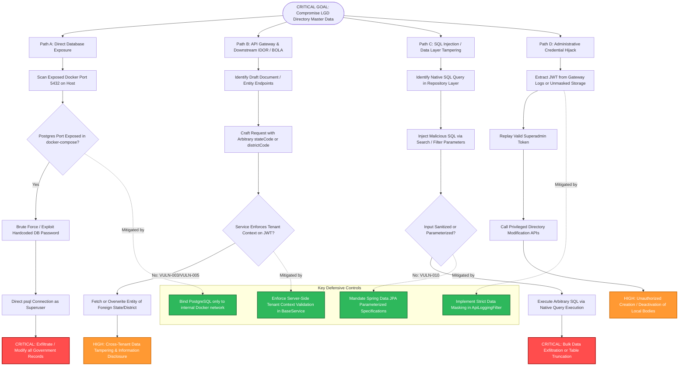
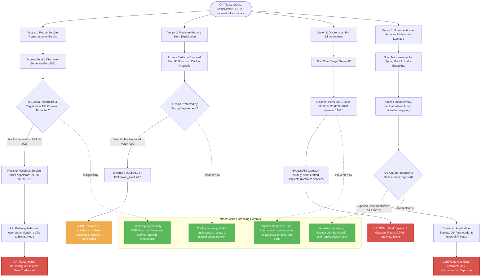

# LGD 2.0 - Comprehensive Attack Tree Diagrams

## Document Overview
- **Project:** Local Government Directory (LGD 2.0)
- **Document Type:** Threat Modeling & Attack Tree Specification
- **Security Standard:** OWASP Threat Modeling & ISO/IEC 27005
- **Visual Notation:** Mermaid Flowcharts (`flowchart TD`)
- **Status:** Phase 1 Deliverable

---

## 1. Attack Tree 1: Government Directory Master Data Compromise

### 1.1 Objective & Scope
The threat actor seeks to read unauthorized confidential draft records, corrupt active state/district/village administrative boundaries, or maliciously delete local body directory entities.



---

## 2. Attack Tree 2: State / District Tenant Boundary Bypass (Multi-Tenancy Breakdown)

### 2.1 Objective & Scope
The threat actor (e.g., State A Nodal Officer or District A Operator) attempts to inspect, modify, approve, or publish draft government orders belonging to State B or District B.

```mermaid
flowchart TD
    ROOT([CRITICAL GOAL: Bypass State / District Multi-Tenant Isolation])

    %% Branches
    ROOT --> T1[Vector 1: Request Payload Parameter Manipulation]
    ROOT --> T2[Vector 2: Direct Object Reference in Path Variables]
    ROOT --> T3[Vector 3: JWT State/District Claim Tampering]
    ROOT --> T4[Vector 4: Direct Service-to-Service Request Spoofing]

    %% Vector 1 Details
    T1 --> P1[Intercept Draft Creation / Update API Request]
    P1 --> P2[Change 'stateCode' from State 19 to State 27]
    P2 --> P3{Controller validates stateCode against JWT claims?}
    P3 -- No --> P4[Service updates draft record under foreign state hierarchy]
    P4 --> IMP_T1[Tenant Violation: Cross-State Record Modification]

    %% Vector 2 Details
    T2 --> O1[Access GET /api/revenue/draft/{draftId}]
    O1 --> O2[Enumerate Sequential draftId belonging to foreign district]
    O2 --> O3{Is Entity Owner Ownership Verified in SQL Query?}
    O3 -- No --> O4[Fetch Confidential Draft Order & Attached Gazette PDF]
    O4 --> IMP_T2[Confidentiality Breach: Pre-Publication Gazette Leaked]

    %% Vector 3 Details
    T3 --> J1[Inspect Client-Side Stored JWT]
    J1 --> J2[Modify Payload stateCode: 19 -> 27]
    J2 --> J3[Resign JWT using Leaked or Default Signing Secret]
    J3 --> J4{API Gateway / Microservice verifies HMAC signature?}
    J4 -- Signature Valid / Key Compromised --> J5[Downstream service accepts forged stateCode claim]
    J5 --> IMP_T3[Full Lateral Escalation to Foreign State Authority]

    %% Vector 4 Details
    T4 --> S1[Gain Access to Docker Internal Network or Bypass Gateway]
    S1 --> S2[Call Revenue Microservice Directly on Port 8083]
    S2 --> S3[Inject Forged Headers: X-User-State: 27, X-User-Role: STATE_ADMIN]
    S3 --> S4{Microservice validates JWT independently or trusts header blindly?}
    S4 -- Blind Trust --> S5[Process administrative approval for foreign state]
    S5 --> IMP_T4[Unauthorized State Gazette Publication]

    %% Defensive Controls
    subgraph MultiTenantDefenses [Tenant Isolation Controls]
        MTD1[TenantFilter: Enforce stateCode/districtCode from verified JWT claims only]
        MTD2[JPA Hibernate Filters / Row-Level Security for State & District IDs]
        MTD3[Strong 512-bit HS512 / RS256 asymmetric keys with Vault rotation]
        MTD4[Mutual TLS or Shared Gateway Secret Validation for East-West calls]
    end

    P3 -.->|Enforced by| MTD1
    O3 -.->|Enforced by| MTD2
    J4 -.->|Protected by| MTD3
    S4 -.->|Hardened by| MTD4

    classDef crit fill:#d9534f,stroke:#c9302c,stroke-width:2px,color:#fff;
    classDef warn fill:#f0ad4e,stroke:#eea236,stroke-width:2px,color:#fff;
    classDef safe fill:#5cb85c,stroke:#4cae4c,stroke-width:2px,color:#fff;

    class IMP_T1,IMP_T3,IMP_T4 crit;
    class IMP_T2 warn;
    class MTD1,MTD2,MTD3,MTD4 safe;
```

---

## 3. Attack Tree 3: JWT Compromise & Session Hijacking

### 3.1 Objective & Scope
The adversary seeks to generate fraudulent authorization tokens, reuse revoked sessions, or impersonate administrative personnel across the microservices ecosystem.

```mermaid
flowchart TD
    ROOT([CRITICAL GOAL: Compromise JWT & Hijack User Sessions])

    %% Main Vectors
    ROOT --> J_V1[Vector 1: Cryptographic Key Compromise]
    ROOT --> J_V2[Vector 2: Revoked Token Replay & Lifetime Exploitation]
    ROOT --> J_V3[Vector 3: Client-Side Token Exfiltration]
    ROOT --> J_V4[Vector 4: In-Transit Token Interception]

    %% Vector 1
    J_V1 --> K1[Extract Hardcoded 'jwt.secret' from Git / application.properties]
    K1 --> K2{Secret Key Entropy < 256 bits or static?}
    K2 -- Yes: VULN-001 --> K3[Craft Offline Forged JWT with role: 'SUPER_ADMIN']
    K3 --> K4[Present Forged JWT to API Gateway or Internal Services]
    K4 --> EXP1[CRITICAL: Full Platform Compromise as Superadmin]

    %% Vector 2
    J_V2 --> R1[User Logs Out from Web Application]
    R1 --> R2[Auth Service Attempts Redis Blacklist Storage]
    R2 --> R3{Is Redis Blacklist checked on EVERY microservice filter?}
    R3 -- No / Downstream skips Redis --> R4[Replay Logged-Out JWT until Expiration (24h+)]
    R4 --> EXP2[HIGH: Unauthorized API Operations via Stale Token]

    %% Vector 3
    J_V3 --> X1[Discover Stored XSS in Local Body / Entity Description]
    X1 --> X2[Malicious Script Accesses localStorage.getItem('token')]
    X2 --> X3[Exfiltrate Bearer Token to Attacker C2 Server]
    X3 --> EXP3[HIGH: Complete Account Takeover of Logged-In Officer]

    %% Vector 4
    J_V4 --> N1[Sniff Plaintext Internal Network Traffic]
    N1 --> N2{Internal Docker Traffic Uses HTTP Plaintext?}
    N2 -- Yes: All East-West is HTTP --> N3[Harvest Authorization Bearer Headers in Transit]
    N3 --> EXP4[HIGH: Credential Theft across Microservice Mesh]

    %% Defensive Mitigations
    subgraph JWTDefenses [Cryptographic & Session Defenses]
        JD1[Migrate to Asymmetric RS256/Ed25519 with Vault-managed Private Key]
        JD2[Enforce Distributed Redis Blacklist Filter on Gateway & Downstream Services]
        JD3[Store Tokens in HttpOnly, Secure, SameSite=Strict Cookies]
        JD4[Enable mTLS (Mutual TLS) for all East-West Internal Communications]
    end

    K2 -.->|Mitigated by| JD1
    R3 -.->|Mitigated by| JD2
    X2 -.->|Mitigated by| JD3
    N2 -.->|Mitigated by| JD4

    classDef crit fill:#d9534f,stroke:#c9302c,stroke-width:2px,color:#fff;
    classDef warn fill:#f0ad4e,stroke:#eea236,stroke-width:2px,color:#fff;
    classDef safe fill:#5cb85c,stroke:#4cae4c,stroke-width:2px,color:#fff;

    class EXP1,EXP3 crit;
    class EXP2,EXP4 warn;
    class JD1,JD2,JD3,JD4 safe;
```

---

## 4. Attack Tree 4: e-Hastakshar eSign Transaction Forgery

### 4.1 Objective & Scope
The attacker attempts to publish unapproved revenue drafts, forge digital signatures, or spoof CDAC e-Hastakshar completion callbacks to publish unverified government orders into the legal directory.

```mermaid
flowchart TD
    ROOT([CRITICAL GOAL: Forge eSign & Publish Unauthorized Government Orders])

    %% Branches
    ROOT --> E_B1[Path 1: Direct Callback Spoofing / Replay]
    ROOT --> E_B2[Path 2: XML Signature Verification Bypass]
    ROOT --> E_B3[Path 3: PDF Document Hash Substitution]
    ROOT --> E_B4[Path 4: Certificate Trust Chain Exploitation]

    %% Path 1
    E_B1 --> CB1[Analyze Revenue Endpoint: POST /api/revenue/ehastakshar/callback]
    CB1 --> CB2[Inspect Callback Parameters: responseXml, txnId]
    CB2 --> CB3{Is Callback Authenticated via HMAC / Nonce verification?}
    CB3 -- No: Publicly Reachable --> CB4[Send Replayed or Synthetic XML with Status='SUCCESS']
    CB4 --> OUT1[CRITICAL: Force State Machine Transition to 'PUBLISHED']

    %% Path 2
    E_B2 --> XML1[Intercept e-Hastakshar XML Response Payload]
    XML1 --> XML2[Inject XML Signature Wrapping / Malformed Digest]
    XML2 --> XML3{Does XmlSignatureUtil perform Strict Schema & C14N Validation?}
    XML3 -- Loose Verification --> XML4[Signature Validator Returns True for Altered XML]
    XML4 --> OUT2[CRITICAL: Tampered Transaction Approved]

    %% Path 3
    E_B3 --> H1[Initiate eSign Flow for Draft Government Order A]
    H1 --> H2[Replace Hash of Approved PDF with Unapproved PDF B before CDAC Dispatch]
    H2 --> H3{Does Revenue Service verify pre-signing SHA-256 against post-signing PDF?}
    H3 -- Missing Hash Audit Check --> H4[Attacher embeds valid signature on fraudulent document]
    H4 --> OUT3[HIGH: Fraudulent Gazette Order Legally Binding]

    %% Path 4
    E_B4 --> CT1[Supply Self-Signed or Untrusted X.509 Certificate in XML Signature]
    CT1 --> CT2{Does Revenue Service validate against CCA India Root CA Truststore?}
    CT2 -- Truststore Not Enforced --> CT3[Signature Accepted from Rogue Intermediate Certificate]
    CT3 --> OUT4[CRITICAL: Untrusted Identity Affixed as Government Authority]

    %% Defensive Controls
    subgraph eSignDefenses [e-Hastakshar Integrity Controls]
        ESD1[Cryptographic Nonce & One-Time Token tied to txnId in Redis]
        ESD2[Strict XML Canonicalization (C14N) & Defend against XML Wrapping]
        ESD3[Cryptographic Hash Binding: Assert SHA-256(Original) == SHA-256(Signed)]
        ESD4[Enforce Strict CCA India / CDAC Root Certificate Chain Validation]
    end

    CB3 -.->|Protected by| ESD1
    XML3 -.->|Hardened by| ESD2
    H3 -.->|Verified by| ESD3
    CT2 -.->|Enforced by| ESD4

    classDef crit fill:#d9534f,stroke:#c9302c,stroke-width:2px,color:#fff;
    classDef warn fill:#f0ad4e,stroke:#eea236,stroke-width:2px,color:#fff;
    classDef safe fill:#5cb85c,stroke:#4cae4c,stroke-width:2px,color:#fff;

    class OUT1,OUT2,OUT4 crit;
    class OUT3 warn;
    class ESD1,ESD2,ESD3,ESD4 safe;
```

---

## 5. Attack Tree 5: Privilege Escalation (RBAC Breakdown)

### 5.1 Objective & Scope
An authenticated user with low-level privileges (e.g., District Operator) elevates permissions to District Nodal Officer, State Administrator, or Superadmin.

```mermaid
flowchart TD
    ROOT([CRITICAL GOAL: Elevate Privileges to Superadmin / State Authority])

    %% Vectors
    ROOT --> PE_V1[Vector 1: User Registration / Update Mass Assignment]
    ROOT --> PE_V2[Vector 2: Missing Method-Level Authorization]
    ROOT --> PE_V3[Vector 3: Role Identifier Substitution in API Request]
    ROOT --> PE_V4[Vector 4: Client-Side Route & UI Element Unhiding]

    %% Vector 1
    PE_V1 --> MA1[Call POST /api/users or PUT /api/users/{userId}]
    MA1 --> MA2[Inject JSON field: 'roles': ['ROLE_SUPER_ADMIN', 'ROLE_STATE_ADMIN']]
    MA2 --> MA3{Does UserDto sanitize role assignments against caller's role?}
    MA3 -- No / Blind Entity Mapping --> MA4[User Record updated with Elevated Roles in DB]
    MA4 --> RESULT1[CRITICAL: Permanent Superadmin Account Creation]

    %% Vector 2
    PE_V2 --> MA_E1[Discover Administrative Controller Endpoints in User Management]
    MA_E1 --> MA_E2[Send HTTP Request with Low-Privilege Bearer Token]
    MA_E2 --> MA_E3{Is @PreAuthorize('hasRole(...)') present on Controller Method?}
    MA_E3 -- Missing: Default permitAll or Generic Authenticated --> MA_E4[Admin method executes without role check]
    MA_E4 --> RESULT2[CRITICAL: Execution of Administrative Functions]

    %% Vector 3
    PE_V3 --> RI1[Call User Role Mapping API]
    RI1 --> RI2[Tamper with roleId / organizationId in Payload]
    RI2 --> RI3{Does backend verify caller has authority to assign this roleId?}
    RI3 -- Authorization Missing --> RI4[Assign Administrative Role to Self or Accomplice]
    RI4 --> RESULT3[HIGH: Unauthorized Role Acquisition]

    %% Vector 4
    PE_V4 --> UI1[Inspect React Bundle (lgd_react / lgd-um)]
    UI1 --> UI2[Bypass Frontend Route Guards (isAdmin = true)]
    UI2 --> UI3{Does Backend enforce identical authorization on corresponding APIs?}
    UI3 -- Backend assumes Gateway or UI filtered --> UI4[Administrative Action Completed]
    UI3 -- Backend validates role strictly --> UI5[Blocked with 403 Forbidden]
    UI4 --> RESULT4[CRITICAL: Complete UI-to-Backend Security Collapse]

    %% Defensive Controls
    subgraph RBACDefenses [Privilege Enforcement Controls]
        RBD1[Use Strict Role-Specific Request DTOs without Role Assignment Fields]
        RBD2[Enforce Global @EnableMethodSecurity with Strict @PreAuthorize Rules]
        RBD3[Hierarchical Role Validation Service: Users cannot grant roles >= their own]
        RBD4[Zero-Trust API Architecture: Never trust frontend routing state]
    end

    MA3 -.->|Mitigated by| RBD1
    MA_E3 -.->|Enforced by| RBD2
    RI3 -.->|Enforced by| RBD3
    UI3 -.->|Guaranteed by| RBD4

    classDef crit fill:#d9534f,stroke:#c9302c,stroke-width:2px,color:#fff;
    classDef warn fill:#f0ad4e,stroke:#eea236,stroke-width:2px,color:#fff;
    classDef safe fill:#5cb85c,stroke:#4cae4c,stroke-width:2px,color:#fff;

    class RESULT1,RESULT2,RESULT4 crit;
    class RESULT3 warn;
    class RBD1,RBD2,RBD3,RBD4 safe;
```

---

## 6. Attack Tree 6: Internal Infrastructure & Discovery Compromise

### 6.1 Objective & Scope
The adversary targets supporting infrastructure (Eureka Discovery, Redis Cache, PostgreSQL, Docker daemon) to intercept traffic, spoof microservices, or disable the entire LGD platform.



---

## 7. Comparative Attack Tree Summary Matrix

| Tree ID | Attack Scenario Goal | Primary STRIDE Vector | Root Vulnerability Reference | Highest Impact Rating | Primary Defensive Countermeasure |
|:---|:---|:---|:---|:---|:---|
| **AT-01** | Government Master Data Compromise | Tampering / Info Disclosure | `VULN-003`, `VULN-005`, `VULN-010` | **Critical (CVSS 9.8)** | Server-side tenant filtering, parameterized JPA queries |
| **AT-02** | State/District Tenant Boundary Bypass | Elevation of Privilege / Tampering | `VULN-003`, `VULN-004` | **Critical (CVSS 9.1)** | JWT claim validation, Hibernate tenant row-level filtering |
| **AT-03** | JWT Compromise & Session Hijacking | Spoofing / Repudiation | `VULN-001`, `VULN-002`, `VULN-013` | **Critical (CVSS 9.8)** | Asymmetric RS256 keys, Redis blacklist enforcement |
| **AT-04** | eSign Transaction Forgery | Spoofing / Tampering | `VULN-006`, `VULN-011` | **Critical (CVSS 9.6)** | Callback one-time nonce verification, SHA-256 PDF hash audit |
| **AT-05** | Privilege Escalation (RBAC Breakdown) | Elevation of Privilege | `VULN-004`, `VULN-012` | **Critical (CVSS 9.4)** | Method-level `@PreAuthorize`, strict DTO parameter binding |
| **AT-06** | Internal Infrastructure Compromise | Spoofing / Denial of Service | `VULN-007`, `VULN-008`, `VULN-009` | **Critical (CVSS 9.8)** | Eureka HTTP Basic auth, Docker host port unbinding |
