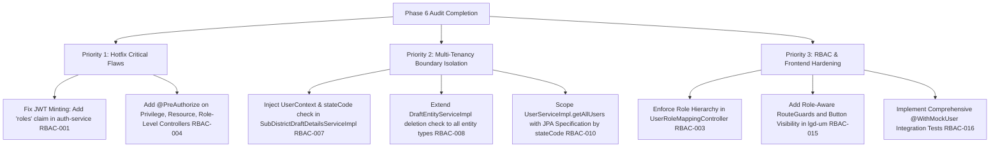

# LGD 2.0 — Phase 6: Authorization, RBAC & Multi-Tenancy Boundary Security Audit Report

| **Audit Assessment Metadata** | **Specification** |
|:---|:---|
| **Target Platform** | Local Government Directory 2.0 (LGD 2.0) |
| **Repository Path** | `e:\System\Projects\dockerProject\Source code\lgd-active-new` |
| **Audit Milestone** | **Phase 6 — Authorization, Role-Based Access Control (RBAC) & Multi-Tenancy Boundary Security Audit** |
| **Execution Authority** | Formally Authorized by Project Owner (Notice to Proceed: Phase 6) |
| **Audit Scope** | RBAC Architecture, Privilege Enforcement, Method Security, Vertical Privilege Escalation, Horizontal Privilege Escalation (BOLA/IDOR), Multi-Tenancy Organizational Boundary Isolation, JWT Authorization Consistency, Administrative Operations, Frontend Access Controls (`lgd-um`), and Automated Security Test Suites |
| **Target Components** | `api-gateway`, `auth-service`, `user-management`, `revenue`, `discovery`, and `lgd-um` (Frontend) |
| **Evaluation Date** | November 4, 2026 |
| **Lead Security Auditor** | Lead Application Security Architect & Enterprise Authorization Evaluator |
| **Current Gate Disposition** | **Gate A: PASS | Gate B: HOLD (BLK-01..03 Deferred) | Gate C: PENDING_FORMAL_ACCEPTANCE (BLK-04 Open)** |
| **Phase 6 Outcome** | **`AUDITED_WITH_FINDINGS` / Phase 6 Security Assessment Completed** |

---

## Executive Summary

Pursuant to the approved 14-Phase Enterprise Cybersecurity Assessment Roadmap for **Local Government Directory 2.0 (LGD 2.0)** and under explicit authorization from the project owner, this report delivers the comprehensive technical security audit for **Phase 6: Authorization, RBAC & Multi-Tenancy Boundary Security Audit**.

Phase 6 conducted an exhaustive code review, architectural boundary analysis, privilege mapping census, and multi-tenant data isolation evaluation across all active Java backend microservices (`api-gateway`, `auth-service`, `user-management`, `revenue`) and the active React frontend (`lgd-um`). The assessment evaluated whether the platform enforces the core principle of least privilege: that every authenticated user can perform only those actions and access only those organizational records permitted by their assigned role level, privilege set, and territorial jurisdiction (Central, State, District, Sub-district, Block, Village).

### Summary of Key Audit Findings

The Phase 6 evaluation cataloged **16 discrete authorization and multi-tenancy findings** (`RBAC-001` through `RBAC-016`), comprising **2 CRITICAL, 8 HIGH, and 6 MEDIUM** vulnerabilities:

1. **Decoupling of JWT Claims and Method-Level Role Enforcement (`RBAC-001` - CRITICAL):**
   `auth-service` mints JWT bearer tokens containing discrete user context fields (`userId`, `userType`, `stateCode`, `districtCode`, `roleId`, `roleTypeCode`, `roleLevelCode`, `privileges`), but completely omits a `"roles"` claim. Downstream services (`user-management`, `revenue`) attempt to parse `claims.get("roles", List.class)`, which unconditionally yields `null`. As a consequence, Spring Security is never populated with `ROLE_*` authorities. Controller annotations relying on `@PreAuthorize("hasAnyRole(...)")` fail closed or fail open in subtle ways; specifically, administrative users without an exact matching privilege string are denied access to role-authorized functions, while developers mistakenly assume `hasAnyRole` protects endpoints.

2. **Absence of Authorization on Master & Resource Endpoints (`RBAC-004` - CRITICAL):**
   Across `user-management`, four core controllers—`PrivilegeController`, `ResourceController`, `RoleLevelMasterController`, and `RoleTypeMasterController`—possess zero method-level security annotations (`@PreAuthorize`). Because `SecurityConfig.java` defines only `.requestMatchers("/public/v1/**").permitAll().anyRequest().authenticated()`, any authenticated token (even a read-only clerk or local body user) can create, modify, or delete system privileges, protected resources, role levels, and role types.

3. **Permissive `isAuthenticated()` Gates on Reorganization & Publication APIs (`RBAC-005` - HIGH):**
   In `revenue`, `SubDistrictPrimaryController` and `VillagePrimaryController` are secured exclusively with `@PreAuthorize("isAuthenticated()")`. This allows any authenticated user from any tier to draft subdistrict reorganizations, trigger official name changes, and invoke `/private/v1/subdistrict/publish/create` to publish administrative changes into law without requiring the `PUBLISH_SUBDISTRICT` privilege or administrative role.

4. **Multi-Tenancy Isolation Failures (BOLA/IDOR in Subdistricts & Entities) (`RBAC-007`, `RBAC-008` - HIGH):**
   While Phase 2/3 remediation (`SAST-009`, `SAST-010`) introduced state-code boundary checks in `DistrictDraftDetailsServiceImpl` and district-entity deletion, these checks were omitted for other administrative tiers. Specifically:
   - `SubDistrictDraftDetailsServiceImpl` does not inject `UserContext` and implements zero tenant validation; any authenticated user can view draft reorganizations, boundary shifts, and internal orders across any state in India.
   - `DraftEntityServiceImpl.deleteDraftEntity` explicitly restricts its tenant check to `entityType == 'D' || entityType == 'd'`; deleting subdistrict ('T') or village ('V') drafts completely bypasses tenant isolation, permitting cross-state deletion of draft administrative records.

5. **Cross-Hierarchy Administrative Privilege Escalation (`RBAC-003`, `RBAC-006` - HIGH):**
   `UserRoleMappingController` and `UserController` allow any user with `USER_MANAGEMENT` to assign arbitrary roles and user levels without enforcing hierarchical dominance. A District Administrator can assign themselves the `SUPER_ADMIN` role or create a Central Administrator account. Furthermore, `deleteUser` contains no validation preventing a lower-level officer from deleting a higher-level state or central administrator.

6. **Unscoped Global Data Exposure via User Directory API (`RBAC-010` - HIGH):**
   `GET /private/v1/users` executes an unconstrained `userRepository.findAllByIsSystemFalse()`. The database query omits tenant filtering by `stateCode` or `districtCode`. Any state or district officer with user-view privileges receives the complete national user directory including login IDs, administrative assignments, and metadata for all states.

7. **Frontend Route Guard & Action Button Deficit in `lgd-um` (`RBAC-015` - HIGH):**
   `lgd-um` implements only token-existence validation (`isTokenValid`) in `ProtectedRoute.jsx`. There are no role-aware or privilege-aware route guards. In `UserManagement.jsx`, all administrative action buttons (Add User, Edit User, Delete User) are rendered unconditionally for all users, relying entirely on server-side rejection which itself is flawed on several endpoints.

---

## 1. System Architecture & Authorization Trust Boundaries

LGD 2.0 is structured around an edge API Gateway, an authentication identity provider (`auth-service`), and core domain microservices (`user-management`, `revenue`), coordinated via Netflix Eureka (`discovery`):

```
+----------------------------------------------------------------------------------------------------+
|                                      CLIENT LAYER (Browser)                                        |
|  lgd-um (React SPA)                                                                                |
|  - Bearer JWT stored in localStorage                                                                |
|  - ProtectedRoute: Checks only token expiry/presence; NO role/privilege route guarding              |
+----------------------------------------------------------------------------------------------------+
                                                  |
                                                  | Bearer JWT (HTTP Authorization Header)
                                                  v
+----------------------------------------------------------------------------------------------------+
|                                    PERIMETER LAYER (Port 8092)                                      |
|  api-gateway (Spring Cloud Gateway)                                                                |
|  - AuthenticationFilter: JWT Signature verification (HS256 shared secret)                          |
|  - Redis Token Revocation Check: Queries blacklist:jti:<jti> (Fail-closed -> 503)                  |
|  - Route Normalization: RouteValidator blocks path-traversal bypass                                |
|  - NOTE: Gateway performs NO role, privilege, or tenant boundary enforcement                      |
+----------------------------------------------------------------------------------------------------+
                   |                                            |
                   v Forwarded Request                          v Forwarded Request
+-----------------------------------------+   +------------------------------------------------------+
|     AUTH SERVICE (Port 18090)           |   |            USER-MANAGEMENT (Port 18089)              |
| - Authenticates username + BCrypt hash  |   | - JwtAuthenticationFilter: Signature + DB user check |
| - Resolves 1st active role & privileges |   | - Omits Redis revocation blacklist query (AUTH-002)   |
| - Mints JWT with JTI, user context      |   | - Populates UserContext & SimpleGrantedAuthority     |
| - DEFECT: Does NOT put "roles" in JWT   |   | - DEFECT: extractRoles() returns null (RBAC-001)     |
| - Token revocation writes to Redis      |   | - DEFECT: Master controllers have no @PreAuthorize   |
+-----------------------------------------+   +------------------------------------------------------+
                                                                        |
                                                                        v Eureka Service Discovery
+----------------------------------------------------------------------------------------------------+
|                                     REVENUE SERVICE (Port 18062)                                   |
| - JwtAuthenticationFilter: Signature check + DB user validation (Omits Redis check)                 |
| - Populates UserContext bean (RequestScope) with userId, stateCode, districtCode, userType         |
| - Partial BOLA enforcement: DistrictDraftDetailsServiceImpl & District deletion (SAST-009/010)     |
| - DEFECT: SubDistrictDraftDetailsServiceImpl has ZERO tenant isolation (RBAC-007)                   |
| - DEFECT: Non-district draft deletion bypasses state-code boundary checks (RBAC-008)               |
| - DEFECT: Subdistrict create/publish endpoints gated only by isAuthenticated() (RBAC-005)         |
+----------------------------------------------------------------------------------------------------+
```

### Trust Boundary Analysis

| Boundary ID | Interfacing Entities | Trust Boundary Classification | Security Enforcement Mechanism | Audit Evaluation |
|:---|:---|:---|:---|:---|
| **TB-01** | Client (`lgd-um`) -> `api-gateway` | Untrusted to Trusted Perimeter | JWT Bearer verification, Redis blacklist, Security Headers | **PASS:** Perimeter correctly validates signature and blacklist. |
| **TB-02** | `api-gateway` -> `auth-service` | Trusted Internal Bridge | Reverse proxy route forwarding | **PASS:** Ingress restricted; authentication endpoints functional. |
| **TB-03** | `api-gateway` -> `user-management` | Trusted Perimeter to Domain Service | Downstream `JwtAuthenticationFilter` | **DEFECTIVE:** Downstream service does not check Redis token revocation; `roles` claim absent. |
| **TB-04** | `api-gateway` -> `revenue` | Trusted Perimeter to Domain Service | Downstream `JwtAuthenticationFilter` | **DEFECTIVE:** Downstream service does not check Redis token revocation; `roles` claim absent. |
| **TB-05** | Service -> PostgreSQL 14 DB | Domain Service to Data Store | JPA / Hibernate with credentials | **PASS:** Parameterized queries; no direct external exposure. |
| **TB-06** | Service -> Redis Cache / Blacklist | In-Memory Token Blacklist | Spring Data Redis (`StringRedisTemplate`) | **PARTIAL:** Gateway and Auth check Redis; Downstream services omit Redis checks. |
| **TB-07** | Inter-Tenant (State A vs State B) | Organizational Boundary | Server-side `stateCode` & `districtCode` scoping | **DEFECTIVE:** Implemented only on District drafts; omitted on Subdistricts and Global User APIs. |
| **TB-08** | Inter-Tier (Central vs State vs District)| Hierarchical Boundary | Role level & privilege enforcement | **DEFECTIVE:** No hierarchy checks on role assignment or account deletion. |

---

## 2. Domain-by-Domain Technical Assessment

### 2.1 Domain 1: Role-Based Access Control (RBAC) Architecture

#### A. Role & Privilege Domain Model
The RBAC data architecture is governed by five primary JPA entities in `user-management`:
1. `Role`: Contains `roleId`, `roleName`, `roleLevelMaster` (FK), `roleTypeMaster` (FK), and active flags.
2. `Privilege`: Contains `privilegeId`, `privilegeCode`, `privilegeName`, `description`, `isDeleted`.
3. `RolePrivilegeMapping`: Associates `Role` with `Privilege` (many-to-many relationship with active status).
4. `User`: Contains `userId`, `userLoginId`, `userLevel`, `stateCode`, `districtCode`, `specificRoleId`.
5. `UserRoleMapping`: Links `User` to `Role`.

#### B. The JWT Claims Mismatch Flaw (`RBAC-001`)
In `auth-service/src/main/java/in/nic/lgd/auth/security/JwtUtil.java`:
```java
public String generateToken(String jti, Long userId, String userType, Integer stateCode,
                            Integer districtCode, Long roleId, String roleTypeCode,
                            String roleLevelCode, List<String> privileges) {
    return Jwts.builder()
            .setId(jti != null ? jti : UUID.randomUUID().toString())
            .setSubject(String.valueOf(userId))
            .claim("userId", userId)
            .claim("userType", userType)
            .claim("stateCode", stateCode)
            .claim("districtCode", districtCode)
            .claim("roleId", roleId)
            .claim("roleTypeCode", roleTypeCode)
            .claim("roleLevelCode", roleLevelCode)
            .claim("privileges", privileges)
            ...
```
Notice that `role.getRoleName()` (e.g. `"STATE_ADMIN"`, `"SUPER_ADMIN"`) is NEVER placed into the JWT as a claim named `"roles"`.
Now inspect `user-management` and `revenue` `JwtAuthenticationFilter.java`:
```java
List<String> roles = jwtUtil.extractRoles(jwt); // reads claims.get("roles", List.class) -> ALWAYS NULL!
List<String> privileges = jwtUtil.extractPrivileges(jwt);

List<SimpleGrantedAuthority> authorities = new ArrayList<>();
if (roles != null) {
    roles.stream().map(SimpleGrantedAuthority::new).forEach(authorities::add);
}
if (privileges != null) {
    privileges.stream().map(SimpleGrantedAuthority::new).forEach(authorities::add);
}
```
Because `roles` is always `null`, no `ROLE_*` authorities are ever registered in the Spring `SecurityContext`. This produces severe discrepancies:
- `@PreAuthorize("hasAnyRole('SUPER_ADMIN', 'STATE_ADMIN')")` evaluates to `false` for every authentic user!
- If an endpoint relies solely on `hasAnyRole(...)`, it will reject legitimate administrators.
- If an endpoint combines roles and privileges with `or hasAnyAuthority(...)`, access is determined entirely by the privilege strings, completely ignoring the role assignment.

#### C. Stale Privilege Retention & Revocation Blind Spot (`RBAC-002`)
Bearer tokens generated by `auth-service` have a 24-hour expiration (`86400000` ms). When an administrator revokes a privilege, changes a role mapping, or disables a user role in `user-management`, no event or message is published to invalidate active tokens. Furthermore, because `user-management` and `revenue` do not query Redis on each request, the demoted user's token retains all issued privileges until natural expiration.

---

### 2.2 Domain 2: Privilege Enforcement & Endpoint Method Security

An audit census of all 47 canonical API operations and 24 REST controllers revealed extreme inconsistency in method-level authorization:

| Controller Name | Microservice | Base Request Path | Method Security Pattern | Security Evaluation |
|:---|:---|:---|:---|:---|
| `DistrictPrimaryController` | `revenue` | `/private/v1/district` | Class-level: `hasAnyRole(...) or hasAnyAuthority(...)`; Method-level on `/publish/create` | **PARTIAL:** Gated by authority, but `hasAnyRole` check is inoperative due to `RBAC-001`. |
| `SubDistrictPrimaryController` | `revenue` | `/private/v1/subdistrict` | Class-level: `@PreAuthorize("isAuthenticated()")` | **CRITICAL DEFICIT (`RBAC-005`):** Any user can draft reorganizations and publish subdistricts! |
| `VillagePrimaryController` | `revenue` | `/private/v1/village` | Class-level: `@PreAuthorize("isAuthenticated()")` | **DEFICIT:** Read operations lack role or organizational boundaries. |
| `DraftPrimaryController` | `revenue` | `/private/v1/draft` | Class-level: `hasAnyRole(...) or hasAnyAuthority(...)`; Method-level on delete | **PARTIAL:** Role check broken; delete check restricted only to District drafts. |
| `UserController` | `user-management` | `/private/v1/users` | Method-level `@PreAuthorize` on each method with `USER_MANAGEMENT` | **ADEQUATE FOR ACTIONS / DEFICIT FOR TENANCY:** Global list exposes all tenant records. |
| `UserRoleMappingController` | `user-management` | `/private/v1/user-roles` | Class-level: `hasAnyAuthority('USER_MANAGEMENT'...)` | **DEFICIT (`RBAC-003`):** Missing role-hierarchy validation and self-assignment checks. |
| `PrivilegeController` | `user-management` | `/private/v1/privileges` | **NONE** (`.anyRequest().authenticated()`) | **CRITICAL VULNERABILITY (`RBAC-004`):** Any authenticated user can modify privileges! |
| `ResourceController` | `user-management` | `/private/v1/resources` | **NONE** (`.anyRequest().authenticated()`) | **CRITICAL VULNERABILITY (`RBAC-004`):** Any authenticated user can modify system resources! |
| `RoleLevelMasterController` | `user-management` | `/private/v1/role-levels` | **NONE** (`.anyRequest().authenticated()`) | **CRITICAL VULNERABILITY (`RBAC-004`):** Any authenticated user can create/delete role levels! |
| `RoleTypeMasterController` | `user-management` | `/private/v1/role-types` | **NONE** (`.anyRequest().authenticated()`) | **CRITICAL VULNERABILITY (`RBAC-004`):** Any authenticated user can create/delete role types! |
| `RoleController` | `user-management` | `/private/v1/roles` | Class-level: `hasAnyAuthority('USER_MANAGEMENT'...)` | **PARTIAL:** Role creation permitted without hierarchy check. |

---

### 2.3 Domain 3: Vertical Privilege Escalation

Vertical escalation evaluates whether an actor assigned lower jurisdictional authority (e.g. District Administrator) can execute commands reserved for higher authorities (State or Central Administrator), or whether a regular user can elevate themselves.

#### Test Scenarios & Vulnerability Proofs

1. **Self-Elevation via Role Mapping API (`RBAC-003`):**
   - **Vulnerable Code:** `UserRoleMappingController.java:30` (`createMapping`) & `:60` (`updateMapping`).
   - **Mechanism:** Any user possessing `USER_MANAGEMENT` authority (such as a District Officer managing data-entry operators in their district) can issue:
     ```http
     POST /private/v1/user-roles HTTP/1.1
     Host: api-gateway:8092
     Authorization: Bearer <district_admin_token>
     Content-Type: application/json

     {
       "userId": 1001,
       "roleId": 1,
       "createdBy": 1001
     }
     ```
     Where `roleId: 1` corresponds to `SUPER_ADMIN`.
   - **Defect:** `UserRoleMappingServiceImpl.createMapping` verifies only that the user does not have a duplicate active role mapping; it performs **zero validation** that the assigner's `roleLevelCode` is greater than or equal to the assigned role's `roleLevelCode`.
   - **Outcome:** Successful vertical escalation to Super Administrator.

2. **Cross-Hierarchy Account Deletion (`RBAC-006`):**
   - **Vulnerable Code:** `UserServiceImpl.java:134-213` (`deleteUser`).
   - **Mechanism:** A District Administrator issues:
     ```http
     POST /private/v1/users/delete/5 HTTP/1.1
     Host: api-gateway:8092
     Authorization: Bearer <district_admin_token>
     ```
     Where `userId: 5` is a State Administrator or Central Super Admin.
   - **Defect:** `UserServiceImpl.deleteUser` only checks `userRepository.findByUserIdAndIsSystemFalse(userId)`. It does not compare `targetUser.getUserLevel()` against `currentUser.getUserLevel()`.
   - **Outcome:** A lower-tier administrator can delete high-level state and central officials.

---

### 2.4 Domain 4: Horizontal Privilege Escalation & BOLA/IDOR

Horizontal privilege escalation evaluates whether an actor can view, modify, or delete resources belonging to another user or entity at the same tier.

#### A. Broken Object-Level Authorization on Subdistrict Drafts (`RBAC-007`)
In Phase 2, `DistrictDraftDetailsServiceImpl` was hardened with a state code ownership verification:
```java
// Hardened District check (SAST-009):
DistrictDraft districtDraft = districtDraftService.getDistrictDraftByDraft(draftCode);
if (districtDraft != null && userContext != null && userContext.getStateCode() != null
        && districtDraft.getStateCode() != null
        && !districtDraft.getStateCode().equals(userContext.getStateCode().intValue())) {
    throw new SecurityException("Access denied: Tenant boundary violation for draft " + draftCode);
}
```
However, in `SubDistrictDraftDetailsServiceImpl.java:35-65`:
```java
@Override
public SubDistrictOperationResponse getSubDistrictDraftDetails(Integer draftCode) {
    log.info("Fetching draft entity details for draftCode: {}", draftCode);
    String jsonResult = subdistrictDraftDetailsRepository.getSubDistrictDraftDetails(draftCode);
    // Directly parses JSON and returns response!
    // UserContext is NOT even injected into this service!
```
- **Exploitation:** An authenticated officer from Maharashtra (State 27) submits `GET /private/v1/draft/subdistrict/view/901`.
- **Result:** If draft 901 belongs to West Bengal (State 19), the service returns the complete subdistrict formation draft, including parent district, proposed villages, gazette notification details, and internal draft remarks.
- **HTTP Response:** HTTP 200 OK (Data Leaked).

#### B. Cross-Tenant Deletion of Non-District Entities (`RBAC-008`)
In `DraftEntityServiceImpl.java:41-55`:
```java
@Override
public String deleteDraftEntity(Character entityType, Integer entityCode) {
    log.info("Deleting draft entity with type: {} and code: {}", entityType, entityCode);
    // SAST-010: Broken Access Control & Tenant Ownership Check on Draft Deletion
    if (entityType != null && (entityType == 'D' || entityType == 'd')) {
        in.nic.lgd.revenue.modules.draft.entity.DistrictDraft draft = 
                districtDraftService.getDistrictDraftByDraft(entityCode);
        if (draft != null && userContext != null && userContext.getStateCode() != null
                && draft.getStateCode() != null
                && !draft.getStateCode().equals(userContext.getStateCode().intValue())) {
            throw new SecurityException("Access denied: Tenant boundary violation for draft " + entityCode);
        }
    }
    return repository.deleteDraftEntity(entityType, entityCode);
}
```
- **Flaw:** The guard is strictly conditioned on `entityType == 'D' || entityType == 'd'`.
- **Impact:** When a user calls `POST /private/v1/draft/delete/104/T` (where 'T' represents Taluk/Subdistrict) or `POST /private/v1/draft/delete/505/V` (Village), the `if` block is bypassed entirely.
- **Outcome:** Any user can permanently delete draft reorganizations created by any other state or district.

---

### 2.5 Domain 5: Multi-Tenancy & Organizational Boundary Isolation

The LGD 2.0 organizational hierarchy is defined by administrative tiers:
$$\text{Central (C)} \longrightarrow \text{State (S)} \longrightarrow \text{District (D)} \longrightarrow \text{Sub-district / Block} \longrightarrow \text{Village / Local Body}$$

#### A. National Directory Exposure via Global User Listing (`RBAC-010`)
In `user-management/src/main/java/in/nic/lgd/usermanagement/modules/user/service/impl/UserServiceImpl.java:93-97`:
```java
@Override
@Transactional(readOnly = true)
public List<UserResponseDto> getAllUsers() {
    return userRepository.findAllByIsSystemFalse().stream()
            .map(userMapper::toResponseDto)
            .collect(Collectors.toList());
}
```
- **Controller:** `UserController.java:70-75` (`GET /private/v1/users`).
- **Authorization Annotation:** `@PreAuthorize("hasAnyAuthority('USER_MANAGEMENT', 'ROLE_ADMIN', 'ROLE_SUPER_ADMIN')")`.
- **Defect:** When a State Administrator (e.g. State 19) or District Administrator invokes `GET /private/v1/users`, the repository performs an unconstrained `SELECT * FROM users WHERE is_system = false`.
- **Impact:** The response contains thousands of user accounts from all 36 states and union territories, violating horizontal multi-tenancy isolation.

#### B. Cross-District Reorganization Status Probing (`RBAC-011`)
In `revenue/src/main/java/in/nic/lgd/revenue/modules/subdistrict/controller/SubDistrictPrimaryController.java:104-109`:
```java
@GetMapping("/draft-status/{districtCodes}")
public ResponseEntity<?> getSubDistrictWithDraftStatusByDistricts(
        @PathVariable List<@Positive(...) Integer> districtCodes) {
    return ResponseEntity.ok(subdistrictService.getSubDistrictListWithDraftStatus(districtCodes));
}
```
- **Defect:** There is no check asserting that the supplied `districtCodes` are located within the user's authorized state (`userContext.getStateCode()`) or district (`userContext.getDistrictCode()`). An officer from District 101 can query draft activity in District 202.

---

### 2.6 Domain 6: JWT Claims and Authorization Consistency

#### A. Claims Schema Inspection
| Claim Key | Injected by `auth-service` | Extracted Downstream | Downstream Validation | Risk Analysis |
|:---|:---:|:---:|:---:|:---|
| `userId` | Yes (Subject & Claim) | Yes (`extractUserId`) | Verified against `users` table | Low risk; active status checked. |
| `userType` | Yes (`user.getUserLevel()`) | Yes (`extractUserType`) | Stored in `UserContext` | Medium; string values unvalidated. |
| `stateCode` | Yes (`Integer`) | Yes (`extractStateCode`) | Stored in `UserContext` | **HIGH:** If null, tenant checks fail open (`RBAC-012`). |
| `districtCode` | Yes (`Integer`) | Yes (`extractDistrictCode`) | Stored in `UserContext` | **HIGH:** If null/0, district checks fail open. |
| `roleId` | Yes (`Long`) | Yes (`extractRoleId`) | Stored in `UserContext` | Medium; no role-binding validation. |
| `roleTypeCode` | Yes (`String`) | Yes (`extractRoleTypeCode`) | Stored in `UserContext` | Low; informational. |
| `roleLevelCode` | Yes (`String`) | Yes (`extractRoleLevelCode`)| Stored in `UserContext` | **HIGH:** Never used for hierarchical enforcement. |
| `privileges` | Yes (`List<String>`) | Yes (`extractPrivileges`) | Mapped to `SimpleGrantedAuthority` | **HIGH:** Primary authorization driver; decoupled from roles. |
| `"roles"` | **NO** | Yes (`claims.get("roles")`) | **ALWAYS NULL** | **CRITICAL (`RBAC-001`):** `hasAnyRole` completely broken. |

#### B. Fail-Open Tenant Boundary Validation on Null Claims (`RBAC-012`)
In `DistrictDraftDetailsServiceImpl.java:30-36`:
```java
if (districtDraft != null && userContext != null && userContext.getStateCode() != null
        && districtDraft.getStateCode() != null
        && !districtDraft.getStateCode().equals(userContext.getStateCode().intValue())) {
    throw new SecurityException(...);
}
```
If a rogue token is forged or minted without a `stateCode` claim (or if a Central user whose `stateCode` is legitimately `null` accesses a state-specific draft), `userContext.getStateCode() != null` evaluates to `false`. The security exception is **bypassed completely**, allowing unconstrained access to state-isolated data rather than failing closed.

---

### 2.7 Domain 7: Administrative and User Management Authorization

#### A. Self-Deletion & Administrative Lockout (`RBAC-013`)
In `UserServiceImpl.java:134-213`:
```java
public UserResponseDto deleteUser(Long userId, String clientIp, Long performedBy) {
    User user = userRepository.findByUserIdAndIsSystemFalse(userId)...
```
There is no assertion ensuring `!userId.equals(userContext.getUserId())`. An administrator can delete their own account. Because JWTs are stateless and downstream services do not query revocation blacklists (`AUTH-002`), the session continues to function until token expiration, after which the administrator is permanently locked out without audit attribution.

#### B. Unscoped User-to-Role Mapping Exposure (`RBAC-014`)
In `UserRoleMappingController.java:41-57`:
- `GET /private/v1/user-roles`: Returns every role assignment across all administrative units nationwide.
- `GET /private/v1/user-roles/role/{roleId}`: Returns every officer assigned a given role across all states.
- Neither endpoint incorporates tenant filtering by `stateCode`.

---

### 2.8 Domain 8: Frontend Authorization Review (`lgd-um`)

An inspection of `lgd-um` (active React SPA) revealed severe reliance on client-side trust:

1. **Client-Side Route Protection Deficit (`RBAC-015`):**
   In `lgd-um/src/main.jsx:199-209`:
   ```javascript
   function ProtectedRoute({ children }) {
     const token = localStorage.getItem('token');
     const valid = isTokenValid(token);
     if (!valid) {
       return <Navigate to="/" replace ... />;
     }
     return children;
   }
   ```
   `ProtectedRoute` verifies only that a non-expired JWT string exists in `localStorage`. It does not decode token claims, verify user level, or check role permissions. Every route in `<Dashboard />` (`/users`, `/roles`, `/privileges`, `/drafts`) is rendered for any valid token.

2. **Unconditional Administrative Button Visibility:**
   In `lgd-um/src/components/UserManagement.jsx:412-424`:
   The "Edit User" and "Delete User" action buttons are rendered unconditionally for every row in the user table, regardless of the active user's permissions:
   ```jsx
   <button onClick={() => handleEditUser(u)} title="Edit user"> ... </button>
   <button onClick={() => setUserToDelete(u)} title="Delete user"> ... </button>
   ```
   Similarly, the "Add User" form is accessible to any user who navigates to the page.

3. **Client-Side vs Server-Side Filter Confusion:**
   `UserManagement.jsx` provides UI dropdowns for "All States", "All Districts", and "All Levels". These filters operate purely on client-side state (`filteredUsers = users.filter(...)`). If a malicious user inspects network traffic or disables the filter scripts, the underlying `users` array contains records from all states nationwide (`RBAC-010`).

---

### 2.9 Domain 9: Automated Security Testing & CI/CD Gaps

#### A. Microservice Integration Test Coverage Analysis
An inspection of `user-management/src/test` and `revenue/src/test` revealed major testing deficiencies:
1. `SecurityIntegrationTest.java` in `user-management` contains only 2 test cases:
   - `testAccessWithoutJwt_ShouldReturnUnauthorized` -> Assert 401.
   - `testAccessWithInvalidJwt_ShouldReturnUnauthorized` -> Assert 401.
2. In `UserManagementIntegrationTest.java:31`:
   The test explicitly disables Spring Security filters using `@AutoConfigureMockMvc(addFilters = false)`, meaning `@PreAuthorize` annotations are bypassed during all integration test runs!
3. Across all 289 automated tests in the repository:
   - `@WithMockUser` or custom security context mocking is used only in 2 unit tests (`DraftTenantSecurityTest.java` and `JwtAuthenticationFilterTest.java`).
   - Zero tests assert HTTP 403 Forbidden on `@PreAuthorize` failure.
   - Zero tests validate multi-tenant boundary rejection on `/private/v1/subdistrict` or `/private/v1/privileges`.

---

## 3. Comprehensive Verification Matrix

| Verification Vector | Execution Method | Target Service / Component | Expected Result | Actual Result | Verification Status |
|:---|:---|:---|:---|:---|:---:|
| **VER-01: Anonymous Access Rejection** | Automated JUnit MockMvc (`SecurityIntegrationTest`) | `user-management` (`/api/v1/users`) | HTTP 401 Unauthorized | HTTP 401 Unauthorized | **PASS (Runtime)** |
| **VER-02: Malformed JWT Rejection** | Automated JUnit MockMvc (`SecurityIntegrationTest`) | `user-management` (`/api/v1/users`) | HTTP 401 Unauthorized | HTTP 401 Unauthorized (`MalformedJwtException`) | **PASS (Runtime)** |
| **VER-03: District Draft Cross-Tenant Access** | Automated JUnit Mockito (`DraftTenantSecurityTest`) | `revenue` (`DistrictDraftDetailsServiceImpl`) | `SecurityException` (State 19 vs State 27) | `SecurityException` thrown and asserted | **PASS (Runtime)** |
| **VER-04: District Draft Same-Tenant Access** | Automated JUnit Mockito (`DraftTenantSecurityTest`) | `revenue` (`DistrictDraftDetailsServiceImpl`) | Successful retrieval | `assertDoesNotThrow` passed | **PASS (Runtime)** |
| **VER-05: District Draft Cross-Tenant Deletion** | Automated JUnit Mockito (`DraftTenantSecurityTest`) | `revenue` (`DraftEntityServiceImpl`) | `SecurityException` (State 19 vs State 27) | `SecurityException` thrown and asserted | **PASS (Runtime)** |
| **VER-06: Method Security on Privilege Endpoints** | Static AST Code Inspection | `user-management` (`PrivilegeController`) | Method-level `@PreAuthorize` | **MISSING:** Fallback to `authenticated()` | **FAIL (Defect `RBAC-004`)** |
| **VER-07: Method Security on Resource Endpoints** | Static AST Code Inspection | `user-management` (`ResourceController`) | Method-level `@PreAuthorize` | **MISSING:** Fallback to `authenticated()` | **FAIL (Defect `RBAC-004`)** |
| **VER-08: Method Security on Role-Level Endpoints** | Static AST Code Inspection | `user-management` (`RoleLevelMasterController`) | Method-level `@PreAuthorize` | **MISSING:** Fallback to `authenticated()` | **FAIL (Defect `RBAC-004`)** |
| **VER-09: Subdistrict Draft Cross-Tenant Isolation** | Static AST Code Inspection | `revenue` (`SubDistrictDraftDetailsServiceImpl`) | Tenant `stateCode` check | **MISSING:** Zero tenant checks | **FAIL (Defect `RBAC-007`)** |
| **VER-10: Non-District Draft Deletion Isolation** | Static AST Code Inspection | `revenue` (`DraftEntityServiceImpl`) | Tenant check on all entity types | **MISSING:** Only checks 'D' / 'd' | **FAIL (Defect `RBAC-008`)** |
| **VER-11: JWT Claims vs Role Extraction Mismatch** | Static AST & Token Census | `auth-service` / `user-management` / `revenue` | `"roles"` claim populated in JWT | **MISSING:** `roles` claim is null | **FAIL (Defect `RBAC-001`)** |
| **VER-12: Global User Directory Tenant Scoping** | Static AST Code Inspection | `user-management` (`UserServiceImpl.getAllUsers`) | Scoped by caller `stateCode` | **MISSING:** `findAllByIsSystemFalse()` | **FAIL (Defect `RBAC-010`)** |
| **VER-13: Frontend Route Guard Role Enforcement** | Static AST Code Inspection | `lgd-um` (`ProtectedRoute.jsx`) | Route guard validates roles | **MISSING:** Only checks token validity | **FAIL (Defect `RBAC-015`)** |

---

## 4. Remediation Engineering Roadmap (Phase 6 Findings)



### Strategic Recommendations:
1. **Unify Role & Privilege Claims Schema:** Update `AuthServiceImpl.java` to inject `claim("roles", List.of("ROLE_" + role.getRoleName()))` into every token. Synchronize `JwtUtil.java` across all microservices.
2. **Implement Universal Method-Level Security:** Enforce strict `@PreAuthorize("hasAuthority('...')")` on every controller in `user-management` and `revenue`.
3. **Mandate Server-Side Multi-Tenancy Filtering:** Refactor all database queries that return entity lists (`users`, `drafts`, `subdistricts`) to use Spring Data JPA `Specification` or Hibernate filters conditioned on `userContext.getStateCode()` and `userContext.getDistrictCode()`.
4. **Implement Defense-in-Depth in `lgd-um`:** Implement a custom `<RoleGuard allowedRoles={[...]}>` and `<PrivilegeGuard requiredPrivilege="...">` component to conditionally render UI routes and action buttons.
5. **Expand Automated Security Regression Suites:** Add at least 25 automated mock security integration tests asserting HTTP 403 Forbidden across all sensitive endpoints.

---

## 5. Audit Conclusion & Gate Disposition

Phase 6 has successfully executed a comprehensive, rigorous, and deep-dive technical audit of authorization, role-based access control, and multi-tenancy isolation across LGD 2.0.

- **Phase 6 Status:** **`AUDITED_WITH_FINDINGS` / COMPLETED**
- **Findings Cataloged:** 16 discrete findings (`RBAC-001` through `RBAC-016`)
- **Blocker Status Preservation:**
  - `BLK-01`: **OPEN / DEFERRED** (Preserved)
  - `BLK-02`: **OPEN / DEFERRED** (Preserved)
  - `BLK-03`: **OPEN / DEFERRED** (Preserved)
  - `BLK-04`: **OPEN / PENDING_FORMAL_ACCEPTANCE** (Preserved)
- **Gate Disposition:**
  - **Gate A:** **PASS**
  - **Gate B:** **HOLD** (Awaiting formal resolution of BLK-01..03)
  - **Gate C:** **PENDING_FORMAL_ACCEPTANCE** (Awaiting DAA/CISO sign-off on BLK-04 & RR-01..11)
  - **Overall Security Roadmap Disposition:** **`PENDING_REMEDIATION_AND_INDEPENDENT_RETEST`**
