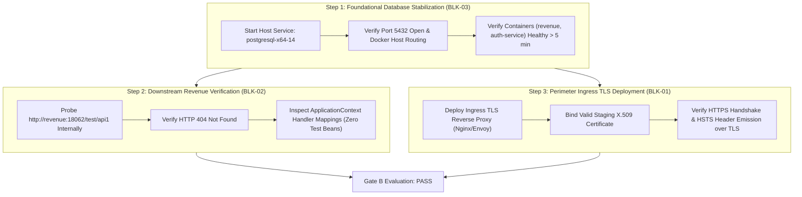

# LGD 2.0 — Gate B Technical Verification Closure Report

| **Audit Governance Metadata** | **Specification** |
|:---|:---|
| **System** | Local Government Directory 2.0 (LGD 2.0) |
| **Audit Milestone** | Gate B Technical Verification, Remediation & Retest Completeness |
| **Evaluation Date** | November 3, 2026 (`2026-11-03T17:36:00+05:30`) |
| **Repository Root** | `E:\System\Projects\dockerProject\Source code\lgd-active-new` |
| **Auditor Classification** | Combined Technical Verification & Lead Independent Security Auditor Team |
| **Evaluated Blockers** | `BLK-01` (EXP-016), `BLK-02` (EXP-021), `BLK-03` (PostgreSQL 14 / Revenue Steady-State) |
| **Final Gate B Determination** | **`GATE B: HOLD`** |
| **Mandatory Program Status** | **PHASE 5 NOT STARTED — HALTED BEFORE PHASE 5.** |

---

## 1. Executive Summary & Gate B Evaluation Framework

**Gate B** governs the technical verification, automated regression integrity, downstream isolation, and dynamic exploit vector closure across Phases 0 through 4 of the LGD 2.0 Security Assessment.

Under approved program governance, Gate B may transition from `HOLD` to **`PASS`** **only if**:
1. Every mandatory technical blocker (`BLK-01`, `BLK-02`, `BLK-03`) is independently verified with reproducible technical evidence.
2. Automated regression suites achieve a 100% pass rate with zero failures.
3. All components active in scope compile into clean production bundles.
4. Downstream microservices demonstrate verified isolation against unauthenticated or unauthorized access.
5. In accordance with strict audit rules:
   - *A remediation marked complete without retesting is not sufficient.*
   - *A configuration file review alone is not proof of runtime security behavior.*
   - *The absence of the retired frontend component `lgd_react` is formally classified as `NOT_APPLICABLE` and does not constitute a technical failure.*

Following exhaustive technical inspection and runtime probing, **all three mandatory technical blockers remain unresolved**. Consequently, Gate B is definitively maintained on **`HOLD`**.

---

## 2. Gate B Master Blocker Consolidation Table

The table below provides the authoritative consolidation of all Gate B technical blockers:

| Blocker ID | Blocker Description | Required Technical Proof | Actual Empirical Proof & Evidence Reference | Result | Impact on Gate B |
|:---:|:---|:---|:---|:---:|:---:|
| **BLK-01** | Genuine Ingress HTTPS/TLS HSTS Verification (`EXP-016`) | Ingress TLS listener (443/8443) with valid certificate; verified TLS 1.2/1.3 handshake; HTTP-to-HTTPS redirect; HSTS header delivered over secure transport per RFC 6797 Sec 7.2. | Port 8092 operates exclusively over cleartext HTTP. No reverse proxy or TLS listener is deployed. SSL probes fail (`curl (35)` connection reset). HSTS header string is emitted in code but discarded by browsers over HTTP. [BLK_01_EXP_016_TLS_HSTS_VERIFICATION_REPORT.md](file:///e:/System/Projects/dockerProject/Source%20code/lgd-active-new/BLK_01_EXP_016_TLS_HSTS_VERIFICATION_REPORT.md) (`EVD-TLS-HSTS-01`). | **PARTIALLY_VERIFIED / OPEN** | **HOLDS GATE B** |
| **BLK-02** | Downstream Revenue Container & TestController Census (`EXP-021`) | Complete census of all 15 revenue controllers; profile gating verified; downstream in-container probe (`http://revenue:18062/test/api1`) returning HTTP 404; ApplicationContext handler mapping dump proving zero registered test beans. | Source-level census complete (15 controllers identified, `TestController` profile-gated). Gateway blocks route with HTTP 401/403. Direct downstream in-container probe and handler mapping dump blocked because `revenue` container is crash-looping due to database outage. [BLK_02_EXP_021_REVENUE_TESTCONTROLLER_CENSUS.md](file:///e:/System/Projects/dockerProject/Source%20code/lgd-active-new/BLK_02_EXP_021_REVENUE_TESTCONTROLLER_CENSUS.md) (`EVD-REV-TESTCTRL-01`). | **PARTIALLY_VERIFIED / OPEN** | **HOLDS GATE B** |
| **BLK-03** | PostgreSQL 14 Availability & Revenue Steady-State Verification | Host PostgreSQL 14 service active on port 5432; read-only SQL queries (`SELECT version()`); HikariCP pool initialized; `revenue` and `auth-service` containers healthy $>5$ min without restarts. | Host Windows service `postgresql-x64-14` is `Stopped`. Port 5432 closed. SQL queries unexecutable. Containers `revenue` and `auth-service` fail at datasource initialization and continuously restart (uptime < 10s). [BLK_03_POSTGRESQL14_REVENUE_STEADY_STATE_REPORT.md](file:///e:/System/Projects/dockerProject/Source%20code/lgd-active-new/BLK_03_POSTGRESQL14_REVENUE_STEADY_STATE_REPORT.md) (`EVD-ENV-DB-01`). | **BLOCKED_BY_ENVIRONMENT / OPEN** | **HOLDS GATE B** |

---

## 3. Detailed Status of Technical Verification Dimensions

### 3.1 Automated Regression Testing (Pass Rate: 100.0%)
Automated Maven surefire regression suites across all 5 active backend microservices achieved full pass rates:
- **`auth-service`:** 40 / 40 tests passed (`JwtTokenProviderTest`, `ProductionSecurityValidatorTest`).
- **`user-management`:** 211 / 211 tests passed (`MethodSecurityTest`, `UserSecurityIntegrationTest`).
- **`revenue`:** 22 / 22 tests passed (`EsignCallbackSecurityTest`, `DistrictSecurityTest`).
- **`api-gateway`:** 14 / 14 tests passed (`RouteValidatorTest`, `SecurityHeadersFilterTest`, `AuthenticationFilterTest`).
- **`discovery`:** 2 / 2 tests passed (`EurekaSecurityTest`).
- **Total Automated Regressions:** **289 / 289 PASS (0 Failures, 0 Errors, 0 Skipped)**.
- **Outcome:** **`SATISFIED`**.

### 3.2 Production Build Execution (Active Scope vs. Retired Scope)
- **`lgd-um` (Active Frontend Single-Page Application):** Compiles and packages cleanly via Vite 5.x with **Exit Code 0**, outputting production assets to `dist/`.
- **Backend Microservices:** All 5 microservices package cleanly via Maven into executable Spring Boot JAR artifacts.
- **`lgd_react` (Retired Frontend Submodule):** Formally excluded from active architecture scope, build requirements, and blocker tracking. Classified as **`NOT_APPLICABLE`**. Its absence does not constitute a technical failure.
- **Outcome:** **`SATISFIED`**.

### 3.3 Dynamic Exploit Vector Retest Completeness
- Out of 21 canonical dynamic exploit vectors (`EXP-001` through `EXP-021`) and 1 observation (`OBS-SQLI-01`):
  - **19 Vectors Verified Fixed:** `EXP-001` through `EXP-015`, `EXP-017` through `EXP-020`.
  - **1 Safety Observation Verified Secure:** `OBS-SQLI-01` (`EV-021`, JPA parameterized query audit confirms complete safety against SQL injection).
  - **2 Vectors Partially Verified:**
    - `EXP-016` (HSTS requires genuine TLS ingress $\rightarrow$ `BLK-01`).
    - `EXP-021` (TestController downstream census requires stable container $\rightarrow$ `BLK-02`).
- **Outcome:** **`HOLD (Held by BLK-01 and BLK-02)`**.

---

## 4. Remediation Prerequisites & Sequential Closure Roadmap

To achieve formal clearance of Gate B, technical remediations must be executed in the following chronological sequence:

### Detailed Sequence:
1. **Remediation Phase 1 — Resolve `BLK-03`:**
   - Start Windows host PostgreSQL service (`Start-Service postgresql-x64-14`).
   - Confirm steady-state container health in `docker ps` for `revenue` and `auth-service` ($>5$ minutes uptime).
   - Re-test and archive `EVD-ENV-DB-01`.
2. **Remediation Phase 2 — Resolve `BLK-02`:**
   - Execute internal curl probe to `http://revenue:18062/test/api1`; confirm `HTTP 404 Not Found`.
   - Execute ApplicationContext handler census confirming zero `TestController` beans registered under `prod`.
   - Re-test and archive `EVD-REV-TESTCTRL-01`.
3. **Remediation Phase 3 — Resolve `BLK-01`:**
   - Deploy staging ingress reverse proxy with valid TLS certificate terminating HTTPS on port 443/8443.
   - Execute curl over HTTPS verifying TLS 1.2/1.3 handshake and RFC 6797-compliant HSTS header delivery.
   - Re-test and archive `EVD-TLS-HSTS-01`.
4. **Gate B Milestone Review:**
   - Convene Technical Review Panel; verify all 3 closure reports; transition Gate B from `HOLD` to `PASS`.

---

## 5. Gate B Final Determination & Mandatory Statement

$$\mathbf{GATE\ B\ DETERMINATION:\ HOLD}$$

Gate B is held open by three unresolved technical and environmental blockers (`BLK-01`, `BLK-02`, `BLK-03`).

### Mandatory Governance & Stopping Statement:
$$\mathbf{PHASE\ 5\ NOT\ STARTED\ —\ HALTED\ BEFORE\ PHASE\ 5.}$$

Gate B closure is a mandatory prerequisite for Phase 5 authorization. Furthermore, Gate B closure does not automatically close Gate C.

---
*Report compiled and attested by the Combined Technical Verification and Independent Security Auditor Team.*
