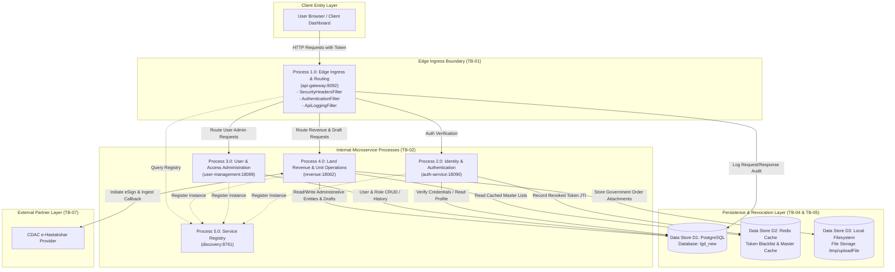
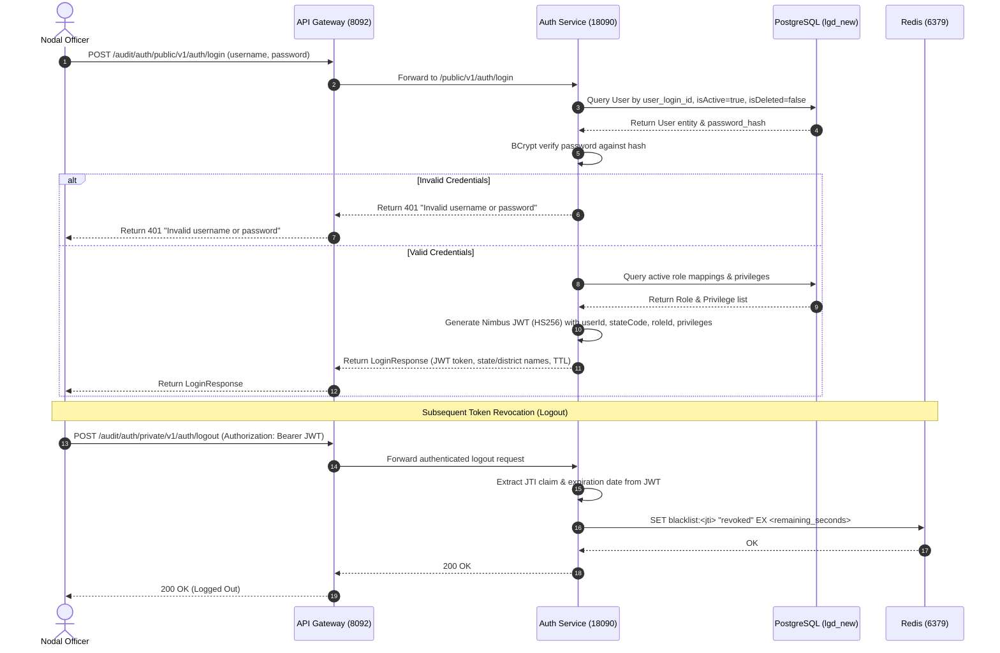
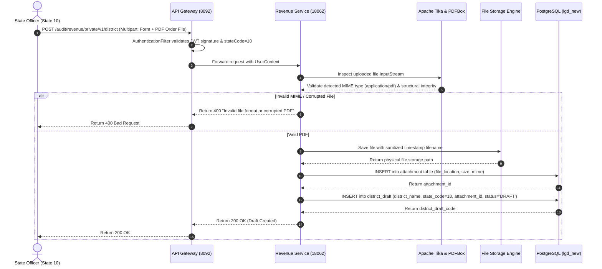
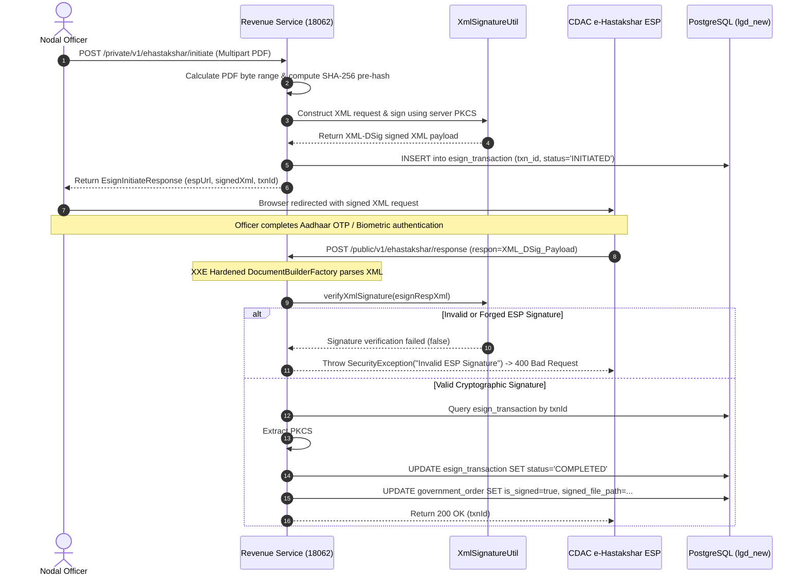

# LGD 2.0 - Data Flow Diagrams (DFD) & Architecture Maps

| **Document Version** | 1.0.0 |
| **Audit Phase** | Phase 1: Threat Modeling & Trust Boundary Analysis |
| **System** | Local Government Directory (LGD 2.0) |
| **Notation Standard** | Yourdon / DeMarco & Gane-Sarson DFD Mappings in Mermaid |

---

## 1. DFD Level 0: Global Context Diagram

The Level 0 Context Diagram establishes the global perimeter of the LGD 2.0 System, its external entities, and high-level data exchanges across the environment boundary.

```mermaid
graph LR
    subgraph ExternalEntities ["External Entities"]
        Officer["Government Nodal Officer<br/>(State / District Level)"]
        Citizen["Public User / Citizen"]
        CDAC_ESP["CDAC e-Hastakshar ESP<br/>(Electronic Signature Provider)"]
    end

    subgraph LGDSystemBoundary ["LGD 2.0 System Boundary"]
        LGD["Local Government Directory (LGD 2.0)<br/>Microservices Platform"]
    end

    Officer -->|1. Credentials, Draft Orders, Attachments| LGD
    LGD -->|2. JWT Bearer Tokens, Menus, Verification Status| Officer

    Citizen -->|3. Public Directory Queries (State, District, Village)| LGD
    LGD -->|4. Master Data Directory Responses| Citizen

    LGD -->|5. SHA-256 Pre-hashed PDF Byte Range, Signed XML| CDAC_ESP
    CDAC_ESP -->|6. XML-DSig Callback with PKCS#7 Signature| LGD
```

---

## 2. DFD Level 1: System Decomposition & Subsystems

The Level 1 DFD decomposes the LGD 2.0 system into its constituent microservices, persistence engines, cache layers, and demarcated trust boundaries.



---

## 3. DFD Level 2: Critical Business Flows

### 3.1 Flow 1: Authentication & Token Lifecycle



---

### 3.2 Flow 2: Government Directory Draft Creation & Attachment Storage



---

### 3.3 Flow 3: e-Hastakshar Pre-Signing & External Callback Ingestion



---

### 3.4 Flow 4: Gazette Publication & Multi-Tenant State Boundary Enforcement

```mermaid
sequenceDiagram
    autonumber
    actor Officer as Officer (StateCode: 10)
    participant GW as API Gateway (8092)
    participant Rev as Revenue Service (18062)
    participant DB as PostgreSQL (lgd_new)

    Officer->>GW: POST /audit/revenue/private/v1/district/publish/create (draftCode=502)
    GW->>GW: Validate JWT; extract UserContext (stateCode=10)
    GW->>Rev: Forward publish request
    Rev->>DB: SELECT * FROM district_draft WHERE district_code = 502
    DB-->>Rev: Return DistrictDraft (stateCode=20)
    
    Note over Rev: Tenant Boundary Enforcement Check
    Rev->>Rev: Compare districtDraft.getStateCode() [20] vs userContext.getStateCode() [10]
    alt State Boundary Mismatch (BOLA Detected)
        Rev-->>GW: Throw SecurityException ("Tenant boundary violation: State 10 cannot publish draft of State 20")
        GW-->>Officer: Return 403 Forbidden / 400 Bad Request
    else State Boundary Matches
        Rev->>DB: Call stored procedure create_district_fn(...)
        DB-->>Rev: Return new active district code & order code
        Rev->>DB: UPDATE district SET is_active=true
        Rev-->>GW: Return PublishDistrictResponse (Success)
        GW-->>Officer: Return 200 OK
    end
```
