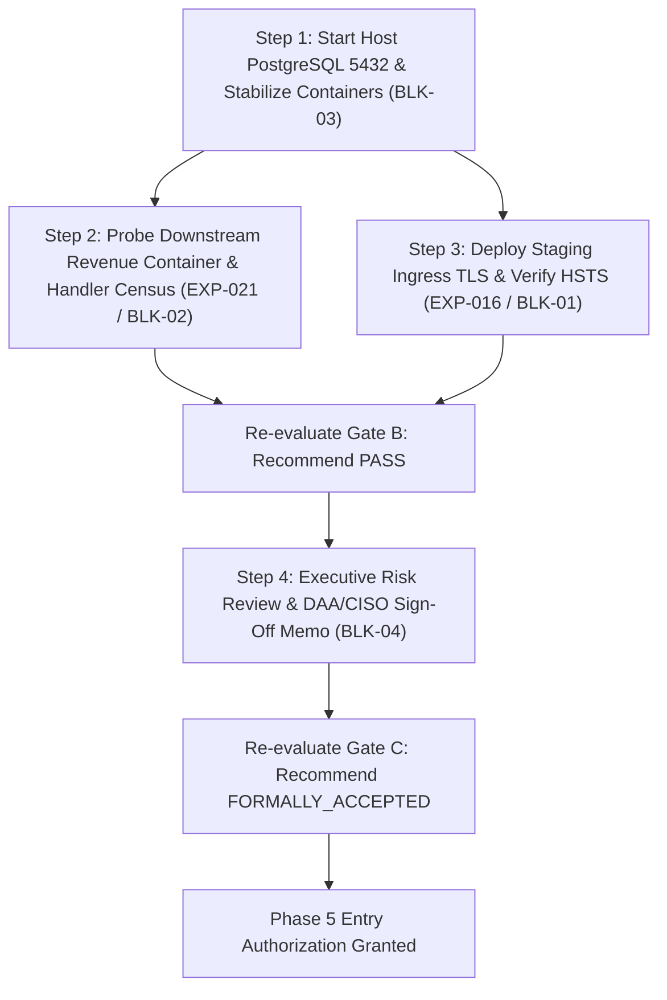

# LGD 2.0 — Phase 0–4 Remaining Blockers Register

| **Governance Metadata** | **Specification** |
|:---|:---|
| **System** | Local Government Directory 2.0 (LGD 2.0) |
| **Audit Milestone** | Phase 0–4 Final Closure & Phase 5 Entry Blocker Register |
| **Evaluation Date** | November 3, 2026 (`2026-11-03T15:25:00+05:30`) |
| **Repository Root** | `E:\System\Projects\dockerPn started.
Phase 7 has NOT been started.
Phase 9 has NOT been started.
No application source code or production infrastructure was modified.
No executive approvals or cryptographic evidence was fabricated.
$$\mathbf{PHASE\ 5\ NOT\ STARTED\ —\ HALTED\ BEFORE\ PHASE\ 5.}$$roject\Source code\lgd-active-new` |
| **Auditor Classification** | Lead Independent Application Security Auditor |
| **Total Active Blockers** | **4 Formal Blockers** (3 Technical / Environment under Gate B, 1 Governance under Gate C) |
| **Phase 5 Readiness Determination** | **`NOT READY`** |
| **Mandatory Program Status** | **PHASE 5 NOT STARTED — HALTED BEFORE PHASE 5.** |

---

## 1. Executive Summary & Blocker Governance Framework

This **Remaining Blockers Register** catalogs the exact set of unresolved technical, environmental, and governance conditions preventing the formal authorization and entry into **Phase 5** (Authentication & Session Security Deep Audit).

In compliance with the mandatory stopping condition:
$$\mathbf{PHASE\ 5\ NOT\ STARTED\ —\ HALTED\ BEFORE\ PHASE\ 5.}$$

Phase 5 entry criteria require that all Phase 0 through Phase 4 gates achieve formal clearance:
- **Gate A:** Must achieve `PASS` status (Documentation, Traceability, and Cryptographic Evidence Integrity).
- **Gate B:** Must achieve `PASS` status (Technical Verification, Automated Regressions, and Exploit Vector Closure).
- **Gate C:** Must achieve `FORMALLY_ACCEPTED` status (Executive Residual Risk Authorization).

Because Gate B is currently on **`HOLD`** (held by three technical/environmental blockers) and Gate C is **`PENDING_FORMAL_ACCEPTANCE`** (held by one governance blocker), the **four active blockers** detailed below must be systematically closed in the recommended sequence.

Pursuant to the authorized architecture scope decision, the retired and nonexistent frontend component (`lgd_react`) has been formally excluded from the active architecture, current build requirements, technical blocker register, and Phase 5 readiness calculation. Its absence does not constitute a technical failure, and obsolete build requirements have been retired.

---

## 2. Detailed Technical & Governance Blockers

### Blocker 1: Genuine Ingress HTTPS/TLS HSTS Verification (EXP-016)
- **Blocker ID:** `BLK-01`
- **Category:** Gate B / Perimeter Transport Security
- **Affected Component:** `api-gateway` (Port `8092` / Ingress TLS termination point)
- **Current State:** `PARTIALLY_VERIFIED`. The API Gateway's [SecurityHeadersFilter.java](file:///e:/System/Projects/dockerProject/Source%20code/lgd-active-new/api-gateway/src/main/java/in/gov/lgd/gateway/filter/SecurityHeadersFilter.java) emits `Strict-Transport-Security: max-age=31536000; includeSubDomains; preload`. However, the local Docker Compose deployment operates exclusively over cleartext HTTP. Under RFC 6797 Section 7.2, HSTS headers transmitted over insecure HTTP are discarded by user agents and do not provide transport security.
- **Exact Staging TLS Ingress Requirement & Verification:**
  1. Deploy a staging TLS reverse proxy (e.g., Nginx, Envoy, or Spring Cloud Gateway TLS termination listener) in front of the API Gateway.
  2. Configure a valid staging X.509 certificate and private key matching the staging domain name.
  3. Issue a live HTTPS request via curl to the secure ingress endpoint (`https://<staging-host>:443/` or `:8443/`).
  4. Capture raw request/response cryptographic evidence over HTTPS verifying that the response headers contain `Strict-Transport-Security: max-age=31536000; includeSubDomains; preload` delivered over a negotiated TLS 1.2/1.3 session.
- **Required Evidence:** Captured HTTP/1.1 or HTTP/2 over TLS curl handshake log with negotiated ciphersuite, response headers showing HSTS directives, and certificate validation log (`EVD-TLS-HSTS-01`).
- **Responsible Role:** DevSecOps Lead & Perimeter Infrastructure Engineer
- **Dependencies:** Staging TLS certificate issuance; ingress reverse proxy deployment.
- **Recommended Execution Order:** **Step 3**.

---

### Blocker 2: Downstream Revenue Container & TestController Reachability Census (EXP-021)
- **Blocker ID:** `BLK-02`
- **Category:** Gate B / Downstream Application Hardening
- **Affected Component:** `revenue` (Internal port `18062`, `TestController.java`)
- **Current State:** `PARTIALLY_VERIFIED`. Gateway perimeter returns `HTTP 403 Forbidden` (`{"error":"Access denied: insufficient privileges"}`) for `/revenue/test/api1`. Source code inspection confirms `@Profile({"dev", "test"})` on [TestController.java](file:///e:/System/Projects/dockerProject/Source%20code/lgd-active-new/revenue/src/main/java/in/nic/lgd/revenue/controller/TestController.java). However, direct probe against downstream Revenue container port 18062 and Actuator bean mappings (`/actuator/mappings`) could not be completed because the `revenue` container is currently failing to achieve steady-state due to host PostgreSQL connection refusal.
- **Mandatory Verification Standards:**
  - A perimeter HTTP 403 alone is **not** sufficient to prove downstream security or mark `EXP-021` as `VERIFIED_FIXED`.
  - The database service (`BLK-03`) must be available before downstream Revenue verification can be completed.
- **Exact Work Needed to Close Blocker (Once Authorized Environment is Available):**
  1. Confirm host PostgreSQL connectivity on port 5432 and verify `revenue` container startup and steady-state stability.
  2. Confirm the active Spring profile is `prod` via environment inspection (`SPRING_PROFILES_ACTIVE=prod`).
  3. Inspect controller registration and handler mappings. If Spring Boot Actuator mappings (`/actuator/mappings`) are unavailable or disabled, execute an authorized alternative such as an application-context handler mapping test. Sensitive Actuator endpoints will not be exposed merely to perform the audit.
  4. Probe Revenue directly through the internal Docker network (`http://revenue:18062/test/api1` and `http://revenue:18062/private/v1/test/api1`).
  5. Verify that `TestController` endpoints are not registered or reachable in production, returning `HTTP 404 Not Found`.
  6. Capture raw request/response evidence and application mapping evidence.
- **Required Evidence:** In-container/internal network curl response showing `HTTP 404 Not Found` for direct container port probes, and application context mapping evidence proving zero `TestController` handler method beans registered (`EVD-REV-TESTCTRL-01`).
- **Responsible Role:** Backend Security Architect & Quality Assurance Lead
- **Dependencies:** Blocker `BLK-03` (Host PostgreSQL database availability and Revenue container stability).
- **Recommended Execution Order:** **Step 2** (immediately following database restoration).

---

### Blocker 3: Host PostgreSQL 14 Service Availability and Revenue Container Stability
- **Blocker ID:** `BLK-03` *(formerly cataloged as BLK-04)*
- **Category:** Gate B / Environment Infrastructure Dependency
- **Affected Component:** PostgreSQL 14 (Host OS native service on port `5432`) & `revenue` container runtime
- **Current State:** `BLOCKED_BY_ENVIRONMENT`. In [docker-compose.yml](file:///e:/System/Projects/dockerProject/Source%20code/lgd-active-new/docker-compose.yml), microservices connect to `jdbc:postgresql://host.docker.internal:5432/lgd`. At the time of this audit, the Windows host PostgreSQL service (`postgresql-x64-14`) is stopped, causing `revenue` and `auth-service` containers to crash during Spring Boot Datasource initialization. Container `revenue` (`d9f41a9feba0`) is continuously restarting.
- **Exact Work Needed to Close Blocker:**
  1. Start the PostgreSQL 14 service on the host OS (`Start-Service postgresql-x64-14` or Windows Service manager).
  2. Verify PostgreSQL is listening on `5432` with Docker host routing (`host.docker.internal`) enabled.
  3. Verify database `lgd` exists with schema migrations applied and credentials matching `${SPRING_DATASOURCE_USERNAME}` and `${SPRING_DATASOURCE_PASSWORD}`.
  4. Confirm all backend containers (`revenue`, `auth-service`, `user-management`, `api-gateway`, `discovery`) achieve steady-state health in `docker ps` without restarting for > 5 minutes.
- **Required Evidence:** Output of `docker ps` showing all containers healthy and stable, and container application logs showing successful Spring Boot application startup without database connection exceptions (`EVD-ENV-DB-01`).
- **Responsible Role:** Database Administrator & Infrastructure Lead
- **Dependencies:** Host Windows administrative service access.
- **Recommended Execution Order:** **Step 1** (Foundational dependency for Blocker `BLK-02` and live cluster verification).

---

### Blocker 4: Formal DAA / CISO Residual Risk Authorization Memorandum
- **Blocker ID:** `BLK-04` *(formerly cataloged as BLK-05)*
- **Category:** Gate C / Executive Governance
- **Affected Component:** Platform-Wide (`RR-01` through `RR-11`)
- **Current State:** `PENDING_FORMAL_ACCEPTANCE`. All 11 residual risks are documented with compensating controls, operational scopes, and assigned authorities in [SECURITY_RESIDUAL_RISK_REGISTER.md](file:///e:/System/Projects/dockerProject/Source%20code/lgd-active-new/SECURITY_RESIDUAL_RISK_REGISTER.md). In strict adherence to non-fabrication mandates, zero signatures, approvals, or certifications may be simulated or assumed.
- **Exact Work Needed to Close Blocker:**
  1. Prepare the formal Pre-Phase-5 Risk Acceptance Memorandum incorporating the complete residual risk package (`RR-01` through `RR-11`).
  2. Submit the memorandum to the Designated Approving Authority (DAA) and Chief Information Security Officer (CISO).
  3. Conduct an executive risk review session detailing compensating controls and planned phase remediations (Phases 5, 7, 8, 9, 10, 13).
  4. Obtain physical or PKI digital signatures from the authorized DAA and CISO.
  5. Archive the signed memorandum in the audit evidence repository under `EVD-GOV-MEMO-01`.
  6. Update residual risk register status from `PENDING_FORMAL_ACCEPTANCE` to `FORMALLY_ACCEPTED_BY_DAA_CISO`.
- **Required Evidence:** Counter-signed, cryptographically timestamped PDF/document of the formal Risk Acceptance Memorandum with verifiable government PKI digital signatures (`EVD-GOV-MEMO-01`).
- **Responsible Role:** Chief Information Security Officer (CISO) & Project Director
- **Dependencies:** Review and acceptance of Blockers `BLK-01`–`BLK-03` technical evidence.
- **Recommended Execution Order:** **Step 4** (Final prerequisite before Phase 5 authorization).

---

## 3. Architecture Scope Decision: Retirement & Exclusion of Frontend Client Submodule

- **Component:** `lgd_react` (Single-Page Application / Git submodule pointer `c15c8b0e5326e44e751afb2ab931e12a3ae7de95`)
- **Historical Blocker ID:** Formerly cataloged as `BLK-03` (Frontend Client Submodule Population & Production Build Execution)
- **Scope Decision & Technical Justification:**
  - In accordance with the approved architecture scope decision for LGD 2.0, the retired and nonexistent frontend component (`lgd_react`) has been formally excluded from the active architecture, current build requirements, technical blocker register, and Phase 5 readiness calculation.
  - The repository maintains the active frontend `lgd-um` (which compiles cleanly with exit code 0). The unpopulated `lgd_react` submodule pointer represents retired / out-of-scope work.
  - Strict audit rules prohibit:
    - Restoring or recreating the component.
    - Populating the retired submodule (`git submodule update`).
    - Running its build.
    - Treating its absence as a technical failure.
    - Creating replacement work without authorization.
  - Historical evidence and SCA analysis (`RR-08`, `RR-09`) are preserved strictly to maintain audit lineage.
- **Disposition:** **`NOT_APPLICABLE (EXCLUDED FROM ACTIVE ARCHITECTURAL SCOPE)`**. Former blocker `BLK-03` is formally retired and removed from active blocker accounting.

---

## 4. Recommended Sequential Execution Roadmap

To achieve full audit closure and authorize Phase 5 entry, remediation activities must be executed in the following strict chronological sequence:

### Detailed Sequence:
1. **Phase 4.A — Container & Database Stabilization (`BLK-03`):**
   - Action: Start PostgreSQL 14 service on host; verify `auth-service` and `revenue` containers achieve steady-state health in Docker without restarting.
   - Outcome: Closes `BLK-03` (formerly BLK-04).
2. **Phase 4.B — Downstream Revenue Controller Verification (`BLK-02`):**
   - Action: Probe `revenue:18062` internally; query handler mappings or application-context census; capture 404 response and empty controller mapping.
   - Outcome: Resolves `EXP-021` to `VERIFIED_FIXED`; closes `BLK-02`.
3. **Phase 4.C — Ingress TLS & HSTS Verification (`BLK-01`):**
   - Action: Deploy staging reverse proxy / TLS listener; execute curl over HTTPS; capture HSTS response delivered over genuine TLS.
   - Outcome: Resolves `EXP-016` to `VERIFIED_FIXED`; closes `BLK-01`.
   - Gate Impact: Allows **Gate B** to transition from `HOLD` to **`PASS`**.
4. **Phase 4.D — Executive Risk Acceptance Sign-Off (`BLK-04`):**
   - Action: Submit residual risk package (`RR-01` through `RR-11`) to DAA/CISO; obtain executed authorization memo.
   - Outcome: Closes `BLK-04` (formerly BLK-05); allows **Gate C** to transition from `PENDING_FORMAL_ACCEPTANCE` to **`FORMALLY_ACCEPTED`**.
5. **Milestone Authorization:** Convene Phase 5 Gate Review; issue formal Notice to Proceed for Phase 5.

---

## 5. Final Register Status & Mandatory Statement

| Blocker ID | Description | Primary Owner | Status | Gate Impact | Historical ID |
|:---:|:---|:---|:---:|:---:|:---:|
| **BLK-01** | HSTS Verification over Genuine TLS (`EXP-016`) | DevSecOps Lead | **OPEN** | Gate B HOLD | `BLK-01` |
| **BLK-02** | Revenue Downstream Controller Census (`EXP-021`) | Backend Security Lead | **OPEN** | Gate B HOLD | `BLK-02` |
| **BLK-03** | Host PostgreSQL 14 Service Availability & Revenue Stability | DBA & Infrastructure Lead | **OPEN** | Gate B HOLD | `BLK-04` |
| **BLK-04** | Formal DAA/CISO Residual Risk Sign-Off (`RR-01`–`RR-11`) | CISO & Project Director | **OPEN** | Gate C HOLD | `BLK-05` |
| *Retired* | *Frontend `lgd_react` Build Execution (Excluded from Scope)* | *Frontend Lead* | ***NOT_APPLICABLE*** | *No Gate Impact* | *`BLK-03`* |

$$\mathbf{TOTAL\ ACTIVE\ BLOCKERS:\ 4\ FORMAL\ BLOCKERS\ REMAINING\ (3\ Gate\ B,\ 1\ Gate\ C)}$$

### Mandatory Stopping Statement:
$$\mathbf{PHASE\ 5\ NOT\ STARTED\ —\ HALTED\ BEFORE\ PHASE\ 5.}$$

---
*Blockers Register compiled and attested by the Lead Independent Security Auditor.*

