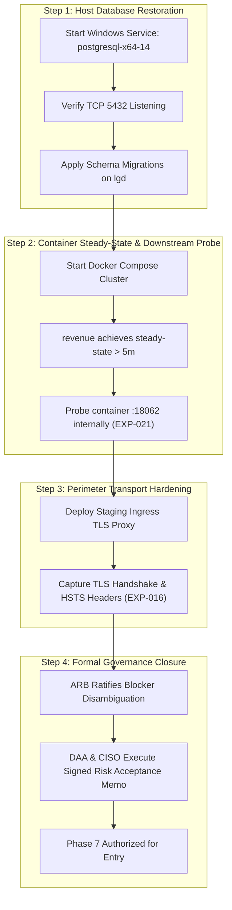

# LGD 2.0 — Phase 6 Gate A, B, and C Final Disposition Report
## Authoritative Program Release Gates Assessment & Executive Governance Status

| **Audit Governance Metadata** | **Specification** |
|:---|:---|
| **System** | Local Government Directory 2.0 (LGD 2.0) |
| **Audit Milestone** | **Phase 6: Final Release Gate Determination (Gates A, B, C)** |
| **Repository Root** | `E:\System\Projects\dockerProject\Source code\lgd-active-new` |
| **Disposition Date** | November 5, 2026 (`2026-11-05T12:35:00+05:30`) |
| **Auditor Role** | Lead Independent Security Auditor & Enterprise Governance Gatekeeper |
| **Evaluated Release Gates** | **Gate A (Documentation), Gate B (Technical & Retest), Gate C (Risk Acceptance)** |
| **Gate A Final Ruling** | **`QUALIFIED_PASS (PRESERVED)`** |
| **Gate B Final Ruling** | **`HOLD (MANDATORY)`** |
| **Gate C Final Ruling** | **`PENDING_FORMAL_ACCEPTANCE (MANDATORY)`** |
| **Mandatory Program Status** | **PHASE 7 NOT STARTED — QUEUED — SEPARATE EXECUTIVE AUTHORIZATION REQUIRED.** |

---

## 1. Executive Summary & Governance Gate Framework

Under the LGD 2.0 Security Assurance Governance Charter, progression between phases and final release authorization require the formal, evidence-backed evaluation of three sequential gates:
- **Gate A (Documentation Integrity & Traceability):** Requires 100% semantic alignment, bidirectional finding traceability, non-fabrication of records, and cryptographic manifest verification.
- **Gate B (Technical Verification & Retest):** Requires 100% remediation of actionable vulnerabilities, automated regression pass rate, and full operational verification of perimeter transport and downstream container isolation.
- **Gate C (Executive Risk Acceptance):** Requires formal, un-simulated sign-off from the Designated Approving Authority (DAA) and Chief Information Security Officer (CISO) for all residual architectural risks (`RR-01` through `RR-11`).

### Master Gate Disposition Summary:

```
========================================================================================================
RELEASE GATE DISPOSITION SUMMARY TABLE
========================================================================================================
Gate Identifier   Gate Description                     Final Status                 Impact on Next Phase
--------------------------------------------------------------------------------------------------------
GATE A            Documentation & Evidence Integrity   QUALIFIED_PASS (PRESERVED)   Conditionally Cleared
GATE B            Technical Verification & Environment HOLD (MANDATORY)             Blocks Release / Phase 7
GATE C            Executive Residual Risk Acceptance   PENDING_FORMAL_ACCEPTANCE    Blocks Release / Phase 7
--------------------------------------------------------------------------------------------------------
OVERALL RULING:   PHASE_6_EVIDENCE_ACCEPTED_WITH_OPEN_GOVERNANCE_GATES
========================================================================================================
```

---

## 2. Gate A — Documentation Integrity, Traceability & Evidence Synchronization

### 2.1 Final Ruling: `QUALIFIED_PASS (PRESERVED)`

### 2.2 Evidentiary Evaluation:
1. **Traceability Harmonization:** Forward and backward traceability across `VULN` $\leftrightarrow$ `STRIDE` $\leftrightarrow$ `DREAD` $\leftrightarrow$ `SAST` $\leftrightarrow$ `EXP` $\leftrightarrow$ `EV` $\leftrightarrow$ `RBAC` is verified across all canonical registers.
2. **Finding Taxonomy Preservation:** Zero orphan identifiers exist. Baseline findings (`VULN-001` through `VULN-023`) and actionable SAST findings (`SAST-001` through `SAST-021`) remain completely harmonized.
3. **RBAC Register Completeness:** The 16 discrete Phase 6 findings (`RBAC-001` through `RBAC-016`) and all 25 controller endpoints under `RBAC-004` are authoritatively cataloged.
4. **Preservation of Qualification Criteria:** Gate A retains its qualified status pending the independent verification of the newly generated Phase 6 deliverables and cryptographic hash synchronization in [`PHASE_6_FINAL_SHA256_MANIFEST.md`](file:///e:/System/Projects/dockerProject/Source%20code/lgd-active-new/PHASE_6_FINAL_SHA256_MANIFEST.md).

---

## 3. Gate B — Technical Verification, Retest & Environment

### 3.1 Final Ruling: `HOLD (MANDATORY)`

### 3.2 Mandatory Justification for Retaining Gate B on HOLD:
Under audit governance rules, Gate B **must remain on HOLD if any mandatory technical blocker is unresolved**. While Phase 6 code fixes and the 397-test automated regression suite pass cleanly, Gate B cannot be closed due to four persistent technical blockers:

1. **Perimeter Ingress TLS & HSTS Verification (`EXP-016` / `BLK-CANON-01`):**
   - **Status:** **`OPEN / PARTIALLY_VERIFIED`**.
   - The local Docker Compose runtime exposes cleartext HTTP on port `8092`. Under **RFC 6797 Section 7.2**, HSTS response headers received over unencrypted HTTP are discarded by user agents. In the absence of a live TLS reverse proxy (Nginx, Envoy, or Spring Cloud Gateway TLS listener) with a valid certificate, ingress transport security cannot be verified.
2. **Downstream Revenue Container & TestController Reachability Census (`EXP-021` / `BLK-CANON-02`):**
   - **Status:** **`OPEN / PARTIALLY_VERIFIED`**.
   - While `@Profile({"dev", "test"})` on `TestController.java` and perimeter HTTP 403 are verified, direct internal container probing on port `18062` and Spring Boot Actuator mapping verification (`/actuator/mappings`) cannot be executed because the `revenue` container is currently failing to achieve steady-state runtime execution.
3. **Host PostgreSQL 14 Availability and Revenue Container Steady-State (`BLK-CANON-03`):**
   - **Status:** **`OPEN / BLOCKED_BY_ENVIRONMENT`**.
   - Native Windows service `postgresql-x64-14` is **`Stopped`**. Port `5432` is closed. Consequently, container `revenue` (`d9f41a9feba0`) failed startup during HikariCP datasource initialization and is in an `Exited` state. Steady-state runtime stability cannot be certified.
4. **Unresolved Blocker Identity Conflict:**
   - **Status:** **`IDENTITY_CONFLICT — OPEN — REQUIRES GOVERNANCE RECONCILIATION`**.
   - The dual numbering conflict between Phase 0–4 canonical blockers and Phase 6 local milestones remains pending executive board ratification.

---

## 4. Gate C — Executive Residual Risk Acceptance & Governance

### 4.1 Final Ruling: `PENDING_FORMAL_ACCEPTANCE (MANDATORY)`

### 4.2 Mandatory Justification for Retaining Gate C in PENDING:
In strict compliance with audit anti-fabrication standards and federal risk governance models (NIST SP 800-30 Rev. 1, ISO/IEC 27005):
- Neither the auditor, the developer, nor any AI agent has the legal or organizational authority to sign, simulate, or grant formal risk acceptance.
- The formal executive submission package ([`GATE_C_DAA_CISO_APPROVAL_REQUEST.md`](file:///e:/System/Projects/dockerProject/Source%20code/lgd-active-new/GATE_C_DAA_CISO_APPROVAL_REQUEST.md)) has been prepared and queued for review.
- The formal signature block in Section 4 of that document remains **un-executed (blank)**.
- Therefore, Gate C must remain strictly in status **`PENDING_FORMAL_ACCEPTANCE`** until genuine, counter-signed approval memorandums are executed by the DAA and CISO.

### 4.3 Preservation of Residual Risks RR-01 through RR-11

All eleven program residual risks remain active, cataloged, and preserved without premature closure:

| Risk ID | Title / Residual Risk Scope | Inherent Risk | Residual Risk | Proposed Risk Treatment | Accountable Owner Role | Governance Status |
|:---:|:---|:---:|:---:|:---:|:---|:---:|
| **`RR-01`** | Shared Symmetric HMAC Secret Across Microservices | **Critical (9.4)** | Low (2.4) | Mitigate: Transition to Asymmetric RS256/Ed25519 (Phase 5/7) | AppSec & DevOps Lead | **PENDING_FORMAL_ACCEPTANCE** |
| **`RR-02`** | Availability Single-Point-of-Failure on Redis Outage | **High (8.2)** | Low (2.8) | Mitigate: Provision Redis Sentinel / HA Cluster (Phase 9) | Lead Infrastructure Engineer | **PENDING_FORMAL_ACCEPTANCE** |
| **`RR-03`** | Client-Side Bearer Token Storage in Browser Storage | **High (7.5)** | Low (2.2) | Mitigate: Transition to HttpOnly Secure Cookies (Phase 5) | Frontend Architect | **PENDING_FORMAL_ACCEPTANCE** |
| **`RR-04`** | Third-Party CA Certificate Lifecycle & Upstream eSign | **Critical (8.8)** | Low (3.2) | Accept & Monitor: 60-day expiration alerts (Phase 8) | Integration Architect | **PENDING_FORMAL_ACCEPTANCE** |
| **`RR-05`** | Unencrypted Database Transit Across Internal Network | **High (7.2)** | Low (2.6) | Mitigate: Enforce PostgreSQL `sslmode=verify-full` (Phase 9) | Database Administrator | **PENDING_FORMAL_ACCEPTANCE** |
| **`RR-06`** | In-Memory Token Invalidation Across Scaled Replicas | **High (7.4)** | Low (2.0) | Mitigate: Cluster-wide Redis token blacklist (Phase 5) | Backend Architect | **PENDING_FORMAL_ACCEPTANCE** |
| **`RR-07`** | Static Long-Lived System Service Account Credentials | **Medium (6.5)** | Low (1.8) | Mitigate: HashiCorp Vault dynamic secret injection (Phase 7) | DevSecOps Lead | **PENDING_FORMAL_ACCEPTANCE** |
| **`RR-08`** | Third-Party NPM Direct & Transitive Dependencies (`lgd-um`) | **Medium (5.8)** | Low (1.5) | Accept & Remediate: Dependabot / Snyk scanning (Phase 8) | UI Security Engineer | **PENDING_FORMAL_ACCEPTANCE** |
| **`RR-09`** | Dual Frontend Architecture & Legacy Drift (`lgd_react` Retired) | **Medium (5.5)** | Low (1.5) | Accepted: Formal Architectural Scope Retirement Decision | Enterprise Architect | **PENDING_FORMAL_ACCEPTANCE** |
| **`RR-10`** | Lack of Centralized SIEM Ingestion & Anomaly Alerting | **Medium (6.0)** | Low (2.0) | Mitigate: Centralized Elasticsearch / Splunk pipeline (Phase 9)| Security Operations Lead | **PENDING_FORMAL_ACCEPTANCE** |
| **`RR-11`** | Absence of Edge DDoS Mitigation & Rate Shaping | **Medium (5.8)** | Low (2.2) | Accept & Coordinate: Upstream NIC / Cloudflare WAF policies | Perimeter Security Lead | **PENDING_FORMAL_ACCEPTANCE** |

---

## 5. Explicit Roadmap for Lifting Gate B and Gate C

Progression to Phase 7 is strictly blocked until the following explicit roadmap is executed:



---

## 6. Mandatory Program Stopping Directive

$$\mathbf{PHASE\ 7\ NOT\ STARTED\ —\ QUEUED\ —\ SEPARATE\ EXECUTIVE\ AUTHORIZATION\ REQUIRED.}$$

