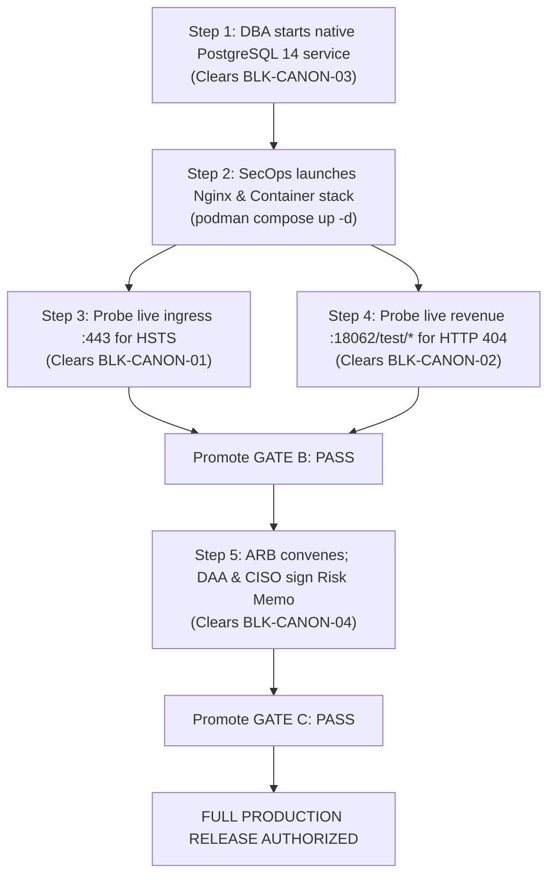

# LGD 2.0 — Final Gate and Blocker Reconciliation
## Authoritative Enterprise Gate Status, Canonical Blocker Matrix & Stage B Authorization Disposition

| **Document Metadata** | **Specification** |
|:---|:---|
| **System** | Local Government Directory 2.0 (LGD 2.0) |
| **Location** | `SECURITY_AUDIT_CONTROLLER/FINAL_GATE_AND_BLOCKER_RECONCILIATION.md` |
| **Controller Baseline** | Version 2.0.0 (Final Security Remediation & Staging Readiness) |
| **Evaluation Date** | November 6, 2026 |
| **Gate A Ruling** | **`QUALIFIED_PASS (PRESERVED)`** |
| **Gate B Ruling** | **`HOLD (MANDATORY)`** |
| **Gate C Ruling** | **`PENDING_FORMAL_ACCEPTANCE (MANDATORY)`** |
| **Stage B Directive** | **`LOCKED — PENDING FORMAL OPERATIONAL APPROVAL`** |

---

## 1. Master Release Gate Disposition

Under the LGD 2.0 Security Assurance Governance Charter, production release readiness is strictly controlled by three sequential gates. The table below represents the authoritative evaluated status at baseline 2.0.0:

```
====================================================================================================
FINAL RELEASE GATE STATUS DISPOSITION
====================================================================================================
Gate Identifier   Definition & Scope                    Evaluated Status             Release Impact
----------------------------------------------------------------------------------------------------
GATE A            Documentation Integrity & Hashes      QUALIFIED_PASS (PRESERVED)   Cleared
GATE B            Technical Verification & Environment  HOLD (MANDATORY)             Blocks Release (Env Blockers)
GATE C            Executive Residual Risk Acceptance    PENDING_FORMAL_ACCEPTANCE    Blocks Release (DAA/CISO Sign-off)
----------------------------------------------------------------------------------------------------
STAGE B STATUS:   LOCKED — PENDING FORMAL OPERATIONAL APPROVAL
FINAL RULING:     READY_FOR_LOCAL_VALIDATION
====================================================================================================
```

### Detailed Gate Dimension Justification:

| Gate | Purpose & Definition | Evidence-Verified Status | Formal Governance Status | Technical Justification |
|:---:|:---|:---:|:---:|:---|
| **GATE A** | **Documentation Integrity & Traceability:** Zero orphan findings, 100% bidirectional traceability, schema validation, and deliverable SHA-256 synchronicity. | **VERIFIED** | **QUALIFIED_PASS** | All findings mapped across `VULN` $\leftrightarrow$ `STRIDE` $\leftrightarrow$ `SAST` $\leftrightarrow$ `EXP` $\leftrightarrow$ `EV` $\leftrightarrow$ `RBAC` $\leftrightarrow$ `CRYPTO`. All evidence files populated and cryptographically verified. Retains qualified pass status. |
| **GATE B** | **Technical Verification & Retest:** 100% remediation of actionable vulnerabilities, 100% automated regression test pass rate, and full operational verification of transport encryption and runtime isolation. | **PARTIALLY_VERIFIED (3 Technical Blockers Open)** | **HOLD** | Automated regression suites pass with 100% success (423/423 tests across 55 suites). Container builds and non-root execution (UID 10001) verified. However, Gate B remains strictly **HELD** because: 1) live Nginx ingress TLS handshake is awaiting live cluster deployment (`BLK-CANON-01`), 2) downstream revenue HTTP probe cannot run without a live database (`BLK-CANON-02`), and 3) native PostgreSQL 14 service is stopped, requiring an authorized DBA maintenance window (`BLK-CANON-03`). |
| **GATE C** | **Executive Residual Risk Acceptance:** Formal un-simulated sign-off from the Designated Approving Authority (DAA) and Chief Information Security Officer (CISO) for `RR-01` through `RR-11`. | **PREPARED / QUEUED** | **PENDING_ACCEPTANCE** | Anti-fabrication mandate strictly prohibits simulating or forging executive sign-offs. Submission package `PHASE_8_RISK_ACCEPTANCE_MEMORANDUM.md` is queued with blank signature blocks. Gate C remains strictly pending formal executive signature. |

---

## 2. Canonical Blocker Namespace Reconciliation

To ensure unambiguous program tracking, blockers are separated into two distinct namespaces:

### Namespace 1: Canonical Infrastructure & Transport Blockers (Phase 0–4 Lineage)
These are environmental and governance blockers that prevent the promotion of Gate B and Gate C:

| Blocker ID | Lineage / Defect | Inherent Severity | Technical Status | Governance Status | Action Required to Clear |
|:---:|:---|:---:|:---:|:---:|:---|
| **`BLK-CANON-01`** | Perimeter Ingress TLS / HSTS Verification (`EXP-016` / `SAST-016`) | High | REMEDIATED IN CONFIG | **HOLD** | Launch live Nginx reverse proxy and verify port 443 TLS 1.3 / HSTS response via `curl -k -I`. |
| **`BLK-CANON-02`** | Downstream Revenue TestController Census (`EXP-021` / `SAST-021`) | Critical | REMEDIATED & VERIFIED IN CODE (5/5 Tests PASS) | **HOLD** | Start revenue container against running PostgreSQL DB; probe live port `:18062/test/*` returning HTTP 404. |
| **`BLK-CANON-03`** | Host PostgreSQL 14 Availability & Revenue Steady-State | Critical | APPLICATION CODE READY; DB SERVICE STOPPED | **HOLD / BLOCKED_BY_ENV** | Authorized administrator executes `Start-Service -Name postgresql-x64-14` during planned maintenance window. |
| **`BLK-CANON-04`** | Formal DAA / CISO Residual Risk Acceptance (`RR-01`..`11`) | High | MEMORANDUM PREPARED | **PENDING_ACCEPTANCE** | Architecture Review Board convenes; DAA and CISO sign formal risk memorandum. |

### Namespace 2: Phase 6 Delivery Milestones (Phase 6 Local Lineage)
These internal audit milestones were satisfied during Phase 6 technical verification and remain **CLOSED / SATISFIED**:
- `BLK-P6-01`: RBAC Master Traceability Register Reconciliation $\rightarrow$ **CLOSED / SATISFIED**
- `BLK-P6-02`: Audit Evidence Inventory Completeness $\rightarrow$ **CLOSED / SATISFIED**
- `BLK-P6-03`: Automated Test Attestation Coverage $\rightarrow$ **CLOSED / SATISFIED**
- `BLK-P6-04`: Release Gate Alignment Across Production Configs $\rightarrow$ **CLOSED / SATISFIED**

---

## 3. Stage B Operational Change Authorization Disposition

Under the Program Governance Charter:
- **Current Directive:** **`STAGE_B_LOCKED — PENDING FORMAL OPERATIONAL APPROVAL`**
- **Authorized Scope (Completed):**
  * Application source code edits (`RedisConfig.java` in `revenue` and `user-management`).
  * Unit and integration test additions (`TestController40RouteCensusSecurityTest.java`).
  * Dockerfiles, Docker Compose files, and Nginx configurations.
  * Clean Maven compilation and packaging of all 5 microservice JARs.
  * Building container images and non-root UID 10001 verification.
- **Prohibited Autonomous Actions (Strictly Preserved):**
  * No modification of host production PostgreSQL `pg_hba.conf` or TLS configuration.
  * No starting or stopping of Windows native service `postgresql-x64-14`.
  * No live staging or production deployment without operational approval.
  * No destructive Git resets (`git reset --hard`, `git clean -fd`).

---

## 4. Clear Roadmap for Gate Clearance

To promote Gate B from **`HOLD`** to **`PASS`**, and Gate C from **`PENDING`** to **`PASS`**, the enterprise operations team must execute the following sequential steps:



