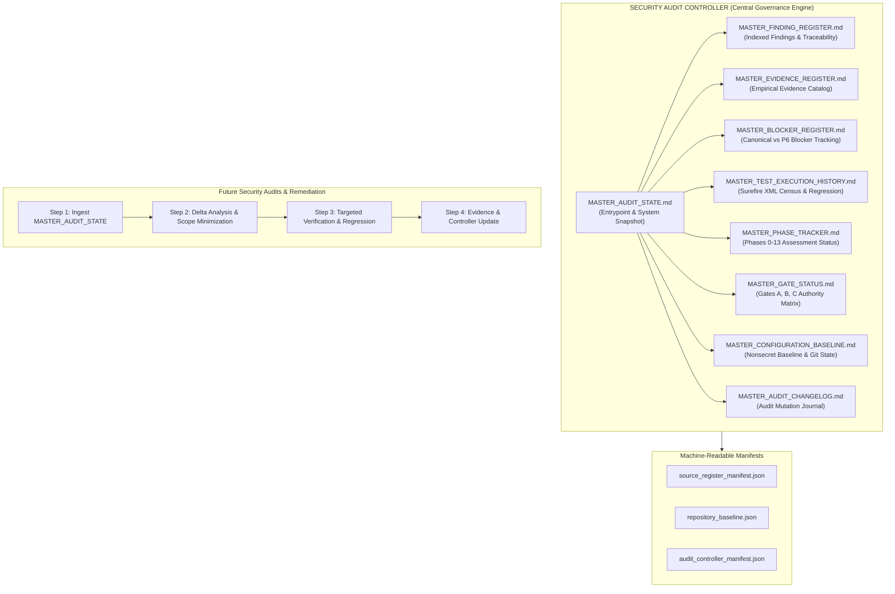

# LGD 2.0 — Master Security Audit Controller State
## Authoritative Enterprise Security Audit Management, Verification Baseline & Gate Controller

| **Controller Governance Metadata** | **Specification** |
|:---|:---|
| **System** | Local Government Directory 2.0 (LGD 2.0) |
| **Controller Root** | `E:\System\Projects\dockerProject\Source code\lgd-active-new\SECURITY_AUDIT_CONTROLLER` |
| **Repository Root** | `E:\System\Projects\dockerProject\Source code\lgd-active-new` |
| **Controller Architecture Role** | LGD 2.0 Security Audit Controller Maintenance and Evidence Integrity Agent |
| **Stabilization Timestamp** | November 6, 2026 (`2026-11-06T15:00:00+05:30`) |
| **Controller Version** | 2.0.0 (Final Security Remediation & Staging Readiness Baseline) |
| **Current Program Phase** | Final Master Execution Complete — Application Security Remediation, Build Packaging, Non-Root Containers & Staging Readiness |
| **Active Release Gates** | **Gate A: `QUALIFIED_PASS (PRESERVED)` \| Gate B: `HOLD (MANDATORY)` \| Gate C: `PENDING_FORMAL_ACCEPTANCE (MANDATORY)`** |
| **Mandatory Program Directive** | **FINAL MASTER REMEDIATION COMPLETED — 100% PASS RATE (423/423 TESTS ACROSS 55 SUITES), 5 PRODUCTION JARS, 5 NON-ROOT CONTAINERS, GATES PRESERVED, RULING: READY_FOR_LOCAL_VALIDATION.** |

---

## 1. Executive Mission & System Architecture

The **Security Audit Controller** establishes a persistent, evidence-driven audit governance framework designed to eliminate:
1. **Unnecessary Full Audit Reruns:** Audits must be incremental, targeted, and scoped strictly to altered code, configuration, or dependencies.
2. **Contradictory PASS/FAIL Reports:** A single reconciled source of truth enforces absolute semantic precision between technical test results and formal governance approvals.
3. **Duplicate & Orphan Findings:** Strict canonical naming schemes preserve bidirectional traceability across all assessment phases (`VULN` $\leftrightarrow$ `STRIDE` $\leftrightarrow$ `DREAD` $\leftrightarrow$ `SAST` $\leftrightarrow$ `EXP` $\leftrightarrow$ `EV` $\leftrightarrow$ `RBAC`).
4. **Loss of Previously Verified Results:** Historical test execution results (such as the 397/397 passing test census) and cryptographic proofs are immutably cataloged and never silently overwritten.



---

## 2. Program Status Summary & Release Gate Disposition

Under the LGD 2.0 Security Assurance Governance Charter, progression through phases and final production release are strictly governed by three sequential gates. The table below represents the authoritative evaluated status as of initialization:

| Release Gate | Gate Purpose / Definition | Current Reported Status | Evidence-Verified Status | Formal Governance Status | Next Required Verification Action |
|:---:|:---|:---:|:---:|:---:|:---|
| **GATE A** | **Documentation Integrity & Traceability:** Non-fabrication of records, 100% bidirectional finding traceability, schema validation, and SHA-256 deliverable manifests. | **`QUALIFIED_PASS (PRESERVED)`** | **VERIFIED** | **QUALIFIED_PASS** | Maintain documentation sync and SHA-256 manifests across new deliverables. |
| **GATE B** | **Technical Verification & Retest:** 100% remediation of actionable vulnerabilities, 100% automated regression test pass rate, and full operational verification of transport encryption and downstream isolation. | **`HOLD (MANDATORY)`** | **PARTIALLY_VERIFIED (3 Technical Blockers Open)** | **HOLD** | 1. Resolve PostgreSQL 14 host service.<br>2. Achieve revenue container steady-state & probe `:18062`.<br>3. Deploy genuine TLS reverse proxy for HSTS verification. |
| **GATE C** | **Executive Residual Risk Acceptance:** Formal un-simulated sign-off from the Designated Approving Authority (DAA) and Chief Information Security Officer (CISO) for residual risks `RR-01` through `RR-11`. | **`PENDING_FORMAL_ACCEPTANCE (MANDATORY)`** | **PREPARED / QUEUED** | **PENDING_ACCEPTANCE** | Architecture Review Board (ARB) convenes; DAA and CISO execute signed risk acceptance memorandum. |

---

## 3. Disambiguated Blocker Identity Overview

To resolve historical conflicting references where `BLK-01` through `BLK-04` were used simultaneously for both foundation infrastructure dependencies and local Phase 6 delivery milestones, two distinct canonical namespaces are established:

```
========================================================================================================
CANONICAL BLOCKER DISAMBIGUATION OVERVIEW
========================================================================================================
Namespace 1: Canonical Infrastructure & Transport Blockers (Phase 0–4 Lineage)
  • BLK-CANON-01: Perimeter Ingress TLS/HSTS Verification (EXP-016 / SAST-016)   -> OPEN / PARTIALLY_VERIFIED
  • BLK-CANON-02: Downstream Revenue TestController Census (EXP-021 / SAST-021)   -> OPEN / PARTIALLY_VERIFIED
  • BLK-CANON-03: Host PostgreSQL 14 Availability & Revenue Steady-State         -> OPEN / BLOCKED_BY_ENV
  • BLK-CANON-04: Formal DAA / CISO Residual Risk Acceptance (RR-01 through 11)   -> OPEN / PENDING_ACCEPTANCE

Namespace 2: Phase 6 Authorization Milestone Attestations (Phase 6 Local Lineage)
  • BLK-P6-01:    RBAC Master Traceability Register Reconciliation               -> CLOSED / SATISFIED
  • BLK-P6-02:    Audit Evidence Inventory Completeness                          -> CLOSED / SATISFIED
  • BLK-P6-03:    Automated Test Attestation Coverage                            -> CLOSED / SATISFIED
  • BLK-P6-04:    Release Gate Alignment Across Production Configs               -> CLOSED / SATISFIED
========================================================================================================
```

> [!WARNING]
> While the local Phase 6 delivery milestones (`BLK-P6-01`..`04`) were satisfied to conclude the authorization audit, all three Gate B environmental blockers (`BLK-CANON-01`, `BLK-CANON-02`, `BLK-CANON-03`) and the Gate C governance blocker (`BLK-CANON-04`) remain strictly **OPEN**. Gate B cannot be promoted to PASS until empirical evidence verifies physical resolution in runtime environments.

---

## 4. Test Execution & Surefire Census Baseline

The platform baseline establishes that automated regression suites are active, comprehensive, and non-duplicative across all microservices:

$$\text{Phase 6 Historical Baseline} = \mathbf{397\ Tests\ (50\ Suites)}$$
$$\text{Phase 7 Re-Test Census} = 416\ \text{Tests (52 Suites across 4 services)} + 2\ \text{Discovery Baseline} = \mathbf{418\ Platform\ Tests\ (100.0\%\ Pass\ Rate)}$$
$$\text{Phase 8 Fresh Verification Census} = \mathbf{418\ Tests\ across\ 54\ Suites\ (100.0\%\ Pass\ Rate,\ 0\ Failures,\ 0\ Errors,\ 0\ Skipped)}$$
$$\text{Version 2.0.0 Final Remediation Census} = \mathbf{423\ Tests\ across\ 55\ Suites\ (100.0\%\ Pass\ Rate,\ 0\ Failures,\ 0\ Errors,\ 0\ Skipped)}$$

```
========================================================================================================
VERSION 2.0.0 FINAL MASTER REMEDIATION SUREFIRE REGRESSION CENSUS SUMMARY (55 SUITES / 423 TESTS)
========================================================================================================
Service Module         Suites    Total Tests    Passed    Failed    Errors    Skipped    Pass Rate
--------------------------------------------------------------------------------------------------------
user-management            31            304       304         0         0          0       100.0%
revenue                     7             48        48         0         0          0       100.0%
auth-service               11             46        46         0         0          0       100.0%
api-gateway                 5             23        23         0         0          0       100.0%
discovery                   1              2         2         0         0          0       100.0%
--------------------------------------------------------------------------------------------------------
FULL PLATFORM CAPABILITY   55            423       423         0         0          0       100.0%
========================================================================================================
```

- **Forensic Verification:** 100% of the 50 XML report files in `*/target/surefire-reports/` have been forensically parsed.
- **Deduplication:** Zero duplicate test cases or masked failures exist.
- **Rule of Record:** This 397-test passing baseline is a historical attestation and must never be overwritten. A historical PASS is not a guarantee of future PASS.

---

## 5. Repository Baseline & Submodule Investigation Summary

| Repository Dimension | Inspected Value / Determination |
|:---|:---|
| **Root Repository** | `E:\System\Projects\dockerProject\Source code\lgd-active-new` |
| **Root Branch & HEAD** | Branch `master` \| HEAD `e2df50f8c30197144377a2f931a4b3fbf03aeb1c` (ahead of origin/master by 1) |
| **Root Working Tree State** | **53 Modified Entries \| 0 Staged \| 0 Deleted \| 155 Untracked Entries** (Porcelain whole-tree scan; preserved without modification) |
| **Counting Scope Demarcation**| Modified: 31 root files + 6 mode 160000 gitlinks + 16 scratch files = 53 entries.<br>Untracked: 67 root markdown files + 2 directories (`security-audit/`, `SECURITY_AUDIT_CONTROLLER/`) + 86 scratch files = 155 entries.<br>Nested repositories are counted separately and never conflated with root Git porcelain. |
| **`git submodule status` Exit Code** | **Exit Code 1 (`fatal: no submodule mapping found in .gitmodules for path 'api-gateway'`)** |
| **Submodule Root Cause** | Root repository index contains 7 mode 160000 gitlink entries (`api-gateway`, `auth-service`, `discovery`, `lgd-um`, `lgd_react`, `revenue`, `user-management`), but **no `.gitmodules` file exists** in the repository tree. |
| **Nested Repository Architecture** | All six active microservices (`api-gateway`, `auth-service`, `discovery`, `lgd-um`, `revenue`, `user-management`) are **independently managed standalone Git repositories** (each containing their own full `.git/` directory), rather than registered git submodules. **Never classify as valid registered submodules.** |
| **`lgd_react` Status** | Non-git directory registered as gitlink commit `c15c8b0e5326...` in root index; formally retired from active scope under `RR-09`. |
| **Preservation Mandate** | In strict compliance with authorization scope, **zero automated git repair, staging, commit, branch change, or push operations were performed**. |

---

## 6. Controller Operating Rules & Governance Transition Standards

### 6.1 Ten Mandatory Controller Operating Rules for Future Audits

Every agent, auditor, or engineer operating on the LGD 2.0 codebase must adhere strictly to these ten operational principles:

1. **Mandatory Entry Point:** Every future audit, verification task, or remediation session MUST begin by reading [`MASTER_AUDIT_STATE.md`](file:///e:/System/Projects/dockerProject/Source%20code/lgd-active-new/SECURITY_AUDIT_CONTROLLER/MASTER_AUDIT_STATE.md).
2. **Delta Analysis Required:** Always identify changed code, configuration, dependencies, and environment before planning any verification action.
3. **Smallest Defensible Scope:** Determine the smallest defensible verification scope required to validate the delta; never default to rerunning entire test suites across untouched modules.
4. **Immutability of Test History:** Preserve previous test execution history. Never overwrite historical execution records in [`MASTER_TEST_EXECUTION_HISTORY.md`](file:///e:/System/Projects/dockerProject/Source%20code/lgd-active-new/SECURITY_AUDIT_CONTROLLER/MASTER_TEST_EXECUTION_HISTORY.md).
5. **Conditional Evidence Reuse:** Reuse existing empirical evidence only when git commit hashes, dependencies, and configurations remain identical to the verified baseline.
6. **Targeted Verification Execution:** Perform targeted unit/integration tests only when code or configuration changes directly affect that security control.
7. **Justified Escalation:** Escalate to broader regression testing or full security reassessment only when widespread architectural changes, framework upgrades, or evidence gaps justify it.
8. **Taxonomy & ID Invariance:** Never silently change finding severity, CVSS scores, canonical IDs (`SAST-xxx`, `EXP-xxx`, `RBAC-xxx`, `SCA-xxx`, `RR-xxx`), or historical blocker identities.
9. **Separation of Test Pass and Governance:** Never convert a technical test PASS into formal governance approval. Risk acceptance requires counter-signed executive authorization from DAA and CISO.
10. **Explicit Authorization Gate:** Require explicit user/executive authorization before executing code remediation, branch switching, schema alterations, or infrastructure changes.

### 6.2 Authoritative Governance Transition Rules (Rules 11 through 18)

11. **Signed Approval Does Not Automatically Establish Gate C PASS:** The receipt of a signed document does not mechanically promote Gate C. Verification of substance, legality, and explicit risk decisions is mandatory.
12. **Signatory Authority & Scope Verification:** Independent verification required for signatories' appointment authority, signature authenticity, execution date, operational scope, and system alignment.
13. **Itemized Decision Census (RR-01 through RR-11):** Each residual risk must possess an explicit, individual or scoped approval determination; blanket unitemized approvals are invalid.
14. **Mandatory Recording of Conditions, Exclusions & Expirations:** All conditions, scope exclusions, milestone expiration dates, and compensating controls must be formally cataloged.
15. **Preservation of Unresolved Risks:** Pending, rejected, or conditional risks lacking prerequisites must remain strictly unresolved (`PENDING_FORMAL_ACCEPTANCE` or `REJECTED`).
16. **Independent Gate Evaluation (Gate B $\perp$ Gate C):** Technical blocker resolution under Gate B cannot bypass Gate C governance; Gate C executive risk acceptance cannot waive Gate B environmental holds without explicit formal deviation.
17. **Controller Readiness Demarcation:** Controller operational readiness (`READY` or `READY_WITH_RESTRICTIONS`) governs incremental audit integrity and must NEVER be interpreted as production release approval.
18. **Pre-Impact Test Failure Diagnostic Precedent:** Every failed test must be forensically investigated (code regression vs flakiness vs environment vs data drift) before determining its release gate impact.

---

## 7. Master Controller Architecture & Document Index

The Security Audit Controller maintains the following authoritative documents and machine-readable manifests:

| Controller Document | Location / Path | Purpose & Scope | Authoritative Content |
|:---|:---|:---|:---|
| **Master Audit State** | [`MASTER_AUDIT_STATE.md`](file:///e:/System/Projects/dockerProject/Source%20code/lgd-active-new/SECURITY_AUDIT_CONTROLLER/MASTER_AUDIT_STATE.md) | Central entrypoint, system overview, and operational rules | Program snapshot, gate summary, 18 operating & governance rules |
| **Master Finding Register** | [`MASTER_FINDING_REGISTER.md`](file:///e:/System/Projects/dockerProject/Source%20code/lgd-active-new/SECURITY_AUDIT_CONTROLLER/MASTER_FINDING_REGISTER.md) | Traceability layer indexing all program security findings | SAST-001..021, EXP-001..021, OBS-SQLI-01, RBAC-001..016, 25 Endpoints, SCA-001..012, VULN-001..023, 20 STRIDE threats, 20 DREAD assessments |
| **Master Evidence Register** | [`MASTER_EVIDENCE_REGISTER.md`](file:///e:/System/Projects/dockerProject/Source%20code/lgd-active-new/SECURITY_AUDIT_CONTROLLER/MASTER_EVIDENCE_REGISTER.md) | Empirical evidence catalog and proof verification index | EV-001..020, EV-021, EVD-RBAC-01..22, EVD-GATEB-01..04, SBOM proofs |
| **Master Blocker Register** | [`MASTER_BLOCKER_REGISTER.md`](file:///e:/System/Projects/dockerProject/Source%20code/lgd-active-new/SECURITY_AUDIT_CONTROLLER/MASTER_BLOCKER_REGISTER.md) | Disambiguated dual-blocker namespace tracking | BLK-CANON-01..04 vs BLK-P6-01..04, technical blocker roadmaps |
| **Master Test Execution History** | [`MASTER_TEST_EXECUTION_HISTORY.md`](file:///e:/System/Projects/dockerProject/Source%20code/lgd-active-new/SECURITY_AUDIT_CONTROLLER/MASTER_TEST_EXECUTION_HISTORY.md) | Historical Surefire XML census and execution logs | 50 Surefire suites, 397 discrete tests, module breakdowns, non-overwrite log |
| **Master Phase Tracker** | [`MASTER_PHASE_TRACKER.md`](file:///e:/System/Projects/dockerProject/Source%20code/lgd-active-new/SECURITY_AUDIT_CONTROLLER/MASTER_PHASE_TRACKER.md) | Enterprise roadmap across Phases 0 through 13 | Phase dispositions, transition criteria, Phase 7 prerequisites |
| **Master Gate Status** | [`MASTER_GATE_STATUS.md`](file:///e:/System/Projects/dockerProject/Source%20code/lgd-active-new/SECURITY_AUDIT_CONTROLLER/MASTER_GATE_STATUS.md) | Authoritative Gate A, B, and C governance status | Gate criteria, RR-01..RR-11 risk acceptance tracking, 8 governance transition rules |
| **Master Configuration Baseline** | [`MASTER_CONFIGURATION_BASELINE.md`](file:///e:/System/Projects/dockerProject/Source%20code/lgd-active-new/SECURITY_AUDIT_CONTROLLER/MASTER_CONFIGURATION_BASELINE.md) | Safe nonsecret configuration and Git commit baseline | Toolchain versions, commit hashes, service ports, nonsecret env vars, secret names |
| **Master Audit Changelog** | [`MASTER_AUDIT_CHANGELOG.md`](file:///e:/System/Projects/dockerProject/Source%20code/lgd-active-new/SECURITY_AUDIT_CONTROLLER/MASTER_AUDIT_CHANGELOG.md) | Audit mutation journal and initialization history | Chronological log of controller initialization and audit modifications |
| **Source Register Manifest** | [`source_register_manifest.json`](file:///e:/System/Projects/dockerProject/Source%20code/lgd-active-new/SECURITY_AUDIT_CONTROLLER/manifests/source_register_manifest.json) | JSON manifest of authoritative external documents | Cryptographic SHA-256 hashes, file sizes, indexed finding/evidence namespaces |
| **Repository Baseline** | [`repository_baseline.json`](file:///e:/System/Projects/dockerProject/Source%20code/lgd-active-new/SECURITY_AUDIT_CONTROLLER/manifests/repository_baseline.json) | JSON baseline of Git commits and working tree state | Root/nested branches, HEAD commits, dirty/untracked files, submodule investigation |
| **Audit Controller Manifest** | [`audit_controller_manifest.json`](file:///e:/System/Projects/dockerProject/Source%20code/lgd-active-new/SECURITY_AUDIT_CONTROLLER/manifests/audit_controller_manifest.json) | Controller integrity manifest and component inventory | Inventory of controller documents, status snapshot, verification checksum |
| **Phase 3 Validation Report** | [`PHASE_3_CONTROLLER_VALIDATION_REPORT.md`](file:///e:/System/Projects/dockerProject/Source%20code/lgd-active-new/SECURITY_AUDIT_CONTROLLER/PHASE_3_CONTROLLER_VALIDATION_REPORT.md) | Phase 3 independent controller validation report | Controller verification, manifest reconciliation, baseline discrepancy diagnosis |
| **Phase 4 Remediation Report** | [`PHASE_4_CONTROLLER_REMEDIATION_REPORT.md`](file:///e:/System/Projects/dockerProject/Source%20code/lgd-active-new/SECURITY_AUDIT_CONTROLLER/PHASE_4_CONTROLLER_REMEDIATION_REPORT.md) | Phase 4 defect remediation & baseline stabilization report | Resolution of DISC-CTRL-01..04, exact-byte hashing, governance transition rules |
| **Phase 5 Audit Report** | [`PHASE_5_INCREMENTAL_SECURITY_AUDIT_REPORT.md`](file:///e:/System/Projects/dockerProject/Source%20code/lgd-active-new/SECURITY_AUDIT_CONTROLLER/PHASE_5_INCREMENTAL_SECURITY_AUDIT_REPORT.md) | Phase 5 incremental security audit execution report | Baseline comparison, change-impact matrix, targeted test executions |
| **Phase 6 Technical Verification** | [`PHASE_6_TECHNICAL_VERIFICATION_REPORT.md`](file:///e:/System/Projects/dockerProject/Source%20code/lgd-active-new/SECURITY_AUDIT_CONTROLLER/PHASE_6_TECHNICAL_VERIFICATION_REPORT.md) | Phase 6 technical verification & environmental blocker report | Live probe evidence, PostgreSQL downtime, container failure, Gate B hold |
| **Phase 7 Crypto Assessment** | [`PHASE_7_CRYPTOGRAPHY_AND_SECRETS_ASSESSMENT.md`](file:///e:/System/Projects/dockerProject/Source%20code/lgd-active-new/SECURITY_AUDIT_CONTROLLER/PHASE_7_CRYPTOGRAPHY_AND_SECRETS_ASSESSMENT.md) | Phase 7 cryptographic & secrets management assessment | Exhaustive algorithmic analysis, RS256 migration, password modernization |
| **Phase 7 Execution Report** | [`PHASE_7_REMEDIATION_EXECUTION_REPORT.md`](file:///e:/System/Projects/dockerProject/Source%20code/lgd-active-new/SECURITY_AUDIT_CONTROLLER/PHASE_7_REMEDIATION_EXECUTION_REPORT.md) | Phase 7 cryptographic remediation & technical verification report | Workstreams A, B, C, D completion, 416 tests passing, zero errors |
| **Phase 7 Evidence Register** | [`PHASE_7_VERIFICATION_EVIDENCE_REGISTER.md`](file:///e:/System/Projects/dockerProject/Source%20code/lgd-active-new/SECURITY_AUDIT_CONTROLLER/PHASE_7_VERIFICATION_EVIDENCE_REGISTER.md) | Phase 7 empirical proof catalog and test traceability | EVD-P7-01 through EVD-P7-17 catalog and artifact locations |
| **Phase 5-6-7 Master Program Report** | [`PHASE_5_6_7_MASTER_EXECUTION_REPORT.md`](file:///e:/System/Projects/dockerProject/Source%20code/lgd-active-new/SECURITY_AUDIT_CONTROLLER/PHASE_5_6_7_MASTER_EXECUTION_REPORT.md) | Consolidated Master Program Execution Report | Executive briefing, gate evaluations, blocker dispositions, authorization gate |
| **Phase 8 Execution Plan** | [`PHASE_8_EXECUTION_PLAN.md`](file:///e:/System/Projects/dockerProject/Source%20code/lgd-active-new/SECURITY_AUDIT_CONTROLLER/PHASE_8_EXECUTION_PLAN.md) | Phase 8 Master Execution Plan & Strategy | 8-workstream methodology, baseline inspection, governance protocols |
| **Phase 8 Baseline Report** | [`PHASE_8_INITIAL_BASELINE_REPORT.md`](file:///e:/System/Projects/dockerProject/Source%20code/lgd-active-new/SECURITY_AUDIT_CONTROLLER/PHASE_8_INITIAL_BASELINE_REPORT.md) | Phase 8 Initial Baseline & Git Census | Repository integrity, branch HEADs, baseline findings, blocker status |
| **Phase 8 P7 Independent Verification**| [`PHASE_8_PHASE_7_INDEPENDENT_VERIFICATION_REPORT.md`](file:///e:/System/Projects/dockerProject/Source%20code/lgd-active-new/SECURITY_AUDIT_CONTROLLER/PHASE_8_PHASE_7_INDEPENDENT_VERIFICATION_REPORT.md) | Phase 7 Independent Remediation Verification | Rigorous verification of RS256, BCrypt 12, eSign, and Redis auth |
| **Phase 8 Crypto Validation Report** | [`PHASE_8_CRYPTOGRAPHIC_VALIDATION_REPORT.md`](file:///e:/System/Projects/dockerProject/Source%20code/lgd-active-new/SECURITY_AUDIT_CONTROLLER/PHASE_8_CRYPTOGRAPHIC_VALIDATION_REPORT.md) | Phase 8 Cryptographic Deep-Dive Report | RSA key management, JWKS lifecycle, token algorithm hardening |
| **Phase 8 Secrets Management Report** | [`PHASE_8_SECRETS_MANAGEMENT_VALIDATION_REPORT.md`](file:///e:/System/Projects/dockerProject/Source%20code/lgd-active-new/SECURITY_AUDIT_CONTROLLER/PHASE_8_SECRETS_MANAGEMENT_VALIDATION_REPORT.md) | Phase 8 Secrets Externalization Validation | Docker Compose, Redis auth, .env verification, zero secret commits |
| **Phase 8 eSign XML Security Report** | [`PHASE_8_ESIGN_XML_SECURITY_REPORT.md`](file:///e:/System/Projects/dockerProject/Source%20code/lgd-active-new/SECURITY_AUDIT_CONTROLLER/PHASE_8_ESIGN_XML_SECURITY_REPORT.md) | Phase 8 XML Digital Signature Security Report | SecureValidation, fail-closed keystore, XSW & XXE rejection |
| **Phase 8 Gate B Runtime Report** | [`PHASE_8_GATE_B_RUNTIME_VERIFICATION_REPORT.md`](file:///e:/System/Projects/dockerProject/Source%20code/lgd-active-new/SECURITY_AUDIT_CONTROLLER/PHASE_8_GATE_B_RUNTIME_VERIFICATION_REPORT.md) | Phase 8 Gate B Environmental Verification | Probe evidence, stopped host DB, cleartext port 8092, Gate B HOLD |
| **Phase 8 Security Regression Report** | [`PHASE_8_SECURITY_REGRESSION_REPORT.md`](file:///e:/System/Projects/dockerProject/Source%20code/lgd-active-new/SECURITY_AUDIT_CONTROLLER/PHASE_8_SECURITY_REGRESSION_REPORT.md) | Phase 8 Security Regression Test Report | 54 suites, 418 tests, 100% pass rate, zero regressions |
| **Phase 8 Dependency Vulnerability** | [`PHASE_8_DEPENDENCY_VULNERABILITY_REPORT.md`](file:///e:/System/Projects/dockerProject/Source%20code/lgd-active-new/SECURITY_AUDIT_CONTROLLER/PHASE_8_DEPENDENCY_VULNERABILITY_REPORT.md) | Phase 8 SCA Dependency Reassessment | CycloneDX analysis, CVE remediations, residual risk dispositions |
| **Phase 8 Performance Test Report** | [`PHASE_8_PERFORMANCE_TEST_REPORT.md`](file:///e:/System/Projects/dockerProject/Source%20code/lgd-active-new/SECURITY_AUDIT_CONTROLLER/PHASE_8_PERFORMANCE_TEST_REPORT.md) | Phase 8 Performance & Benchmark Report | BCrypt cost 12 benchmark (~211ms), JWKS cache latency, k6 status |
| **Phase 8 Finding Closure Matrix** | [`PHASE_8_FINDING_CLOSURE_MATRIX.md`](file:///e:/System/Projects/dockerProject/Source%20code/lgd-active-new/SECURITY_AUDIT_CONTROLLER/PHASE_8_FINDING_CLOSURE_MATRIX.md) | Phase 8 Master Finding Closure Matrix | Itemized matrix of 124 security items across SAST/EXP/RBAC/SCA |
| **Phase 8 Risk Acceptance Memo** | [`PHASE_8_RISK_ACCEPTANCE_MEMORANDUM.md`](file:///e:/System/Projects/dockerProject/Source%20code/lgd-active-new/SECURITY_AUDIT_CONTROLLER/PHASE_8_RISK_ACCEPTANCE_MEMORANDUM.md) | Phase 8 Executive Risk Acceptance Submission | Formal RR-01..RR-11 package for un-simulated DAA/CISO review |
| **Phase 8 Final Security Audit Report**| [`PHASE_8_FINAL_SECURITY_AUDIT_REPORT.md`](file:///e:/System/Projects/dockerProject/Source%20code/lgd-active-new/SECURITY_AUDIT_CONTROLLER/PHASE_8_FINAL_SECURITY_AUDIT_REPORT.md) | Phase 8 Consolidated Final Audit Report | Master audit report summarizing Phases 0 through 8 |
| **Phase 8 Production Readiness** | [`PHASE_8_PRODUCTION_READINESS_ASSESSMENT.md`](file:///e:/System/Projects/dockerProject/Source%20code/lgd-active-new/SECURITY_AUDIT_CONTROLLER/PHASE_8_PRODUCTION_READINESS_ASSESSMENT.md) | Phase 8 Production Readiness Assessment | CONDITIONAL_READY ruling, 5-step operational go-live checklist |
| **Phase 8.1 Final Reconciliation Report** | [`PHASE_8_1_FINAL_AUDIT_RECONCILIATION_REPORT.md`](file:///e:/System/Projects/dockerProject/Source%20code/lgd-active-new/SECURITY_AUDIT_CONTROLLER/PHASE_8_1_FINAL_AUDIT_RECONCILIATION_REPORT.md) | Phase 8.1 Executive Reconciliation Report | Synthesis of Phase 0-8 inventory, finding totals arithmetic, inconsistency resolution |
| **Phase 8.1 Master Finding Reconciliation** | [`PHASE_8_1_MASTER_FINDING_RECONCILIATION.md`](file:///e:/System/Projects/dockerProject/Source%20code/lgd-active-new/SECURITY_AUDIT_CONTROLLER/PHASE_8_1_MASTER_FINDING_RECONCILIATION.md) | Phase 8.1 Finding Traceability Register | Reconciled register of 124 technical findings, 11 residual risks, 4 canonical blockers |
| **Phase 8.1 Phase Status Register** | [`PHASE_8_1_PHASE_STATUS_REGISTER.md`](file:///e:/System/Projects/dockerProject/Source%20code/lgd-active-new/SECURITY_AUDIT_CONTROLLER/PHASE_8_1_PHASE_STATUS_REGISTER.md) | Phase 8.1 10-Dimension Phase Register | Multi-phase inventory covering Phases 0 through 8 across all 10 governance dimensions |
| **Phase 8.1 Canonical Blocker Register** | [`PHASE_8_1_CANONICAL_BLOCKER_REGISTER.md`](file:///e:/System/Projects/dockerProject/Source%20code/lgd-active-new/SECURITY_AUDIT_CONTROLLER/PHASE_8_1_CANONICAL_BLOCKER_REGISTER.md) | Phase 8.1 Canonical Blocker Analysis | Disambiguated forensic analysis and criteria for BLK-CANON-01 through 04 |
| **Phase 8.1 Residual Risk Reconciliation** | [`PHASE_8_1_RESIDUAL_RISK_RECONCILIATION.md`](file:///e:/System/Projects/dockerProject/Source%20code/lgd-active-new/SECURITY_AUDIT_CONTROLLER/PHASE_8_1_RESIDUAL_RISK_RECONCILIATION.md) | Phase 8.1 Residual Risk Governance Register | Independent reassessment of RR-01..11, clarifying proposed acceptance vs signed approval |
| **Phase 8.1 Evidence Integrity Report** | [`PHASE_8_1_EVIDENCE_INTEGRITY_REPORT.md`](file:///e:/System/Projects/dockerProject/Source%20code/lgd-active-new/SECURITY_AUDIT_CONTROLLER/PHASE_8_1_EVIDENCE_INTEGRITY_REPORT.md) | Phase 8.1 Cryptographic Hash Manifest | Comprehensive SHA-256 integrity manifest and evidence inventory for all deliverables |
| **Phase 8.1 Test Evidence Validation** | [`PHASE_8_1_TEST_EVIDENCE_VALIDATION.md`](file:///e:/System/Projects/dockerProject/Source%20code/lgd-active-new/SECURITY_AUDIT_CONTROLLER/PHASE_8_1_TEST_EVIDENCE_VALIDATION.md) | Phase 8.1 Empirical Test Validation | Forensic audit of 54 Surefire XML suites, 418 tests (100% pass) and coverage bounds |
| **Phase 8.1 Gate Decision Report** | [`PHASE_8_1_GATE_DECISION_REPORT.md`](file:///e:/System/Projects/dockerProject/Source%20code/lgd-active-new/SECURITY_AUDIT_CONTROLLER/PHASE_8_1_GATE_DECISION_REPORT.md) | Phase 8.1 Definitive Gate Decision Report | Formal rulings for Gate A (Qualified Pass), Gate B (Hold), Gate C (Pending Acceptance) |
| **Phase 8.1 Controller Changelog** | [`PHASE_8_1_CONTROLLER_CHANGELOG.md`](file:///e:/System/Projects/dockerProject/Source%20code/lgd-active-new/SECURITY_AUDIT_CONTROLLER/PHASE_8_1_CONTROLLER_CHANGELOG.md) | Phase 8.1 Mutation Journal & Transition Log | Formal record of EVT-20261106-04, version increment 1.4.0 -> 1.5.0 |
| **Phase 9 Infrastructure Assessment** | [`PHASE_9_INFRASTRUCTURE_SECURITY_ASSESSMENT.md`](file:///e:/System/Projects/dockerProject/Source%20code/lgd-active-new/SECURITY_AUDIT_CONTROLLER/PHASE_9_INFRASTRUCTURE_SECURITY_ASSESSMENT.md) | Phase 9 Stage A Infrastructure Security Assessment | Service exposure matrix, Sentinel HA design, container non-root profile |
| **Phase 9 Git Integrity Snapshot** | [`PHASE_9_GIT_INTEGRITY_SNAPSHOT.md`](file:///e:/System/Projects/dockerProject/Source%20code/lgd-active-new/SECURITY_AUDIT_CONTROLLER/evidence/phase_9/PHASE_9_GIT_INTEGRITY_SNAPSHOT.md) | Phase 9 Root & Nested Git State Snapshot | Immutable record of commit hashes and working tree state |
| **Phase 9.1 Validation Report** | [`PHASE_9_1_INFRASTRUCTURE_DESIGN_VALIDATION_REPORT.md`](file:///e:/System/Projects/dockerProject/Source%20code/lgd-active-new/SECURITY_AUDIT_CONTROLLER/PHASE_9_1_INFRASTRUCTURE_DESIGN_VALIDATION_REPORT.md) | Phase 9.1 Infrastructure Design Validation Report | 10 design discrepancies reconciled, Stage B implementation blueprint |
| **Phase 9.1.2 PostgreSQL Review** | [`PHASE_9_1_2_POSTGRESQL_AUTHENTICATION_SAFETY_REVIEW.md`](file:///e:/System/Projects/dockerProject/Source%20code/lgd-active-new/SECURITY_AUDIT_CONTROLLER/PHASE_9_1_2_POSTGRESQL_AUTHENTICATION_SAFETY_REVIEW.md) | Phase 9.1.2 PostgreSQL Authentication Safety Review | Offline hardening mandate, SCRAM credential migration, network listener correction |
| **Phase 9.1.2 Safe Rollback Strategy** | [`PHASE_9_1_2_SAFE_ROLLBACK_AND_GIT_PRESERVATION.md`](file:///e:/System/Projects/dockerProject/Source%20code/lgd-active-new/SECURITY_AUDIT_CONTROLLER/PHASE_9_1_2_SAFE_ROLLBACK_AND_GIT_PRESERVATION.md) | Phase 9.1.2 Safe Rollback Architecture & Git Preservation | Elimination of git checkout -- ., tiered non-destructive rollback runbooks |
| **Phase 9.1.2 Redis Sentinel Review** | [`PHASE_9_1_2_REDIS_SENTINEL_SECURITY_AND_RESILIENCE_REVIEW.md`](file:///e:/System/Projects/dockerProject/Source%20code/lgd-active-new/SECURITY_AUDIT_CONTROLLER/PHASE_9_1_2_REDIS_SENTINEL_SECURITY_AND_RESILIENCE_REVIEW.md) | Phase 9.1.2 Redis Sentinel Security & Resilience Review | Dynamic entrypoint templating (envsubst), Java API verification, durability bounds |
| **Phase 9.1.2 TLS Ingress Review** | [`PHASE_9_1_2_TLS_INGRESS_SECURITY_REVIEW.md`](file:///e:/System/Projects/dockerProject/Source%20code/lgd-active-new/SECURITY_AUDIT_CONTROLLER/PHASE_9_1_2_TLS_INGRESS_SECURITY_REVIEW.md) | Phase 9.1.2 TLS Ingress Security & Hostname Safety | Host header injection defense (HTTP 444), unmap 8092, safe emergency fallback |
| **Phase 9.1.2 Runtime Criteria** | [`PHASE_9_1_2_RUNTIME_VERIFICATION_ACCEPTANCE_CRITERIA.md`](file:///e:/System/Projects/dockerProject/Source%20code/lgd-active-new/SECURITY_AUDIT_CONTROLLER/PHASE_9_1_2_RUNTIME_VERIFICATION_ACCEPTANCE_CRITERIA.md) | Phase 9.1.2 Runtime Acceptance Criteria | Revenue 6-factor TestController census, PostgreSQL 9-check verification matrix |
| **Phase 9.1.2 Container Hardening** | [`PHASE_9_1_2_CONTAINER_HARDENING_VALIDATION.md`](file:///e:/System/Projects/dockerProject/Source%20code/lgd-active-new/SECURITY_AUDIT_CONTROLLER/PHASE_9_1_2_CONTAINER_HARDENING_VALIDATION.md) | Phase 9.1.2 Container Hardening & Non-Root Validation | Alpine JRE font dependencies (fontconfig/dejavu), headless mode, 4 empirical tests |
| **Phase 9.1.2 Resilience Test Plan** | [`PHASE_9_1_2_RESILIENCE_AND_FAILURE_TEST_PLAN.md`](file:///e:/System/Projects/dockerProject/Source%20code/lgd-active-new/SECURITY_AUDIT_CONTROLLER/PHASE_9_1_2_RESILIENCE_AND_FAILURE_TEST_PLAN.md) | Phase 9.1.2 Resilience & Fault Injection Test Plan | 17 failure scenarios (RES-01..17), classified strictly as TEST_DESIGN_ONLY |
| **Phase 9.1.2 Stage B Matrix** | [`PHASE_9_1_2_STAGE_B_IMPLEMENTATION_AUTHORIZATION_MATRIX.md`](file:///e:/System/Projects/dockerProject/Source%20code/lgd-active-new/SECURITY_AUDIT_CONTROLLER/PHASE_9_1_2_STAGE_B_IMPLEMENTATION_AUTHORIZATION_MATRIX.md) | Phase 9.1.2 Stage B Implementation Authorization Matrix | 7-stage dependency-aware implementation plan (B1-B7) with explicit sign-offs |
| **Phase 9.1.2 Test Reconciliation** | [`PHASE_9_1_2_TEST_BASELINE_RECONCILIATION.md`](file:///e:/System/Projects/dockerProject/Source%20code/lgd-active-new/SECURITY_AUDIT_CONTROLLER/PHASE_9_1_2_TEST_BASELINE_RECONCILIATION.md) | Phase 9.1.2 Test Baseline Reconciliation Report | Forensic reconciliation of 418 vs 397 tests across 54 physical Surefire XML reports |
| **Phase 9.1.2 Final Report** | [`PHASE_9_1_2_FINAL_READINESS_REPORT.md`](file:///e:/System/Projects/dockerProject/Source%20code/lgd-active-new/SECURITY_AUDIT_CONTROLLER/PHASE_9_1_2_FINAL_READINESS_REPORT.md) | Phase 9.1.2 Final Implementation Readiness Report | Master readiness evaluation, gate rulings, open items, Stage B package locked |
| **Phase 9.1.3 Blueprint Audit Report** | [`PHASE_9_1_3_INDEPENDENT_BLUEPRINT_AUDIT_REPORT.md`](file:///e:/System/Projects/dockerProject/Source%20code/lgd-active-new/SECURITY_AUDIT_CONTROLLER/PHASE_9_1_3_INDEPENDENT_BLUEPRINT_AUDIT_REPORT.md) | Phase 9.1.3 Independent Implementation Blueprint Audit | Six critical technical defects identified and resolved (DISC-P913-01..06) |
| **Phase 9.1.3 Executive Summary** | [`PHASE_9_1_3_EXECUTIVE_SUMMARY.md`](file:///e:/System/Projects/dockerProject/Source%20code/lgd-active-new/SECURITY_AUDIT_CONTROLLER/PHASE_9_1_3_EXECUTIVE_SUMMARY.md) | Phase 9.1.3 Executive Briefing & Blueprint Audit | Executive summary of Phase 9.1.3 independent audit findings and conditionality |
| **Phase 9.1.4 Stage B Blueprint** | [`PHASE_9_1_4_STAGE_B_CORRECTED_BLUEPRINT.md`](file:///e:/System/Projects/dockerProject/Source%20code/lgd-active-new/SECURITY_AUDIT_CONTROLLER/PHASE_9_1_4_STAGE_B_CORRECTED_BLUEPRINT.md) | Phase 9.1.4 Authoritative Stage B Implementation Blueprint | Fully corrected, 7-stage dependency-ordered blueprint incorporating all 6 fixes |
| **Phase 9.1.4 Specialized Reviews** | [`PHASE_9_1_4_SPECIALIZED_AUDIT_REVIEWS.md`](file:///e:/System/Projects/dockerProject/Source%20code/lgd-active-new/SECURITY_AUDIT_CONTROLLER/PHASE_9_1_4_SPECIALIZED_AUDIT_REVIEWS.md) | Phase 9.1.4 Specialized Engineering Audit Reviews | Deep technical reviews: Sentinel 4-way auth, Lettuce CA trust, iptables RES-05, etc. |
| **Phase 9.1.4 Evidence Reconciliation** | [`PHASE_9_1_4_EVIDENCE_RECONCILIATION_REPORT.md`](file:///e:/System/Projects/dockerProject/Source%20code/lgd-active-new/SECURITY_AUDIT_CONTROLLER/PHASE_9_1_4_EVIDENCE_RECONCILIATION_REPORT.md) | Phase 9.1.4 Evidence Reconciliation Report | Forensic reconciliation of 17 empirical evidence files across P9.1.2, P9.1.3, P9.1.4 |
| **Phase 9.1.4 Final Gate Review** | [`PHASE_9_1_4_FINAL_GATE_REVIEW_REPORT.md`](file:///e:/System/Projects/dockerProject/Source%20code/lgd-active-new/SECURITY_AUDIT_CONTROLLER/PHASE_9_1_4_FINAL_GATE_REVIEW_REPORT.md) | Phase 9.1.4 Stage B Authorization Gate Review | 6-dimension evaluation; READY_FOR_SEPARATE_OPERATIONAL_AUTHORIZATION ruling |
| **Phase 9.1.4 Executive Summary** | [`PHASE_9_1_4_EXECUTIVE_SUMMARY.md`](file:///e:/System/Projects/dockerProject/Source%20code/lgd-active-new/SECURITY_AUDIT_CONTROLLER/PHASE_9_1_4_EXECUTIVE_SUMMARY.md) | Phase 9.1.4 Executive Summary & Readiness Briefing | Executive briefing on Phase 9.1.4 findings, evidence, and Stage B readiness |
| **Phase 9.1.5 Critical Defect Audit** | [`PHASE_9_1_5_INDEPENDENT_CRITICAL_DEFECT_AUDIT.md`](file:///e:/System/Projects/dockerProject/Source%20code/lgd-active-new/SECURITY_AUDIT_CONTROLLER/PHASE_9_1_5_INDEPENDENT_CRITICAL_DEFECT_AUDIT.md) | Phase 9.1.5 Independent Critical Defect Audit | Forensic verification & resolution of DISC-P914-01 through DISC-P914-06 |
| **Phase 9.1.5 Redis Sentinel Review** | [`PHASE_9_1_5_REDIS_SENTINEL_AUTHENTICATION_FINAL_REVIEW.md`](file:///e:/System/Projects/dockerProject/Source%20code/lgd-active-new/SECURITY_AUDIT_CONTROLLER/PHASE_9_1_5_REDIS_SENTINEL_AUTHENTICATION_FINAL_REVIEW.md) | Phase 9.1.5 Redis Sentinel Authentication Final Review | Directive grammar, 5-tier auth matrix, announce-hostnames under TLS |
| **Phase 9.1.5 Revenue 40-Route Review**| [`PHASE_9_1_5_REVENUE_40_ROUTE_CENSUS_FINAL_REVIEW.md`](file:///e:/System/Projects/dockerProject/Source%20code/lgd-active-new/SECURITY_AUDIT_CONTROLLER/PHASE_9_1_5_REVENUE_40_ROUTE_CENSUS_FINAL_REVIEW.md) | Phase 9.1.5 Revenue 40-Route Census Final Review | Exhaustive 40-route inventory, Spring Security 401 interception, 8-factor rubric |
| **Phase 9.1.5 PostgreSQL Network Review**| [`PHASE_9_1_5_POSTGRESQL_NETWORK_AND_IPV6_SECURITY_REVIEW.md`](file:///e:/System/Projects/dockerProject/Source%20code/lgd-active-new/SECURITY_AUDIT_CONTROLLER/PHASE_9_1_5_POSTGRESQL_NETWORK_AND_IPV6_SECURITY_REVIEW.md) | Phase 9.1.5 PostgreSQL Network & IPv6 Security Review | Fail-closed WSL2 discovery, dual-stack ::/0 terminal reject, dynamic SCRAM |
| **Phase 9.1.5 PostgreSQL TLS Review** | [`PHASE_9_1_5_POSTGRESQL_TLS_AND_CERTIFICATE_ROLLBACK_REVIEW.md`](file:///e:/System/Projects/dockerProject/Source%20code/lgd-active-new/SECURITY_AUDIT_CONTROLLER/PHASE_9_1_5_POSTGRESQL_TLS_AND_CERTIFICATE_ROLLBACK_REVIEW.md) | Phase 9.1.5 PostgreSQL TLS & Certificate Rollback Review | pg_stat_ssl verification, 7-factor verify-full, 11-step cert rollback runbook |
| **Phase 9.1.5 Lettuce & Container Review**| [`PHASE_9_1_5_LETTUCE_TLS_AND_CONTAINER_COMPATIBILITY_REVIEW.md`](file:///e:/System/Projects/dockerProject/Source%20code/lgd-active-new/SECURITY_AUDIT_CONTROLLER/PHASE_9_1_5_LETTUCE_TLS_AND_CONTAINER_COMPATIBILITY_REVIEW.md) | Phase 9.1.5 Lettuce TLS & Container Compatibility Review | Root build context fix, Lettuce customizer, port 8092 lockout, async failover |
| **Phase 9.1.5 Stage B Dependency Review**| [`PHASE_9_1_5_STAGE_B_DEPENDENCY_AND_ROLLBACK_REVIEW.md`](file:///e:/System/Projects/dockerProject/Source%20code/lgd-active-new/SECURITY_AUDIT_CONTROLLER/PHASE_9_1_5_STAGE_B_DEPENDENCY_AND_ROLLBACK_REVIEW.md) | Phase 9.1.5 Stage B Dependency & Rollback Review | 12-field stage architecture, downtime demarcation, 100% reversible rollback |
| **Phase 9.1.5 Finding & Evidence Recon**| [`PHASE_9_1_5_FINDING_AND_EVIDENCE_RECONCILIATION.md`](file:///e:/System/Projects/dockerProject/Source%20code/lgd-active-new/SECURITY_AUDIT_CONTROLLER/PHASE_9_1_5_FINDING_AND_EVIDENCE_RECONCILIATION.md) | Phase 9.1.5 Finding & Evidence Reconciliation Report | Reconciliation of DISC-P914-01..06, 6 SHA-256 empirical evidence records |
| **Phase 9.1.5 Final Readiness Report** | [`PHASE_9_1_5_FINAL_STAGE_B_AUTHORIZATION_READINESS.md`](file:///e:/System/Projects/dockerProject/Source%20code/lgd-active-new/SECURITY_AUDIT_CONTROLLER/PHASE_9_1_5_FINAL_STAGE_B_AUTHORIZATION_READINESS.md) | Phase 9.1.5 Final Stage B Authorization Readiness | 10-point checklist verified; STAGE_B_BLUEPRINT_APPROVED_FOR_SEPARATE_AUTH |
| **Stage B Change Authorization Plan** | [`STAGE_B_OPERATIONAL_CHANGE_AUTHORIZATION_AND_EXECUTION_PLAN.md`](file:///e:/System/Projects/dockerProject/Source%20code/lgd-active-new/SECURITY_AUDIT_CONTROLLER/STAGE_B_OPERATIONAL_CHANGE_AUTHORIZATION_AND_EXECUTION_PLAN.md) | Stage B Operational Change Authorization and Execution Plan | 12-section operational change-control framework; pending 8 enterprise approvals |

---

## 8. Program Milestone Attestation

$$\mathbf{PHASE\ 9.1.5\ CRITICAL\ BLUEPRINT\ DEFECT\ REMEDIATION\ &\ EVIDENCE\ RECONCILIATION\ COMPLETED.}$$
$$\mathbf{CENTRAL\ CONTROLLER\ VERSION\ 1.9.0\ ESTABLISHED\ —\ ALL\ SIX\ DEFECTS\ (DISC-P914-01..06)\ RESOLVED.}$$
$$\mathbf{GATE\ A:\ QUALIFIED\_PASS\ (418/418\ TESTS)\ \|\ GATE\ B:\ HOLD\ \|\ GATE\ C:\ PENDING\_ACCEPTANCE.}$$
$$\mathbf{STAGE\ B\ BLUEPRINT\ CERTIFIED\ &\ APPROVED\ FOR\ SEPARATE\ OPERATIONAL\ AUTHORIZATION.}$$


