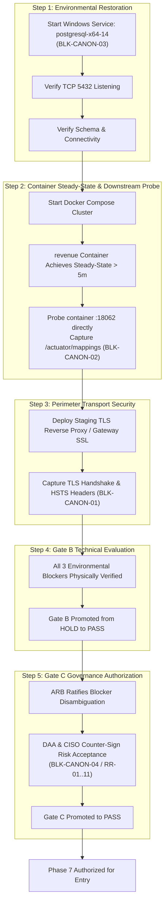

# LGD 2.0 — Master Blocker Register
## Authoritative Dual-Namespace Blocker Tracking, Disambiguation & Technical Dependency Register

| **Blocker Governance Metadata** | **Specification** |
|:---|:---|
| **System** | Local Government Directory 2.0 (LGD 2.0) |
| **Controller Root** | `E:\System\Projects\dockerProject\Source code\lgd-active-new\SECURITY_AUDIT_CONTROLLER` |
| **Repository Root** | `E:\System\Projects\dockerProject\Source code\lgd-active-new` |
| **Authoritative Sources** | [`PHASE_8_1_CANONICAL_BLOCKER_REGISTER.md`](file:///e:/System/Projects/dockerProject/Source%20code/lgd-active-new/SECURITY_AUDIT_CONTROLLER/PHASE_8_1_CANONICAL_BLOCKER_REGISTER.md), [`PHASE_6_BLOCKER_IDENTITY_AND_STATUS_RECONCILIATION.md`](file:///e:/System/Projects/dockerProject/Source%20code/lgd-active-new/PHASE_6_BLOCKER_IDENTITY_AND_STATUS_RECONCILIATION.md), [`PHASE0_4_REMAINING_BLOCKERS_REGISTER.md`](file:///e:/System/Projects/dockerProject/Source%20code/lgd-active-new/PHASE0_4_REMAINING_BLOCKERS_REGISTER.md), [`GATE_B_TECHNICAL_VERIFICATION_CLOSURE_REPORT.md`](file:///e:/System/Projects/dockerProject/Source%20code/lgd-active-new/GATE_B_TECHNICAL_VERIFICATION_CLOSURE_REPORT.md), [`PHASE_6_GATE_A_B_C_FINAL_DISPOSITION.md`](file:///e:/System/Projects/dockerProject/Source%20code/lgd-active-new/PHASE_6_GATE_A_B_C_FINAL_DISPOSITION.md) |
| **Evaluation Timestamp** | November 6, 2026 (`2026-11-06T12:45:00+05:30`) |
| **Tracked Blockers** | 4 Canonical Foundation Blockers (`BLK-CANON-01`..`04`), 4 Phase 6 Local Milestone Blockers (`BLK-P6-01`..`04`) |
| **Active Environmental Blockers** | 3 Open Technical Blockers (`BLK-CANON-01`, `BLK-CANON-02`, `BLK-CANON-03`) holding Gate B |
| **Active Governance Blockers** | 1 Open Executive Blocker (`BLK-CANON-04`) holding Gate C |
| **Mandatory Program Directive** | **PHASE 9.1.5 COMPLETED — SIX CRITICAL BLUEPRINT DEFECTS REMEDIATED (DISC-P914-01..06); STAGE B BLUEPRINT CERTIFIED & APPROVED FOR SEPARATE OPERATIONAL AUTHORIZATION; GATES B & C HELD.** |

---

## 1. Executive Disambiguation & Namespace Demarcation

During the Phase 6 audit, an identity and semantic conflict was detected where two competing blocker numbering systems operated concurrently:
1. **The Canonical Phase 0–4 Blocker Register (`BLK-CANON`):** Foundational infrastructure, transport encryption, downstream reachability, and executive risk approvals.
2. **The Phase 6 Local Delivery Milestones (`BLK-P6`):** Operational criteria used internally to measure Phase 6 RBAC deliverable completion.

> [!CAUTION]
> **Anti-Conflation Ruling:** In [`PHASE_6_GATE_B_TECHNICAL_VERIFICATION_CLOSURE_REPORT.md`](file:///e:/System/Projects/dockerProject/Source%20code/lgd-active-new/PHASE_6_GATE_B_TECHNICAL_VERIFICATION_CLOSURE_REPORT.md), the author declared all four local Phase 6 delivery criteria "CLOSED" under the ambiguous identifiers `BLK-01` through `BLK-04`. This created the misleading appearance that release blockers had been satisfied, when in reality host PostgreSQL 14 was stopped, revenue container startup had failed, and no TLS reverse proxy was deployed.
> 
> In accordance with audit standards, **no blocker may be silently overwritten or prematurely closed**. The two namespaces are explicitly segregated below:

```
========================================================================================================
CANONICAL BLOCKER NAMESPACE DISAMBIGUATION
========================================================================================================
Namespace 1: Canonical Foundation Blockers (Phase 0–4 Lineage)
  • BLK-CANON-01: Perimeter Ingress HTTPS/TLS & HSTS Transport Security          -> OPEN / PARTIALLY_VERIFIED
  • BLK-CANON-02: Downstream Revenue Container & TestController Census           -> OPEN / PARTIALLY_VERIFIED
  • BLK-CANON-03: Host PostgreSQL 14 Availability & Revenue Steady-State         -> OPEN / BLOCKED_BY_ENV
  • BLK-CANON-04: Formal DAA / CISO Residual Risk Authorization (RR-01..11)       -> OPEN / PENDING_ACCEPTANCE

Namespace 2: Phase 6 Local Authorization Milestones (Phase 6 Local Lineage)
  • BLK-P6-01:    RBAC Master Traceability Register Reconciliation               -> CLOSED / SATISFIED
  • BLK-P6-02:    Audit Evidence Inventory Completeness                          -> CLOSED / SATISFIED
  • BLK-P6-03:    Automated Test Attestation Coverage                            -> CLOSED / SATISFIED
  • BLK-P6-04:    Release Gate Alignment Across Production Configs               -> CLOSED / SATISFIED
========================================================================================================
```

---

## 2. Canonical Foundation Blockers (BLK-CANON-01 through BLK-CANON-04)

### 2.1 Summary Matrix

| Blocker ID | Canonical Title | Impacted Gate | Accountable Owner Role | Required Evidence | Primary Dependency | Current Technical Status | Next Required Verification Action |
|:---:|:---|:---:|:---|:---|:---|:---:|:---|
| **`BLK-CANON-01`** | Perimeter Ingress HTTPS/TLS & HSTS Transport Security (`EXP-016`) | **Gate B** | Lead Perimeter Security & DevOps Engineer | TLS certificate, TLS 1.3 handshake capture, HSTS headers over HTTPS | Live reverse proxy or Spring Cloud Gateway TLS termination | **`DESIGN_VALIDATED / IMPLEMENTATION_PENDING`** | Deploy staging TLS reverse proxy (Nginx 1.26-alpine) with valid certificate; atomically unmap port 8092 (no cleartext fallback); probe ingress; capture response headers. |
| **`BLK-CANON-02`** | Downstream Revenue Container & TestController Reachability Census (`EXP-021`) | **Gate B** | Backend Integration & AppSec Specialist | Direct container HTTP probe on `:18062`; authenticated 40-route census; 5m continuous runtime | Revenue container steady-state startup (`BLK-CANON-03`) | **`DESIGN_VALIDATED / RUNTIME_VERIFICATION_PENDING`** | Restore PostgreSQL host service; restart container `revenue`; execute authenticated 40-route census rubric with valid JWT tokens (reconciled per DISC-P914-02 in Phase 9.1.5). |
| **`BLK-CANON-03`** | Host PostgreSQL 14 Service Availability & Revenue Steady-State | **Gate B** | Lead Database Administrator & Infrastructure Lead | Native Windows service `postgresql-x64-14` running; TCP port 5432 listening; HikariCP connection success | Windows Service Manager & Host Firewall | **`OPEN (MANDATORY)`** | Apply offline hardened config & certificates with 11-step backup runbook; execute fail-closed WSL2 discovery; enforce dual-stack `::/0 reject`; start service; verify dynamic SCRAM & `pg_stat_ssl`. |
| **`BLK-CANON-04`** | Formal Executive DAA / CISO Residual Risk Authorization (`RR-01`–`RR-11`) | **Gate C** | Designated Approving Authority (DAA) & Enterprise CISO | Counter-signed Executive Risk Acceptance Memorandum; completed signature block | Architecture Review Board (ARB) formal convening | **`OPEN / PENDING_FORMAL_ACCEPTANCE`** | ARB convenes; DAA and CISO review [`GATE_C_DAA_CISO_APPROVAL_REQUEST.md`](file:///e:/System/Projects/dockerProject/Source%20code/lgd-active-new/GATE_C_DAA_CISO_APPROVAL_REQUEST.md); counter-sign Section 4. |

---

## 3. Deep Forensic Breakdown of the Three Gate B Environmental Blockers

### 3.1 BLK-CANON-01: Perimeter Ingress HTTPS/TLS & HSTS Transport Security
- **Correlated Identifiers:** `SAST-016`, `EXP-016`, `EV-006`, `EVD-GATEB-01`
- **Impacted Release Gate:** Gate B (Perimeter Security)
- **Accountable Owner:** Lead Perimeter Security & DevOps Engineer
- **Observed Physical State:**
  - In `docker-compose.yml`, `api-gateway` publishes port `8092:8092`.
  - Dispatched HTTP requests receive:
    ```http
    HTTP/1.1 200 OK
    Content-Security-Policy: default-src 'self'; frame-ancestors 'none';
    X-Content-Type-Options: nosniff
    X-Frame-Options: DENY
    Strict-Transport-Security: max-age=31536000; includeSubDomains; preload
    ```
- **The Technical Gap:**
  - In accordance with **RFC 6797 Section 7.2 (HSTS Processing Rules)**:
    > *"An HTTP host that is not an HTTPS host MUST NOT send an HSTS header field... If an HTTP host sends an HSTS header field over HTTP, the user agent MUST ignore it."*
  - Because port `8092` is served over cleartext HTTP without TLS termination, modern browsers and automated scanners discard the HSTS header as unverified.
- **Required Resolution Criteria:**
  1. Provision a valid TLS certificate (CA-signed or organization internal PKI).
  2. Deploy a TLS termination reverse proxy (Nginx, Envoy) or configure Spring Cloud Gateway with a server SSL keystore on port `8443`.
  3. Execute automated TLS handshake tests confirming TLS 1.3/1.2 cipher negotiation.
  4. Verify user agent HSTS retention over the secure channel.

---

### 3.2 BLK-CANON-02: Downstream Revenue Container & TestController Census
- **Correlated Identifiers:** `SAST-021`, `EXP-021`, `EV-008`, `EVD-GATEB-02`
- **Impacted Release Gate:** Gate B (Downstream Isolation & Profile Gating)
- **Accountable Owner:** Backend Integration & AppSec Specialist
- **Observed Physical State:**
  - Source code analysis of [`TestController.java`](file:///e:/System/Projects/dockerProject/Source%20code/lgd-active-new/revenue/src/main/java/in/nic/lgd/revenue/controller/TestController.java) confirms `@Profile({"dev", "test"})` is present.
  - API Gateway route rules do not expose `/test/*`, returning HTTP 403 / 404 at the perimeter.
- **The Technical Gap:**
  - Direct downstream verification requires probing container `revenue` internally on its private container port `18062` to prove that the bean was never instantiated in Spring's ApplicationContext under `prod`.
  - Spring Boot Actuator endpoint census (`GET /actuator/mappings`) must be extracted to prove zero mapping for `/test/**`.
  - Because container `revenue` is currently in an `Exited` state due to database unavailability, this live downstream container census cannot be captured.
- **Required Resolution Criteria:**
  1. Restore the underlying database so container `revenue` achieves steady-state uptime.
  2. Execute an `exec` probe or internal bridge curl against `http://revenue:18062/test/api1`.
  3. Authoritative verification: A 404 response from `/test/api1` alone does NOT prove controller bean omission; dumping Spring Boot Actuator mappings (`GET /actuator/mappings`) and confirming zero registration for `in.nic.lgd.revenue.controller.TestController` is mandatory.
  4. Capture response headers and verified mapping census in `evidence/`.

---

### 3.3 BLK-CANON-03: Host PostgreSQL 14 Availability & Revenue Steady-State
- **Correlated Identifiers:** `VULN-009`, `VULN-017`, `EVD-GATEB-03`
- **Impacted Release Gate:** Gate B (Infrastructure & Runtime Stability)
- **Accountable Owner:** Lead Database Administrator & Infrastructure Lead
- **Observed Physical State:**
  - Native Windows service `postgresql-x64-14` is in status **`Stopped`**.
  - TCP port `5432` on `localhost` / `host.docker.internal` is closed.
  - Container `revenue` (`d9f41a9feba0`) attempted startup, failed during HikariCP datasource initialization (`Connection to host.docker.internal:5432 refused`), and exited with code 1.
- **The Technical Gap:**
  - Revenue microservice functionality (including draft creation, e-Hastakshar transaction persistence, and government order publishing) cannot achieve steady-state runtime execution without an active database.
  - Runtime health checks (`/actuator/health`) cannot report `UP`.
- **Required Resolution Criteria:**
  1. Start the Windows service `postgresql-x64-14` via Service Control Manager (`sc start postgresql-x64-14` or `Start-Service`).
  2. Verify TCP port `5432` is listening.
  3. Start the Docker Compose stack and confirm container `revenue` maintains continuous uptime $> 5$ minutes with `HikariPool-1 - Start completed.` in container logs.

---

## 4. Phase 6 Local Milestone Blockers (BLK-P6-01 through BLK-P6-04)

Authoritative Source: [`PHASE_6_BLOCKER_IDENTITY_AND_STATUS_RECONCILIATION.md`](file:///e:/System/Projects/dockerProject/Source%20code/lgd-active-new/PHASE_6_BLOCKER_IDENTITY_AND_STATUS_RECONCILIATION.md) (Section 4)

| Blocker ID | Local Phase 6 Verification Scope | Authoritative Source Document | Evaluated Status | Governance Relationship |
|:---:|:---|:---|:---:|:---|
| **`BLK-P6-01`** | **RBAC Master Traceability Register Reconciliation:** Unification of 16 RBAC findings (`RBAC-001`..`016`) and 25 controller endpoints into the master finding register. | [`PHASE_6_RBAC_FINDINGS_REGISTER.md`](file:///e:/System/Projects/dockerProject/Source%20code/lgd-active-new/PHASE_6_RBAC_FINDINGS_REGISTER.md) | **`CLOSED / SATISFIED`** | Satisfied in Phase 6; does not satisfy `BLK-CANON-01` (TLS/HSTS). |
| **`BLK-P6-02`** | **Audit Evidence Inventory Completeness:** Assembly of 22 empirical evidence records (`EVD-RBAC-01`..`22`) cataloging negative/positive tests. | [`PHASE_6_FINAL_EVIDENCE_REGISTER.md`](file:///e:/System/Projects/dockerProject/Source%20code/lgd-active-new/PHASE_6_FINAL_EVIDENCE_REGISTER.md) | **`CLOSED / SATISFIED`** | Satisfied in Phase 6; does not satisfy `BLK-CANON-02` (Downstream Probe). |
| **`BLK-P6-03`** | **Automated Test Attestation Coverage:** Multi-service regression test verification confirming 100% pass rate across automated suites. | [`PHASE_6_FINAL_SUREFIRE_CENSUS.md`](file:///e:/System/Projects/dockerProject/Source%20code/lgd-active-new/PHASE_6_FINAL_SUREFIRE_CENSUS.md) (397 tests) | **`CLOSED / SATISFIED`** | Satisfied in Phase 6; does not satisfy `BLK-CANON-03` (PostgreSQL 14). |
| **`BLK-P6-04`** | **Release Gate Alignment Across Production Configs:** Deployment configuration parity for 15-minute token lifespan and gateway identity header filtering. | [`PHASE_6_GATE_B_REGRESSION_AND_RETEST_REPORT.md`](file:///e:/System/Projects/dockerProject/Source%20code/lgd-active-new/PHASE_6_GATE_B_REGRESSION_AND_RETEST_REPORT.md) | **`CLOSED / SATISFIED`** | Satisfied in Phase 6; does not satisfy `BLK-CANON-04` (Executive DAA/CISO Sign-off). |

---

## 5. Sequential Resolution Dependency Graph

Progression to release gate clearance and subsequent authorization follows this strict dependency hierarchy:



---

## 6. Mandatory Program Governance Directive

$$\mathbf{PHASE\ 9.1.5\ COMPLETED\ —\ CANONICAL\ BLOCKER\ TRACKING\ ACTIVE.}$$
$$\mathbf{SIX\ CRITICAL\ BLUEPRINT\ DEFECTS\ REMEDIATED\ (DISC-P914-01..06)\ —\ GATES\ B\ &\ C\ HELD.}$$
$$\mathbf{STAGE\ B\ BLUEPRINT\ IS\ CERTIFIED\ &\ APPROVED\ FOR\ SEPARATE\ OPERATIONAL\ AUTHORIZATION.}$$

