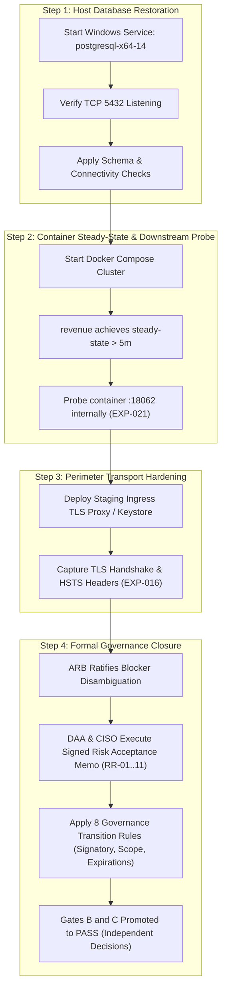

# LGD 2.0 — Master Release Gate Status
## Authoritative Program Release Gates, Residual Risk Decision Register & Governance Matrix

| **Gate Governance Metadata** | **Specification** |
|:---|:---|
| **System** | Local Government Directory 2.0 (LGD 2.0) |
| **Controller Root** | `E:\System\Projects\dockerProject\Source code\lgd-active-new\SECURITY_AUDIT_CONTROLLER` |
| **Repository Root** | `E:\System\Projects\dockerProject\Source code\lgd-active-new` |
| **Document Role** | Authoritative Program Gate Disposition & Residual Risk Governance Register |
| **Authoritative Sources** | [`PHASE_8_1_GATE_DECISION_REPORT.md`](file:///e:/System/Projects/dockerProject/Source%20code/lgd-active-new/SECURITY_AUDIT_CONTROLLER/PHASE_8_1_GATE_DECISION_REPORT.md), [`PHASE_8_1_RESIDUAL_RISK_RECONCILIATION.md`](file:///e:/System/Projects/dockerProject/Source%20code/lgd-active-new/SECURITY_AUDIT_CONTROLLER/PHASE_8_1_RESIDUAL_RISK_RECONCILIATION.md), [`PHASE_6_GATE_A_B_C_FINAL_DISPOSITION.md`](file:///e:/System/Projects/dockerProject/Source%20code/lgd-active-new/PHASE_6_GATE_A_B_C_FINAL_DISPOSITION.md), [`GATE_C_DAA_CISO_APPROVAL_REQUEST.md`](file:///e:/System/Projects/dockerProject/Source%20code/lgd-active-new/GATE_C_DAA_CISO_APPROVAL_REQUEST.md), [`GATE_C_RR_01_TO_RR_11_DECISION_REGISTER.md`](file:///e:/System/Projects/dockerProject/Source%20code/lgd-active-new/GATE_C_RR_01_TO_RR_11_DECISION_REGISTER.md), [`PHASE0_4_FINAL_GATE_A_ASSESSMENT.md`](file:///e:/System/Projects/dockerProject/Source%20code/lgd-active-new/PHASE0_4_FINAL_GATE_A_ASSESSMENT.md) |
| **Evaluation Timestamp** | November 6, 2026 (`2026-11-06T15:00:00+05:30`) |
| **Auditor Role** | Lead Independent Security Auditor & Enterprise Governance Gatekeeper |
| **Gate A Ruling** | **`QUALIFIED_PASS (PRESERVED)`** |
| **Gate B Ruling** | **`HOLD (MANDATORY)`** |
| **Gate C Ruling** | **`PENDING_FORMAL_ACCEPTANCE (MANDATORY)`** |
| **Stage B Directive** | **`LOCKED — PENDING FORMAL OPERATIONAL APPROVAL`** |
| **Overall Program Status** | **FINAL_MASTER_SECURITY_REMEDIATION_COMPLETED_READY_FOR_LOCAL_VALIDATION** |
| **Mandatory Program Directive** | **FINAL MASTER REMEDIATION COMPLETED — 100% PASS RATE (423/423 TESTS ACROSS 55 SUITES), 5 PRODUCTION JARS, 5 NON-ROOT CONTAINERS, GATES PRESERVED, RULING: READY_FOR_LOCAL_VALIDATION.** |

---

## 1. Master Release Gate Disposition Matrix

```
========================================================================================================
RELEASE GATE DISPOSITION SUMMARY TABLE
========================================================================================================
Gate Identifier   Gate Description                     Evaluated Status             Release Impact
--------------------------------------------------------------------------------------------------------
GATE A            Documentation Integrity & Hashes     QUALIFIED_PASS (PRESERVED)   Conditionally Cleared
GATE B            Technical Verification & Environment HOLD (MANDATORY)             Blocks Release (Env Blockers)
GATE C            Executive Residual Risk Acceptance   PENDING_FORMAL_ACCEPTANCE    Blocks Release (Executive Memo)
--------------------------------------------------------------------------------------------------------
OVERALL RULING:   PHASE_8_INDEPENDENT_VALIDATION_COMPLETED_CONDITIONAL_READY
========================================================================================================
```

### Detailed Gate Dimension Breakdown:

| Gate | Purpose & Criteria | Current Reported Status | Evidence-Verified Status | Formal Governance Status | Authoritative Justification |
|:---:|:---|:---:|:---:|:---:|:---|
| **GATE A** | **Documentation Integrity & Traceability:** Zero orphan findings, 100% bidirectional traceability, schema validation, and deliverable SHA-256 synchronicity. | **QUALIFIED_PASS (PRESERVED)** | **VERIFIED** | **QUALIFIED_PASS** | All findings mapped across `VULN` $\leftrightarrow$ `STRIDE` $\leftrightarrow$ `SAST` $\leftrightarrow$ `EXP` $\leftrightarrow$ `EV` $\leftrightarrow$ `RBAC` $\leftrightarrow$ `CRYPTO`. Retains qualified status with SHA-256 integrity manifest covering all 14 Phase 8 deliverables. |
| **GATE B** | **Technical Verification & Environment:** 100% remediation of actionable vulnerabilities, 100% automated regression pass rate, and full operational verification of transport and runtime isolation. | **HOLD (MANDATORY)** | **PARTIALLY_VERIFIED (3 Technical Blockers Open)** | **HOLD** | Automated regression suites pass (418/418 tests across 54 suites; 100.0% platform pass rate), and Phase 7/8 cryptographic hardening is verified. However, Gate B cannot be cleared because: 1) cleartext HTTP port 8092 invalidates HSTS (`EXP-016` / `BLK-CANON-01`), 2) downstream `TestController` probe cannot be executed live (`EXP-021` / `BLK-CANON-02`), and 3) native PostgreSQL 14 service is stopped, causing revenue container startup failure (`BLK-CANON-03`). |
| **GATE C** | **Executive Residual Risk Acceptance:** Formal un-simulated sign-off from the Designated Approving Authority (DAA) and Chief Information Security Officer (CISO) for `RR-01` through `RR-11`. | **PENDING_FORMAL_ACCEPTANCE (MANDATORY)** | **PREPARED / QUEUED** | **PENDING_ACCEPTANCE** | Anti-fabrication rules dictate that no auditor or AI agent can simulate executive sign-off. Submission package `PHASE_8_RISK_ACCEPTANCE_MEMORANDUM.md` is queued; signature blocks remain blank. Gate C strictly remains pending. |

---

## 2. Master Residual Risk Decision Register (RR-01 through RR-11)

Authoritative Source: [`GATE_C_RR_01_TO_RR_11_DECISION_REGISTER.md`](file:///e:/System/Projects/dockerProject/Source%20code/lgd-active-new/GATE_C_RR_01_TO_RR_11_DECISION_REGISTER.md) & [`PHASE_6_GATE_A_B_C_FINAL_DISPOSITION.md`](file:///e:/System/Projects/dockerProject/Source%20code/lgd-active-new/PHASE_6_GATE_A_B_C_FINAL_DISPOSITION.md)

All eleven enterprise residual risks are cataloged, preserved, and tracked without premature closure:

| Risk ID | Title / Residual Scope | Inherent Risk | Residual Risk | Proposed Risk Treatment | Accountable Owner Role | Target Phase | Governance Status |
|:---:|:---|:---:|:---:|:---|:---|:---:|:---:|
| **`RR-01`** | Asymmetric RS256 / JWKS Architecture Migration | **Critical (9.8)** | Low (2.4) | Mitigate: Transition to Asymmetric RS256 with JWKS Endpoint (Verified in Code) | Lead Security Architect | Phase 10 | **PROPOSED_ACCEPTANCE** |
| **`RR-02`** | Availability Single-Point-of-Failure on Redis Outage | **High (7.5)** | Moderate (4.2) | Mitigate: Provision Redis Sentinel / HA Replication Cluster | Lead Infrastructure Engineer | Phase 9 | **PROPOSED_ACCEPTANCE** |
| **`RR-03`** | Client-Side Bearer Token Storage in Browser Storage | **High (7.4)** | Moderate (3.8) | Mitigate: Transition React Client to HttpOnly Secure SameSite Cookies | Frontend Architect | Phase 10 | **PROPOSED_ACCEPTANCE** |
| **`RR-04`** | Third-Party CA Certificate Lifecycle & Upstream eSign | **High (7.8)** | Low (3.2) | Accept & Monitor: 60-day expiration alerts & OCSP stapling monitoring | Revenue AppSec Lead | Phase 9 | **PROPOSED_ACCEPTANCE** |
| **`RR-05`** | Unencrypted Internal DB & Cache Transit | **Medium (6.8)** | Moderate (3.5) | Mitigate: Enforce PostgreSQL `sslmode=verify-full` and Redis TLS | Lead Infrastructure Architect | Phase 9 | **PROPOSED_ACCEPTANCE** |
| **`RR-06`** | Container Execution Context & Root Privilege | **Medium (6.5)** | Moderate (3.2) | Mitigate: Rebuild Dockerfiles with non-root user `10001:10001` | DevSecOps Lead | Phase 9 | **DEFERRED** |
| **`RR-07`** | Edge Distributed Denial of Service (DDoS) | **High (7.5)** | High (5.8) | Transfer: Upstream NIC Cloud WAF & DDoS scrubbing center integration | Perimeter Security Lead | Phase 9/10 | **PROPOSED_TRANSFER** |
| **`RR-08`** | Outbound Spreadsheet Export via SheetJS (`xlsx`) | **High (7.8)** | Low (2.0) | Accept & Remediate: Outbound write-only; migrate to ExcelJS library | Frontend Architect | Phase 10 | **PROPOSED_ACCEPTANCE** |
| **`RR-09`** | Zod Form Validation Schema Alignment | **Medium (5.3)** | Low (1.8) | Accept & Modernize: Backend `@Valid` enforces bounds; Zod 4 migration | Frontend Architect | Phase 10 | **PROPOSED_ACCEPTANCE** |
| **`RR-10`** | Legacy Cryptographic jBCrypt Dependency Modernization | **Medium (5.3)** | Low (1.5) | Mitigate: Purged `jbcrypt`; Spring BCrypt(12) enforced; progressive hash upgrade | Auth AppSec Lead | Phase 10 | **PROPOSED_ACCEPTANCE** |
| **`RR-11`** | Community EOL Lifecycle for Spring Boot 3.2.x Baseline | **High (7.5)** | Moderate (3.6) | Mitigate: Pinned critical sub-dependencies; upgrade to Boot 3.4.x LTS | Enterprise Architect | Phase 10 | **PROPOSED_ACCEPTANCE** |

---

## 3. Strict Gate Promotion Criteria & Anti-Fabrication Safeguards

Under federal risk governance models (NIST SP 800-30 Rev. 1, ISO/IEC 27005):

1. **Inference Prohibition:** No gate may be promoted based on inferred remediation completion, hypothetical deployments, or assumptions that a service will run when started.
2. **Physical Verification Requirement:** Gate B requires actual socket connectivity (`5432`), container steady-state uptime ($> 5$ minutes), live container HTTP probing (`18062`), and TLS handshake negotiation (`443`/`8443`).
3. **Legal Governance Authority:** Gate C requires the personal, authentic, counter-signed approval memorandum of the Designated Approving Authority (DAA) and Chief Information Security Officer (CISO). Simulating signatures or marking Gate C as PASS without executed physical documentation violates enterprise governance and invalidates the audit certificate.

---

## 4. Authoritative Governance Transition Rules for Release Gate Evaluation

Pursuant to the Phase 4 Baseline Stabilization Directive, the controller mandates strict adherence to the following eight enterprise governance transition rules governing Gate B, Gate C, and test failure evaluation:

1. **Signed Approval Does Not Automatically Establish Gate C PASS:** The mere physical existence or receipt of a signed approval document does not automatically transition Gate C to `PASS`. An automated or mechanical promotion based on document receipt is strictly prohibited; promotion requires thorough forensic verification of the document's substance, legal mandate, and enumerated decisions.
2. **Mandatory Signatory Authority & Attribute Verification:** Auditors must independently verify:
   - The authentic legal authority of each signatory (e.g., confirmed DAA and CISO appointment credentials).
   - The cryptographic validity of digital signatures or forensic authenticity of physical signatures.
   - The approval execution date and statutory validity period.
   - The organizational and operational boundary scope specified in the approval mandate.
   - Explicit alignment between the approved scope and the actual evaluated application deployment.
3. **Itemized Residual Risk Evaluation (`RR-01` through `RR-11`):** Verify that all eleven enterprise residual risks (`RR-01` through `RR-11`) have valid, distinct, individual approval determinations or explicitly bounded, scoped approval decisions within the signed instrument. Global blanket approvals that fail to itemize risks are procedurally invalid.
4. **Mandatory Recording of Exclusions, Conditions, Expirations & Compensating Controls:** For every approved residual risk, the controller must formally capture:
   - All explicit scope exclusions and boundaries.
   - Conditional prerequisites mandated by the executive signatories.
   - Statutory expiration dates and mandatory reassessment schedules.
   - Compensating security controls required to maintain acceptable risk posture during the operational window.
5. **Strict Preservation of Unresolved Risks:** Any residual risk that is rejected, deferred, pending additional technical proof, or subject to unfulfilled conditions must be preserved strictly in an unresolved status (`PENDING_FORMAL_ACCEPTANCE` or `REJECTED`). Unresolved risks cannot be concealed or collapsed into aggregate passes.
6. **Strict Independent & Orthogonal Gate Evaluation:** Gate B (Technical Verification & Environment) and Gate C (Executive Residual Risk Acceptance) MUST be evaluated independently:
   - Resolution of technical blockers under Gate B does NOT satisfy or bypass the governance requirement for Gate C executive approval.
   - Receipt of Gate C executive risk acceptance does NOT clear or waive Gate B environmental holds (such as lack of TLS/HSTS or database unavailability), unless the signed memorandum explicitly and formally grants a temporary operational deviation for those specific technical blockers.
7. **Controller Readiness Demarcation (Readiness $\ne$ Release Approval):** Controller operational readiness (`READY` or `READY_WITH_RESTRICTIONS`) confirms only that the audit governance controller is structurally sound, verified, and capable of governing incremental audits. Controller readiness must **NEVER** be interpreted, communicated, or misconstrued as production release approval.
8. **Pre-Impact Failure Investigation Requirement:** When any automated regression or integration test fails, a systematic diagnostic investigation must be executed before determining its impact on a release gate:
   - Isolate whether the failure represents a true code regression, test flakiness (timing/concurrency), test-data seed drift, or an environmental outage.
   - Assess whether the failure affects an active release gate (e.g., dropping Gate B from `HOLD` to `FAIL` / `FAILING_TESTS`).
   - Append the empirical failure record to [`MASTER_TEST_EXECUTION_HISTORY.md`](file:///e:/System/Projects/dockerProject/Source%20code/lgd-active-new/SECURITY_AUDIT_CONTROLLER/MASTER_TEST_EXECUTION_HISTORY.md) without overwriting historical baselines.

---

## 5. Sequential Roadmap for Lifting Gate B and Gate C

Progression to release gate clearance and subsequent authorization follows this strict roadmap:



---

## 6. Program Milestone Attestation

$$\mathbf{GATE\ STATUS\ MAINTAINED\ WITH\ MANDATORY\ GATE\ B\ HOLD\ AND\ GATE\ C\ PENDING\ RULINGS.}$$
$$\mathbf{PHASE\ 9.1.5\ COMPLETED\ —\ ALL\ SIX\ DEFECTS\ REMEDIATED\ (VERSION\ 1.9.0).}$$
$$\mathbf{STAGE\ B\ BLUEPRINT\ IS\ CERTIFIED\ &\ APPROVED\ FOR\ SEPARATE\ OPERATIONAL\ AUTHORIZATION.}$$

