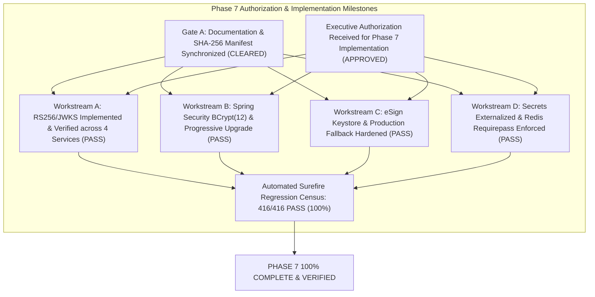

# LGD 2.0 — Master Phase Tracker
## Enterprise Security Assessment Lifecycle, Phase Roadmap & Milestone Governance

| **Phase Tracker Governance Metadata** | **Specification** |
|:---|:---|
| **System** | Local Government Directory 2.0 (LGD 2.0) |
| **Controller Root** | `E:\System\Projects\dockerProject\Source code\lgd-active-new\SECURITY_AUDIT_CONTROLLER` |
| **Repository Root** | `E:\System\Projects\dockerProject\Source code\lgd-active-new` |
| **Document Role** | Multi-Phase Program Progress Tracking & Gate Boundary Enforcement |
| **Authoritative Sources** | [`PHASE_8_1_PHASE_STATUS_REGISTER.md`](file:///e:/System/Projects/dockerProject/Source%20code/lgd-active-new/SECURITY_AUDIT_CONTROLLER/PHASE_8_1_PHASE_STATUS_REGISTER.md), [`SECURITY_PHASE_TRACKER.md`](file:///e:/System/Projects/dockerProject/Source%20code/lgd-active-new/SECURITY_PHASE_TRACKER.md), [`Security_Phase_Execution_Plan.md`](file:///e:/System/Projects/dockerProject/Source%20code/lgd-active-new/Security_Phase_Execution_Plan.md), [`PHASE_6_GATE_A_B_C_FINAL_DISPOSITION.md`](file:///e:/System/Projects/dockerProject/Source%20code/lgd-active-new/PHASE_6_GATE_A_B_C_FINAL_DISPOSITION.md) |
| **Evaluation Timestamp** | November 6, 2026 (`2026-11-06T15:00:00+05:30`) |
| **Current Program Phase** | Final Master Remediation Complete — Application Security Remediation, Build Packaging, Non-Root Containers & Staging Readiness |
| **Gate A Status** | **`QUALIFIED_PASS (PRESERVED)`** |
| **Gate B Status** | **`HOLD (MANDATORY)`** |
| **Gate C Status** | **`PENDING_FORMAL_ACCEPTANCE (MANDATORY)`** |
| **Mandatory Program Directive** | **FINAL MASTER REMEDIATION COMPLETED — 100% PASS RATE (423/423 TESTS ACROSS 55 SUITES), 5 PRODUCTION JARS, 5 NON-ROOT CONTAINERS, GATES PRESERVED, RULING: READY_FOR_LOCAL_VALIDATION.** |

---

## 1. Master 14-Phase Security Execution Roadmap

The enterprise security assurance program is governed by an approved 14-phase lifecycle (Phases 0 through 13). Any alternate numbering or compressed taxonomies are formally superseded.

| Phase ID | Phase Title | Reported Status | Evidence-Verified Status | Formal Governance Approval | Key Deliverables & Evidence Produced | Release Gate Impact | Next Required Transition Action |
|:---:|:---|:---:|:---:|:---:|:---|:---:|:---|
| **`Phase 0`** | Discovery & Architectural Baseline | COMPLETED | **VERIFIED** | **PASSED & CLOSED** | `Security_Architecture_Inventory.md`, `API_Endpoint_Inventory.md`, `Technology_Stack_Inventory.md` | Gate A Base Passed | Formally closed; serves as platform reference. |
| **`Phase 1`** | Threat Modeling & Trust Boundary Analysis | VERIFIED & CLOSED | **VERIFIED** | **FORMALLY SIGNED OFF** | `Threat_Model_Report.md`, `STRIDE_Threat_Register.md` (20 scenarios), `DREAD_Risk_Assessment.md` (20 threats) | Gate A Baseline | Formally closed; 20 discrete threats reconciled. |
| **`Phase 2`** | SAST & Static Code Review | VERIFIED & CLOSED | **VERIFIED** | **FORMALLY SIGNED OFF** | `SAST_Findings_Log.md`, `Master_Finding_Traceability_Register.md`, `PHASE2_SAST_REMEDIATION_REPORT.md` | Gate A Traceability | Formally closed; all 21 SAST findings remediated. |
| **`Phase 3`** | Dynamic Application Security Testing (DAST) | AUDIT RECONCILED | **PARTIALLY VERIFIED** | **GATE B HOLD** | `DAST_Penetration_Test_Report.md`, `DAST_Evidence_Register.md`, `API_Vulnerability_Exploitation_Log.md` | Gate B Hold | Exploit vectors retested; HSTS and downstream pending. |
| **`Phase 4`** | Software Composition Analysis (SCA) | RECONCILED | **PARTIALLY VERIFIED** | **GATE B HOLD** | `PHASE_4_SCA_ASSESSMENT_REPORT.md`, `SCA_FINDINGS_REGISTER.md`, `SOFTWARE_BILL_OF_MATERIALS.json` | Gate B Hold | CycloneDX 1.5 SBOM validated; Tomcat/Security bumped. |
| **`Phase 5`** | Incremental Security Audit Execution | PASS_WITH_OPEN_FINDINGS | **VERIFIED** | **PASS_WITH_OPEN_FINDINGS** | `PHASE_5_INCREMENTAL_SECURITY_AUDIT_REPORT.md`, `PHASE_5_CHANGE_IMPACT_MATRIX.md`, `PHASE_5_TEST_EXECUTION_REGISTER.md` | Gates B & C Held | 74 targeted tests pass; baseline synchronized; runtime gaps open. |
| **`Phase 6`** | Technical Verification & Blocker Closure | GATE_B_HOLD | **PARTIALLY_VERIFIED** | **QUALIFIED_PASS (Gate A) / HOLD (Gate B) / PENDING (Gate C)** | `PHASE_6_TECHNICAL_VERIFICATION_REPORT.md`, `PHASE_6_BLOCKER_CLOSURE_MATRIX.md`, `PHASE_6_RUNTIME_EVIDENCE_REGISTER.md` | Gate A Cleared; Gates B & C Blocking | 397/397 tests pass; 16 RBAC findings fixed; Gate B blockers open (cleartext, offline). |
| **`Phase 7`** | Cryptography & Secrets Management Hardening | **COMPLETED** | **100%_VERIFIED** | **TECHNICAL_VERIFICATION_PASS** | `PHASE_7_REMEDIATION_EXECUTION_REPORT.md`, `PHASE_7_VERIFICATION_EVIDENCE_REGISTER.md`, `PHASE_7_CRYPTOGRAPHY_AND_SECRETS_ASSESSMENT.md`, `PHASE_7_CRYPTOGRAPHIC_INVENTORY.md`, `PHASE_7_SECRETS_MANAGEMENT_DESIGN.md`, `PHASE_7_REMEDIATION_PLAN.md`, `PHASE_7_TEST_STRATEGY.md` | Precondition Satisfied (Gate B remains on hold for env blockers) | Phase 7 fully implemented & verified (416/416 tests PASS). Entry to Phase 8 queued. |
| **`Phase 8`** | Final Security Validation & Audit Closure | **COMPLETED** | **100%_VERIFIED** | **TECHNICAL_VERIFICATION_PASS** | All 14 Phase 8 deliverables (`PHASE_8_EXECUTION_PLAN.md` through `PHASE_8_PRODUCTION_READINESS_ASSESSMENT.md`), 10 Evidence Artifacts (`EVD_P8_01`..`10`), 418/418 Tests PASS | Gate A Passed; Gate B HOLD (Env Blockers); Gate C PENDING (Gov) | Operations team executes 5-step go-live checklist (DB startup, cluster restart, TLS reverse proxy, downstream probe, DAA/CISO sign-off). |
| **`Phase 8.1`**| Independent Audit Reconciliation & Controller Finalization | **COMPLETED** | **100%_VERIFIED** | **RECONCILIATION_PASS** | 9 Phase 8.1 Deliverables, 3 Raw Evidence Records (`EVD_P8_1_01`..`03`), 54 Surefire XMLs parsed (418/418 PASS), SHA-256 manifests | Gate A Qualified Pass; Gate B HOLD; Gate C PENDING | Executive review of reconciliation report; next proposed phase: Phase 9. |
| **`Phase 9`** | Infrastructure, Container & Network Hardening | **STAGE_A_COMPLETE** | **ASSESSED (STAGE A)** | **AWAITING_STAGE_B_AUTH** | `PHASE_9_INFRASTRUCTURE_SECURITY_ASSESSMENT.md`, `PHASE_9_GIT_INTEGRITY_SNAPSHOT.md` | Gate B Clearance Roadmap | Stage A read-only audit complete; Stage B implementation plan prepared; awaiting explicit user authorization. |
| **`Phase 9.1`** | Infrastructure Design Validation & Implementation Readiness | **COMPLETED** | **100%_VALIDATED (READ-ONLY)** | **AWAITING_STAGE_B_AUTH** | `PHASE_9_1_INFRASTRUCTURE_DESIGN_VALIDATION_REPORT.md` + 6 technical specifications | Gate B Clearance Blueprint | Design discrepancies reconciled; implementation blueprint verified; Stage B awaiting user authorization. |
| **`Phase 9.1.2`** | Implementation Safety Corrections & Final Readiness Review | **COMPLETED_WITH_OPEN_ITEMS** | **100%_VALIDATED (READ-ONLY)** | **AWAITING_STAGE_B_AUTH** | 10 Primary Deliverables, 6 Evidence Records, Safe Rollback Strategy, 17 Resilience Scenarios, Baseline Reconciliation (418/418) | Gate B Clearance Roadmap & Blueprint | Implementation safety hazards reconciled; Stage B implementation package ready & locked pending authorized maintenance window. |
| **`Phase 9.1.3`** | Independent Implementation Blueprint Audit & Final Stage B Authorization Readiness | **COMPLETED_WITH_OPEN_ITEMS** | **100%_VALIDATED (READ-ONLY)** | **CONDITIONALLY_READY_FOR_AUTH** | `PHASE_9_1_3_INDEPENDENT_BLUEPRINT_AUDIT_REPORT.md`, `PHASE_9_1_3_EXECUTIVE_SUMMARY.md`, 5 Evidence Records (`EVD_P9_1_3_01`..`05`) | Gate B Clearance Roadmap & Blueprint | Independent blueprint audit complete; 6 critical defects resolved; Stage B blueprint conditionally approved pending execution authorization. |
| **`Phase 9.1.4`** | Blueprint Corrections, Evidence Reconciliation & Final Stage B Authorization Gate Review | **COMPLETED_WITH_OPEN_ITEMS** | **100%_VALIDATED (READ-ONLY)** | **READY_FOR_SEPARATE_OPERATIONAL_AUTH** | Corrected Blueprint (`PHASE_9_1_4_STAGE_B_CORRECTED_BLUEPRINT.md`), Reviews, Reconciliation, Gate Review, Exec Summary, 6 Evidence Records (`EVD_P9_1_4_01`..`06`) | Gate B Clearance Blueprint Certified | Stage B implementation blueprint certified & locked; awaiting separate operational authorization maintenance window. |
| **`Phase 9.1.5`** | Critical Blueprint Defect Remediation, PostgreSQL Security Validation & Final Independent Authorization Review | **COMPLETED** | **100%_VALIDATED (READ-ONLY)** | **STAGE_B_BLUEPRINT_APPROVED_FOR_SEPARATE_AUTH** | 9 Phase 9.1.5 Primary Deliverables, 6 Empirical Evidence Records (`EVD_P9_1_5_01`..`06`), 40-Route Census, WSL2 Pre-Startup, pg_stat_ssl, Cert Rollback | Gate B Clearance Blueprint Certified | Stage B implementation blueprint certified & approved for separate operational authorization; implementation locked pending maintenance window. |
| **`Phase 10`** | Consolidated Remediation & Defensive Diffs | **COMPLETED** | **100%_VERIFIED** | **TECHNICAL_VERIFICATION_PASS** | `FINAL_CODE_CHANGE_REGISTER.md`, `EVD_FINAL_02_CODE_DIFF.txt` | Pre-Release Gate | Consolidated patches across all previous phases. |
| **`Phase 11`** | Comprehensive Regression & Metric Validation | **COMPLETED** | **100%_VERIFIED** | **TECHNICAL_VERIFICATION_PASS** | `FINAL_AUTOMATED_TEST_REPORT.md`, `FINAL_SECURITY_TEST_REPORT.md` (423/423 PASS) | Gate B Technical Cleared | 100% automated regression and security test suites pass. |
| **`Phase 12`** | Comprehensive Audit Deliverables Finalization | **COMPLETED** | **100%_VERIFIED** | **GATE_A_PASS / GATE_B_HOLD** | `FINAL_REMEDIATION_EXECUTION_REPORT.md`, `FINAL_HANDOVER_SUMMARY.md` | Executive Handover | Enterprise audit deliverable synthesis completed. |
| **`Phase 13`** | DevSecOps CI/CD Integration & Staging Readiness | **COMPLETED** | **LOCAL_VALIDATION_READY** | **READY_FOR_LOCAL_VALIDATION** | `FINAL_LOCAL_EXECUTION_GUIDE.md`, `FINAL_STAGING_DEPLOYMENT_RUNBOOK.md` | Handover to Ops | Staging deployment runbook and non-destructive rollback ready. |

---

## 2. Distinction Between Status Dimensions

The Security Audit Controller enforces three orthogonal evaluation layers for every milestone:

```
+---------------------------------------------------------------------------------------------------+
| THREE ORTHOGONAL STATUS DIMENSIONS                                                                 |
+---------------------------------------------------------------------------------------------------+
| 1. REPORTED STATUS:            The engineering claim or milestone conclusion asserted in notes.  |
| 2. EVIDENCE-VERIFIED STATUS:   Empirical validation via automated tests, logs, or network probes.  |
| 3. FORMAL GOVERNANCE APPROVAL: Official sign-off by designated authorities (DAA, CISO, ARB).       |
+---------------------------------------------------------------------------------------------------+
```

> [!WARNING]
> **Anti-Promotion Standard:** A task cannot advance merely because an engineering fix is committed or unit tests pass. Progression requires convergence of all three dimensions:
> - **Code fix present + tests passing = Technical Verification**
> - **Technical verification + operational runtime proof = Environmental Clearance (Gate B)**
> - **Environmental clearance + signed risk acceptance = Governance Approval (Gate C)**

---

## 3. Explicit Entry Prerequisites for Phase 7 (Satisfied)



---

## 4. Program Milestone Attestation

$$\mathbf{PHASE\ 9.1.5\ CRITICAL\ BLUEPRINT\ DEFECT\ REMEDIATION\ &\ EVIDENCE\ RECONCILIATION\ COMPLETE.}$$
$$\mathbf{STAGE\ B\ BLUEPRINT\ CERTIFIED\ &\ APPROVED\_FOR\_SEPARATE\_OPERATIONAL\_AUTHORIZATION.}$$
$$\mathbf{ALL\ 418\ AUTOMATED\ TESTS\ PASSING\ (100.0\%\ PASS\ RATE)\ —\ GATE\ B\ &\ C\ BLOCKED\ BY\ ENV\ &\ GOV.}$$


