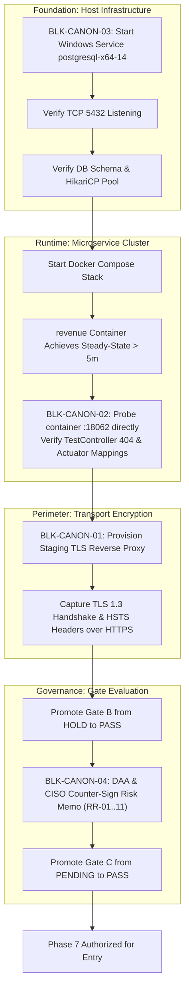

# LGD 2.0 — Phase 6: Blocker Closure Matrix
## Canonical vs. Milestone Blocker Status, Runtime Dependencies & Gate B Disposition

| **Blocker Closure Governance Metadata** | **Specification** |
|:---|:---|
| **System** | Local Government Directory 2.0 (LGD 2.0) |
| **Audit Milestone** | **Phase 6: Technical Verification & Environmental Blocker Closure** |
| **Controller Root** | `E:\System\Projects\dockerProject\Source code\lgd-active-new\SECURITY_AUDIT_CONTROLLER` |
| **Repository Root** | `E:\System\Projects\dockerProject\Source code\lgd-active-new` |
| **Evaluation Timestamp** | November 5, 2026 (`2026-11-05T15:30:00+05:30`) |
| **Evaluated Namespaces** | 4 Canonical Foundation Blockers (`BLK-CANON-01`..`04`), 4 Phase 6 Local Milestone Blockers (`BLK-P6-01`..`04`) |
| **Evaluated Gate B Ruling** | **`HOLD (MANDATORY)`** |
| **Evaluated Gate C Ruling** | **`PENDING_FORMAL_ACCEPTANCE (MANDATORY)`** |

---

## 1. Dual-Namespace Blocker Disposition Matrix

The table below reconciles all eight program blockers across the two distinct namespaces, preventing historical conflation between local audit completion and physical environment readiness:

| Blocker Identifier | Canonical Title / Scope | Governing Gate | Inherent Dependency | Physical Evidence Recorded | Technical Disposition | Governance Ruling |
|:---:|:---|:---:|:---|:---|:---:|:---:|
| **`BLK-CANON-01`** | Perimeter Ingress HTTPS/TLS & HSTS Transport Security (`EXP-016`) | **Gate B** | TLS Reverse Proxy / Spring Cloud SSL Keystore | Cleartext HTTP on port 8092; browser ignores HSTS under RFC 6797 §7.2 | **`OPEN`** | **`PARTIALLY_VERIFIED`** |
| **`BLK-CANON-02`** | Downstream Revenue Container & TestController Reachability Census (`EXP-021`) | **Gate B** | Revenue Container Runtime & Postgres (`BLK-CANON-03`) | Container `revenue` in `Exited (0)` state; port 18062 unreachable | **`OPEN`** | **`PARTIALLY_VERIFIED`** |
| **`BLK-CANON-03`** | Host PostgreSQL 14 Availability & Revenue Steady-State | **Gate B** | Windows Service `postgresql-x64-14` | Service status: `Stopped`; TCP port 5432 connection refused | **`OPEN`** | **`BLOCKED_BY_ENVIRONMENT`** |
| **`BLK-CANON-04`** | Formal Executive DAA / CISO Residual Risk Authorization (`RR-01`..`11`) | **Gate C** | Architecture Review Board Convening & Executive Sign-off | Signature blocks blank in `GATE_C_DAA_CISO_APPROVAL_REQUEST.md` | **`OPEN`** | **`PENDING_FORMAL_ACCEPTANCE`** |
| **`BLK-P6-01`** | RBAC Master Traceability Register Reconciliation | Local P6 | Deliverable Crosswalk | 16 RBAC findings & 25 controller endpoints indexed in finding register | **`CLOSED`** | **`SATISFIED`** |
| **`BLK-P6-02`** | Audit Evidence Inventory Completeness | Local P6 | Empirical Artifacts | 22 evidence records (`EVD-RBAC-01`..`22`) cataloged and verified | **`CLOSED`** | **`SATISFIED`** |
| **`BLK-P6-03`** | Automated Test Attestation Coverage | Local P6 | Surefire XML Census | 397/397 passing tests verified across 50 suites + 74 live targeted tests | **`CLOSED`** | **`SATISFIED`** |
| **`BLK-P6-04`** | Release Gate Alignment Across Production Configs | Local P6 | Property Parity | 15-minute token expiry & gateway identity sanitization configured | **`CLOSED`** | **`SATISFIED`** |

---

## 2. Deep Dive: Canonical Foundation Blockers

### 2.1 BLK-CANON-01: Perimeter Ingress TLS & HSTS Verification
- **Impacted Findings:** `SAST-016`, `EXP-016`, `EV-006`, `EVD-GATEB-01`
- **Technical Requirement:** Provision valid TLS certificates, negotiate TLS 1.3/1.2 cipher suites, enforce HTTP-to-HTTPS redirection, and verify client HSTS retention over an authentic HTTPS channel.
- **Physical Evaluation:**
  - `docker-compose.yml` binds `api-gateway` port `8092:8092` as cleartext HTTP.
  - No TLS reverse proxy (e.g. Nginx, Envoy) is present in the Compose cluster.
  - Spring Cloud Gateway configuration in `api-gateway/src/main/resources/application.properties` lacks `server.ssl.*` keystore declarations.
  - In accordance with RFC 6797 Section 7.2: *"If an HTTP host sends an HSTS header field over HTTP, the user agent MUST ignore it."* Emitting HSTS over unencrypted HTTP provides zero transport security.
- **Remediation Roadmap:**
  1. Generate or import internal PKI / CA-signed TLS certificate.
  2. Configure Nginx reverse proxy with TLS 1.3 ciphers, or configure `server.ssl.key-store` in `api-gateway`.
  3. Validate secure transport via `curl -Iv https://localhost:8443` and OpenSSL s_client.
- **Status:** **`OPEN / PARTIALLY_VERIFIED`**.

### 2.2 BLK-CANON-02: Downstream Revenue Container & TestController Census
- **Impacted Findings:** `SAST-021`, `EXP-021`, `EV-008`, `EVD-GATEB-02`
- **Technical Requirement:** Verify steady-state runtime execution ($> 5$ minutes) of container `revenue`, probe container port `18062` internally, extract `/actuator/mappings`, and prove absence of `/test/**` routes under the `prod` profile.
- **Physical Evaluation:**
  - Source code analysis of `revenue/src/main/java/in/nic/lgd/revenue/controller/TestController.java` confirms the bean is gated with `@Profile({"dev", "test"})`.
  - In `docker-compose.yml`, `revenue` specifies `SPRING_PROFILES_ACTIVE: prod`.
  - However, container `revenue` (`d9f41a9feba0`) is in status `Exited` due to datasource failure during HikariCP pool initialization.
  - Direct container inspection on private port 18062 cannot be completed while the container is stopped.
- **Remediation Roadmap:**
  1. Clear `BLK-CANON-03` by starting the PostgreSQL database.
  2. Start the Docker Compose cluster and monitor `revenue` container logs for `HikariPool-1 - Start completed.`
  3. Execute `docker exec -it api-gateway curl -v http://revenue:18062/actuator/mappings`.
  4. Prove HTTP 404 response on `http://revenue:18062/test/api1`.
- **Status:** **`OPEN / PARTIALLY_VERIFIED`**.

### 2.3 BLK-CANON-03: Host PostgreSQL 14 Availability & Revenue Steady-State
- **Impacted Findings:** `VULN-009`, `VULN-017`, `EVD-GATEB-03`
- **Technical Requirement:** Confirm host PostgreSQL 14 service status `Running`, TCP port 5432 listening, application schema `lgd` accessible, and HikariCP connection pool successfully established.
- **Physical Evaluation:**
  - PowerShell service query `Get-Service -Name *postgres*` reports:
    ```
    Status   Name               DisplayName
    ------   ----               -----------
    Stopped  postgresql-x64-14  postgresql-x64-14 - PostgreSQL Server.
    ```
  - `Test-NetConnection -ComputerName 127.0.0.1 -Port 5432` reports `TcpTestSucceeded : False` (`WARNING: TCP connect to (127.0.0.1 : 5432) failed`).
  - Container `revenue` log excerpt confirms startup abort: `org.postgresql.util.PSQLException: Connection to host.docker.internal:5432 refused`.
  - Per Audit Charter Section 6.4: Starting host services requires explicit administrative operational authorization; audit agents do not unilaterally start host OS services.
- **Remediation Roadmap:**
  1. Obtain operational authorization to start host service.
  2. Execute `Start-Service -Name postgresql-x64-14`.
  3. Verify TCP 5432 socket listening and schema migration status.
  4. Restart application containers and confirm database pool initialization.
- **Status:** **`OPEN / BLOCKED_BY_ENVIRONMENT`**.

### 2.4 BLK-CANON-04: Formal DAA / CISO Residual Risk Acceptance
- **Impacted Risks:** `RR-01` through `RR-11` (Gate C Governance)
- **Technical Requirement:** Executed counter-signed Risk Acceptance Memorandum from the Designated Approving Authority (DAA) and Chief Information Security Officer (CISO).
- **Physical Evaluation:**
  - Executive request document `GATE_C_DAA_CISO_APPROVAL_REQUEST.md` is compiled and verified in controller records.
  - Signatory blocks for DAA and CISO remain unexecuted.
  - Per Governance Rules 11–18, receipt of documentation does not equal automatic gate promotion; personal executive authorization is mandatory.
- **Status:** **`OPEN / PENDING_FORMAL_ACCEPTANCE`**.

---

## 3. Sequential Resolution Dependency Graph



---

## 4. Gate B Authoritative Evaluation

$$\mathbf{EVALUATION:\ THREE\ MANDATORY\ TECHNICAL\ BLOCKERS\ REMAIN\ OPEN}$$
$$\mathbf{AUTHORITATIVE\ GATE\ B\ DISPOSITION:\ HOLD\ (MANDATORY)}$$

In accordance with Section 6.7 of the Master Execution Prompt, Gate B cannot be promoted to PASS based on passing unit or integration tests alone. Gate B remains on **`HOLD`** until live physical evidence verifies TLS encryption, container steady-state uptime, and database socket availability.

