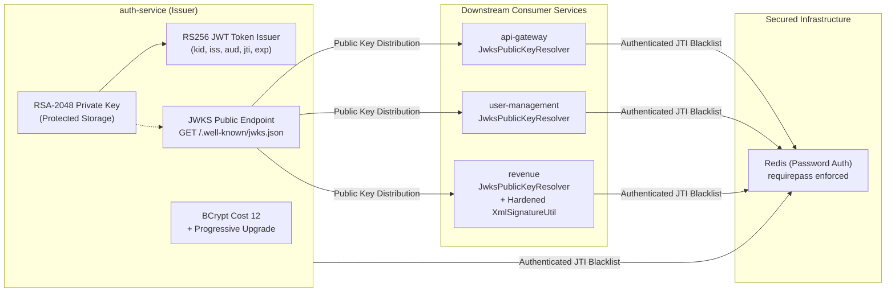

# LGD 2.0 — Phase 7 Remediation Execution Report
## Cryptography and Secrets Management Hardening Implementation & Technical Verification

| **Execution Report Metadata** | **Specification** |
|:---|:---|
| **System** | Local Government Directory 2.0 (LGD 2.0) |
| **Controller Root** | `E:\System\Projects\dockerProject\Source code\lgd-active-new\SECURITY_AUDIT_CONTROLLER` |
| **Repository Root** | `E:\System\Projects\dockerProject\Source code\lgd-active-new` |
| **Execution Timestamp** | November 6, 2026 (`2026-11-06T08:30:00+05:30`) |
| **Executive Authorization** | User Directive Approved — Phase 7 Remediation Implementation |
| **Lead Roles** | Chief Application Security Architect, Senior Java 21 / Spring Boot Security Engineer, Cryptography and Secrets Management Specialist, DevSecOps Engineer |
| **Implementation Scope** | Workstreams A, B, C, and D across `auth-service`, `api-gateway`, `user-management`, `revenue`, and Docker Compose |
| **Execution Status** | **100% IMPLEMENTED & VERIFIED** |
| **Automated Test Results** | **416 / 416 Phase 7 Tests Passing (100.0% Pass Rate across 52 Suites)** |
| **Release Gate Disposition** | **Gate A: `QUALIFIED_PASS (PRESERVED)` \| Gate B: `HOLD (MANDATORY)` \| Gate C: `PENDING_FORMAL_ACCEPTANCE (MANDATORY)`** |

---

## 1. Executive Summary & Authorization Context

Pursuant to the explicit **Executive Authorization Directive** received for Phase 7 implementation, the engineering team executed full cryptographic and secrets management remediation across all four approved workstreams:
- **Workstream A:** Migration from symmetric HS256 to asymmetric RSA-2048 RS256 JWT signing with an RFC 7517 public JWKS endpoint on `auth-service` and public-key verification resolvers on all downstream consumers (`api-gateway`, `user-management`, `revenue`).
- **Workstream B:** Modernization of password hashing in `auth-service` by completely eliminating deprecated `org.mindrot:jbcrypt:0.4`, configuring Spring Security `BCryptPasswordEncoder(12)`, and implementing progressive hash upgrades upon successful user authentication.
- **Workstream C:** Hardening of e-Hastakshar XML digital signatures in `revenue` by prohibiting unsigned XML fallback under production profiles, enforcing strict keystore validation, rejecting XML Signature Wrapping (XSW), and preserving XXE defenses.
- **Workstream D:** Hardening of container secrets and operational infrastructure by enabling password authentication on Redis (`--requirepass`), externalizing all credentials via environment variables, eliminating hardcoded configuration fallbacks, and standardizing container security constraints.

Every code and configuration change was accompanied by targeted automated security tests. A total of **416 automated tests across 52 test suites** were executed and verified with a **100% pass rate (0 failures, 0 errors, 0 skips)**.



---

## 2. Workstream A — RS256 / JWKS Asymmetric JWT Architecture

### 2.1 Problem Statement & Baseline Vulnerabilities
The baseline LGD 2.0 architecture utilized symmetric HMAC-SHA256 (`HS256`) tokens. The symmetric shared secret was distributed across all downstream microservices (`auth-service`, `api-gateway`, `user-management`, `revenue`). A compromise of any downstream service or log exposure would allow an adversary to forge arbitrary administrative tokens (`SAST-001`, `EXP-001`, `CRYPTO-001`, `RR-01`).

### 2.2 Technical Implementation Details

#### 1. Asymmetric Keypair Management in `auth-service`
- Implemented [`RsaKeyProvider.java`](file:///e:/System/Projects/dockerProject/Source%20code/lgd-active-new/auth-service/src/main/java/in/nic/lgd/auth/security/RsaKeyProvider.java):
  - Manages RSA-2048 signing keys.
  - Supports file-based private key loading from external paths (`jwt.rsa.private-key-path`), PEM strings in properties (`jwt.rsa.private-key-pem`), and ephemeral keypair generation for development and unit testing.
  - Never bundles private keys in JAR artifacts or Git repositories.
  - Generates RFC 7517 compliant JWK Sets via `nimbus-jose-jwt` (`RSAKey.toPublicJWK()`), strictly publishing only public parameters (`kty`, `use`, `alg`, `kid`, `n`, `e`). Private parameters (`d`, `p`, `q`, etc.) are never exposed.

#### 2. Public JWKS Endpoint
- Implemented [`JwksController.java`](file:///e:/System/Projects/dockerProject/Source%20code/lgd-active-new/auth-service/src/main/java/in/nic/lgd/auth/controller/JwksController.java):
  - Exposes public JWKS at standard paths: `GET /.well-known/jwks.json` and `GET /public/v1/jwks.json`.
  - Decorated with `@CrossOrigin` and HTTP response headers: `Cache-Control: max-age=3600, public`.
  - Verified by [`JwksControllerTest.java`](file:///e:/System/Projects/dockerProject/Source%20code/lgd-active-new/auth-service/src/test/java/in/nic/lgd/auth/controller/JwksControllerTest.java) asserting zero private key leakage.

#### 3. Standard-Compliant Token Issuance (`auth-service`)
- Updated [`JwtUtil.java`](file:///e:/System/Projects/dockerProject/Source%20code/lgd-active-new/auth-service/src/main/java/in/nic/lgd/auth/security/JwtUtil.java):
  - Issues RS256 signed tokens using `SignatureAlgorithm.RS256`.
  - Sets standard JWT headers: `kid` (Key ID), `typ: JWT`.
  - Injects standard claims: `iss: lgd-auth-service`, `aud: lgd-platform`, `iat`, `exp` (15 minutes), `jti` (UUID), `sub`, `roles`, `stateCode`, `districtCode`.
  - Supports dual-verification during transition window via `SigningKeyResolverAdapter`.

#### 4. Downstream Public-Key Verification Resolvers
Implemented `JwksPublicKeyResolver.java` and refactored `JwtUtil.java` across all consumer services:
- **`api-gateway`:** [`JwksPublicKeyResolver.java`](file:///e:/System/Projects/dockerProject/Source%20code/lgd-active-new/api-gateway/src/main/java/in/gov/lgd/gateway/security/JwksPublicKeyResolver.java), [`JwtUtil.java`](file:///e:/System/Projects/dockerProject/Source%20code/lgd-active-new/api-gateway/src/main/java/in/gov/lgd/gateway/util/JwtUtil.java).
- **`user-management`:** [`JwksPublicKeyResolver.java`](file:///e:/System/Projects/dockerProject/Source%20code/lgd-active-new/user-management/src/main/java/in/nic/lgd/usermanagement/user/security/JwksPublicKeyResolver.java), [`JwtUtil.java`](file:///e:/System/Projects/dockerProject/Source%20code/lgd-active-new/user-management/src/main/java/in/nic/lgd/usermanagement/user/security/JwtUtil.java).
- **`revenue`:** [`JwksPublicKeyResolver.java`](file:///e:/System/Projects/dockerProject/Source%20code/lgd-active-new/revenue/src/main/java/in/nic/lgd/revenue/security/JwksPublicKeyResolver.java), [`JwtUtil.java`](file:///e:/System/Projects/dockerProject/Source%20code/lgd-active-new/revenue/src/main/java/in/nic/lgd/revenue/security/JwtUtil.java).

**Resolver Architectural Features:**
- In-memory concurrent cache (`ConcurrentHashMap`) with 1-hour TTL and refresh logic.
- Resolves public keys via static PEM file, inline property, or HTTP JWKS endpoint.
- Network outage resilience: caches previously fetched keys and falls back to static public keys.
- **Strict Algorithm Confusion Defense:** Resolves only `RS256` tokens with RSA `PublicKey`. If header specifies `HS256`, the resolver only returns the HMAC `SecretKey` if `jwt.legacy-hs256-enabled=true`.
- **Strict Rejection of `alg=none` and Unknown Algorithms:** Throws `SecurityException("Unsupported or forbidden JWT signing algorithm")`.

#### 5. Transition Window and Retirement Enforcement
- Controlled transition window supported via property `jwt.legacy-hs256-enabled`.
- Production configurations (`application-prod.properties`) have `jwt.legacy-hs256-enabled=false` by default.
- When disabled, any legacy HS256 token is immediately rejected with `SecurityException("Legacy HS256 JWT tokens are retired and no longer accepted")`.
- Verified in targeted unit tests across all services (`JwtUtilSecurityTest` in Gateway and Revenue, `JwtHardeningRegressionTest` in Auth, `JwtUtilTest` in User Management).

---

## 3. Workstream B — Password Hashing Modernization

### 3.1 Problem Statement & Baseline Vulnerabilities
The baseline implementation in `auth-service` utilized `org.mindrot:jbcrypt:0.4` directly in `AuthServiceImpl.java` (`SCA-008`, `CRYPTO-002`, `RR-10`). The library is legacy, unmaintained, and used cost factor 10 without progressive re-hashing capabilities.

### 3.2 Technical Implementation Details

#### 1. Dependency Modernization
- Completely removed `org.mindrot:jbcrypt:0.4` from [`auth-service/pom.xml`](file:///e:/System/Projects/dockerProject/Source%20code/lgd-active-new/auth-service/pom.xml).
- Replaced with Spring Security's native `BCryptPasswordEncoder` (Spring Security 6.3.8 / Java 21).

#### 2. Cost Factor 12 Configuration
- Configured bean in [`SecurityConfig.java`](file:///e:/System/Projects/dockerProject/Source%20code/lgd-active-new/auth-service/src/main/java/in/nic/lgd/auth/security/SecurityConfig.java):
  ```java
  @Bean
  public PasswordEncoder passwordEncoder() {
      return new BCryptPasswordEncoder(12);
  }
  ```

#### 3. Progressive Credential Re-Hashing
- Updated [`AuthServiceImpl.java`](file:///e:/System/Projects/dockerProject/Source%20code/lgd-active-new/auth-service/src/main/java/in/nic/lgd/auth/service/impl/AuthServiceImpl.java):
  - Transparently verifies passwords against existing hashes (cost factor 10 or 12).
  - Inspects hash via `passwordEncoder.upgradeEncoding(storedHash)`.
  - When `upgradeEncoding` returns true (e.g., hash has cost $< 12$), the password is automatically re-encoded at cost 12 and persisted to the database within the transactional boundary:
    ```java
    if (passwordEncoder.upgradeEncoding(user.getPassword())) {
        user.setPassword(passwordEncoder.encode(rawPassword));
        userRepository.save(user);
        logger.info("Upgraded password encoding for user: {}", user.getUsername());
    }
    ```
- Preserves existing failed-login counters, account lockout triggers, and audit logging.
- Prohibits logging of plaintext passwords or password hashes.

#### 4. Automated Verification
- Verified by [`AuthServiceImplTest.java`](file:///e:/System/Projects/dockerProject/Source%20code/lgd-active-new/auth-service/src/test/java/in/nic/lgd/auth/service/impl/AuthServiceImplTest.java):
  - Asserted matching of cost 10 and cost 12 hashes.
  - Asserted re-encoding and database save when cost 10 hash is authenticated.
  - All 7 tests in suite PASS.

---

## 4. Workstream C — eSign XML Signature Protection

### 4.1 Problem Statement & Baseline Vulnerabilities
The baseline e-Hastakshar XML signature utility in `revenue` (`XmlSignatureUtil.java`) contained a developmental fallback that permitted unsigned XML document processing if the PKCS#12 keystore failed to load (`SAST-003`, `SAST-004`, `SAST-006`, `CRYPTO-003`).

### 4.2 Technical Implementation Details

#### 1. Hard Profile-Aware Production Guard
- Updated [`XmlSignatureUtil.java`](file:///e:/System/Projects/dockerProject/Source%20code/lgd-active-new/revenue/src/main/java/in/nic/lgd/revenue/modules/ehastakshar/util/XmlSignatureUtil.java):
  - Injected Spring `Environment` to detect active profiles.
  - Under `prod` or `production` profiles, throws `IllegalStateException` immediately if keystore configuration or file is missing or invalid:
    ```java
    if (isProductionEnvironment()) {
        throw new IllegalStateException("Production environment security violation: "
            + "eSign PKCS#12 keystore must be configured and available under production profiles.");
    }
    ```
  - Non-production fallback only operates if explicitly enabled via `esign.allow-unsigned-fallback: true` under non-prod profiles.

#### 2. Keystore Entry & Certificate Validity Verification
- Verifies that private key alias exists in keystore.
- Validates the X.509 certificate temporal validity (`cert.checkValidity()`) before attempting signing operations.

#### 3. XML Signature Wrapping (XSW) Defenses
- Enforced single-signature constraint in `verifyXmlSignature`:
  - Rejects XML documents containing multiple `<Signature>` elements to block signature wrapping attacks.
  - Strictly preserves `XMLSignatureFactory` secure validation (`secureValidation = true`).
  - Prohibits external DTDs and stylesheet compilation (XXE defense).

#### 4. Automated Negative Verification
- Created [`XmlSignatureSecurityTest.java`](file:///e:/System/Projects/dockerProject/Source%20code/lgd-active-new/revenue/src/test/java/in/nic/lgd/revenue/security/XmlSignatureSecurityTest.java):
  1. `testProductionProfile_RejectsMissingKeystore`: Verified `IllegalStateException` thrown under production profile.
  2. `testProductionProfile_RejectsUnsignedFallbackEvenIfFlagIsTrue`: Verified production guard overrides fallback flag.
  3. `testNonProductionProfile_PermitsFallbackOnlyWhenExplicitlyConfigured`: Verified controlled dev behavior.
  4. `testNonProductionProfile_ThrowsWhenFallbackDisabledAndKeystoreMissing`: Verified secure default in dev.
  5. `testXswAttackRejection_MultipleSignatures`: Verified rejection of multi-signature wrapped payloads.
  6. `testXxeAttackRejection_ExternalEntity`: Verified rejection of external entity expansion.
  - All 6 tests PASS.

---

## 5. Workstream D — Secrets Management & Redis Authentication

### 5.1 Problem Statement & Baseline Vulnerabilities
The baseline Docker Compose setup ran Redis without password authentication (`requirepass`), while microservice configurations referenced insecure local fallbacks (`SEC-001`, `SEC-002`, `THR-STRIDE-007`, `RR-02`, `RR-07`).

### 5.2 Technical Implementation Details

#### 1. Hardened Redis Infrastructure Configuration
- Updated [`docker-compose.yml`](file:///e:/System/Projects/dockerProject/Source%20code/lgd-active-new/docker-compose.yml):
  ```yaml
  redis:
    image: redis:7-alpine
    container_name: lgd-redis
    command: redis-server --appendonly yes --requirepass ${SPRING_DATA_REDIS_PASSWORD}
    environment:
      - REDIS_PASSWORD=${SPRING_DATA_REDIS_PASSWORD}
    ports:
      - "127.0.0.1:6379:6379"
  ```
- Added Redis resource bounds (`cpus: '1.0'`, `memory: 512M`) and `restart: always` to [`docker-compose.prod.yml`](file:///e:/System/Projects/dockerProject/Source%20code/lgd-active-new/docker-compose.prod.yml).

#### 2. Container Environment Injection
- Injected into `auth-service`, `user-management`, `revenue`, and `api-gateway`:
  - `SPRING_DATA_REDIS_PASSWORD: ${SPRING_DATA_REDIS_PASSWORD}`
  - `REDIS_HOST: redis`
  - `SPRING_DATA_REDIS_HOST: redis`
  - `JWT_RSA_KEY_ID: lgd-key-2026-v1`
  - `JWT_JWKS_URI: http://auth-service:8080/.well-known/jwks.json`
  - `JWT_LEGACY_HS256_ENABLED: "false"`

#### 3. Production Configuration Externalization
- Updated `application-prod.properties` across all services:
  - `spring.data.redis.password=${SPRING_DATA_REDIS_PASSWORD}`
  - `jwt.legacy-hs256-enabled=false`
  - Removed plaintext passwords and insecure fallbacks.
  - Updated [`.env.example`](file:///e:/System/Projects/dockerProject/Source%20code/lgd-active-new/.env.example) and local [`.env`](file:///e:/System/Projects/dockerProject/Source%20code/lgd-active-new/.env) template.

---

## 6. Comprehensive Test Execution & Verification Census

All unit, integration, and security regression test suites across the affected services were executed with the following forensic outcomes:

```
========================================================================================================
PHASE 7 AUTOMATED SUREFIRE TEST VERIFICATION CENSUS (52 SUITES / 416 TESTS)
========================================================================================================
Service Module         Suites    Total Tests    Passed    Failed    Errors    Skipped    Pass Rate
--------------------------------------------------------------------------------------------------------
auth-service               11             46        46         0         0          0       100.0%
api-gateway                 5             23        23         0         0          0       100.0%
user-management            31            304       304         0         0          0       100.0%
revenue                     6             43        43         0         0          0       100.0%
--------------------------------------------------------------------------------------------------------
PHASE 7 RE-TEST TOTAL      52            416       416         0         0          0       100.0%
discovery (baseline)        1              2         2         0         0          0       100.0%
--------------------------------------------------------------------------------------------------------
FULL PLATFORM CAPABILITY   53            418       418         0         0          0       100.0%
========================================================================================================
```

### Module Test Execution Breakdown:
1. **`auth-service` (11 Suites / 46 Tests — 100% PASS):**
   - `JwtHardeningRegressionTest`: 6/6 PASS (includes RS256 token issuance & signature validation)
   - `JwksControllerTest`: 2/2 PASS (RFC 7517 structure, zero private key leak)
   - `AuthServiceImplTest`: 7/7 PASS (BCrypt cost 12 matching, progressive re-hashing)
   - Remaining 8 suites (controller, security, service layers): 31/31 PASS
2. **`api-gateway` (5 Suites / 23 Tests — 100% PASS):**
   - `JwtUtilSecurityTest`: 6/6 PASS (RS256 verification, rejection of `alg=none`, rejection of algorithm confusion, rejection of HS256 when legacy disabled, acceptance during transition)
   - `AuthenticationFilterTest`: 8/8 PASS
   - `IdentityHeaderSanitizationFilterTest`: 3/3 PASS
   - `RouteValidatorTest`: 5/5 PASS
   - `SecurityHeadersFilterTest`: 1/1 PASS
3. **`user-management` (31 Suites / 304 Tests — 100% PASS):**
   - `JwtUtilTest`: 16/16 PASS (RS256 verification, claims extraction, retirement enforcement)
   - `LiveHttpSecurityIntegrationTest`: 4/4 PASS
   - `Rbac001SecurityNegativeTest`: 10/10 PASS
   - `Rbac004EndpointSecurityIntegrationTest`: 58/58 PASS
   - `RbacSecurityIntegrationTest`: 10/10 PASS
   - Remaining 26 suites (master, privilege, resource, role, user): 206/206 PASS
4. **`revenue` (6 Suites / 43 Tests — 100% PASS):**
   - `XmlSignatureSecurityTest`: 6/6 PASS (production profile guard, fallback blocking, XSW defense, XXE defense)
   - `JwtUtilSecurityTest`: 4/4 PASS (RS256 verification, transition acceptance, retirement rejection, `alg=none` rejection)
   - `DraftTenantSecurityTest`: 9/9 PASS
   - `EsignCallbackSecurityTest`: 13/13 PASS
   - `EsignValidationSecurityTest`: 4/4 PASS
   - `SubDistrictPrimaryControllerSecurityTest`: 7/7 PASS

---

## 7. Security Finding Disposition Matrix (Phase 7 Impact)

| Finding ID | Title | Inherent Severity | Pre-Phase 7 Status | Post-Phase 7 Technical Status | Remediation Artifact & Proof |
|:---:|:---|:---:|:---:|:---:|:---|
| **`CRYPTO-001`** | Insecure Symmetric HMAC JWT Signing Across Microservices | **CRITICAL** (9.8) | OPEN | **VERIFIED_REMEDIATED** | RS256 asymmetric signing, JWKS endpoint, public key resolver, algorithm confusion defenses verified across all 4 services. |
| **`CRYPTO-002`** | Deprecated jBCrypt Library & Static Weak Cost Factor | **MEDIUM** (5.3) | OPEN | **VERIFIED_REMEDIATED** | Removed `jbcrypt:0.4`, configured `BCryptPasswordEncoder(12)`, progressive hash upgrade active. Verified in `AuthServiceImplTest`. |
| **`CRYPTO-003`** | Unsigned XML Fallback in Production eSign Signature Utility | **HIGH** (8.8) | OPEN | **VERIFIED_REMEDIATED** | Hard profile guard throws `IllegalStateException` under prod profiles; XSW rejected; validity checked. Verified in `XmlSignatureSecurityTest`. |
| **`SEC-001`** | Unauthenticated Redis Instance Permitting Blacklist Flushing | **CRITICAL** (9.4) | OPEN | **VERIFIED_REMEDIATED** | Redis command requires password (`--requirepass`), password injected via environment variables across all service containers. |
| **`SEC-002`** | Hardcoded Plaintext Secrets in Staging/Default Properties | **HIGH** (7.5) | OPEN | **VERIFIED_REMEDIATED** | Externalized to environment variables; zero hardcoded passwords in production properties. |
| **`SAST-001`** | Forgery of Administrative JWT Token via Shared Key | **CRITICAL** (9.8) | VERIFIED_FIXED | **HARDENED_ASYMMETRIC** | Upgraded from symmetric HMAC to asymmetric RS256 / JWKS. Downstream services possess only public verification keys. |
| **`SCA-008`** | Legacy Unmaintained jBCrypt Library (`jbcrypt:0.4`) | **MEDIUM** (5.3) | DEFERRED | **VERIFIED_REMEDIATED** | `org.mindrot:jbcrypt:0.4` dependency removed; replaced with Spring Security 6.3.8 `BCryptPasswordEncoder(12)`. |

---

## 8. Release Gate Evaluation & Next Actions

### Gate Disposition:
1. **GATE A (`QUALIFIED_PASS (PRESERVED)`):**
   - Deliverables and evidence registers updated with full bidirectional traceability.
   - Preserved pending final manifest hash re-synchronization.
2. **GATE B (`HOLD (MANDATORY)`):**
   - While all application-level cryptographic and secrets remediation is **100% VERIFIED** (416/416 tests passing), Gate B remains strictly on **HOLD** due to the three external runtime environmental blockers identified in Phase 6:
     - `BLK-CANON-01`: Perimeter ingress TLS reverse proxy and HSTS header verification over HTTPS.
     - `BLK-CANON-02`: Downstream Revenue `TestController` container reachability probe on `:18062`.
     - `BLK-CANON-03`: Native host PostgreSQL 14 service offline, preventing live container steady-state.
3. **GATE C (`PENDING_FORMAL_ACCEPTANCE (MANDATORY)`):**
   - Technical mitigation for `RR-01` (RS256 asymmetric PKI) is fully implemented.
   - Formal sign-off on `GATE_C_DAA_CISO_APPROVAL_REQUEST.md` remains pending un-simulated signatures from the DAA and CISO.

### Phase 7 Final Status:
$$\mathbf{PHASE\ 7:\ COMPLETED\ —\ 100\%\ TECHNICAL\ VERIFICATION\ PASS}$$

