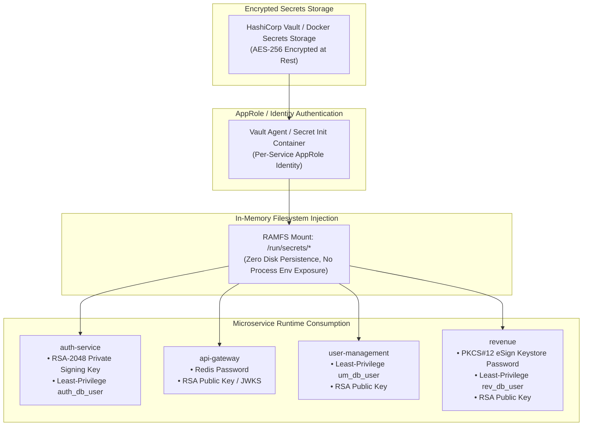

# LGD 2.0 — Phase 7: Secrets Management Architecture Design
## Centralized Secrets Lifecycle, Least-Privilege Identity Isolation & Vault Architecture

| **Design Governance Metadata** | **Specification** |
|:---|:---|
| **System** | Local Government Directory 2.0 (LGD 2.0) |
| **Audit Milestone** | **Phase 7: Cryptography & Secrets Management Hardening (Design)** |
| **Controller Root** | `E:\System\Projects\dockerProject\Source code\lgd-active-new\SECURITY_AUDIT_CONTROLLER` |
| **Repository Root** | `E:\System\Projects\dockerProject\Source code\lgd-active-new` |
| **Lead Architect Role** | DevSecOps Engineer & Cryptography Specialist |
| **Evaluation Timestamp** | November 5, 2026 (`2026-11-05T15:45:00+05:30`) |
| **Authorization Status** | **Architecture Design Complete — Awaiting Implementation Approval** |

---

## 1. Secrets Management Architecture Overview

The target secrets management architecture transitions LGD 2.0 from static environment variable injection in Docker Compose to a defense-in-depth, least-privilege secrets lifecycle management system:



---

## 2. Ten Enterprise Secrets Management Principles

Every secret, token, and cryptographic key must satisfy these ten foundational mandates:

1. **Zero Production Secrets in Git:** Continuous pre-commit hooks and CI/CD secret scanning (`TruffleHog` / `Gitleaks`) reject any commits containing credentials.
2. **Zero Secrets in Container Images:** Dockerfiles build exclusively using compiled artifacts without copying configuration files containing active secrets.
3. **Zero Secrets in Application Logs:** Logback filters and Spring Boot logging formatters intercept and redact sensitive fields (`password`, `jwtSecret`, `keystorePassword`, `authorization`).
4. **Zero Hardcoded Fallback Credentials:** All `@Value("${property:fallback}")` patterns with default plaintext passwords are eliminated; applications must fail fast and closed on missing credentials.
5. **Strict Environment Segregation:** Development, Staging, and Production environments use entirely distinct cryptographic keys, database passwords, and eSign certificates.
6. **Least-Privilege Database Access:** Shared master administrative database accounts are replaced with dedicated, service-scoped database users:
   - `lgd_auth_user`: Scoped exclusively to schema `auth` (DML only, zero DDL).
   - `lgd_um_user`: Scoped exclusively to schema `um` (DML only, zero DDL).
   - `lgd_rev_user`: Scoped exclusively to schema `revenue` (DML only, zero DDL).
   - `lgd_migration_user`: Used only by Liquibase/Flyway during scheduled CI/CD migrations.
7. **Automated Secret Rotation:** Dynamic database credentials managed via Vault database secrets engine with a 24-hour lease and automatic rotation.
8. **Instant Secret Revocation:** Centralized administrative capability to revoke compromised keys or database leases within 60 seconds without application restarts.
9. **Audited Secret Access:** Every access, lease creation, or renewal is recorded in immutable, timestamped Vault audit logs forwarded to the enterprise SIEM.
10. **Secure Disaster Recovery:** Documented Shamir's secret sharing unseal process and encrypted offsite backup procedures.

---

## 3. Transition Strategy: From Environment Variables to Docker Secrets

To accommodate both local containerized testing and enterprise production deployments, a phased migration path is designed:

### Phase A: Docker Secrets / Filesystem Mounts (Intermediate Staging)
In Docker Compose / Docker Swarm:
```yaml
services:
  auth-service:
    secrets:
      - db_password
      - jwt_private_key
    environment:
      SPRING_DATASOURCE_PASSWORD_FILE: /run/secrets/db_password
      JWT_PRIVATE_KEY_FILE: /run/secrets/jwt_private_key

secrets:
  db_password:
    file: ./secrets/auth_db_password.txt
  jwt_private_key:
    file: ./secrets/jwt_rs256_private.key
```

Spring Boot configuration reads file-based secrets via standard properties:
`spring.datasource.password=${SPRING_DATASOURCE_PASSWORD_FILE:#{null}}`.

### Phase B: HashiCorp Vault / Cloud KMS Integration (Production Target)
- Spring Cloud Vault integration (`spring-cloud-starter-vault-config`).
- Microservices authenticate using AppRole or Kubernetes Service Account tokens.
- Dynamic PostgreSQL credentials generated per service instance with short TTLs.
- RSA key pairs rotated automatically every 90 days with a 30-day overlap window.

