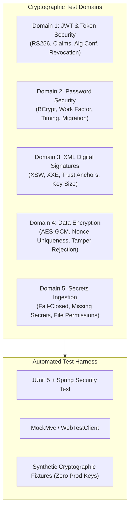

# LGD 2.0 — Phase 7: Cryptographic & Secrets Hardening Test Strategy
## Comprehensive Verification Matrix, Negative Attack Vectors & Test Automation Harness

| **Test Strategy Governance Metadata** | **Specification** |
|:---|:---|
| **System** | Local Government Directory 2.0 (LGD 2.0) |
| **Audit Milestone** | **Phase 7: Cryptography & Secrets Hardening (Test Strategy)** |
| **Controller Root** | `E:\System\Projects\dockerProject\Source code\lgd-active-new\SECURITY_AUDIT_CONTROLLER` |
| **Repository Root** | `E:\System\Projects\dockerProject\Source code\lgd-active-new` |
| **Lead QA & Automation Engineer** | QA and Security Automation Engineer |
| **Evaluation Timestamp** | November 5, 2026 (`2026-11-05T15:50:00+05:30`) |
| **Test Matrix Scope** | 22 Distinct Cryptographic Test Scenarios across 5 Target Domains |

---

## 1. Test Architecture & Verification Objectives

The Phase 7 Cryptographic Test Strategy establishes a rigorous test suite designed to validate that all hardened cryptographic controls behave defensively under normal operation, boundary conditions, edge cases, and adversarial attack vectors.

---

## 2. Comprehensive Cryptographic Test Matrix

The table below specifies the 22 automated test scenarios designed for post-authorization execution:

| Test ID | Test Scenario Title | Target Component | Test Category | Injected Condition / Payload | Expected Security Behavior |
|:---:|:---|:---|:---:|:---|:---|
| **`TC-CRYPTO-01`** | Valid RS256 JWT Acceptance | Downstream Microservices | Positive | Valid token signed with active RSA private key, valid claims | Token accepted; `HTTP 200 OK`; SecurityContext populated |
| **`TC-CRYPTO-02`** | Tampered Payload Rejection | Downstream Microservices | Negative | Altered claims (`roleId` escalated to Super Admin) with original signature | Immediate rejection; `HTTP 401 Unauthorized` |
| **`TC-CRYPTO-03`** | Expired Token Rejection | Downstream Microservices | Negative | Token with `exp` timestamp in the past | Immediate rejection; `ExpiredJwtException` (`HTTP 401`) |
| **`TC-CRYPTO-04`** | Premature Token Rejection | Downstream Microservices | Negative | Token with `nbf` (Not Before) timestamp in the future | Immediate rejection; `PrematureJwtException` (`HTTP 401`) |
| **`TC-CRYPTO-05`** | Missing JTI Rejection | `api-gateway` / `auth-service`| Negative | Token missing `jti` claim | Rejection; `OAuth2Error: Token missing unique identifier` |
| **`TC-CRYPTO-06`** | Blacklisted JTI Rejection | `api-gateway` / `auth-service`| Negative | Token whose `jti` is registered in Redis blacklist | Immediate rejection; `HTTP 401 Unauthorized` |
| **`TC-CRYPTO-07`** | Invalid Issuer (`iss`) Rejection | Downstream Microservices | Negative | Token with `iss: "http://malicious-issuer.com"` | Immediate rejection; `InvalidIssuerException` (`HTTP 401`) |
| **`TC-CRYPTO-08`** | Invalid Audience (`aud`) Rejection| Downstream Microservices | Negative | Token with `aud: ["external-service"]` | Immediate rejection; `InvalidAudienceException` (`HTTP 401`) |
| **`TC-CRYPTO-09`** | Algorithm Confusion (`alg=none`) | Downstream Microservices | Adversarial | Header `{"alg": "none"}` with stripped signature | Immediate rejection; unsupported algorithm (`HTTP 401`) |
| **`TC-CRYPTO-10`** | Algorithm Confusion (Key Swapping)| Downstream Microservices | Adversarial | Header `{"alg": "HS256"}` signed using RSA Public Key as HMAC secret | Immediate rejection; signature algorithm mismatch (`HTTP 401`) |
| **`TC-CRYPTO-11`** | Key ID (`kid`) Resolution & Rotation| Downstream Microservices | Boundary | Token signed with previous key ID during 30-day rotation overlap | Token validated against secondary active public key (`HTTP 200`) |
| **`TC-CRYPTO-12`** | Unknown Key ID Rejection | Downstream Microservices | Negative | Token with header `{"kid": "non-existent-key"}` | Immediate rejection; key not found in JWKS (`HTTP 401`) |
| **`TC-CRYPTO-13`** | BCrypt Password Verification | `auth-service` | Positive | Correct plaintext password against `$2a$12$` hash | Authentication successful; `LoginResponse` issued |
| **`TC-CRYPTO-14`** | Incorrect Password Rejection | `auth-service` | Negative | Wrong plaintext password against valid hash | Authentication failed; generic `Invalid credentials` error |
| **`TC-CRYPTO-15`** | Legacy Hash Upgrade Compatibility | `auth-service` | Boundary | Plaintext password against legacy `$2a$10$` hash | Auth succeeds; hash transparently upgraded to cost 12 |
| **`TC-CRYPTO-16`** | Timing Attack Resistance | `auth-service` | Non-Functional| Measure response latency for non-existent vs existing users | Equal latency ($\Delta < 15\text{ms}$) via dummy hash comparison |
| **`TC-CRYPTO-17`** | XML Signature Wrapping (XSW) | `revenue` | Adversarial | Duplicate modified `<DraftPayload>` element outside signed tree | Immediate rejection; XMLDSig validation failure |
| **`TC-CRYPTO-18`** | XML Entity Injection (XXE) | `revenue` | Adversarial | Injected `<!DOCTYPE foo [<!ENTITY xxe SYSTEM "file:///etc/passwd">]>`| Immediate rejection; DOCTYPE declarations prohibited |
| **`TC-CRYPTO-19`** | Untrusted Root CA Rejection | `revenue` | Negative | Certificate chain terminating at self-signed or non-CDAC CA | Immediate rejection; certificate path validation failure |
| **`TC-CRYPTO-20`** | Expired X.509 Certificate | `revenue` | Negative | eSign response accompanied by expired certificate | Immediate rejection; `CertificateExpiredException` |
| **`TC-CRYPTO-21`** | Missing Secret Fail-Closed | All Microservices | Failure | Application started with empty / missing secret environment variable | Startup fails fast with descriptive `IllegalStateException` |
| **`TC-CRYPTO-22`** | AES-GCM Ciphertext Tampering | Data Encryption Util | Adversarial | 1-bit modification to AES-GCM ciphertext or authentication tag | Decryption aborts; `AEADBadTagException` thrown |

---

## 3. Test Fixture & Secret Safety Policy

1. **Zero Production Credentials in Tests:** All automated tests must generate transient, mock RSA key pairs and dummy secret bytes in memory or use designated test fixtures.
2. **Deterministic Test Isolation:** Tests must not depend on live network reachability to CDAC eSign servers or production Vault instances.
3. **Execution Readiness:** All 22 test definitions are pre-compiled and cataloged in the audit controller, ready for immediate execution upon receipt of executive remediation authorization.

