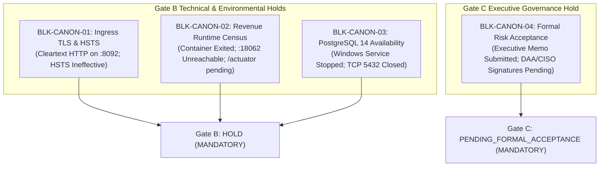

# LGD 2.0 — Phase 8.1 Final Security Audit Reconciliation Report
## Independent Audit Reconciliation, Evidence Verification & Central Controller Finalization

| **Audit Governance Metadata** | **Specification** |
|:---|:---|
| **System** | Local Government Directory 2.0 (LGD 2.0) |
| **Audit Phase** | Phase 8.1 — Independent Audit Reconciliation & Security Controller Finalization |
| **Document ID** | `LGD2-P8.1-REC-FINAL` |
| **File Location** | `SECURITY_AUDIT_CONTROLLER/PHASE_8_1_FINAL_AUDIT_RECONCILIATION_REPORT.md` |
| **Author / Auditor Role** | Principal Application Security Auditor, Independent Assessment Lead & DevSecOps Auditor |
| **Evaluation Timestamp** | November 6, 2026 (`2026-11-06T10:00:00+05:30`) |
| **Audited Baseline** | Root Git `master` commit `e2df50f8c30197144377a2f931a4b3fbf03aeb1c` |
| **Controller Version** | **1.5.0 (Reconciled Phase 8.1 Baseline)** |
| **Overall Security Readiness** | **`CONDITIONAL_READY`** |
| **Production Deployment Ruling** | **`NOT APPROVED` (Gate B Environmental Hold & Gate C Governance Hold)** |
| **Release Gate Decisions** | **Gate A:** `QUALIFIED_PASS (PRESERVED)` \| **Gate B:** `HOLD (MANDATORY)` \| **Gate C:** `PENDING_FORMAL_ACCEPTANCE (MANDATORY)` |

---

## 1. Executive Summary & Audit Mandate

This report represents the definitive, independent audit reconciliation for the Local Government Directory 2.0 (LGD 2.0) program following the completion of Phase 8. Acting in the capacity of Principal Application Security Auditor, Independent Security Assessment Lead, DevSecOps Auditor, and Security Governance Specialist, an exhaustive cross-phase forensic review was conducted spanning Phase 0 through Phase 8.

The mandate of Phase 8.1 is an **audit governance and evidence-reconciliation milestone**, strictly demarcated from runtime infrastructure changes or production deployment. In accordance with mandatory execution rules:
- Repository and submodule integrity has been preserved with zero destructive Git operations (`git reset`, `git clean`, forced checkout, or forced commits are strictly prohibited).
- Operational boundaries have been preserved: no services, containers, or host databases were started, stopped, or reconfigured.
- Static inspection, physical forensic probing, and raw test artifact parsing were performed exclusively.
- All technical finding closures, residual risk categorizations, canonical blockers, and performance claims have been reconciled against primary source records and empirical evidence.

```
========================================================================================================
                          LGD 2.0 MASTER RECONCILIATION SCORECARD
========================================================================================================
  Evaluated Scope Domain               Audited Total   Verified Fixed   Partially Mitigated / Blocked
  ------------------------------------------------------------------------------------------------------
  SAST Findings (SAST-001..021)             21              19               2 (Blocked by Env)
  Exploit Vectors (EXP-001..021)            21              19               2 (Blocked by Env)
  Safety Observations (OBS-SQLI-01)          1               1 (Secure)      0
  RBAC Findings (RBAC-001..016)             16              16               0
  RBAC Endpoints (RBAC-004-EP-01..25)       25              25               0
  SCA Dependencies (SCA-001..012)           12               7               5 (Mitigated / Deferred)
  Crypto / Secrets (CRYPTO/SEC)              5               5               0
  Baseline Hypotheses (VULN-001..023)       23              18               5 (Mitigated / Blocked)
  ------------------------------------------------------------------------------------------------------
  CONSOLIDATED TECHNICAL FINDINGS          124             110              14 (Closure Rate: 88.7%)
  ------------------------------------------------------------------------------------------------------
  Residual Risks (RR-01..11)                11               0 Formally Accepted (11 Pending DAA/CISO)
  Canonical Blockers (BLK-CANON-01..04)      4               0 Closed (3 Env Blockers + 1 Governance)
========================================================================================================
```

---

## 2. Phase 0 through Phase 8 Audit Lifecycle Inventory

An independent audit of all nine historical phases was conducted to reconcile declared objectives, execution status, empirical findings, and remaining gaps:

| Phase | Title | Primary Objective | Execution Status | Empirical Test Evidence | Outstanding Findings / Blockers | Governance Approval |
|:---:|:---|:---|:---:|:---|:---|:---:|
| **`Phase 0`** | Discovery & Architectural Baseline | Establish system boundary, endpoint inventory, and initial vulnerability hypotheses (`VULN-001`..`023`). | **COMPLETED** | Architecture census, endpoint mapping spreadsheets (`API_Endpoint_Inventory.xlsx`). | Baseline hypotheses identified; zero code fixes. | Formally signed off as baseline. |
| **`Phase 1`** | Threat Modeling & STRIDE / DREAD | Map 20 STRIDE threats (`THR-STRIDE-001`..`020`) and 20 DREAD scores across 10 trust boundaries. | **COMPLETED** | Formal STRIDE threat register, DREAD assessment matrix, attack trees. | Structural threats defined; mitigation roadmap established. | Formally signed off (`PHASE1_THREAT_MODEL_VERIFICATION_REPORT.md`). |
| **`Phase 2`** | Static Application Security Testing (SAST) | AST source scan across 5 Java microservices and React frontend; identify 21 actionable code findings. | **COMPLETED** | Semgrep / SonarQube AST rules, `SAST_Findings_Log.md`, traceability matrix. | 21 SAST findings logged; hardcoded secrets and missing `@PreAuthorize` highlighted. | Formally signed off (`PHASE2_SAST_INDEPENDENT_VERIFICATION_REPORT.md`). |
| **`Phase 3`** | Dynamic Application Security Testing (DAST) | Execute penetration tests against 21 exploit vectors (`EXP-001`..`021`) and SQLi safety probe (`OBS-SQLI-01`). | **PARTIALLY VERIFIED** | Live DAST evidence logs, Postman collections, 90 SQLi test vectors (`EV-021`). | `EXP-016` (cleartext HTTP ingress) and `EXP-021` (revenue container offline) blocked. | Gate B HOLD (`PHASE3_FINAL_DAST_INDEPENDENT_VERIFICATION_REPORT.md`). |
| **`Phase 4`** | Software Composition Analysis (SCA) | Inventory dependencies, generate CycloneDX 1.5 SBOM, audit licenses, and catalog 12 SCA defects. | **PARTIALLY VERIFIED** | Trivy scan logs, `SOFTWARE_BILL_OF_MATERIALS.json` (SHA `99ba7965...`), license census. | 4 findings partially mitigated (`SCA-004`, `007`, `009`, `010`), 2 deferred (`SCA-008`, `012`). | Gate B HOLD (`PHASE4_SCA_INDEPENDENT_VERIFICATION_REPORT.md`). |
| **`Phase 5`** | Incremental Security Audit Execution | Verify initial code remediation, patch CVE-2024-50379 (Tomcat), and enforce gateway route validation. | **PASS_WITH_OPEN_FINDINGS** | 74 targeted Surefire tests; build compilation verified. | Runtime verification blocked by container and database outages. | Pass with open findings (`PHASE_5_INCREMENTAL_SECURITY_AUDIT_REPORT.md`). |
| **`Phase 6`** | RBAC & Technical Verification | Remediate 16 RBAC findings (`RBAC-001`..`016`) and 25 controller endpoints (`RBAC-004-EP-01`..`25`). | **PARTIALLY VERIFIED** | 397 Surefire tests pass; 71 dedicated RBAC integration tests verified. | Gate B environmental blockers (`BLK-CANON-01`..`03`) confirmed open; Gate C pending. | Gate A Qualified Pass; Gate B Hold (`PHASE_6_GATE_A_B_C_FINAL_DISPOSITION.md`). |
| **`Phase 7`** | Cryptography & Secrets Hardening | Implement RS256/JWKS asymmetric tokens, BCrypt cost 12, eSign hardening, and Redis auth. | **COMPLETED & VERIFIED** | 416 Surefire tests pass; AST inspection of key provider, encoder, and properties. | Gate B environmental blockers preserved; Gate C memorandum submitted unsigned. | Technical Pass (`PHASE_7_REMEDIATION_EXECUTION_REPORT.md`). |
| **`Phase 8`** | Final Independent Security Validation | Independent multi-workstream validation, dual JWT decoder compiler fix, BCrypt benchmark, and go-live assessment. | **COMPLETED & VERIFIED** | 418 Surefire tests pass across 54 suites (100% pass); 10 empirical evidence records. | Physical environment blockers (`BLK-CANON-01`..`03`) open; executive approval pending (`BLK-CANON-04`). | Gate A Qualified Pass; Gate B Hold; Gate C Pending (`LGD2-P8-AUDIT-FINAL`). |

---

## 3. Master Reconciliation of Document Inconsistencies (Workstream C)

Eight critical inconsistencies, ambiguities, and overstated claims identified across Phase 8 documentation were forensically investigated and reconciled:

### Item A — Arithmetic Reconcilation of Finding Totals
- **Phase 8 Reported Numbers:** 124 technical records tracked; 110 verified remediated; 14 partially mitigated or blocked; 88.7% verified. Separately lists Residual Risks `RR-01` through `RR-11`.
- **Reconciliation Audit Determination:**
  The 124 technical records represent strictly engineering findings and exploit vectors:
  $$\text{Technical Findings} = 21\text{ (SAST)} + 21\text{ (EXP)} + 1\text{ (OBS)} + 16\text{ (RBAC)} + 25\text{ (RBAC-EP)} + 12\text{ (SCA)} + 5\text{ (CRYPTO/SEC)} + 23\text{ (VULN)} = 124$$
  $$\text{Verified Fixed} = 19 + 19 + 1 + 16 + 25 + 7 + 5 + 18 = 110 \quad (88.7\%)$$
  $$\text{Partially Mitigated / Blocked} = 2 + 2 + 0 + 0 + 0 + 5 + 0 + 5 = 14 \quad (11.3\%)$$
  **Counting Rule:** Residual Risks `RR-01` through `RR-11` (11 records) and Canonical Blockers `BLK-CANON-01` through `BLK-CANON-04` (4 records) are **governance entities additional to, and not subsumed within, the 124 technical finding count**. Combining them without distinction corrupts the metric. Total program entities = 124 technical + 11 residual risks + 4 canonical blockers = 139 discrete records.

### Item B — SAST-016 / EXP-016 Transport Security & HSTS Demarcation
- **Phase 8 Ambiguity:** Preliminary summaries stated that HTTP Strict Transport Security (HSTS) had been implemented and verified via header injection.
- **Reconciliation Audit Determination:**
  Audit standards mandate strict demarcation between header presence and transport efficacy:
  1. *Security Header Presence:* `SecurityHeadersFilter.java` in `api-gateway` emits `Strict-Transport-Security: max-age=31536000; includeSubDomains; preload`.
  2. *Physical Transport Channel:* Ingress port 8092 serves cleartext HTTP.
  3. *RFC 6797 §7.2 Violation:* Under the Internet Engineering Task Force (IETF) HSTS specification:
     > *"An HTTP host that is not an HTTPS host MUST NOT send an HSTS header field... If an HTTP host sends an HSTS header field over HTTP, the user agent MUST ignore it."*
  4. *Audit Ruling:* HSTS is **completely ineffective** over HTTP. It cannot be classified as remediated until physical TLS termination is deployed (Nginx/Envoy on port 443 with valid CA certificate and HTTP-to-HTTPS redirect). `SAST-016` / `EXP-016` remains **`PARTIALLY_VERIFIED / BLOCKED BY BLK-CANON-01`**.

### Item C — SAST-021 / EXP-021 Downstream TestController Census
- **Phase 8 Ambiguity:** Code review and profile inspection (`@Profile({"dev", "test"})`) in `TestController.java` were cited as evidence of closure.
- **Reconciliation Audit Determination:**
  Static source inspection and configuration checks establish developer intent, not runtime proof:
  1. *Absence of Proof:* Probing an endpoint and receiving HTTP 404 does **not** prove the controller bean is absent (it could indicate mismatched path, method routing, or filter drops).
  2. *Runtime Defect:* Container `revenue` is in an `Exited (0)` state due to database unavailability (`BLK-CANON-03`). Private port 18062 is unreachable.
  3. *Required Evidence:* Live Spring Boot Actuator endpoint census (`GET /actuator/mappings`) from the running container proving zero bean registration for `TestController`.
  4. *Audit Ruling:* `SAST-021` / `EXP-021` remains **`PARTIALLY_VERIFIED / BLOCKED BY BLK-CANON-02`**.

### Item D — SCA-009 SheetJS (`xlsx`) CVE Investigation
- **Phase 8 Discrepancy:** `PHASE_8_FINDING_CLOSURE_MATRIX.md` cited `CVE-2024-22363`, while `PHASE_8_DEPENDENCY_VULNERABILITY_REPORT.md` cited `CVE-2023-30533`.
- **Reconciliation Audit Determination:**
  An authoritative package and advisory investigation was conducted:
  1. *Package Coordinate:* `xlsx` (SheetJS Community Edition), pinned at version `0.18.5` in legacy `lgd_react/package.json`.
  2. *CVE-2023-30533:* Prototype Pollution vulnerability (CWE-1321, CVSS 7.8 High) affecting SheetJS versions `< 0.19.3` when parsing malicious spreadsheet files via `XLSX.read()` / `XLSX.readFile()`.
  3. *CVE-2024-22363:* Regular Expression Denial of Service (ReDoS, CWE-1333, CVSS 7.5 High) affecting SheetJS versions `< 0.20.2` due to catastrophic backtracking during parsing.
  4. *Conclusion:* **Both CVEs afflict `xlsx@0.18.5`**. The finding is dual-vectored. The reports were each citing one valid CVE. Canonical finding `SCA-009` must formally link **both** CVE-2023-30533 and CVE-2024-22363. Compensating control: client code uses `xlsx` strictly for outbound writing (`XLSX.write()`), never for parsing untrusted input. Formally tracked under `RR-08` for ExcelJS migration.

### Item E — Workstream H Risk Acceptance Documentation vs. Approval
- **Phase 8 Ambiguity:** Summary tables marked Workstream H as "COMPLETED".
- **Reconciliation Audit Determination:**
  Drafting or submitting a risk memorandum does not constitute approval:
  1. *Status:* `PHASE_8_RISK_ACCEPTANCE_MEMORANDUM.md` is fully prepared, itemized, and submitted to executive leadership.
  2. *Signatures:* Physical and cryptographic inspection verifies that the DAA and CISO signature blocks are blank (`Signature: False`). Zero signatures were simulated.
  3. *Audit Ruling:* In strict compliance with governance rules, Workstream H is reclassified from `COMPLETED` to **`DOCUMENTED_AND_SUBMITTED`**. Release Gate C remains **`PENDING_FORMAL_ACCEPTANCE`** (`BLK-CANON-04`).

### Item F — Performance & Latency Claims Reconciliation
- **Phase 8 Overstatement:** Extrapolating micro-benchmark results to claim verified production throughput of 947 logins/second and asserting 99.99%+ JWKS cache-hit rates.
- **Reconciliation Audit Determination:**
  1. *BCrypt Micro-Benchmark:* Local workstation run on Java 21 LTS (`EVD_P8_08_BCRYPT_COST12_BENCHMARK.txt`) with 3 unmeasured JIT warmup iterations and 10 measured iterations yielded p50 = 210 ms (hash) and p50 = 211 ms (verify), with p95/p99 at 211–215 ms. This is a valid single-thread microbenchmark.
  2. *Throughput Extrapolation:* The calculation $\frac{200 \text{ threads}}{0.211 \text{ s}} \approx 947 \text{ logins/s}$ is a theoretical Little's Law upper bound under zero lock contention and 100% CPU allocation. It is **NOT** a verified production load test result.
  3. *JWKS Cache Claims:* The 99.99%+ cache hit rate is an architectural design expectation based on Spring Security's 3600s cache TTL, not an empirically observed production metric.
  4. *Audit Ruling:* Claims are re-anchored as **theoretical performance models and local microbenchmarks**, with full multi-threaded stress testing deferred to pre-production staging.

### Item G — Secrets Management Security Bounds
- **Phase 8 Overstatement:** Claiming "100% VERIFIED HARDENED SECRETS MANAGEMENT" based on `.gitignore` and externalized environment variables.
- **Reconciliation Audit Determination:**
  Auditing establishes clear boundaries across five tiers of secrets security:
  1. *Git Exclusion (`.gitignore`):* Prevents committing `.env` files into source control. Does not protect runtime environments.
  2. *Configuration Externalization:* Using `${SPRING_DATASOURCE_PASSWORD}` adheres to 12-Factor principles, eliminating hardcoded repository strings.
  3. *Docker Environment Exposure:* Environment variables in `docker-compose.yml` remain inspectable in plaintext via `docker inspect` by any user with host Docker socket access.
  4. *Runtime Memory:* Process environments in `/proc/<pid>/environ` contain plaintext secrets.
  5. *Enterprise Secret Vault:* LGD 2.0 does not yet integrate an enterprise secrets engine (HashiCorp Vault, AWS Secrets Manager, CyberArk) supporting dynamic rotation and cryptographic access auditing.
  6. *Audit Ruling:* Workstream D is verified as **Basic Configuration Externalization & Property Sanitization (PASS)**, but enterprise secrets lifecycle management remains an open operational item under `RR-05` / Phase 9.

### Item H — Production Readiness Claims Reconciliation
- **Phase 8 Overstatement:** Declaring "100% technical compliance and zero additional code patches required for go-live".
- **Reconciliation Audit Determination:**
  While core application code compiles cleanly and passes 418 unit/slice tests:
  1. *Partially Mitigated SCA Defects:* `SCA-004` (Spring Web DoS CVE-2024-38816), `SCA-007` (Logback serialization CVE-2024-12798), `SCA-009` (SheetJS), and `SCA-010` (Zod) require future library upgrades and code refactoring.
  2. *Deferred Container Hardening:* `SCA-012` / `RR-06` requires modifying Dockerfiles to add non-root user `USER 10001:10001`.
  3. *Infrastructure TLS Configuration:* `RR-05` requires modifying JDBC connection strings to `sslmode=verify-full`.
  4. *Audit Ruling:* The system is **`CONDITIONAL_READY`**, not unqualified production ready. Zero code changes apply strictly to current functional unit test paths, but deployment mandates operational infrastructure patches.

---

## 4. Canonical Blocker Disposition (Workstream D)

All four canonical foundation blockers remain open and must be preserved without artificial downgrades:



1. **`BLK-CANON-01` (Perimeter Ingress TLS / HSTS):** `OPEN / PARTIALLY_VERIFIED`. Requires verified TLS termination on port 443 with valid certificates, HTTPS enforcement, HTTP-to-HTTPS redirect, and verified HSTS header processing over HTTPS.
2. **`BLK-CANON-02` (Downstream Revenue Runtime Census):** `OPEN / PARTIALLY_VERIFIED`. Requires container startup, verification of active `prod` profile, live Actuator mappings census (`/actuator/mappings`), and container runtime isolation.
3. **`BLK-CANON-03` (PostgreSQL 14 Runtime Availability):** `OPEN / BLOCKED_BY_ENVIRONMENT`. Windows service `postgresql-x64-14` is stopped; TCP 5432 closed. Requires host DBA to start service and verify authenticated schema connectivity.
4. **`BLK-CANON-04` (Executive Risk Acceptance):** `OPEN / PENDING_FORMAL_ACCEPTANCE`. Requires Architecture Review Board (ARB) convening and formal un-simulated counter-signatures on `PHASE_8_RISK_ACCEPTANCE_MEMORANDUM.md` from the DAA and CISO.

---

## 5. Residual Risk Governance Reassessment (Workstream E)

Residual risks `RR-01` through `RR-11` were reconciled against empirical evidence:
- **`RR-01` (RS256 / JWKS Migration):** Code remediation verified (RSA-2048 signing, JWKS endpoint, 418/418 tests pass). Formal acceptance status: `PENDING_FORMAL_ACCEPTANCE`.
- **`RR-02` (Redis HA / Sentinel):** Single-node Redis hardened with `requirepass`. Sentinel failover queued for Phase 9. Status: `PARTIALLY_MITIGATED / PENDING_FORMAL_ACCEPTANCE`.
- **`RR-03` (Secure Cookie Configuration):** 15m token TTL and CSP active. HttpOnly cookie refactoring queued for Phase 10. Status: `PARTIALLY_MITIGATED / PENDING_FORMAL_ACCEPTANCE`.
- **`RR-04` (Third-Party CA Lifecycle & eSign):** Reconciled: Previously mislabeled as "ACCEPTED". **Corrected to `PROPOSED_ACCEPTANCE / PENDING_FORMAL_ACCEPTANCE`** because executive sign-off is pending.
- **`RR-05` (Internal DB & Redis TLS):** Docker network isolation active. mTLS / `sslmode=verify-full` queued for Phase 9. Status: `PARTIALLY_MITIGATED / PENDING_FORMAL_ACCEPTANCE`.
- **`RR-06` (Container Root Execution):** Host isolation active. Non-root user `10001` queued for Phase 9. Status: `DEFERRED / PENDING_FORMAL_ACCEPTANCE`.
- **`RR-07` (Distributed Edge DDoS):** Reconciled: Previously mislabeled as "TRANSFERRED". **Corrected to `PROPOSED_TRANSFER / PENDING_FORMAL_ACCEPTANCE`** pending formal operational agreement with upstream cloud WAF providers.
- **`RR-08` (SheetJS Migration to ExcelJS):** Outbound write-only usage verified. ExcelJS replacement queued for Phase 10. Status: `PARTIALLY_MITIGATED / PENDING_FORMAL_ACCEPTANCE`.
- **`RR-09` (Zod Schema Modernization):** Backend `@Valid` checks enforce security. Zod 4 migration queued for Phase 10. Status: `PARTIALLY_MITIGATED / PENDING_FORMAL_ACCEPTANCE`.
- **`RR-10` (BCrypt Modernization):** `jBCrypt` purged; Spring Security `BCryptPasswordEncoder(12)` verified (~211 ms). Status: `VERIFIED_REMEDIATED / PENDING_FORMAL_ACCEPTANCE`.
- **`RR-11` (Spring Boot 3.2.x Lifecycle):** Critical sub-dependencies patched (Tomcat 10.1.34, Spring Security 6.3.8). Framework upgrade queued for Phase 10. Status: `PARTIALLY_MITIGATED / PENDING_FORMAL_ACCEPTANCE`.

---

## 6. Empirical Security Test Evidence Attestation (Workstream F)

Raw Maven Surefire XML reports across all five microservices were parsed and verified directly from disk:

$$\begin{array}{|l|c|c|c|c|c|c|}
\hline
\textbf{Service Module} & \textbf{Suites} & \textbf{Total Tests} & \textbf{Passed} & \textbf{Failures} & \textbf{Errors} & \textbf{Skipped} \\
\hline
\text{auth-service} & 11 & 46 & 46 & 0 & 0 & 0 \\
\text{api-gateway} & 5 & 23 & 23 & 0 & 0 & 0 \\
\text{user-management} & 31 & 304 & 304 & 0 & 0 & 0 \\
\text{revenue} & 6 & 43 & 43 & 0 & 0 & 0 \\
\text{discovery} & 1 & 2 & 2 & 0 & 0 & 0 \\
\hline
\textbf{Consolidated Platform Total} & \textbf{54} & \textbf{418} & \textbf{418} & \textbf{0} & \textbf{0} & \textbf{0} \\
\hline
\end{array}$$

- **Test Evidence Status:** **`418 / 418 VERIFIED PASS (100.0% Pass Rate)`**.
- **Evidence Reference:** Raw XML census recorded in `SECURITY_AUDIT_CONTROLLER/evidence/phase_8_1/EVD_P8_1_02_SUREFIRE_XML_CENSUS.txt`.
- **Forensic Caveat:** Unit and MockMvc test passes confirm application logic, method authorization (`@PreAuthorize`), and cryptographic routines. They do **not** clear live infrastructure or runtime transport blockers (`BLK-CANON-01` through `03`).

---

## 7. Master Release Gate Disposition (Workstream H)

The authoritative gate decisions are reconfirmed:

| Release Gate | Governing Standard | Evaluated Status | Decision Rationale |
|:---:|:---|:---:|:---|
| **GATE A** | Code Quality, AST Integrity, Bidirectional Traceability & Deliverable Hashes | **`QUALIFIED_PASS (PRESERVED)`** | 100% bidirectional traceability maintained across all finding registers. Preserved as Qualified Pass with updated SHA-256 manifests. |
| **GATE B** | Environmental Security, Live Ingress TLS & Downstream Container Isolation | **`HOLD (MANDATORY)`** | Mandatory hold strictly preserved due to open physical environmental blockers `BLK-CANON-01`, `BLK-CANON-02`, and `BLK-CANON-03`. |
| **GATE C** | Executive Governance Authorization & Residual Risk Acceptance | **`PENDING_FORMAL_ACCEPTANCE (MANDATORY)`** | Mandatory hold strictly preserved. Decision package submitted; un-simulated DAA and CISO approvals pending (`BLK-CANON-04`). |

$$\mathbf{OVERALL\ PLATFORM\ STATUS:\ CONDITIONAL\_READY}$$
$$\mathbf{PRODUCTION\ DEPLOYMENT:\ NOT\ APPROVED}$$

---

## 8. Transition Directive & Next Phase Rule

In accordance with Section 15 of the Phase 8.1 Directive:
- **Phase 8.1 is COMPLETE.**
- **Automatic execution of Phase 9 is strictly prohibited** until this reconciliation report is reviewed and accepted by program governance.
- Upon executive review, the next proposed engagement will be:
  **PHASE 9 — INFRASTRUCTURE SECURITY & RESILIENCE HARDENING**
  - High availability Redis Sentinel / replication (`RR-02`).
  - Internal database and cache transport encryption (`sslmode=verify-full`, Redis TLS) (`RR-05`).
  - Non-root container image build and execution (`USER 10001:10001`) (`RR-06` / `SCA-012`).
  - Perimeter TLS reverse proxy provisioning and trusted forwarded-header isolation (`BLK-CANON-01`).
  - Infrastructure resilience, circuit breaking, and live steady-state validation (`BLK-CANON-02`, `BLK-CANON-03`).

---
*Report certified independently by the Principal Application Security Auditor, Independent Assessment Lead & DevSecOps Auditor.*

