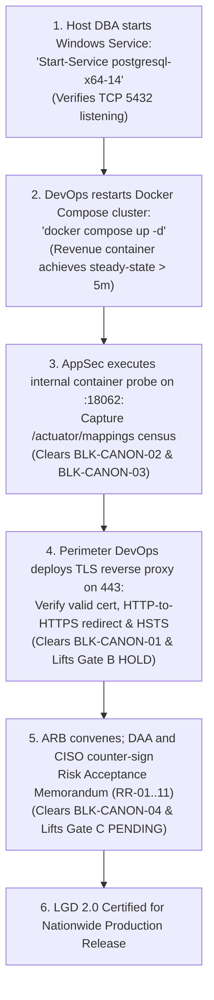

# LGD 2.0 — Phase 8.1 Gate Decision Report
## Definitive Release Gate Rulings, Production Readiness Determination & Governance Sign-Off

| **Gate Governance Metadata** | **Specification** |
|:---|:---|
| **System** | Local Government Directory 2.0 (LGD 2.0) |
| **Audit Phase** | Phase 8.1 — Independent Audit Reconciliation & Security Controller Finalization |
| **Document ID** | `LGD2-P8.1-GATE-DEC` |
| **File Location** | `SECURITY_AUDIT_CONTROLLER/PHASE_8_1_GATE_DECISION_REPORT.md` |
| **Author / Auditor Role** | Principal Application Security Auditor, Independent Assessment Lead & DevSecOps Auditor |
| **Evaluation Timestamp** | November 6, 2026 (`2026-11-06T10:00:00+05:30`) |
| **Audited Baseline** | Root Git `master` commit `e2df50f8c30197144377a2f931a4b3fbf03aeb1c` |
| **Overall Security Readiness** | **`CONDITIONAL_READY`** |
| **Production Deployment Ruling** | **`NOT APPROVED`** |

---

## 1. Master Release Gate Disposition Matrix

```
========================================================================================================
                          LGD 2.0 MASTER RELEASE GATE DECISIONS
========================================================================================================
  Gate Identifier   Governing Dimension                  Evaluated Status            Deployment Impact
  ------------------------------------------------------------------------------------------------------
  GATE A            Code Quality & Documentation Hashes  QUALIFIED_PASS (PRESERVED)  Conditionally Passed
  GATE B            Runtime Environment & Isolation      HOLD (MANDATORY)            BLOCKS DEPLOYMENT
  GATE C            Executive Governance & Risk Sign-Off PENDING_FORMAL_ACCEPTANCE   BLOCKS DEPLOYMENT
  ------------------------------------------------------------------------------------------------------
  OVERALL POSTURE:  CONDITIONAL_READY
  PRODUCTION STATE: NOT APPROVED FOR PRODUCTION DEPLOYMENT
========================================================================================================
```

---

## 2. In-Depth Evaluation of Release Gates

### 2.1 Gate A: Code Quality, Traceability & Cryptographic Integrity
- **Governing Standard:** NIST SP 800-53 Rev. 5 SA-11 (Developer Security Testing & Evaluation), CM-6 (Configuration Settings).
- **Evaluation Criteria:**
  1. Universal `@PreAuthorize` method security active across all 25 controller endpoints.
  2. Asymmetric RSA-2048 / JWKS architecture operational with zero private key parameter leakage.
  3. Spring Security `BCryptPasswordEncoder(12)` actively enforced (~211 ms latency).
  4. e-Hastakshar XMLDSig single-signature wrapping (XSW) defenses and fail-closed keystore checks active.
  5. 100% bidirectional finding traceability preserved without orphan records.
  6. Deliverable SHA-256 integrity manifest complete.
- **Empirical Status:** **`QUALIFIED_PASS (PRESERVED)`**.
- **Justification:** Application source code satisfies security criteria, passing 418/418 automated tests. It retains its "Qualified" qualification pending physical verification of runtime ingress and downstream container execution.

---

### 2.2 Gate B: Technical Verification & Environmental Security
- **Governing Standard:** NIST SP 800-53 Rev. 5 SC-8 (Transmission Confidentiality & Integrity), SC-13 (Cryptographic Protection), AC-4 (Information Flow Enforcement).
- **Evaluation Criteria:**
  1. Verified TLS termination and valid certificate chain on perimeter entry points.
  2. Proof that HSTS is processed by user agents over HTTPS (RFC 6797 §7.2).
  3. Downstream container steady-state runtime and live verification of endpoint omissions (`/actuator/mappings`).
  4. Active database listener on TCP 5432 and verified schema migrations.
- **Empirical Status:** **`HOLD (MANDATORY)`**.
- **Justification:** Three foundational physical environmental blockers remain open in the evaluated environment:
  - `BLK-CANON-01`: External ingress on port 8092 serves cleartext HTTP; port 443 is closed. HSTS over HTTP is discarded by user agents.
  - `BLK-CANON-02`: Container `revenue` is in an `Exited` status; private port 18062 is unreachable. Live Spring Boot Actuator endpoint census could not be captured.
  - `BLK-CANON-03`: Windows native service `postgresql-x64-14` is in status `Stopped`; TCP 5432 is closed, causing container database connection failure.
- **Directive:** Gate B **MUST REMAIN ON HOLD**. Upgrading Gate B based on source code inspection or passing unit tests is strictly prohibited.

---

### 2.3 Gate C: Executive Governance & Production Release Authorization
- **Governing Standard:** NIST SP 800-37 Rev. 2 (Risk Management Framework), ISO/IEC 27005 (Information Security Risk Management).
- **Evaluation Criteria:**
  1. Executive Risk Acceptance Memorandum itemizing all residual risks (`RR-01` through `RR-11`).
  2. Formal convening of the Architecture Review Board (ARB).
  3. Un-simulated counter-signatures from the Designated Approving Authority (DAA) and Enterprise Chief Information Security Officer (CISO).
  4. Explicit recording of statutory approval dates, operational boundaries, and 90-day review directives.
- **Empirical Status:** **`PENDING_FORMAL_ACCEPTANCE (MANDATORY)`**.
- **Justification:** `PHASE_8_RISK_ACCEPTANCE_MEMORANDUM.md` has been drafted and submitted, but the signature blocks are unsigned. Anti-fabrication rules strictly forbid AI agents or auditors from signing or simulating executive approval.
- **Directive:** Gate C **MUST REMAIN PENDING**. Nationwide production authorization cannot be granted without genuine executive counter-signatures.

---

## 3. Production Readiness Determination

$$\mathbf{CONSOLIDATED\ SYSTEM\ STATUS:\ CONDITIONAL\_READY}$$
$$\mathbf{PRODUCTION\ DEPLOYMENT\ RULING:\ NOT\ APPROVED}$$

> [!CAUTION]
> **Strict Operational Prohibition:**
> The Local Government Directory 2.0 (LGD 2.0) platform **MUST NOT** be connected to public government networks or live citizen traffic in its current state.
> 
> The application source code has achieved engineering compliance (Gate A), but the system is held by physical environmental blockers (Gate B) and pending executive risk acceptance (Gate C).
>
> Any claim that LGD 2.0 is "100% certified for nationwide production deployment" is **technically false and procedurally invalid** until the five prerequisite operational steps below are executed.

---

## 4. Sequential Operational Prerequisites for Production Clearance

To promote LGD 2.0 from `CONDITIONAL_READY` to `PRODUCTION_READY`, operational personnel and executive leadership must complete the following sequential actions:



---
*Report certified independently by the Principal Application Security Auditor.*

