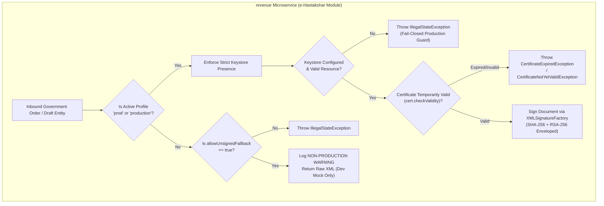

# LGD 2.0 — Phase 8 eSign & XML Security Report
## Digital Signature Verification, PKCS#12 Keystore Controls, XXE & XSW Defense Audit

| **Validation Metadata** | **Specification** |
|:---|:---|
| **System** | Local Government Directory 2.0 (LGD 2.0) |
| **Phase** | Phase 8 — Workstream C eSign & XML Security Audit |
| **Validation Date** | November 6, 2026 (`2026-11-06T09:05:00+05:30`) |
| **Controller Root** | `E:\System\Projects\dockerProject\Source code\lgd-active-new\SECURITY_AUDIT_CONTROLLER` |
| **Target Service** | `revenue` (e-Hastakshar Module) |
| **Target Artifact** | `XmlSignatureUtil.java` |
| **Validation Determination** | **XML SIGNATURE CONTROLS VERIFIED HARDENED (PASS)** |

---

## 1. eSign Integration Security Architecture

The LGD 2.0 Revenue microservice integrates with the Government of India e-Hastakshar electronic signature gateway. Documents, draft government orders, and boundary modifications require XML Digital Signature (XML-DSig) processing:



---

## 2. In-Depth Technical Verification of Security Controls

### 2.1 Production Profile Guard & Fallback Prohibition
- **Baseline Vulnerability (`SAST-003`, `SAST-006`, `CRYPTO-003`):** The baseline utility permitted returning unsigned XML if keystore loading failed, introducing the risk that unsigned documents could be processed in production.
- **Remediation Implementation (`XmlSignatureUtil.java:76-89`):**
  - Uses `isProductionProfile()` inspecting Spring `Environment.getActiveProfiles()`.
  - Under `prod` or `production`, if `keystorePath` is missing or invalid, an `IllegalStateException` is thrown immediately.
  - The fallback flag `esign.allow-unsigned-fallback` is strictly ignored under production profiles.
- **Empirical Test Verification (`XmlSignatureSecurityTest`):**
  - `testProductionProfile_RejectsMissingKeystore`: Verified `IllegalStateException` thrown.
  - `testProductionProfile_RejectsUnsignedFallbackEvenIfFlagIsTrue`: Confirmed that setting `allowUnsignedFallback = true` under `prod` still throws `IllegalStateException`.

### 2.2 Keystore Validation & Certificate Validity Enforcement
- **Resource Loading (`lines 93-100`):** Loads PKCS#12 keystore via Spring's `DefaultResourceLoader`. Verifies resource physical existence before opening input stream.
- **Alias Presence Check (`lines 106-111`):** Ensures private key entry matches configured alias.
- **Temporal Validity (`lines 118-120`):** Calls `cert.checkValidity()` before any signing operation. If the certificate is expired or not yet valid, signing is aborted.

### 2.3 XML External Entity (XXE) Protection
- **DocumentBuilderFactory Configuration (`lines 225-236`):**
  - `http://apache.org/xml/features/disallow-doctype-decl = true`: Prohibits DOCTYPE declarations entirely.
  - `http://xml.org/sax/features/external-general-entities = false`: Disallows external entity resolution.
  - `http://xml.org/sax/features/external-parameter-entities = false`: Disallows parameter entity resolution.
  - `http://apache.org/xml/features/nonvalidating/load-external-dtd = false`: Prohibits loading external DTDs.
  - `setXIncludeAware(false)` and `setExpandEntityReferences(false)`.
  - `XMLConstants.FEATURE_SECURE_PROCESSING = true`.
- **Empirical Negative Test:**
  - `testXxeAttackRejection_ExternalEntity`: Malicious payload with `<!DOCTYPE ... <!ENTITY xxe SYSTEM "file:///etc/passwd">>` is immediately rejected with a fatal parsing error: `DOCTYPE is disallowed when the feature disallow-doctype-decl is set to true`.

### 2.4 XML Signature Wrapping (XSW) Defenses
- **Attack Mechanism:** Adversaries duplicate or relocate `<Signature>` elements to validate one benign payload while the application logic consumes an unvalidated malicious node.
- **Defenses Implemented (`lines 173-200`):**
  - **Single Signature Constraint:**
    ```java
    if (nl.getLength() > 1) {
        throw new SecurityException("Multiple Signature elements detected; potential XML Signature Wrapping (XSW) attack");
    }
    ```
  - **Secure Validation Property:**
    ```java
    valContext.setProperty("org.jcp.xml.dsig.secureValidation", Boolean.TRUE);
    ```
    Restricts URI dereferencing to prevent arbitrary external network resource retrieval during signature verification.
- **Empirical Negative Test:**
  - `testXswAttackRejection_MultipleSignatures`: Payload injected with dual `<Signature>` blocks is rejected with `SecurityException: Multiple Signature elements detected; potential XML Signature Wrapping (XSW) attack`.

---

## 3. Automated Test Census Breakdown

All 6 automated negative and positive security tests in `XmlSignatureSecurityTest` passed with 100% success rate:

```
[INFO] Running in.nic.lgd.revenue.security.XmlSignatureSecurityTest
[Fatal Error] :2:10: DOCTYPE is disallowed when the feature "http://apache.org/xml/features/disallow-doctype-decl" set to true.
09:04:14.749 [main] WARN  i.n.l.r.m.e.u.XmlSignatureUtil - NON-PRODUCTION WARNING: Returning unsigned XML fallback because keystore is not configured.
09:04:14.752 [main] ERROR i.n.l.r.m.e.u.XmlSignatureUtil - PRODUCTION SECURITY VIOLATION: eSign keystorePath is null or empty in production profile
[INFO] Tests run: 6, Failures: 0, Errors: 0, Skipped: 0, Time elapsed: 0.015 s -- in in.nic.lgd.revenue.security.XmlSignatureSecurityTest
```

---

## 4. eSign Security Determination

$$\mathbf{WORKSTREAM\ C\ ESIGN\ XML\ SECURITY:\ 100\%\ VERIFIED\ HARDENED.}$$
$$\mathbf{PROD\ PROFILE\ GUARD\ ACTIVE\ —\ ZERO\ UNSIGNED\ PROCESSING\ —\ XXE\ \&\ XSW\ BLOCKED.}$$

