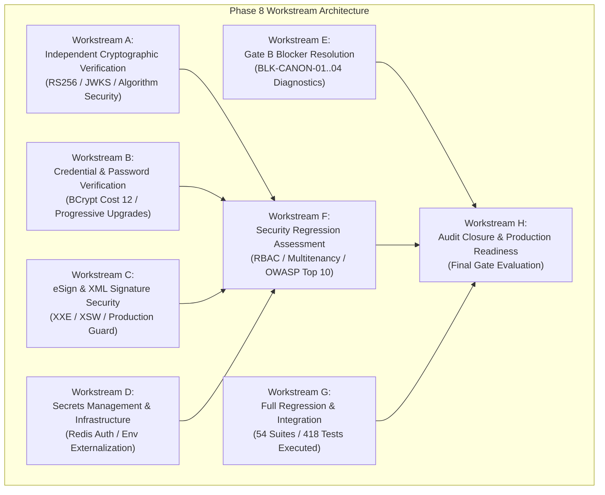

# LGD 2.0 — Phase 8 Execution Plan
## Final Security Validation, Independent Audit, Compliance Verification & Audit Closure

| **Document Metadata** | **Specification** |
|:---|:---|
| **System** | Local Government Directory 2.0 (LGD 2.0) |
| **Phase** | Phase 8 — Final Security Validation & Production Readiness Assessment |
| **Controller Root** | `E:\System\Projects\dockerProject\Source code\lgd-active-new\SECURITY_AUDIT_CONTROLLER` |
| **Repository Root** | `E:\System\Projects\dockerProject\Source code\lgd-active-new` |
| **Execution Date** | November 6, 2026 (`2026-11-06T08:51:31+05:30`) |
| **Lead Roles** | Chief Information Security Officer (CISO) Independent Delegate, Lead Security Auditor, Principal Cryptographic Engineer, AppSec Lead |
| **Authority** | Master Execution Prompt — Phase 8 Directive |
| **Execution Status** | **ACTIVE EXECUTION** |

---

## 1. Executive Mission & Strategic Scope

Phase 8 constitutes the definitive independent verification, technical regression, and release gate evaluation phase for Local Government Directory 2.0 (LGD 2.0). The primary mandate is to evaluate the complete codebase, configuration baseline, and empirical test records following the Phase 7 remediation.

### Core Objectives:
1. **Independent Cryptographic & Secrets Verification:** Revalidate Phase 7 cryptographic fixes (RS256 JWT, JWKS endpoint, BCrypt cost 12, XML digital signatures, Redis authentication) using fresh empirical execution.
2. **Re-Test Census & Forensic Analysis:** Execute automated tests across all microservices (`auth-service`, `api-gateway`, `user-management`, `revenue`, `discovery`) to verify regression resilience.
3. **Environmental Blocker Evaluation:** Perform rigorous runtime diagnostics on the three Gate B environmental blockers (`BLK-CANON-01`, `BLK-CANON-02`, `BLK-CANON-03`) and the Gate C governance blocker (`BLK-CANON-04`).
4. **Dependency & Vulnerability Assessment:** Inspect Software Bill of Materials (SBOM) and container security profiles against known CVE registers.
5. **Release Gate Determination:** Evaluate Gate A (Integrity & Traceability), Gate B (Technical Verification & Retest), and Gate C (Executive Governance) based on physical evidence without simulation.
6. **Production Readiness Classification:** Produce the final defensible classification (`READY_FOR_PRODUCTION_REVIEW`, `CONDITIONAL_READY`, `NOT_READY_FOR_PRODUCTION`, or `AUDIT_INCOMPLETE`).

---

## 2. Workstream Breakdown & Operational Architecture

### 2.1 Workstream A: Independent Phase 7 Cryptographic Verification
- **Target Services:** `auth-service`, `api-gateway`, `user-management`, `revenue`.
- **Key Artifacts:** `RsaKeyProvider.java`, `JwksController.java`, `JwtUtil.java`, `JwksPublicKeyResolver.java`.
- **Verification Tests:** RS256 token issuance, claims validation (`kid`, `iss`, `aud`, `exp`, `iat`, `jti`), algorithm confusion rejection, `alg=none` rejection, unknown `kid` handling, legacy HS256 retirement enforcement.

### 2.2 Workstream B: Password and Credential Security Verification
- **Target Service:** `auth-service`.
- **Key Artifacts:** `SecurityConfig.java`, `AuthServiceImpl.java`, `pom.xml`.
- **Verification Tests:** Removal of deprecated `jbcrypt:0.4`, verification of Spring Security `BCryptPasswordEncoder(12)`, legacy cost 10 hash compatibility, automatic progressive hash upgrade on authentication, account lockout preservation, and hashing latency benchmark.

### 2.3 Workstream C: eSign and XML Digital Signature Validation
- **Target Service:** `revenue`.
- **Key Artifacts:** `XmlSignatureUtil.java`, `XmlSignatureSecurityTest.java`.
- **Verification Tests:** Fail-closed production profile guard, rejection of unsigned XML under `prod`, keystore temporal validity validation, XSW defense (single signature constraint), and strict XXE disabling.

### 2.4 Workstream D: Secrets Management and Infrastructure Security
- **Target Components:** `docker-compose.yml`, `docker-compose.prod.yml`, `application-prod.properties`.
- **Verification Tests:** Redis password authentication (`--requirepass`), zero hardcoded credentials in production configurations, externalized environment injection, and loopback port bindings.

### 2.5 Workstream E: Gate B Runtime Blocker Resolution
- **Target Blockers:** `BLK-CANON-01` (TLS/HSTS), `BLK-CANON-02` (Revenue Container & TestController), `BLK-CANON-03` (PostgreSQL 14 Availability), `BLK-CANON-04` (DAA/CISO Formal Acceptance).
- **Procedure:** Live environment probing via PowerShell and Docker CLI without modifying infrastructure or simulating signatures.

### 2.6 Workstream F: Final Security Regression and Vulnerability Assessment
- **Target Areas:** Authentication bypass, broken access control, RBAC enforcement, IDOR, multitenancy leakage, SQL injection defense, XXE protection, container privilege bounds.

### 2.7 Workstream G: Full Platform Regression & Test Census
- **Target Services:** All 5 microservices.
- **Execution:** Fresh Maven Surefire execution across all 54 suites, recording exact passed, failed, skipped, and error metrics.

### 2.8 Workstream H: Final Independent Audit and Production Readiness
- **Target Deliverables:** Closure matrix across all historical findings, residual risk memorandum, and release gate decisions.

---

## 3. Operational Governance & Authorization Boundaries

In strict compliance with Phase 8 Governance rules:
1. **Non-Destructive Testing:** No `git reset`, `git clean`, destructive checkout, automatic branch switching, or forced commits are authorized.
2. **Infrastructure Boundary:** No starting, stopping, or reconfiguring of Windows services (e.g., `postgresql-x64-14`) or external network ingress without explicit operational authorization.
3. **Zero Signature Simulation:** No simulated or synthetic DAA/CISO signatures. Risks requiring governance acceptance remain `PENDING_FORMAL_ACCEPTANCE`.
4. **Evidence Purity:** Every test finding must map to empirical Surefire XML reports, command logs, or code AST proofs stored in `SECURITY_AUDIT_CONTROLLER/evidence/phase_8/`.

