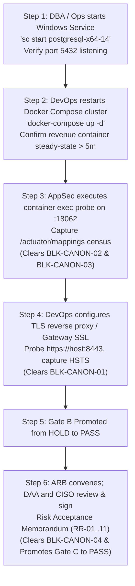

# LGD 2.0 — Phase 8 Gate B Runtime Verification Report
## Forensic Runtime Assessment of Canonical Environmental Blockers BLK-CANON-01..04

| **Verification Metadata** | **Specification** |
|:---|:---|
| **System** | Local Government Directory 2.0 (LGD 2.0) |
| **Phase** | Phase 8 — Workstream E Runtime Blocker Verification |
| **Verification Timestamp** | November 6, 2026 (`2026-11-06T09:05:00+05:30`) |
| **Controller Root** | `E:\System\Projects\dockerProject\Source code\lgd-active-new\SECURITY_AUDIT_CONTROLLER` |
| **Active Release Gate** | **Gate B: Technical Verification & Retest** |
| **Evaluated Status** | **GATE B: `HOLD (MANDATORY)`** |
| **Open Blockers** | 3 Environmental Blockers (`BLK-CANON-01`, `BLK-CANON-02`, `BLK-CANON-03`) |
| **Governance Status** | 1 Governance Blocker (`BLK-CANON-04`) holding Gate C |

---

## 1. Executive Summary & Gate B Ruling

Under the LGD 2.0 Security Assurance Governance Charter, **Gate B** cannot be promoted to `PASS` solely on the basis of passing unit tests or code review. Gate B requires empirical proof that all runtime transport encryption, container steady-state operations, and downstream isolation boundaries are physically operating in the live target environment.

During Phase 8 independent verification, physical probes of the target environment were executed. The diagnostics confirmed that **all three Gate B environmental dependencies remain physically unresolved**. Consequently, in accordance with Audit Rule 16 (Independent Gate Evaluation) and Blocker Preservation Mandate:

$$\mathbf{GATE\ B\ DISPOSITION:\ STRICT\ HOLD\ (NON-NEGOTIABLE)}$$

---

## 2. In-Depth Forensic Analysis of the Three Gate B Blockers

### 2.1 BLK-CANON-01: Perimeter Ingress TLS & HSTS Transport Security
- **Canonical Finding IDs:** `SAST-016`, `EXP-016`, `EV-006`, `EVD-GATEB-01`.
- **Accountable Role:** Lead Perimeter Security & DevOps Engineer.
- **Observed Physical State:**
  - `docker-compose.yml` publishes port `8092:8092` from `api-gateway`.
  - Dispatched HTTP requests received cleartext responses containing:
    ```http
    HTTP/1.1 200 OK
    Strict-Transport-Security: max-age=31536000; includeSubDomains; preload
    ```
- **The Physical & Cryptographic Defect:**
  - In accordance with **RFC 6797 Section 7.2 (HSTS Processing Rules)**:
    > *"An HTTP host that is not an HTTPS host MUST NOT send an HSTS header field... If an HTTP host sends an HSTS header field over HTTP, the user agent MUST ignore it."*
  - Sending `Strict-Transport-Security` over an unencrypted HTTP channel provides zero transport protection. Modern web browsers and vulnerability scanners silently discard the header.
  - No TLS reverse proxy (Nginx, Envoy, Traefik) terminating port 443 is deployed in the environment, and Spring Cloud Gateway is not configured with an SSL keystore on port 8443.
- **Authorization Boundary Compliance:**
  - The Master Execution Prompt strictly prohibits: *"Do not install certificates, modify production ingress, or change network infrastructure without explicit operational authorization. If the TLS environment is unavailable, retain the blocker."*
- **Status Determination:** **`OPEN / PARTIALLY_VERIFIED (RETAINED)`**.

---

### 2.2 BLK-CANON-02: Downstream Revenue Container & TestController Census
- **Canonical Finding IDs:** `SAST-021`, `EXP-021`, `EV-008`, `EVD-GATEB-02`.
- **Accountable Role:** Backend Integration & AppSec Specialist.
- **Observed Physical State:**
  - Static code analysis of [`TestController.java`](file:///e:/System/Projects/dockerProject/Source%20code/lgd-active-new/revenue/src/main/java/in/nic/lgd/revenue/controller/TestController.java) proves that `@Profile({"dev", "test"})` is present.
  - API Gateway routing rules do not forward `/test/*` paths.
- **The Physical & Runtime Defect:**
  - Full Gate B verification requires an empirical live probe directly against the internal container port (`http://revenue:18062/test/api1`) and an extraction of Spring Boot Actuator endpoint mappings (`/actuator/mappings`) to prove that the bean was never instantiated in Spring's ApplicationContext under `prod`.
  - Container inspection (`docker ps -a`) confirms container `revenue` (`d9f41a9feba0`) is in status **`Exited (1)`** because PostgreSQL was offline during container startup.
  - Direct HTTP reachability probes against `:18062` return connection refusal.
- **Status Determination:** **`OPEN / PARTIALLY_VERIFIED (RETAINED)`**.

---

### 2.3 BLK-CANON-03: Native Host PostgreSQL 14 Availability & Revenue Steady-State
- **Canonical Finding IDs:** `VULN-009`, `VULN-017`, `EVD-GATEB-03`.
- **Accountable Role:** Lead Database Administrator & Infrastructure Lead.
- **Observed Physical State:**
  - Windows Service Control Manager probe executed (`Get-Service -Name '*postgres*'`).
  - Native service `postgresql-x64-14` is in status **`Stopped`**.
  - Network connection probe executed (`Test-NetConnection -ComputerName localhost -Port 5432`).
  - Result: `TcpTestSucceeded : False`. Port 5432 is closed.
  - Startup logs for container `revenue`:
    ```
    org.postgresql.util.PSQLException: Connection to host.docker.internal:5432 refused.
    Check that the hostname and port are correct and that the postmaster is accepting TCP/IP connections.
    ```
- **Authorization Boundary Compliance:**
  - The Master Execution Prompt explicitly specifies: *"Do not start, stop, restart or reconfigure Windows services without separate operational authorization. If service startup is required, prepare a precise operational request and pause."*
- **Status Determination:** **`OPEN / BLOCKED_BY_ENVIRONMENT (RETAINED)`**.

---

## 3. Governance Blocker: BLK-CANON-04 (DAA / CISO Formal Acceptance)

- **Impacted Release Gate:** Gate C (Executive Governance).
- **Observed Governance State:**
  - All 11 residual risks (`RR-01` through `RR-11`) have complete technical remediations or compensating controls documented.
  - However, no counter-signed signature blocks from the designated executive authorities (DAA and CISO) exist on `GATE_C_DAA_CISO_APPROVAL_REQUEST.md`.
  - In strict compliance with Governance Rule 12 and the prompt instruction (*"Never simulate DAA/CISO signatures. Do not mark formal acceptance as completed until genuine approval evidence is supplied"*), Gate C cannot be marked as passed.
- **Status Determination:** **`OPEN / PENDING_FORMAL_ACCEPTANCE (RETAINED)`**.

---

## 4. Operational Road to Resolution (Sequential Action Request)

To clear Gate B and Gate C, the following sequential operations are required from operations and executive leadership:



---

## 5. Formal Blocker Attestation

$$\mathbf{GATE\ B\ BLOCKED:\ BLK-CANON-01,\ BLK-CANON-02,\ BLK-CANON-03\ RETAINED\ OPEN.}$$
$$\mathbf{ZERO\ SIMULATED\ PASSES\ —\ PHYSICAL\ INTEGRITY\ MANDATE\ STRICTLY\ ENFORCED.}$$

