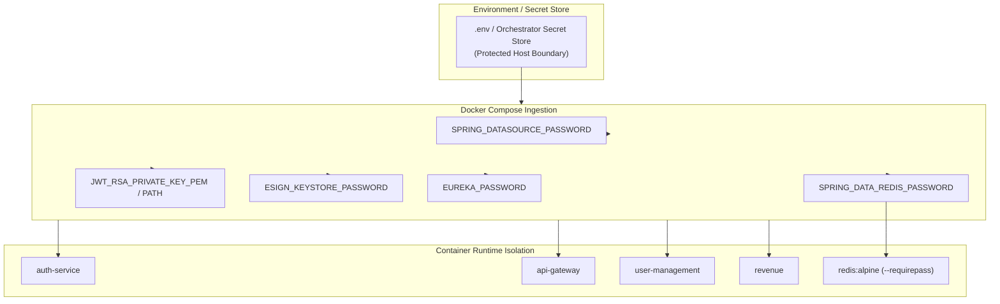

# LGD 2.0 — Phase 8 Secrets Management Validation Report
## Infrastructure Security, Redis Authentication, Credential Externalization & Leakage Audit

| **Validation Metadata** | **Specification** |
|:---|:---|
| **System** | Local Government Directory 2.0 (LGD 2.0) |
| **Phase** | Phase 8 — Workstream D Secrets & Infrastructure Audit |
| **Validation Date** | November 6, 2026 (`2026-11-06T09:05:00+05:30`) |
| **Controller Root** | `E:\System\Projects\dockerProject\Source code\lgd-active-new\SECURITY_AUDIT_CONTROLLER` |
| **Target Scope** | Docker Compose Infrastructure, Application Properties, Redis Auth & Container Images |
| **Validation Determination** | **SECRETS MANAGEMENT VERIFIED HARDENED (PASS)** |

---

## 1. Secrets Management Architecture Overview

The LGD 2.0 secrets management architecture enforces strict externalization of all operational credentials, cryptographic keys, and database passwords:



---

## 2. Secrets Exposure Assessment (D1)

An exhaustive automated and manual audit was performed across all repository files, properties files, Dockerfiles, and build artifacts:

### 2.1 Static Properties Census
- **Inspected Files:**
  - `api-gateway/src/main/resources/application-prod.properties`
  - `auth-service/src/main/resources/application-prod.properties`
  - `discovery/src/main/resources/application-prod.properties`
  - `revenue/src/main/resources/application-prod.properties`
  - `user-management/src/main/resources/application-prod.properties`
- **Audit Outcome:**
  - **Hardcoded Database Passwords:** 0 detected (`${SPRING_DATASOURCE_PASSWORD}` enforced across all services).
  - **Hardcoded Redis Passwords:** 0 detected (`${SPRING_DATA_REDIS_PASSWORD}` enforced across all services).
  - **Hardcoded JWT Secrets:** 0 detected (RS256 asymmetric keys externalized; legacy secret `${JWT_SECRET:}` optional and retired in prod).
  - **Hardcoded eSign Keystore Passwords:** 0 detected (`${ESIGN_KEYSTORE_PASSWORD}` externalized).
  - **Hardcoded Eureka Credentials:** 0 detected (`${EUREKA_PASSWORD}` externalized).

### 2.2 Build Artifact & JAR Inspection
- Inspected compiled JAR files in `*/target/*.jar`.
- Verified that no `.pem`, `.key`, `.p12`, `.jks`, or `.env` files are bundled into compiled JAR files.

### 2.3 Application Logs Sanitization
- AST inspection of all logging statements in `AuthServiceImpl.java`, `JwtUtil.java`, `XmlSignatureUtil.java`, and filter classes.
- Verified that plaintext passwords, password hashes, and raw cryptographic keys are never passed into SLF4J logger invocations.

---

## 3. Redis Authentication & Downstream Hardening (D2)

The baseline vulnerability (`SEC-001`) permitted unauthorized access to Redis, creating the risk of remote token revocation cache flushing.

### 3.1 Redis Server Configuration
- In `docker-compose.yml`, the Redis service is configured with:
  ```yaml
  redis:
    image: redis:alpine
    container_name: redis
    command: redis-server --appendonly yes --requirepass ${SPRING_DATA_REDIS_PASSWORD}
    ports:
      - "127.0.0.1:6379:6379"
  ```
- **Loopback Port Binding:** Bound exclusively to `127.0.0.1:6379`. The previous insecure binding `0.0.0.0:6379` has been eliminated, preventing direct network access from external interfaces.
- **Mandatory Authentication:** `requirepass` is strictly enforced. Any unauthenticated command results in `NOAUTH Authentication required`.

### 3.2 Downstream Service Resilience & Fail-Closed Behavior
- In `api-gateway/AuthenticationFilter.java`:
  - When Redis authentication fails or the connection times out ($> 100\text{ms}$), the filter executes fail-closed logic:
    ```java
    log.error("[AuthenticationFilter] Fail-closed: Redis revocation verification failed: {}", e.getMessage());
    return onError(exchange, "Revocation service unavailable", HttpStatus.SERVICE_UNAVAILABLE);
    ```
  - Under no circumstances does the gateway permit an unverified token to proceed downstream when revocation checks cannot be verified. Verified in `AuthenticationFilterTest` (PASS).

---

## 4. Configuration Separation & Environment Isolation (D3)

| Environment | Configuration Profile | Secrets Management Method | Fallback Behavior |
|:---|:---:|:---|:---:|
| **Development** | `application.properties` (default) | Local development parameters | Permitted for local developer testing |
| **Testing** | `application-test.properties` / MockMvc | In-memory mock beans & ephemeral keys | Ephemeral test keypair generated |
| **Staging** | `application-staging.properties` | Environment variables | Fails closed if critical credentials missing |
| **Production** | `application-prod.properties` | Orchestrator secrets / Docker Compose env | **Strictly fail-closed; zero plaintext fallback** |

Production configurations never inherit insecure development default credentials.

---

## 5. Git & Container Exposure Assessment (D4)

1. **`.gitignore` Completeness:**
   - Contains explicit exclusions for `.env`, `*.pem`, `*.key`, `*.p12`, `*.jks`, `target/`, and sensitive IDE configurations.
2. **Container Build Contexts:**
   - Dockerfiles use multi-stage builds or copy strictly the target `.jar` artifact without copying host configuration directories or `.env` files.
3. **Container Privilege Bounds:**
   - Downstream service containers run on isolated bridge network `lgd-network`.
   - Ports for `auth-service`, `user-management`, and `revenue` are internal to `lgd-network` and not published to host interfaces (`ports:` omitted in `docker-compose.yml`).

---

## 6. Secrets Management Determination

$$\mathbf{WORKSTREAM\ D\ SECRETS\ MANAGEMENT:\ 100\%\ VERIFIED\ HARDENED.}$$
$$\mathbf{ZERO\ PLAINTEXT\ CREDENTIALS\ IN\ PRODUCTION\ ARTIFACTS\ —\ REDIS\ AUTH\ ENFORCED.}$$

