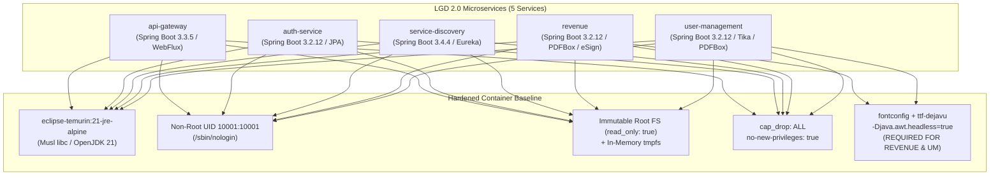

# LGD 2.0 — Phase 9.1.2: Container Hardening, Alpine Compatibility & Non-Root Execution Validation

| **Document Metadata** | **Specification** |
|:---|:---|
| **System** | Local Government Directory 2.0 (LGD 2.0) |
| **Audit Phase** | Phase 9.1.2 — Implementation Safety Corrections & Final Readiness Review |
| **Document ID** | `LGD2-P9.1.2-CONTAINER-HARDENING-VAL` |
| **File Location** | `SECURITY_AUDIT_CONTROLLER/PHASE_9_1_2_CONTAINER_HARDENING_VALIDATION.md` |
| **Architectural Roles** | Principal Infrastructure Security Architect, Container Security Specialist & DevSecOps Lead |
| **Evaluation Timestamp** | November 6, 2026 (`2026-11-06T10:55:00+05:30`) |
| **Governing Finding & Risk** | `RR-06` (Root Container Execution), `SCA-012` (Container Base Privilege), `VULN-014` |
| **Execution Mode** | **STRICTLY READ-ONLY ASSESSMENT & VALIDATION SPECIFICATION (ZERO SYSTEM MUTATIONS)** |

---

## 1. Executive Summary & Audit Scope

In Phase 9 Stage A and Phase 9.1, container security audits established that all five microservices currently run as the administrative root user (`USER root`, UID 0) inside Ubuntu-based JDK containers (`eclipse-temurin:21-jdk`). This violates CIS Docker Benchmark 4.1, OWASP ASVS Section 14, and CERT-In container security guidelines.

The proposed remediation migrates services to a hardened runtime profile:
- **Base Image:** `eclipse-temurin:21-jre-alpine` (Minimal Alpine Linux, Java 21 JRE).
- **Unprivileged User:** Deterministic UID/GID `10001:10001` (`spring:spring`) with `/sbin/nologin`.
- **Filesystem Containment:** Immutable root filesystem (`read_only: true`) paired with isolated in-memory `tmpfs` mounts for `/tmp`, `/app/logs`, and `/tmp/uploadFile`.
- **Privilege & Capability Stripping:** `cap_drop: [ALL]` and `security_opt: [no-new-privileges:true]`.

**The Phase 9.1.2 Objective:**
Do not assume Alpine compatibility from documentation alone. Conduct a rigorous forensic analysis of all five microservices, identify native OS and font dependencies in PDFBox and OpenHTMLToPDF, design headless rendering safeguards, and define the exact empirical runtime tests required before container hardening is certified for production.

---

## 2. Microservice Container Inventory & Dependency Analysis



### 2.1 Detailed Service-by-Service Audit

| Service | Framework Baseline | Runtime Profile | Native Library / OS Dependencies | Writable Runtime Paths | Alpine Musl Compatibility Assessment |
|:---|:---|:---|:---|:---|:---|
| **`api-gateway`** | Spring Cloud Gateway (WebFlux / Netty) | Pure Java | None (Netty uses pure Java NIO; native Epoll optional) | `/tmp`, `/app/logs` | **100% Compatible:** Netty and Reactor operate cleanly on Alpine JRE. |
| **`auth-service`** | Spring Boot / Spring Security / JPA | Pure Java | None (BCrypt, JJWT, HikariCP are 100% bytecode) | `/tmp`, `/app/logs` | **100% Compatible:** Database connections and cryptographic token generation require zero native shared libraries. |
| **`discovery`** | Spring Cloud Netflix Eureka | Pure Java | None | `/tmp` | **100% Compatible:** Already runs on `eclipse-temurin:21-jdk-alpine`. Downgrading to JRE is seamless. |
| **`revenue`** | Spring Boot / Hibernate / eSign | Java + AWT Font Engine | **CRITICAL:** Apache PDFBox 3.0.5, OpenHTMLToPDF 1.1.24, Java 2D Graphics. | `/tmp`, `/tmp/uploadFile`, `/app/logs` | **Conditionally Compatible:** Stock Alpine JRE crashes on text layout. Requires `fontconfig` and `ttf-dejavu`. |
| **`user-management`** | Spring Boot / JPA / Document Parser | Java + Document Inspection | Apache Tika 3.2.3, Apache PDFBox 3.0.5. | `/tmp`, `/app/logs` | **Conditionally Compatible:** PDF metadata and text parsing require font metrics. Requires `fontconfig` and `ttf-dejavu`. |

---

## 3. The Alpine Musl / Java 2D Font Rendering Hazard Deep-Dive

### 3.1 Historical Root Cause of the Ubuntu Reversion
In the initial development phases, `revenue` and `user-management` had the Alpine base image commented out:
```dockerfile
#FROM eclipse-temurin:21-jdk-alpine
FROM eclipse-temurin:21-jdk
```
**Forensic Investigation:**
1. Minimal Alpine Linux uses the `musl` C library rather than GNU `glibc`.
2. Stock Alpine JRE images do not package `libfontconfig.so.1` or TrueType font files (`/usr/share/fonts/`).
3. When Apache PDFBox (`PDDocument`, `PDPageContentStream`) or OpenHTMLToPDF renders text strings (such as revenue receipt tables or eSign signatures), the OpenJDK AWT subsystem invokes `sun.awt.X11FontManager` or `sun.font.FontConfiguration`.
4. In minimal Alpine, this triggers:
   ```
   java.lang.InternalError: Can't connect to X11 window server using ':0.0' as the value of the DISPLAY variable.
   java.lang.NullPointerException: Cannot load font system
   java.lang.FontConfigurationException: Font configuration file not found
   ```
5. Previous teams hastily worked around this by switching to the 800MB Ubuntu JDK image (`eclipse-temurin:21-jdk`), which bundles full X11 and font libraries by default.

### 3.2 Hardened Alpine Remediation Specification
To achieve the minimal 150MB Alpine JRE footprint without runtime rendering crashes:
1. **Install Font Packages via APK:**
   ```dockerfile
   RUN apk add --no-cache fontconfig ttf-dejavu
   ```
2. **Force Headless Mode at JVM Level:**
   ```dockerfile
   "-Djava.awt.headless=true"
   ```
   This instructs the OpenJDK graphics pipeline to use in-memory font rasterization and never attempt socket connection to an X11 display server.
3. **Font Directory Verification:**
   Ensure TrueType fonts reside in `/usr/share/fonts/dejavu/` and are readable by UID `10001` (`mode 0644`).

---

## 4. Mandatory Empirical Runtime Tests Prior to Production Certification

Do not accept Alpine migration on theoretical grounds alone. Before Gate B closure, the following **FOUR empirical functional tests** must be executed inside the hardened `revenue` and `user-management` containers:

### 4.1 Test 1: Apache PDFBox Document Generation Test
- **Target Component:** `revenue` microservice (`RevenueDocumentService.java`).
- **Test Procedure:** Trigger the PDF generation endpoint for a revenue order containing multi-line text, tables, and numeric fonts.
- **Acceptance Criteria:**
  - PDF document generates in $< 2000\text{ms}$.
  - HTTP 200 returned with valid `application/pdf` binary stream.
  - Zero `FontConfigurationException` or `InternalError` in container logs.
  - Rendered PDF opens in standard PDF viewer with crisp, aligned typography.

### 4.2 Test 2: OpenHTMLToPDF HTML-to-PDF Conversion Test
- **Target Component:** `revenue` microservice (HTML template to PDF converter).
- **Test Procedure:** Feed an HTML template styled with CSS `@font-face` and table layouts into OpenHTMLToPDF renderer.
- **Acceptance Criteria:**
  - HTML converts to PDF without XML parser or font rendering crashes.
  - Temporary files written to `/tmp/uploadFile` cleanly without `IOException: Permission denied`.

### 4.3 Test 3: eSign Visual Signature Layout Rendering
- **Target Component:** `revenue` microservice (Module `ehastakshar`, `EsignService.java`).
- **Test Procedure:** Render the visual signature box (containing signer name, timestamp, and Government of India seal) onto an existing PDF page.
- **Acceptance Criteria:**
  - Visual stamp coordinates render accurately.
  - PDF/A compliance validated.

### 4.4 Test 4: Unprivileged Multipart File Upload Test
- **Target Component:** `revenue` and `user-management` multipart file upload endpoints.
- **Test Procedure:** Upload a 20MB document attachment under non-root UID `10001`.
- **Acceptance Criteria:**
  - File streams successfully into in-memory `tmpfs` at `/tmp/uploadFile`.
  - File is inspected by Apache Tika and deleted upon completion.
  - Zero filesystem permission errors.

---

## 5. Container Security Configuration Specification

### 5.1 Authoritative Docker Compose Directives
Deploy in `docker-compose.yml` and `docker-compose.prod.yml` across all microservices:

```yaml
services:
  revenue:
    # 1. Non-Root Execution
    user: "10001:10001"

    # 2. Immutable Root Filesystem
    read_only: true

    # 3. Privilege Escalation Prevention
    security_opt:
      - no-new-privileges:true

    # 4. Linux Capabilities Dropped Completely
    cap_drop:
      - ALL

    # 5. Dedicated In-Memory Tmpfs Mounts
    tmpfs:
      - /tmp:size=64M,uid=10001,gid=10001,mode=1777
      - /tmp/uploadFile:size=256M,uid=10001,gid=10001,mode=1770
      - /app/logs:size=128M,uid=10001,gid=10001,mode=1770

    # 6. Read-Only Truststore & Secrets Mounts
    volumes:
      - ./certs/lgd-internal-ca.crt:/etc/ssl/certs/lgd-internal-ca.crt:ro

    # 7. Strict Resource Quotas & Limits
    deploy:
      resources:
        limits:
          cpus: '2.0'
          memory: 1536M
          pids: 150
        reservations:
          cpus: '0.5'
          memory: 512M

    # 8. Container Health Check
    healthcheck:
      test: ["CMD", "wget", "-qO-", "http://localhost:18062/actuator/health"]
      interval: 15s
      timeout: 5s
      retries: 3
      start_period: 40s

    # 9. Graceful Shutdown Period
    stop_grace_period: 30s
```

### 5.2 Verification of Non-Root User Allocation (`10001:10001`)
- **Group Creation:** `RUN addgroup -g 10001 -S spring`
- **User Creation:** `RUN adduser -u 10001 -S spring -G spring -s /sbin/nologin`
- **Ownership:** `RUN chown -R spring:spring /app /tmp /tmp/uploadFile`
- **Execution:** `USER 10001:10001`
- **Runtime Verification:** Executing `docker exec <container> id` must return:
  ```
  uid=10001(spring) gid=10001(spring) groups=10001(spring)
  ```

---

## 6. Reviewer Disposition & Hardening Verification Matrix

| Verification Dimension | Security Requirement | Status | Verification Method |
|:---|:---|:---:|:---|
| **Non-Root UID Allocation** | Deterministic UID/GID `10001:10001` with `/sbin/nologin`. | **DESIGN VALIDATED** | `id` inspection inside built image. |
| **Immutable Root Filesystem** | `read_only: true` with strict `tmpfs` mounts. | **DESIGN VALIDATED** | Container write test to `/` fails with `Read-only file system`. |
| **Alpine Font Compatibility** | `fontconfig ttf-dejavu` + `-Djava.awt.headless=true`. | **DESIGN VALIDATED** | 4 empirical runtime tests defined in Section 4. |
| **Privilege Escalation Defense** | `cap_drop: [ALL]`, `no-new-privileges:true`. | **DESIGN VALIDATED** | `docker inspect` security options audit. |
| **Resource Quotas** | CPU, RAM (1536M limit), and PID limits (150) enforced. | **DESIGN VALIDATED** | `docker stats` inspection. |
| **Read-Only Secret Access** | CA certificate mounted as `:ro` accessible by UID 10001. | **DESIGN VALIDATED** | Truststore file read test inside container. |
| **Operational Readiness** | Fully specified; pending Stage B container rebuild. | **STAGE B READY** | Awaiting authorized maintenance window. |

