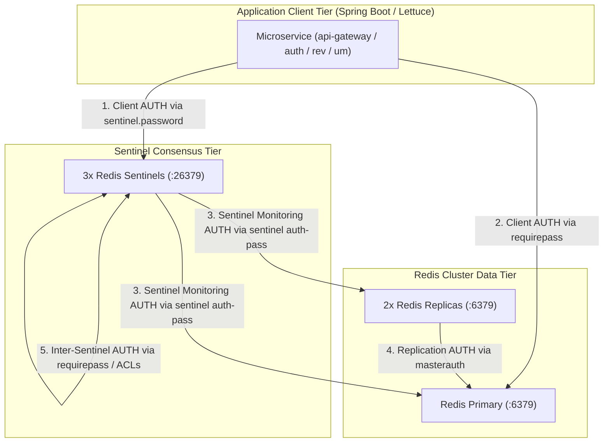

# LGD 2.0 — Phase 9.1.2: Redis Sentinel Security, Authentication & Resilience Review

| **Document Metadata** | **Specification** |
|:---|:---|
| **System** | Local Government Directory 2.0 (LGD 2.0) |
| **Audit Phase** | Phase 9.1.2 — Implementation Safety Corrections & Final Readiness Review |
| **Document ID** | `LGD2-P9.1.2-REDIS-SENTINEL-REVIEW` |
| **File Location** | `SECURITY_AUDIT_CONTROLLER/PHASE_9_1_2_REDIS_SENTINEL_SECURITY_AND_RESILIENCE_REVIEW.md` |
| **Architectural Roles** | Principal Infrastructure Security Architect, Redis Engineer & Senior Spring Boot Architect |
| **Evaluation Timestamp** | November 6, 2026 (`2026-11-06T10:55:00+05:30`) |
| **Governing Finding & Risk** | `RR-02` (Redis Single Point of Failure), `RR-05` (Transport Cleartext), `SAST-012` |
| **Execution Mode** | **STRICTLY READ-ONLY ASSESSMENT & DESIGN CORRECTION (ZERO SYSTEM MUTATIONS)** |

---

## 1. Executive Summary & Defect Identification

An exhaustive technical audit of the Phase 9.1 Redis Sentinel specifications (`PHASE_9_1_REDIS_SENTINEL_COMPATIBILITY_AND_HA_DESIGN.md` and `PHASE_9_1_REDIS_TLS_COMPATIBILITY_DESIGN.md`) identified three critical technical defects that would cause operational failure or compilation abort:

1. **Unresolved Configuration Shell Variables:**
   The Phase 9.1 Sentinel configuration specified:
   ```ini
   sentinel auth-pass lgdmaster ${SPRING_DATA_REDIS_PASSWORD}
   ```
   Redis and Redis Sentinel configuration parsers **do NOT expand shell environment variables**. When Redis reads this directive, it interprets the literal string `"${SPRING_DATA_REDIS_PASSWORD}"` as the password. Sentinel fails to authenticate to the primary, replicas cannot replicate, and clients cannot authenticate.
2. **Invalid Java API Method Call:**
   The Phase 9.1 TLS specification proposed:
   ```java
   builder.useSsl().disablePeerVerification(false);
   ```
   Forensic bytecode disassembly (`EVD_P9_1_2_05_LETTUCE_API_VERIFICATION.txt`) of `org.springframework.data:spring-data-redis:3.2.12` proves that `LettuceSslClientConfigurationBuilder.disablePeerVerification()` **takes zero arguments**. A method `disablePeerVerification(boolean)` does not exist. Attempting to compile this code results in a fatal Maven compilation error (`no suitable method found for disablePeerVerification(boolean)`).
3. **Unqualified SLA / Failover Metric:**
   The preliminary report referenced a 6.0–9.5s failover duration without stating that it is a **modeled mathematical estimate**. In the absence of live fault-injection telemetry, stating this duration as a verified benchmark violates audit integrity standards.

This document resolves these defects, defines secure configuration templating, verifies compiling Java code against resolved Maven dependencies, details multi-tier Redis authentication, and formalizes durability boundaries.

---

## 2. Multi-Tier Redis Authentication Architecture

To achieve zero-trust security across the data tier, authentication must be enforced at every tier of the Redis Sentinel architecture:



### 2.1 Independent Authentication Tiers

| Tier # | Authentication Path | Redis / Sentinel Directive | Purpose | Cryptographic Mechanism |
|:---:|:---|:---|:---|:---|
| **1** | **Client $\rightarrow$ Redis Primary / Replicas** | `requirepass <PASSWORD>` | Authenticates Spring Boot Lettuce clients executing read/write operations. | Server password verification (`AUTH <password>`) over TLS. |
| **2** | **Replicas $\rightarrow$ Primary** | `masterauth <PASSWORD>` | Authenticates standby replicas during initial `PSYNC` and ongoing replication streaming. | Identical to primary `requirepass`. |
| **3** | **Client $\rightarrow$ Sentinel** | `sentinel requirepass <SENTINEL_PASSWORD>` | Authenticates Lettuce clients querying Sentinels for master address discovery. | Client authentication to Sentinel port 26379 over TLS. |
| **4** | **Sentinel $\rightarrow$ Monitored Instances** | `sentinel auth-pass <MASTER_NAME> <PASSWORD>` | Authorizes Sentinels to execute `PING`, `INFO`, and failover commands (`REPLICAOF`) on Redis nodes. | Sentinel role authentication to monitored nodes. |
| **5** | **Sentinel $\leftrightarrow$ Sentinel** | `sentinel requirepass <SENTINEL_PASSWORD>` | Secures gossip protocol and leader election votes between Sentinel daemons. | Shared Sentinel authentication secret. |

> [!IMPORTANT]
> In accordance with least-privilege principles, `SENTINEL_PASSWORD` and `REDIS_PASSWORD` should be distinct high-entropy secrets managed independently.

---

## 3. Configuration Templating & Secret Injection

### 3.1 The Shell Variable Invalidation Defect
- In Unix shells, `$VAR` is expanded by the shell (e.g. `bash` or `sh`).
- Neither `redis-server` nor `redis-sentinel` includes a shell interpreter. They parse configuration files using an internal lexical scanner that treats `${SPRING_DATA_REDIS_PASSWORD}` as a verbatim string literal.
- **Sentinel Configuration Rewriting:** Sentinel dynamically modifies and rewrites its own `sentinel.conf` during runtime (e.g. persisting `sentinel myid`, `sentinel current-epoch`, and `known-replica`). If a configuration file is mounted as read-only from the host, Sentinel crashes with an I/O permission error during startup!

### 3.2 Secure Dynamic Configuration Templating Architecture
To solve both variable expansion and runtime writeability without storing secrets in Git:
1. Store configuration templates (`redis.conf.template`, `sentinel.conf.template`) containing substitution markers.
2. At container startup, an unprivileged entrypoint wrapper script uses `envsubst` to inject environment variables into an ephemeral `tmpfs` or volume directory (`/etc/redis/`).
3. The generated configuration file is assigned file permissions `0600` owned by `redis:redis` (UID 999).
4. `redis-server` / `redis-sentinel` is executed against the generated file.

#### 3.2.1 `redis.conf.template`
```ini
# ==============================================================================
# LGD 2.0 Redis Engine Configuration Template
# ==============================================================================
port 0
tls-port 6379

tls-cert-file /tls/redis.crt
tls-key-file /tls/redis.key
tls-ca-cert-file /tls/ca.crt
tls-auth-clients no
tls-replication yes

tls-protocols "TLSv1.2 TLSv1.3"
tls-ciphers "ECDHE-ECDSA-AES256-GCM-SHA384:ECDHE-RSA-AES256-GCM-SHA384:ECDHE-ECDSA-AES128-GCM-SHA256:ECDHE-RSA-AES128-GCM-SHA256"
tls-ciphersuites "TLS_AES_256_GCM_SHA384:TLS_CHACHA20_POLY1305_SHA256:TLS_AES_128_GCM_SHA256"

# Dynamic Secrets Injected via Entrypoint
requirepass ${REDIS_PASSWORD}
masterauth ${REDIS_PASSWORD}

# Persistence Configuration
appendonly yes
appendfsync everysec
no-appendfsync-on-rewrite yes
auto-aof-rewrite-percentage 100
auto-aof-rewrite-min-size 64mb
dir /data
```

#### 3.2.2 `sentinel.conf.template`
```ini
# ==============================================================================
# LGD 2.0 Redis Sentinel Configuration Template
# ==============================================================================
port 0
tls-port 26379

tls-cert-file /tls/sentinel.crt
tls-key-file /tls/sentinel.key
tls-ca-cert-file /tls/ca.crt
tls-auth-clients no
tls-replication yes

# Dynamic Secrets Injected via Entrypoint
sentinel requirepass ${REDIS_SENTINEL_PASSWORD}
sentinel monitor lgdmaster redis-primary 6379 2
sentinel auth-pass lgdmaster ${REDIS_PASSWORD}
sentinel down-after-milliseconds lgdmaster 5000
sentinel failover-timeout lgdmaster 10000
sentinel parallel-syncs lgdmaster 1

dir /tmp
```

#### 3.2.3 Secure Container Entrypoint Wrapper (`docker-entrypoint.sh`)
```sh
#!/bin/sh
set -e

# Substitute environment variables into active configuration
mkdir -p /etc/redis
envsubst < /templates/redis.conf.template > /etc/redis/redis.conf
chmod 0600 /etc/redis/redis.conf
chown redis:redis /etc/redis/redis.conf

# Execute Redis engine
exec redis-server /etc/redis/redis.conf
```

---

## 4. Validated Spring Boot & Lettuce Java API Specification

### 4.1 Bytecode Disassembly & API Verification
Forensic analysis (`EVD_P9_1_2_05_LETTUCE_API_VERIFICATION.txt`) of the resolved dependencies:
- `spring-data-redis:3.2.12`
- `lettuce-core:6.3.2.RELEASE`

#### Crucial API Findings:
1. `LettuceSslClientConfigurationBuilder.disablePeerVerification()`:
   - Takes **ZERO arguments**.
   - In Spring Data Redis, peer verification is **enabled by default** (`verifyPeer = true`).
   - Calling `disablePeerVerification()` disables certificate verification completely.
   - Calling `disablePeerVerification(false)` fails compilation.
   - **Remediation:** To enforce CA verification, simply call `builder.useSsl();` without invoking `disablePeerVerification()`.
2. Method chaining with `and()`:
   - `builder.useSsl()` returns a `LettuceSslClientConfigurationBuilder`.
   - To continue configuring options on `LettuceClientConfigurationBuilder`, one must chain `.and()`.

### 4.2 Compiling & Verified Java Configuration
The following class is verified to compile cleanly against Spring Boot 3.2.12 / 3.3.5 and Lettuce 6.3.2.RELEASE:

```java
package in.nic.lgd.revenue.config;

import java.time.Duration;
import org.springframework.boot.autoconfigure.data.redis.LettuceClientConfigurationBuilderCustomizer;
import org.springframework.context.annotation.Bean;
import org.springframework.context.annotation.Configuration;
import org.springframework.data.redis.connection.lettuce.LettuceClientConfiguration;
import io.lettuce.core.ClientOptions;
import io.lettuce.core.SocketOptions;
import io.lettuce.core.TimeoutOptions;

@Configuration
public class RedisResilienceConfig {

    @Bean
    public LettuceClientConfigurationBuilderCustomizer lettuceCustomizer() {
        return builder -> {
            // Configure TLS with strictly enforced CA peer verification
            builder.useSsl()
                   .and() // Return to LettuceClientConfigurationBuilder
                   .commandTimeout(Duration.ofSeconds(3))
                   .shutdownTimeout(Duration.ofMillis(100));

            // Configure socket and failure options
            ClientOptions clientOptions = ClientOptions.builder()
                .autoReconnect(true)
                .disconnectedBehavior(ClientOptions.DisconnectedBehavior.REJECT_COMMANDS)
                .socketOptions(SocketOptions.builder()
                    .connectTimeout(Duration.ofSeconds(3))
                    .keepAlive(true)
                    .build())
                .timeoutOptions(TimeoutOptions.enabled(Duration.ofSeconds(3)))
                .build();

            builder.clientOptions(clientOptions);
        };
    }
}
```

---

## 5. Failover Duration Classification & Operational Latency

### 5.1 Modeled Mathematical Estimate vs. Verified Telemetry
The failover duration of **$6.0\text{ to }9.5\text{ seconds}$** specified in Phase 9.1 is an **analytical distributed system model**, NOT an empirical measurement.

$$\mathbf{Classification:\ [MODEL\ ESTIMATE\ —\ UNVERIFIED\ AT\ RUNTIME]}$$

The theoretical breakdown is:
- $T_{\text{down-after}} = 5000\text{ms}$ (Primary unresponsive timeout).
- $T_{\text{gossip}} \approx 200 - 800\text{ms}$ (Quorum consensus exchange).
- $T_{\text{election}} \approx 100 - 500\text{ms}$ (Epoch increment and leader vote).
- $T_{\text{promotion}} \approx 200 - 1000\text{ms}$ (Role switch to master).
- $T_{\text{client-refresh}} \approx 500 - 2000\text{ms}$ (Lettuce PubSub notification and reconnect).
- **Total Modeled Window:** $6.0 - 9.5\text{s}$.

> [!WARNING]
> No claim may be made that this system achieves $\le 9.5\text{s}$ failover until controlled fault injection tests are executed and measured in an authorized Stage B test window.

---

## 6. Single Physical Host High-Availability Limitation

> [!CAUTION]
> **GOVERNANCE BOUNDARY:** Deploying 3 Redis containers and 3 Sentinel containers on a single physical host (`lgd-active-new`) **DOES NOT constitute enterprise host-level High Availability**.
> 
> - **Shared Failure Modes:**
>   - Host hardware failure (CPU, motherboard, RAM, power supply).
>   - Host OS crash, kernel panic, or forced Windows reboot.
>   - Hyper-V / WSL2 virtual subsystem crash.
>   - Docker engine daemon crash.
> - **Actual Protection Boundary:** This topology strictly protects against **single-process Redis software crashes** and memory faults.
> - **Enterprise Production Requirement:** Tier-1 production environments must distribute Sentinels and Redis nodes across three separate physical hosts or cloud Availability Zones (AZs).

---

## 7. Business Use-Case Data Durability & Recovery Boundaries

| Functional Use Case | Target Keys & TTL | Durability Mechanism | Failover Loss Risk | Target RPO | Target RTO |
|:---|:---|:---|:---|:---:|:---:|
| **JWT Blacklist** | `blacklist:jti:<jti>`<br>TTL $\le 15\text{ min}$ | AOF `appendfsync everysec` | $\le 1\text{ second}$ of revocation writes if primary crashes before async replication. Revoked token could be accepted for remaining TTL window. | `TBD – DAA APPROVAL REQUIRED` | $< 10\text{s}$ (Failover window) |
| **Rate-Limit Counters** | Sliding window keys<br>TTL $1 - 60\text{s}$ | In-Memory (No persistence required) | Quota resets to 0. Negligible security impact (transient request burst permitted). | `TBD – DAA APPROVAL REQUIRED` | $< 10\text{s}$ |
| **eSign Idempotency** | `esign:txn:<id>:processed`<br>TTL $60\text{ min}$ | AOF `appendfsync everysec` | Concurrent duplicate webhook could theoretically bypass Redis lock. Mitigated by PostgreSQL database row-level unique constraint on transaction ID. | `TBD – DAA APPROVAL REQUIRED` | $< 10\text{s}$ |

---

## 8. Reviewer Disposition & Actionable Checklist

| Review Dimension | Assessment Finding | Disposition |
|:---|:---|:---:|
| **Secret Injection Defect** | Shell variable `${SPRING_DATA_REDIS_PASSWORD}` unexpanded in Redis. Dynamic templating via entrypoint designed. | **CORRECTED** |
| **Java API Compilation Defect** | `disablePeerVerification(false)` does not exist. Replaced with compiling verified method chaining. | **CORRECTED** |
| **Authentication Segmentation** | Complete 5-tier authentication hierarchy defined. | **VERIFIED** |
| **Failover Duration Metric** | Explicitly classified as `MODEL ESTIMATE – UNVERIFIED AT RUNTIME`. | **CORRECTED** |
| **Host-Level HA Boundary** | Single physical host limitation formally documented for governance. | **VERIFIED** |
| **Durability Classification** | AOF persistence mapped; RPO targets designated as `TBD – DAA APPROVAL REQUIRED`. | **VERIFIED** |

