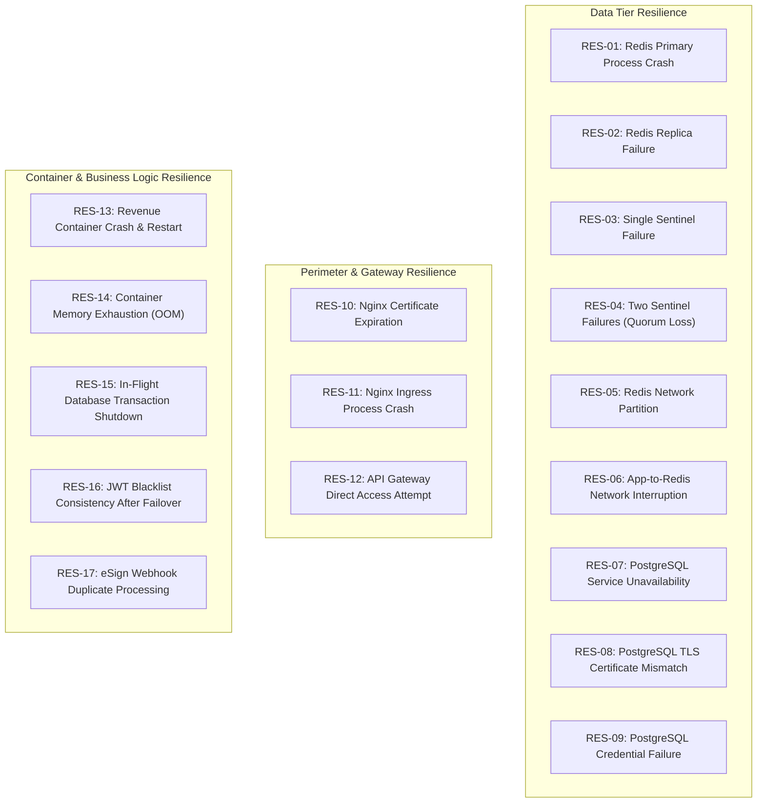

# LGD 2.0 — Phase 9.1.2: Infrastructure Resilience & Fault Injection Test Plan

| **Document Metadata** | **Specification** |
|:---|:---|
| **System** | Local Government Directory 2.0 (LGD 2.0) |
| **Audit Phase** | Phase 9.1.2 — Implementation Safety Corrections & Final Readiness Review |
| **Document ID** | `LGD2-P9.1.2-RESILIENCE-TEST-PLAN` |
| **File Location** | `SECURITY_AUDIT_CONTROLLER/PHASE_9_1_2_RESILIENCE_AND_FAILURE_TEST_PLAN.md` |
| **Architectural Roles** | Principal Infrastructure Security Architect, Lead Chaos Engineer & DevSecOps Lead |
| **Evaluation Timestamp** | November 6, 2026 (`2026-11-06T10:55:00+05:30`) |
| **Governing Finding & Risk** | `RR-02` (Redis SPOF), `RR-05` (Transport Cleartext), `BLK-CANON-01`, `BLK-CANON-02`, `BLK-CANON-03` |
| **Execution Demarcation** | **STRICTLY `TEST_DESIGN_ONLY` — ZERO ACTIVE FAULT INJECTION EXECUTED** |

---

## 1. Executive Summary & Purpose

A critical deliverable omitted from previous Phase 9 activities was a dedicated, comprehensive **Infrastructure Resilience and Fault Injection Test Plan**. While preliminary reports modeled failover durations and fail-closed behaviors, no formal test specification existed to validate system stability under real-world crash, partition, and corruption events.

This document establishes the authoritative test plan covering **seventeen (17) specific infrastructure failure scenarios**.

> [!CRITICAL]
> **GOVERNANCE DEMARCATION:**
> In accordance with Section 9 of the Phase 9.1.2 Directive:
> - Every test case in this document is classified strictly as **`TEST_DESIGN_ONLY`**.
> - **Zero fault injection commands were executed during Phase 9.1.2.**
> - No test case may be marked as `EXECUTED_AND_VERIFIED` until it is physically performed during an authorized Stage B maintenance window and backed by authentic logs and timestamped telemetry.

---

## 2. Test Execution Governance & Safety Controls

Prior to executing any resilience scenario in Stage B, the following safety gates must be cleared:
1. **DAA / Operations Authorization:** Explicit written approval for destructive testing.
2. **Dedicated Test Subnet:** Tests must occur on an isolated staging cluster; never against active citizen traffic.
3. **Pre-Test Snapshot & Backups:** Execution of the Universal Pre-Change Backup Protocol (`PHASE_9_1_2_SAFE_ROLLBACK_AND_GIT_PRESERVATION.md`).
4. **Automated Recovery Watchdogs:** Automated rollback triggers configured if recovery exceeds target thresholds.

---

## 3. Resilience Scenario Matrix (17 Scenarios)



---

### Scenario `RES-01`: Redis Primary Process Crash
- **Target Component:** `redis-primary` container.
- **Preconditions:** Sentinel cluster healthy (1 primary, 2 replicas, 3 sentinels, quorum 2). Applications connected.
- **Execution Steps:**
  1. Inject hard process crash: `docker kill -s SIGKILL redis-primary`.
  2. Monitor Sentinel logs: `docker logs -f redis-sentinel-1`.
  3. Monitor application error rates during transition.
- **Expected Result:**
  - Sentinels detect `sdown` at 5000ms, achieve `odown` consensus.
  - Failover leader elected; standby replica promoted via `REPLICAOF NO ONE`.
  - Lettuce clients receive `+switch-master` PubSub and redirect writes to new master within 6.0–9.5s.
- **Security Acceptance Criteria:** Revocation writes in `api-gateway` fail closed (`HTTP 503`) during failover window rather than permitting unvalidated token usage.
- **Data-Loss Considerations:** Asynchronous replication window loss ($\le 1\text{s}$ under `appendfsync everysec`).
- **Recovery Behavior:** Restarting `redis-primary` demotes it to a replica automatically.
- **Evidence Required:** Sentinel logs, Lettuce reconnect timestamps, Prometheus latency metrics.
- **Operational Auth Required:** `TRUE`
- **Execution Status:** **`TEST_DESIGN_ONLY`**

---

### Scenario `RES-02`: Redis Replica Failure
- **Target Component:** `redis-replica-1` container.
- **Preconditions:** Normal cluster operation.
- **Execution Steps:** Stop replica: `docker stop redis-replica-1`.
- **Expected Result:** Primary logs replication link disconnect. Sentinels detect replica down. Primary continues serving read/write traffic without interruption.
- **Security Acceptance Criteria:** Zero impact on authentication, rate limiting, or eSign operations.
- **Data-Loss Considerations:** Zero data loss.
- **Recovery Behavior:** Starting replica initiates `PSYNC` and catches up replication offset.
- **Evidence Required:** Replica reconnection logs, replication offset parity check.
- **Operational Auth Required:** `TRUE`
- **Execution Status:** **`TEST_DESIGN_ONLY`**

---

### Scenario `RES-03`: Single Sentinel Failure
- **Target Component:** `redis-sentinel-1` container.
- **Preconditions:** All 3 sentinels active.
- **Execution Steps:** Terminate `redis-sentinel-1`: `docker stop redis-sentinel-1`.
- **Expected Result:** Remaining 2 sentinels maintain quorum ($\lfloor 3/2 \rfloor + 1 = 2$). Monitoring and potential failover capabilities remain fully operational.
- **Security Acceptance Criteria:** Platform availability unaffected.
- **Data-Loss Considerations:** Zero data loss.
- **Recovery Behavior:** Sentinel rejoins cluster upon restart and syncs configuration epoch.
- **Evidence Required:** Sentinel gossip logs confirming quorum maintenance.
- **Operational Auth Required:** `TRUE`
- **Execution Status:** **`TEST_DESIGN_ONLY`**

---

### Scenario `RES-04`: Two Sentinel Failures (Quorum Loss)
- **Target Component:** `redis-sentinel-1` and `redis-sentinel-2`.
- **Preconditions:** 3 sentinels active.
- **Execution Steps:** Stop two sentinels: `docker stop redis-sentinel-1 redis-sentinel-2`.
- **Expected Result:**
  - Remaining sentinel has 1 node, which is $< \text{quorum}$ (2).
  - Existing Redis primary continues serving read/write traffic.
  - Automatic failover is **inhibited**; if master crashes while 2 sentinels are down, failover does NOT occur (prevents split-brain).
- **Security Acceptance Criteria:** Existing traffic unaffected; system refuses to elect rogue masters.
- **Data-Loss Considerations:** Zero data loss while master is alive.
- **Recovery Behavior:** Restarting one sentinel restores quorum immediately.
- **Evidence Required:** Sentinel log: `voting aborted: quorum not reached`.
- **Operational Auth Required:** `TRUE`
- **Execution Status:** **`TEST_DESIGN_ONLY`**

---

### Scenario `RES-05`: Redis Network Partition (Split-Brain Resistance, Corrected per DISC-P913-03)
- **Target Component:** Container bridge network packet filter (`iptables` in `DOCKER-USER` chain).
- **Preconditions:** 1 primary (P), 2 replicas (R1, R2), 3 sentinels (S1, S2, S3, Quorum 2). Applications active.
- **Execution Steps (Reconciled Bidirectional Packet Drops):**
  1. Capture container IP addresses on `lgd-data-tier` ($IP_P$, $IP_{S1}$, $IP_{S2}$, $IP_{S3}$, $IP_{R1}$, $IP_{R2}$).
  2. Inject bidirectional DROP rules in `DOCKER-USER` chain isolating Partition A (P + S1) from Partition B (S2 + S3 + R1 + R2 + Clients):
     ```bash
     for SRC in $IP_P $IP_S1; do
       for DST in $IP_S2 $IP_S3 $IP_R1 $IP_R2; do
         iptables -I DOCKER-USER -s $SRC -d $DST -j DROP
         iptables -I DOCKER-USER -s $DST -d $SRC -j DROP
       done
     done
     ```
  3. Verify P and S1 communicate internally; S2, S3, R1, R2 communicate internally; cross-traffic dropped.
- **Expected Result:**
  - In Partition A, S1 sees P alive but lacks quorum (1 vote < Quorum 2). S1 aborts failover; P cannot receive client traffic.
  - In Partition B, S2 and S3 detect P as down, achieve quorum (2 votes >= Quorum 2), elect a leader, increment epoch, and promote R1 to Primary P'.
  - Clients redirect write traffic to R1 (new master).
- **Security Acceptance Criteria:** Split-brain prevented; minority master cannot authorize epoch changes; clients switch cleanly to majority master.
- **Data-Loss Considerations:** Writes made to isolated master during partition are discarded upon demotion.
- **Recovery Behavior:** Flush `iptables` DROP rules (`iptables -D DOCKER-USER ...`). S1 syncs higher epoch from S2/S3; old Primary P receives `REPLICAOF P'` and demotes cleanly to a standby replica.
- **Evidence Required:** iptables drop logs, Sentinel consensus traces, configuration epoch verification records.
- **Operational Auth Required:** `TRUE`
- **Execution Status:** **`TEST_DESIGN_ONLY`**

---

### Scenario `RES-06`: Application-to-Redis Network Interruption
- **Target Component:** Docker network link between `api-gateway` and Redis cluster.
- **Preconditions:** Active JWT authentication traffic.
- **Execution Steps:** Block port 6379 from `api-gateway` via packet drop rule.
- **Expected Result:**
  - Netty command timeout fires after configured 3000ms.
  - `AuthenticationFilter` in API Gateway catches timeout and executes strict **fail-closed** policy:
    ```json
    HTTP/1.1 503 Service Unavailable
    {"status": 503, "error": "Authentication Infrastructure Unavailable"}
    ```
- **Security Acceptance Criteria:** Zero unauthenticated or revoked tokens accepted. System refuses to fail open!
- **Data-Loss Considerations:** Zero data loss.
- **Recovery Behavior:** Removing packet drop restores authenticated traffic automatically via Lettuce reconnect.
- **Evidence Required:** Gateway HTTP 503 audit logs, Lettuce reconnect traces.
- **Operational Auth Required:** `TRUE`
- **Execution Status:** **`TEST_DESIGN_ONLY`**

---

### Scenario `RES-07`: PostgreSQL Service Unavailability
- **Target Component:** Host Windows service `postgresql-x64-14`.
- **Preconditions:** All microservices running.
- **Execution Steps:** Stop database: `Stop-Service -Name postgresql-x64-14`.
- **Expected Result:**
  - Microservices log HikariCP connection timeout (`connection-timeout=5000ms`).
  - Read/write database operations return HTTP 500 / 503.
  - Application containers do NOT crash or terminate; HikariCP enters connection retry loop.
- **Security Acceptance Criteria:** Database credentials and stack traces suppressed from client error responses.
- **Data-Loss Considerations:** In-flight uncommitted transactions roll back cleanly.
- **Recovery Behavior:** Starting service restores database connection pool without container restarts.
- **Evidence Required:** HikariCP reconnection logs, health check recovery timestamps.
- **Operational Auth Required:** `TRUE`
- **Execution Status:** **`TEST_DESIGN_ONLY`**

---

### Scenario `RES-08`: PostgreSQL TLS Certificate Mismatch
- **Target Component:** Host `server.crt`.
- **Preconditions:** PostgreSQL running with TLS.
- **Execution Steps:** Deploy a valid certificate issued for `CN=wrong-server.domain` lacking `host.docker.internal` in SAN. Restart database.
- **Expected Result:** Microservices connecting with `sslmode=verify-full` abort TLS handshake immediately:
  ```
  PSQLException: The server name host.docker.internal does not match the server certificate
  ```
- **Security Acceptance Criteria:** Microservices strictly refuse to transmit database credentials over unverified TLS channels.
- **Data-Loss Considerations:** Zero data loss.
- **Recovery Behavior:** Re-deploying certificate with authoritative SAN restores connectivity.
- **Evidence Required:** PSQLException hostname mismatch log entry.
- **Operational Auth Required:** `TRUE`
- **Execution Status:** **`TEST_DESIGN_ONLY`**

---

### Scenario `RES-09`: PostgreSQL Credential Failure
- **Target Component:** Database role password.
- **Preconditions:** Hardened database active.
- **Execution Steps:** Alter password of `lgd_prod_user` in database without updating container environment variables.
- **Expected Result:**
  - PostgreSQL rejects connection with `FATAL: password authentication failed for user "lgd_prod_user"`.
  - HikariCP pool shuts down gracefully; application refuses requests requiring DB access.
- **Security Acceptance Criteria:** Authentication failure logged in PostgreSQL audit log with remote IP.
- **Data-Loss Considerations:** Zero data loss.
- **Recovery Behavior:** Restoring password restores connectivity.
- **Evidence Required:** PostgreSQL security rejection log.
- **Operational Auth Required:** `TRUE`
- **Execution Status:** **`TEST_DESIGN_ONLY`**

---

### Scenario `RES-10`: Nginx Certificate Expiration
- **Target Component:** Perimeter ingress certificate (`lgd-ingress.crt`).
- **Preconditions:** Ingress running on port 443.
- **Execution Steps:** Deploy an expired certificate in staging environment and reload Nginx.
- **Expected Result:**
  - Browser / client TLS handshake fails with `SEC_ERROR_EXPIRED_CERTIFICATE`.
  - Connection terminated before HTTP payload transmission.
- **Security Acceptance Criteria:** Strict TLS handshake termination; zero fallback to cleartext HTTP.
- **Data-Loss Considerations:** Zero data loss.
- **Recovery Behavior:** Executing zero-downtime certificate reload (`nginx -s reload`) with valid cert restores traffic instantly.
- **Evidence Required:** Client handshake termination log, OpenSSL verification error.
- **Operational Auth Required:** `TRUE`
- **Execution Status:** **`TEST_DESIGN_ONLY`**

---

### Scenario `RES-11`: Nginx Process Failure
- **Target Component:** Container `lgd-ingress`.
- **Preconditions:** Normal ingress operations.
- **Execution Steps:** Terminate Nginx master process: `docker kill -s SIGKILL lgd-ingress`.
- **Expected Result:**
  - External port 443 / 80 connections immediately drop (TCP RST).
  - Port 8092 remains completely unreachable from external networks.
- **Security Acceptance Criteria:** Zero perimeter exposure; zero bypass of security controls.
- **Data-Loss Considerations:** In-flight HTTP requests terminated.
- **Recovery Behavior:** Docker compose `restart: always` or health check watcher restarts container in $< 5\text{s}$.
- **Evidence Required:** Container restart logs, port closed verification.
- **Operational Auth Required:** `TRUE`
- **Execution Status:** **`TEST_DESIGN_ONLY`**

---

### Scenario `RES-12`: API Gateway Direct-Access Attempt (Bypass Attack)
- **Target Component:** Backend `api-gateway` port 8092.
- **Preconditions:** Ingress deployed; port 8092 unmapped in Compose.
- **Execution Steps:** From an external client machine on the corporate LAN, execute:
  ```bash
  curl -Iv http://<HOST_IP>:8092/auth/login
  ```
- **Expected Result:**
  - Connection refused (`ECONNREFUSED`) or times out.
  - Host firewall / Docker network stack drops packets.
- **Security Acceptance Criteria:** Direct bypass of Nginx TLS termination is 100% impossible from external networks.
- **Data-Loss Considerations:** N/A (Security boundary verification).
- **Recovery Behavior:** Continuous enforcement.
- **Evidence Required:** Packet drop trace / curl connection refused log.
- **Operational Auth Required:** `TRUE`
- **Execution Status:** **`TEST_DESIGN_ONLY`**

---

### Scenario `RES-13`: Revenue Container Crash & Restart
- **Target Component:** Container `revenue`.
- **Preconditions:** Container running as non-root UID 10001 with read-only root.
- **Execution Steps:** Force crash: `docker kill -s SIGKILL revenue`, followed by `docker compose up -d revenue`.
- **Expected Result:**
  - Container restarts cleanly.
  - Temporary files in in-memory `tmpfs` are wiped cleanly.
  - HikariCP reconnects to PostgreSQL; Lettuce reconnects to Redis Sentinel.
- **Security Acceptance Criteria:** Zero dangling locks; zero state contamination.
- **Data-Loss Considerations:** Any unpersisted temporary upload in `/tmp/uploadFile` is lost.
- **Recovery Behavior:** Application startup complete in $< 25\text{s}$.
- **Evidence Required:** Startup logs, health check confirmation.
- **Operational Auth Required:** `TRUE`
- **Execution Status:** **`TEST_DESIGN_ONLY`**

---

### Scenario `RES-14`: Container Memory Exhaustion (OOM Killer)
- **Target Component:** Container `revenue` resource limit (1536MB).
- **Preconditions:** Memory limit enforced in Compose.
- **Execution Steps:** Inject a high-volume load test generating concurrent 500-page PDF reports until memory exceeds 1536MB.
- **Expected Result:**
  - Linux kernel OOM killer terminates process inside container (Exit Code 137).
  - Docker daemon restarts container automatically.
  - Host OS and adjacent containers are completely unaffected due to hard memory quota isolation.
- **Security Acceptance Criteria:** Denial of service localized strictly to single container; host stability preserved.
- **Data-Loss Considerations:** Active PDF rendering tasks abort.
- **Recovery Behavior:** Container reboots in fresh state.
- **Evidence Required:** Docker inspect `OOMKilled: true` event log.
- **Operational Auth Required:** `TRUE`
- **Execution Status:** **`TEST_DESIGN_ONLY`**

---

### Scenario `RES-15`: Application Shutdown During Active Database Transactions
- **Target Component:** Container `revenue` during a long-running database write.
- **Preconditions:** Active multi-table transaction open.
- **Execution Steps:** Issue graceful shutdown: `docker stop -t 30 revenue`.
- **Expected Result:**
  - Spring Boot graceful shutdown hook initiates.
  - In-flight HTTP requests allowed up to 30 seconds to complete (`stop_grace_period: 30s`).
  - If transaction completes, database commits cleanly. If aborted, PostgreSQL executes transactional rollback.
- **Security Acceptance Criteria:** Zero partial/corrupted records in database; ACID integrity preserved.
- **Data-Loss Considerations:** Aborted transaction rolls back cleanly.
- **Recovery Behavior:** Database maintains consistent state.
- **Evidence Required:** PostgreSQL WAL and transaction rollback logs.
- **Operational Auth Required:** `TRUE`
- **Execution Status:** **`TEST_DESIGN_ONLY`**

---

### Scenario `RES-16`: Redis Blacklist Consistency After Failover
- **Target Component:** JWT Revocation Blacklist across Redis failover.
- **Preconditions:** Sentinel cluster active. Token $T_1$ revoked via `auth-service` (`blacklist:jti:T1`).
- **Execution Steps:**
  1. Revoke token $T_1$.
  2. Immediately crash primary: `docker kill -s SIGKILL redis-primary`.
  3. Wait for Sentinel failover to complete ($\approx 8\text{s}$).
  4. Attempt to access protected route via `api-gateway` presenting token $T_1$.
- **Expected Result:**
  - AOF persistence (`appendfsync everysec`) replicated key to replica prior to crash.
  - Gateway queries newly promoted master and finds `blacklist:jti:T1`.
  - Gateway returns `HTTP 401 Unauthorized`.
- **Security Acceptance Criteria:** Revoked token remains rejected; revocation state survives master crash.
- **Data-Loss Considerations:** Worst-case $\le 1\text{s}$ replication gap.
- **Recovery Behavior:** Consistent blacklist lookup.
- **Evidence Required:** Post-failover Redis `EXISTS blacklist:jti:T1` query output, gateway rejection log.
- **Operational Auth Required:** `TRUE`
- **Execution Status:** **`TEST_DESIGN_ONLY`**

---

### Scenario `RES-17`: eSign Duplicate Webhook Processing During Failover
- **Target Component:** eSign transaction idempotency lock (`esign:txn:<id>:processed`).
- **Preconditions:** Active eSign transaction completion.
- **Execution Steps:**
  1. eSign provider fires webhook $W_1$ for transaction `TX-999`.
  2. Crash Redis primary during webhook processing.
  3. eSign provider retries duplicate webhook $W_2$ for transaction `TX-999`.
- **Expected Result:**
  - Even if Redis idempotency key was lost in failover gap, the secondary database constraint (PostgreSQL `UNIQUE` constraint on `revenue_document.esign_txn_id`) rejects duplicate processing with `PSQLException: duplicate key value violates unique constraint`.
  - Application returns HTTP 200/409 without double-signing document.
- **Security Acceptance Criteria:** Multi-tiered defense-in-depth prevents duplicate certificate issuance.
- **Data-Loss Considerations:** Zero financial/document corruption.
- **Recovery Behavior:** Secondary defense maintains integrity.
- **Evidence Required:** Database constraint violation log, eSign audit trail.
- **Operational Auth Required:** `TRUE`
- **Execution Status:** **`TEST_DESIGN_ONLY`**

---

## 4. Test Readiness & Implementation Tracking Summary

| Scenario ID | Test Name | Target Component | Authorization Level | Pre-Execution Artifacts | Status |
|:---:|:---|:---|:---:|:---|:---:|
| **`RES-01`** | Redis Primary Process Crash | Redis Master | Lead Architect | Compose backup, Redis snapshot | **`TEST_DESIGN_ONLY`** |
| **`RES-02`** | Redis Replica Failure | Redis Standby | DevSecOps Lead | Compose backup | **`TEST_DESIGN_ONLY`** |
| **`RES-03`** | Single Sentinel Failure | Sentinel Daemon | DevSecOps Lead | Compose backup | **`TEST_DESIGN_ONLY`** |
| **`RES-04`** | Two Sentinel Failures | Sentinel Consensus | Lead Architect | Quorum verification script | **`TEST_DESIGN_ONLY`** |
| **`RES-05`** | Redis Network Partition | Docker Network | Lead Architect | iptables rule templates | **`TEST_DESIGN_ONLY`** |
| **`RES-06`** | Gateway Redis Interruption | Gateway Filter | DevSecOps Lead | Fail-closed verification script | **`TEST_DESIGN_ONLY`** |
| **`RES-07`** | PostgreSQL Unavailability | Database Service | Lead DBA | Full DB logical backup | **`TEST_DESIGN_ONLY`** |
| **`RES-08`** | PostgreSQL Cert Mismatch | Database TLS | Lead DBA | Test certificates | **`TEST_DESIGN_ONLY`** |
| **`RES-09`** | PostgreSQL Credential Failure | Database Role | Lead DBA | Role dump backup | **`TEST_DESIGN_ONLY`** |
| **`RES-10`** | Nginx Cert Expiration | Perimeter Proxy | Perimeter Lead | Expired test cert | **`TEST_DESIGN_ONLY`** |
| **`RES-11`** | Nginx Process Crash | Ingress Container | Perimeter Lead | Fallback ingress container | **`TEST_DESIGN_ONLY`** |
| **`RES-12`** | Gateway Direct Bypass Attempt | Network Perimeter | Security Auditor | External curl script | **`TEST_DESIGN_ONLY`** |
| **`RES-13`** | Revenue Crash & Restart | Revenue Container | AppSec Lead | Container log watcher | **`TEST_DESIGN_ONLY`** |
| **`RES-14`** | Container Memory OOM | Revenue Memory | DevSecOps Lead | Load testing scripts | **`TEST_DESIGN_ONLY`** |
| **`RES-15`** | In-Flight Transaction Stop | Database Engine | Lead DBA | DB transaction test runner | **`TEST_DESIGN_ONLY`** |
| **`RES-16`** | Blacklist Failover Durability | Gateway / Redis | Security Auditor | Token revocation script | **`TEST_DESIGN_ONLY`** |
| **`RES-17`** | eSign Webhook Idempotency | Revenue / Database | AppSec Lead | Webhook replay harness | **`TEST_DESIGN_ONLY`** |

