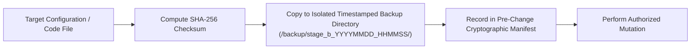

# LGD 2.0 — Phase 9.1.2: Safe Rollback Architecture & Git Working Tree Preservation Specification

| **Document Metadata** | **Specification** |
|:---|:---|
| **System** | Local Government Directory 2.0 (LGD 2.0) |
| **Audit Phase** | Phase 9.1.2 — Implementation Safety Corrections & Final Readiness Review |
| **Document ID** | `LGD2-P9.1.2-SAFE-ROLLBACK-GIT` |
| **File Location** | `SECURITY_AUDIT_CONTROLLER/PHASE_9_1_2_SAFE_ROLLBACK_AND_GIT_PRESERVATION.md` |
| **Architectural Roles** | Principal Infrastructure Security Architect, Lead DevSecOps Engineer & Release Manager |
| **Evaluation Timestamp** | November 6, 2026 (`2026-11-06T10:55:00+05:30`) |
| **Governing Finding & Risk** | Operational Integrity, Working Tree Preservation, Disaster Recovery Standard |
| **Execution Mode** | **STRICTLY READ-ONLY ASSESSMENT & DESIGN SPECIFICATION** |

---

## 1. Executive Summary & Forensic Defect Analysis

In Phase 9.1 documentation (`PHASE_9_1_INFRASTRUCTURE_DESIGN_VALIDATION_REPORT.md` Section 5, line 165), the rollback procedure for Step 4 was specified as:
```bash
git checkout -- . in target modules.
```

### 1.1 Why `git checkout -- .` Is Catastrophically Destructive
Forensic analysis of the current repository working tree (`E:\System\Projects\dockerProject\Source code\lgd-active-new`) reveals:
1. **Extensive Tracked Modifications:** More than 30 files are currently in a modified (`M`) status—including `.env.example`, `.gitignore`, `docker-compose.yml`, `docker-compose.prod.yml`, `API_Vulnerability_Exploitation_Log.md`, `Master_Finding_Traceability_Register.md`, `Vulnerability_Master_Register.md`, and module-level files.
2. **Untracked Security Artifacts:** Over 70 critical audit documents, verification registers, and script files are currently untracked (`??`) in the repository root and `scratch/` directory.
3. **Destructive Execution:** Executing `git checkout -- .` or any equivalent destructive command (`git reset --hard`, `git restore .`, `git clean -fd`):
   - **Instantly obliterates all uncommitted changes** across the entire project or target directories.
   - Irrevocably destroys historical remediation evidence, custom configurations, and in-progress audit annotations.
   - Leaves untracked files orphaned, corrupted, or deleted (if `git clean` is invoked).

> [!CAUTION]
> **RULE OF ENGAGEMENT:** The command `git checkout -- .` and all other destructive Git reset/clean commands are **PERMANENTLY PROHIBITED** across all LGD 2.0 operational procedures.
> Under no circumstances may Git commands be used as a blunt instrument to undo runtime infrastructure changes.

### 1.2 Anti-Conflation Principle: Git vs. Infrastructure State
A fundamental flaw of previous runbooks was treating Git as a complete rollback mechanism for infrastructure.
- **Git only tracks source text files.**
- Git **CANNOT** rollback:
  - Running container states or networking namespaces.
  - Windows services (`postgresql-x64-14`).
  - Database schema, table rows, sequences, or transactional WAL logs.
  - File permissions (NTFS ACLs / Linux POSIX file modes).
  - Deployed X.509 certificates and truststores.
  - Distributed Redis in-memory cache states and Sentinel quorum configurations.

Therefore, this document establishes a **Safe, Tiered Rollback Architecture** utilizing pre-change file-level backups, cryptographic SHA-256 manifests, isolated infrastructure recovery, and strict preservation of user modifications.

---

## 2. Universal Pre-Change Backup Protocol

Before any operational file mutation is executed during Stage B, the operational engineer MUST follow the **Universal Pre-Change Backup Protocol**:



### 2.1 Backup Directory Structure
All pre-change backups must be stored outside the active working paths in dedicated, immutable backup directories:

```
SECURITY_AUDIT_CONTROLLER/backup/
└── stage_b_<TIMESTAMP>/
    ├── PRE_CHANGE_SHA256_MANIFEST.txt
    ├── postgresql/
    │   ├── postgresql.conf.orig
    │   └── pg_hba.conf.orig
    ├── redis/
    │   ├── redis.conf.orig
    │   └── sentinel.conf.orig
    ├── nginx/
    │   └── nginx.conf.orig
    ├── docker/
    │   ├── docker-compose.yml.orig
    │   ├── docker-compose.prod.yml.orig
    │   └── dockerfiles/
    │       ├── api-gateway.Dockerfile.orig
    │       ├── auth-service.Dockerfile.orig
    │       ├── discovery.Dockerfile.orig
    │       ├── revenue.Dockerfile.orig
    │       └── user-management.Dockerfile.orig
    └── java_config/
        ├── RevenueRedisConfig.java.orig
        └── UserManagementRedisConfig.java.orig
```

### 2.2 PowerShell Pre-Change Backup Script
```powershell
# Parameters
$timestamp = Get-Date -Format "yyyyMMdd_HHmmss"
$backupRoot = "SECURITY_AUDIT_CONTROLLER\backup\stage_b_$timestamp"
New-Item -ItemType Directory -Force -Path $backupRoot | Out-Null

function Backup-ConfigFile {
    param([string]$SourcePath, [string]$SubFolder)
    if (Test-Path $SourcePath) {
        $targetDir = Join-Path $backupRoot $SubFolder
        New-Item -ItemType Directory -Force -Path $targetDir | Out-Null
        $destPath = Join-Path $targetDir (Split-Path $SourcePath -Leaf)
        Copy-Item -Path $SourcePath -Destination $destPath -Force
        
        $hash = (Get-FileHash -Path $SourcePath -Algorithm SHA256).Hash
        $entry = "$hash  $SourcePath  ->  $destPath"
        Add-Content -Path (Join-Path $backupRoot "PRE_CHANGE_SHA256_MANIFEST.txt") -Value $entry
        Write-Host "Backed up: $SourcePath (SHA256: $hash)"
    } else {
        Write-Warning "File not found for backup: $SourcePath"
    }
}
```

---

## 3. Tier-by-Tier Safe Rollback Procedures

### 3.1 Tier 1: Application Source Code & Configuration Rollback
**Applicable Changes:** Java configuration modifications in `revenue` and `user-management` (`RedisConfig.java`), `application-prod.properties`.

#### Prohibited:
- `git checkout -- .`
- `git reset --hard`
- `git clean -fd`

#### Approved Safe Procedure:
1. Identify the specific file requiring restoration.
2. Verify the pre-change backup file hash against the `PRE_CHANGE_SHA256_MANIFEST.txt`.
3. Explicitly overwrite only the affected file:
   ```powershell
   Copy-Item "SECURITY_AUDIT_CONTROLLER\backup\stage_b_<TS>\java_config\RevenueRedisConfig.java.orig" `
             "revenue\src\main\java\in\nic\lgd\revenue\config\RedisConfig.java" -Force
   ```
4. Verify file restoration via SHA-256 comparison:
   ```powershell
   $currentHash = (Get-FileHash "revenue\src\main\java\in\nic\lgd\revenue\config\RedisConfig.java" -Algorithm SHA256).Hash
   # Compare with manifest
   ```
5. Recompile and test target module: `mvn test-compile` to verify restoration.
6. **Result:** Zero unrelated files, untracked scripts, or working modifications are touched.

---

### 3.2 Tier 2: PostgreSQL Configuration & Service Rollback
**Applicable Changes:** `postgresql.conf`, `pg_hba.conf`, server certificates.

#### Safety Constraint:
Never restart or reload PostgreSQL with an untested configuration. If a configuration syntax error or binding error occurs:
1. **Stop Service Immediately:**
   ```powershell
   Stop-Service -Name postgresql-x64-14 -Force
   ```
2. **Explicitly Restore Configuration Files from Backup:**
   ```powershell
   Copy-Item "SECURITY_AUDIT_CONTROLLER\backup\stage_b_<TS>\postgresql\postgresql.conf.orig" `
             "E:\Program Files\PostgreSQL\14\data\postgresql.conf" -Force
   Copy-Item "SECURITY_AUDIT_CONTROLLER\backup\stage_b_<TS>\postgresql\pg_hba.conf.orig" `
             "E:\Program Files\PostgreSQL\14\data\pg_hba.conf" -Force
   ```
3. **Verify Restored File Hashes:**
   Confirm SHA-256 of restored files matches pre-change manifest.
4. **Restart Service:**
   ```powershell
   Start-Service -Name postgresql-x64-14
   ```
5. **Verify Listener:**
   `Test-NetConnection -ComputerName 127.0.0.1 -Port 5432`

---

### 3.3 Tier 3: Database Data & Transactional Rollback
**Applicable Changes:** DDL updates, role provisioning, SCRAM password alteration.

#### Requirements:
Configuration rollback does not rollback database data or role metadata in `pg_authid`.
1. **Pre-Change Physical & Logical Backup:**
   Prior to role migration or database alterations, execute a logical database dump:
   ```cmd
   "E:\Program Files\PostgreSQL\14\bin\pg_dumpall.exe" -U postgres -h 127.0.0.1 --globals-only -f "SECURITY_AUDIT_CONTROLLER\backup\stage_b_<TS>\postgresql\globals_backup.sql"
   "E:\Program Files\PostgreSQL\14\bin\pg_dump.exe" -U postgres -h 127.0.0.1 -Fc lgd -f "SECURITY_AUDIT_CONTROLLER\backup\stage_b_<TS>\postgresql\lgd_db_backup.dump"
   ```
2. **Role Metadata Rollback:**
   If SCRAM credential migration locks out applications or fails, restore the global role definitions:
   ```cmd
   "E:\Program Files\PostgreSQL\14\bin\psql.exe" -U postgres -h 127.0.0.1 -f "SECURITY_AUDIT_CONTROLLER\backup\stage_b_<TS>\postgresql\globals_backup.sql"
   ```

---

### 3.4 Tier 4: Redis Topology & Sentinel Rollback
**Applicable Changes:** Transition from standalone Redis container to 3-Sentinel + 3-Node Redis cluster.

#### Failure Scenarios:
- Split-brain condition.
- Replicas failing to synchronize (`PSYNC` failure).
- Lettuce clients failing Sentinel topology discovery.

#### Approved Safe Procedure:
1. **Gracefully Stop Sentinel & Replica Containers:**
   ```powershell
   docker compose stop redis-sentinel-1 redis-sentinel-2 redis-sentinel-3 redis-replica-1 redis-replica-2
   docker compose rm -f redis-sentinel-1 redis-sentinel-2 redis-sentinel-3 redis-replica-1 redis-replica-2
   ```
2. **Restore Standalone Redis in Compose:**
   Explicitly restore `docker-compose.yml` from pre-change backup:
   ```powershell
   Copy-Item "SECURITY_AUDIT_CONTROLLER\backup\stage_b_<TS>\docker\docker-compose.yml.orig" "docker-compose.yml" -Force
   ```
3. **Re-launch Standalone Redis Container:**
   ```powershell
   docker compose up -d redis
   ```
4. **Verify Standalone Connectivity:**
   ```powershell
   docker exec -it redis redis-cli ping
   ```
   **Expected Response:** `PONG` (or `NOAUTH Authentication required`).
5. **Revert Microservice Sentinel Configuration:**
   Restore `application-prod.properties` to point to standalone `redis:6379`.

---

### 3.5 Tier 5: Nginx Perimeter Ingress Rollback
**Applicable Changes:** Port unmapping on `api-gateway`, deployment of Nginx reverse proxy.

#### Prohibited:
- **Never re-expose public plaintext port 8092 (`0.0.0.0:8092`)** as an emergency fallback on untrusted networks! This recreates `BLK-CANON-01` and exposes tokens and data to cleartext interception.

#### Approved Safe Procedure:
1. **Check Nginx Configuration Syntax:**
   If Nginx fails to start or reload, inspect error logs:
   ```powershell
   docker logs lgd-ingress --tail 50
   ```
2. **Certificate Rollback:**
   If certificate is invalid or expired:
   ```powershell
   Copy-Item "certs/backup/lgd-ingress.crt" "certs/lgd-ingress.crt" -Force
   Copy-Item "certs/backup/lgd-ingress.key" "certs/lgd-ingress.key" -Force
   docker exec lgd-ingress nginx -s reload
   ```
3. **Fallback Ingress Container:**
   If Nginx configuration is corrupted, launch a pre-tested, minimal emergency TLS container (`lgd-ingress-fallback`) terminating TLS on port 443 with static configuration.
4. **Diagnostic Local Access (Host Only):**
   If direct Gateway access is strictly required for engineering diagnosis, bind port 8092 **exclusively to host loopback (`127.0.0.1:8092`)**, NEVER `0.0.0.0:8092`:
   ```yaml
   ports:
     - "127.0.0.1:8092:8092" # Permitted for local diagnostics ONLY
   ```

---

### 3.6 Tier 6: Docker Container Hardening Rollback
**Applicable Changes:** Dockerfiles (`eclipse-temurin:21-jre-alpine`, non-root UID 10001), Docker Compose security directives (`read_only: true`, `cap_drop: ALL`).

#### Failure Scenarios:
- Font rendering crashes in PDFBox or OpenHTMLToPDF.
- Application unable to write temporary files or logs.
- Native library incompatibility under Alpine musl libc.

#### Approved Safe Procedure:
1. **Individual Service Rollback:**
   Do not revert all containers if only one fails. Identify the specific service (e.g. `revenue`).
2. **Explicitly Restore Dockerfile:**
   ```powershell
   Copy-Item "SECURITY_AUDIT_CONTROLLER\backup\stage_b_<TS>\docker\dockerfiles\revenue.Dockerfile.orig" "revenue\Dockerfile" -Force
   ```
3. **Selectively Revert Compose Directives for That Service:**
   If `read_only: true` caused the fault, adjust only the affected service in `docker-compose.yml`.
4. **Rebuild Container Image:**
   ```powershell
   docker compose build --no-cache revenue
   docker compose up -d --force-recreate revenue
   ```
5. **Verify Runtime Health:**
   Inspect startup logs: `docker logs revenue --tail 100`.

---

## 4. Cryptographic Integrity & File Tracking Manifest

Every execution of a safe rollback must produce a post-rollback attestation record:

```
================================================================================
LGD 2.0 SAFE ROLLBACK EXECUTION RECORD
Timestamp: <ISO_TIMESTAMP>
Operator: <OPERATOR_IDENTITY>
Reason for Rollback: <INCIDENT_DESCRIPTION>
Tier Affected: <TIER_1_THROUGH_6>
Files Restored:
  - <TARGET_FILE_PATH> (Restored from <BACKUP_PATH>, SHA256: <HASH>)
Validation Test Executed: <TEST_COMMAND_AND_RESULT>
Preservation Check:
  - Tracked modifications in unrelated files: PRESERVED (Confirmed via git status)
  - Untracked audit files: PRESERVED (Confirmed via git status)
================================================================================
```

---

## 5. Summary Matrix: Prohibited vs Approved Operations

| Operational Domain | Prohibited Destructive Command | Approved Safe Rollback Command | Verification Method |
|:---|:---|:---|:---|
| **Git Working Tree** | `git checkout -- .`<br>`git reset --hard`<br>`git clean -fd` | Explicit file-by-file copy from timestamped backup directory (`Copy-Item -Force`) | `git status --short`<br>(Confirms unrelated modifications intact) |
| **PostgreSQL Config** | Starting service before offline editing; blind editing without backup | Stop service $\rightarrow$ restore `postgresql.conf.orig` and `pg_hba.conf.orig` $\rightarrow$ verify hash $\rightarrow$ start service | `Test-NetConnection -Port 5432`<br>`psql` query verification |
| **PostgreSQL Credentials** | In-place overwrite of passwords without logical dump | `pg_dumpall --globals-only` pre-backup $\rightarrow$ restore via `psql -f globals_backup.sql` | `SELECT rolname, rolpassword FROM pg_authid;` |
| **Redis Topology** | Leaving orphaned Sentinel nodes; editing running config in-place | Stop Sentinels $\rightarrow$ restore standalone compose $\rightarrow$ start `redis` $\rightarrow$ verify `PING` | `redis-cli ping`<br>Application health check |
| **Perimeter Ingress** | Exposing `0.0.0.0:8092` cleartext on external network | Restore backup certificates $\rightarrow$ `nginx -s reload` $\rightarrow$ loopback bind `127.0.0.1:8092` for diagnosis only | `curl -Iv https://localhost/healthz` |
| **Container Hardening** | Wholesale revert of all services; running as root indefinitely | Restore individual service Dockerfile from backup $\rightarrow$ rebuild only affected image | Container log inspection<br>`id` inside container |

