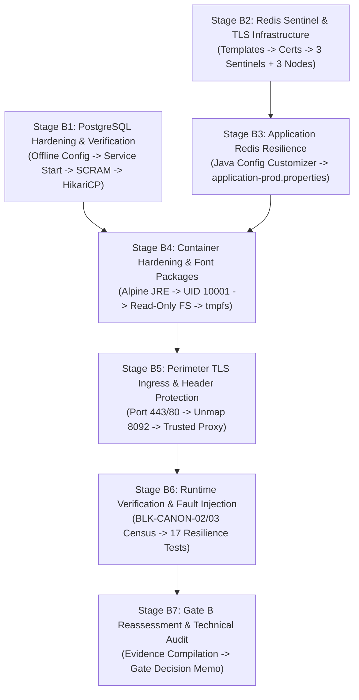

# LGD 2.0 — Phase 9.1.2: Stage B Implementation Sequence & Operational Authorization Matrix

| **Document Metadata** | **Specification** |
|:---|:---|
| **System** | Local Government Directory 2.0 (LGD 2.0) |
| **Audit Phase** | Phase 9.1.2 — Implementation Safety Corrections & Final Readiness Review |
| **Document ID** | `LGD2-P9.1.2-STAGE-B-AUTH-MATRIX` |
| **File Location** | `SECURITY_AUDIT_CONTROLLER/PHASE_9_1_2_STAGE_B_IMPLEMENTATION_AUTHORIZATION_MATRIX.md` |
| **Architectural Roles** | Principal Infrastructure Security Architect, Lead DBA, DevSecOps Lead & Release Manager |
| **Evaluation Timestamp** | November 6, 2026 (`2026-11-06T10:55:00+05:30`) |
| **Governing Blockers** | `BLK-CANON-01`, `BLK-CANON-02`, `BLK-CANON-03`, `BLK-CANON-04` |
| **Execution Mode** | **HISTORICAL PHASE 9.1.2 BLUEPRINT — SUPERSEDED BY PHASE 9.1.4 AUTHORITATIVE BLUEPRINT** |
| **Authoritative Corrected Blueprint** | [`PHASE_9_1_4_STAGE_B_CORRECTED_BLUEPRINT.md`](file:///e:/System/Projects/dockerProject/Source%20code/lgd-active-new/SECURITY_AUDIT_CONTROLLER/PHASE_9_1_4_STAGE_B_CORRECTED_BLUEPRINT.md) |

---

> [!IMPORTANT]
> **GOVERNANCE NOTICE (PHASE 9.1.4 RECONCILIATION):**
> This Phase 9.1.2 document established the initial Stage B implementation sequence. The independent Phase 9.1.3 audit identified six critical technical defects (`DISC-P913-01` through `DISC-P913-06`). All six defects have been fully resolved in the authoritative deliverable:
> [`PHASE_9_1_4_STAGE_B_CORRECTED_BLUEPRINT.md`](file:///e:/System/Projects/dockerProject/Source%20code/lgd-active-new/SECURITY_AUDIT_CONTROLLER/PHASE_9_1_4_STAGE_B_CORRECTED_BLUEPRINT.md).
> Operational execution must adhere strictly to the Phase 9.1.4 corrected blueprint.

---

## 1. Executive Mission & Dependency Ordering Architecture

The remediation of Phase 9 infrastructure findings requires seven sequential, dependency-aware operational stages (**Stage B1 through Stage B7**). Under enterprise change-management governance, these activities **cannot and must not be compressed into a single uncoordinated maintenance window**.

### 1.1 Global Stage Dependency Flow

### 1.2 Mandatory Ordering Constraints
1. **B1 precedes B4 & B6:** The native Windows database (`postgresql-x64-14`) must be hardened and operational before application containers (`revenue`, `user-management`) can be validated in steady-state.
2. **Offline Hardening precedes Service Start:** In B1, configuration files must be modified offline while the service is stopped to prevent the `0.0.0.0/0 trust` unauthenticated exposure.
3. **B2 precedes B3:** Sentinel containers must achieve quorum and establish TLS listeners before microservices are configured to connect to Sentinel endpoints.
4. **B3 precedes B4:** Application Java code and properties must be validated in unit tests before new hardened Docker images are built.
5. **B5 unmaps 8092 atomically:** Nginx ingress deployment and API Gateway host port unmapping must occur concurrently to prevent reverse proxy bypass.

---

## 2. Stage B1 — PostgreSQL Security & Authentication

### Step `B1-01`: Pre-Change Offline Backup & Hash Attestation
- **Target:** Host PostgreSQL Configuration (`E:\Program Files\PostgreSQL\14\data\`).
- **Files Affected:** `postgresql.conf`, `pg_hba.conf`.
- **Related Blocker/Risk:** `BLK-CANON-03`, `RR-05`.
- **Preconditions:** Windows service `postgresql-x64-14` is `Stopped`.
- **Required Authorization:** Lead DBA & DevSecOps Lead.
- **Backup Requirements:** Copy files to `SECURITY_AUDIT_CONTROLLER/backup/stage_b_<TS>/postgresql/`; generate SHA-256 manifest.
- **Expected Impact:** None (Service offline). Downtime: None.
- **Verification:** Compare SHA-256 checksums of backup files.
- **Rollback:** Retain original files in place.
- **Evidence:** `EVD_STAGE_B_B1_01_BACKUP_HASH.txt`.
- **Completion Criteria:** Checksums logged; verified service stopped.

### Step `B1-02`: Server Certificate Deployment & NTFS ACL Hardening
- **Target:** Host PostgreSQL Data Directory.
- **Files Affected:** `server.crt`, `server.key`, `ca.crt`.
- **Related Blocker/Risk:** `RR-05`, `SAST-002`.
- **Preconditions:** Internal CA signed certificate containing `DNS:host.docker.internal` in SAN.
- **Required Authorization:** Lead DBA & Cryptography Specialist.
- **Backup Requirements:** Backup existing certificates if present.
- **Expected Impact:** None. Downtime: None.
- **Verification:** Execute `icacls "E:\Program Files\PostgreSQL\14\data\server.key"` to confirm access restricted strictly to `NT SERVICE\postgresql-x64-14` and `Administrators`.
- **Rollback:** Delete newly copied certificates.
- **Evidence:** `icacls` output capture.
- **Completion Criteria:** Zero unauthorized local access to private key.

### Step `B1-03`: Offline Hardening of `postgresql.conf` & `pg_hba.conf`
- **Target:** Database configuration files.
- **Files Affected:** `postgresql.conf` (listen_addresses, ssl=on, scram), `pg_hba.conf` (purge trust).
- **Related Blocker/Risk:** `RR-05`, `BLK-CANON-03`, `SAST-002`.
- **Preconditions:** Step `B1-01` and `B1-02` completed.
- **Required Authorization:** Lead DBA & Principal Infrastructure Security Architect.
- **Backup Requirements:** Verified in `B1-01`.
- **Expected Impact:** Removes unauthenticated network access rules. Downtime: None.
- **Verification:** Automated regex inspection confirming zero occurrences of `trust` in uncommented lines.
- **Rollback:** Restore `postgresql.conf.orig` and `pg_hba.conf.orig` from backup.
- **Evidence:** Regex validation report on modified files.
- **Completion Criteria:** `pg_hba.conf` matches authoritative specification in `PHASE_9_1_2_POSTGRESQL_AUTHENTICATION_SAFETY_REVIEW.md`.

### Step `B1-04`: Service Activation & TCP Listener Audit
- **Target:** Windows Service `postgresql-x64-14`.
- **Files Affected:** Windows Service Manager.
- **Related Blocker/Risk:** `BLK-CANON-03`.
- **Preconditions:** Step `B1-03` complete. Explicit Stage B Operational Authorization signed.
- **Required Authorization:** Release Manager & Lead DBA.
- **Backup Requirements:** Step `B1-01` backup available.
- **Expected Impact:** PostgreSQL starts and binds to `127.0.0.1:5432` and `172.20.32.1:5432`. Downtime: 0s.
- **Verification:** `Get-Service postgresql-x64-14`; `Test-NetConnection -ComputerName 127.0.0.1 -Port 5432`.
- **Rollback:** `Stop-Service postgresql-x64-14`; restore backup configs.
- **Evidence:** PowerShell service status and port listener proof.
- **Completion Criteria:** Service status is `Running`; TCP 5432 test succeeds.

### Step `B1-05`: SCRAM-SHA-256 Credential Migration
- **Target:** Database Roles (`pg_authid`).
- **Files Affected:** System catalog `pg_authid`.
- **Related Blocker/Risk:** `RR-05`, `SAST-002`.
- **Preconditions:** Step `B1-04` complete; local psql administrative session established.
- **Required Authorization:** Lead DBA.
- **Backup Requirements:** `pg_dumpall --globals-only -f globals_backup.sql`.
- **Expected Impact:** Re-encrypts user passwords using SCRAM-SHA-256. Downtime: None.
- **Verification:** Execute safe boolean query (zero hash export, per `DISC-P913-06`): `SELECT rolname, (rolpassword LIKE 'SCRAM-SHA-256$%') AS is_scram_sha_256, (rolpassword LIKE 'md5%') AS is_md5 FROM pg_authid WHERE rolname IN ('postgres', 'lgd_prod_user', 'lgd_repl_user', 'lgd_monitor');` confirming 100% `is_scram_sha_256 = true` and `is_md5 = false`.
- **Rollback:** Re-apply `globals_backup.sql`.
- **Evidence:** SQL query output showing boolean verification flags with zero password hash exposure.
- **Completion Criteria:** All active roles migrated to SCRAM-SHA-256; zero hash characters in logs.

---

## 3. Stage B2 — Redis TLS & Sentinel Infrastructure

### Step `B2-01`: Configuration Templating & Dynamic Entrypoint Deployment
- **Target:** Docker configuration repository.
- **Files Affected:** `redis.conf.template`, `sentinel.conf.template`, `docker-entrypoint.sh`.
- **Related Blocker/Risk:** `RR-02`, `RR-05`, `DISC-P913-01`.
- **Preconditions:** Redis 8.10.3 image available.
- **Required Authorization:** DevSecOps Lead & Redis Specialist.
- **Backup Requirements:** Backup existing `docker-compose.yml`.
- **Expected Impact:** Eliminates static shell variable defect; incorporates `sentinel sentinel-pass ${REDIS_SENTINEL_PASSWORD}` per `DISC-P913-01`. Downtime: None.
- **Verification:** Dry-run entrypoint script locally to verify `envsubst` outputs valid configuration with `0600` permissions and includes both `sentinel requirepass` and `sentinel sentinel-pass`.
- **Rollback:** Revert entrypoint scripts.
- **Evidence:** Shell script test execution log.
- **Completion Criteria:** Automated variable substitution and inter-Sentinel authentication verified.

### Step `B2-02`: Provisioning Redis Sentinel Cluster (3 Sentinels, 1 Master, 2 Replicas)
- **Target:** Docker Compose Data Tier.
- **Files Affected:** `docker-compose.yml`, `docker-compose.prod.yml`.
- **Related Blocker/Risk:** `RR-02`, `RR-05`, `SAST-012`, `DISC-P913-01`.
- **Preconditions:** Step `B2-01` complete; Redis TLS certificates deployed; immutable image digest pinned (`redis:alpine@sha256:21090af93f8324db2f0f0f4f38a7c60369d47d917e000c3423d89d2ae2883537`).
- **Required Authorization:** Principal Infrastructure Security Architect & DevSecOps Lead.
- **Backup Requirements:** `docker-compose.yml.orig` in backup dir.
- **Expected Impact:** Starts 6 containers on `lgd-data-tier`. Downtime: Transient cache reset.
- **Verification:**
  - `docker compose ps` (all 6 nodes healthy).
  - `redis-cli -p 26379 --tls sentinel masters` returns `lgdmaster` with quorum 2.
- **Rollback:** Stop Sentinel containers; restore standalone Redis in Compose.
- **Evidence:** Sentinel master status output capture.
- **Completion Criteria:** 3 Sentinels monitor 1 Primary and 2 Replicas over TLS; zero NOAUTH gossip errors.

---

## 4. Stage B3 — Application Redis Resilience & Java Customizers

### Step `B3-01`: Java Source Code Configuration Update
- **Target:** Microservice Source Trees (`revenue`, `user-management`).
- **Files Affected:**
  - `revenue/.../config/RedisConfig.java`
  - `user-management/.../config/RedisConfig.java`
- **Related Blocker/Risk:** `RR-02`, `SAST-012`.
- **Preconditions:** Step `B2-02` complete.
- **Required Authorization:** Senior Java Architect & DevSecOps Lead.
- **Backup Requirements:** Copy original `RedisConfig.java` files to backup directory with SHA-256.
- **Expected Impact:** Removes orphan bean; enables auto-reconnect and Sentinel topology updates. Downtime: None (build-time).
- **Verification:** Execute `mvn clean test-compile` in both modules to verify clean compilation.
- **Rollback:** Explicitly restore original `RedisConfig.java` files from backup.
- **Evidence:** Maven compilation log showing zero errors.
- **Completion Criteria:** Code compiles; `LettuceClientConfigurationBuilderCustomizer` active.

### Step `B3-02`: Application Properties Deployment
- **Target:** Application Configuration.
- **Files Affected:** `application-prod.properties` in `api-gateway`, `auth-service`, `revenue`, `user-management`.
- **Related Blocker/Risk:** `RR-02`, `RR-05`.
- **Preconditions:** Step `B3-01` complete.
- **Required Authorization:** DevSecOps Lead.
- **Backup Requirements:** File backups in backup directory.
- **Expected Impact:** Switches Redis connection from standalone host to Sentinel nodes over TLS. Downtime: None.
- **Verification:** Execute unit and integration tests (`mvn test`).
- **Rollback:** Restore properties files from backup.
- **Evidence:** Surefire test execution summary.
- **Completion Criteria:** Tests pass; Sentinel properties registered in Spring environment.

---

## 5. Stage B4 — Container Hardening & Font Packages

### Step `B4-01`: Dockerfile Hardening, Alpine Font Package & Internal CA Import
- **Target:** All 5 Microservice Dockerfiles.
- **Files Affected:**
  - `api-gateway/Dockerfile`, `auth-service/Dockerfile`, `discovery/Dockerfile`,
  - `revenue/Dockerfile`, `user-management/Dockerfile`.
- **Related Blocker/Risk:** `RR-06`, `SCA-012`, `VULN-014`, `DISC-P913-02`.
- **Preconditions:** Steps `B1` through `B3` complete.
- **Required Authorization:** Principal Infrastructure Security Architect & DevSecOps Lead.
- **Backup Requirements:** Copy all 5 Dockerfiles to backup directory with SHA-256.
- **Expected Impact:** Migrates base image to `eclipse-temurin:21-jre-alpine`; imports `lgd-internal-ca.crt` into `$JAVA_HOME/lib/security/cacerts` via `keytool` (per `DISC-P913-02`); adds non-root user `10001:10001`; adds `fontconfig ttf-dejavu` to `revenue`. Downtime: None (build-time).
- **Verification:** Build test images via `docker compose build`. Inspect user ID: `docker run --rm <image> id` returns UID 10001. Verify CA: `docker run --rm <image> keytool -list -keystore "$JAVA_HOME/lib/security/cacerts" -alias lgd-internal-ca`.
- **Rollback:** Restore original Dockerfiles from backup; rebuild previous images.
- **Evidence:** `docker inspect` user, layer size reports, and keytool list output.
- **Completion Criteria:** All images build cleanly; non-root user and internal CA trust verified.

### Step `B4-02`: Docker Compose Containment Enforcement
- **Target:** Runtime Container Manifests.
- **Files Affected:** `docker-compose.yml`, `docker-compose.prod.yml`.
- **Related Blocker/Risk:** `RR-06`, `SCA-012`.
- **Preconditions:** Step `B4-01` complete.
- **Required Authorization:** DevSecOps Lead.
- **Backup Requirements:** File backups in backup directory.
- **Expected Impact:** Enforces `read_only: true`, `cap_drop: [ALL]`, `no-new-privileges:true`, and in-memory `tmpfs`. Containers recreated. Downtime: $< 60\text{ seconds}$ during recreate.
- **Verification:** Test root filesystem write: `docker exec <container> touch /test` fails with `Read-only file system`.
- **Rollback:** Restore previous Compose files; recreate containers.
- **Evidence:** Container security options inspection log.
- **Completion Criteria:** Containers running with immutable root and unprivileged capabilities.

---

## 6. Stage B5 — Perimeter TLS Ingress & Header Protection

### Step `B5-01`: API Gateway Port Unmapping
- **Target:** API Gateway Host Bindings.
- **Files Affected:** `docker-compose.yml`.
- **Related Blocker/Risk:** `BLK-CANON-01`, `EXP-016`.
- **Preconditions:** Step `B4-02` complete.
- **Required Authorization:** Perimeter Security Specialist & DevSecOps Lead.
- **Backup Requirements:** Verified in previous steps.
- **Expected Impact:** Unmaps `8092:8092` from host. Gateway accessible only via `lgd-ingress-tier`. Downtime: Concurrently shifted to Nginx.
- **Verification:** `Test-NetConnection -ComputerName 127.0.0.1 -Port 8092` fails / connection refused.
- **Rollback:** Bind port 8092 strictly to loopback `127.0.0.1:8092` for diagnosis.
- **Evidence:** NetConnection failure output from host.
- **Completion Criteria:** External cleartext gateway access completely severed.

### Step `B5-02`: Hardened Nginx Reverse Proxy Deployment
- **Target:** Perimeter Ingress.
- **Files Affected:** `nginx.conf`, `docker-compose.yml`.
- **Related Blocker/Risk:** `BLK-CANON-01`.
- **Preconditions:** Ingress certificates provisioned; port 80 and 443 free on host.
- **Required Authorization:** Principal Infrastructure Security Architect & Perimeter Lead.
- **Backup Requirements:** Pre-change backup directory manifest.
- **Expected Impact:** Ingress traffic terminates on port 443 with TLS 1.3/1.2; port 80 executes 301 redirect. Downtime: $< 15\text{ seconds}$ service cutover.
- **Verification:**
  - `curl -Iv http://lgdirectory.gov.in/` returns 301 to `https://...`.
  - `curl -Iv https://lgdirectory.gov.in/healthz` returns 200 over TLS.
  - Test unknown host header: returns HTTP 444.
- **Rollback:** Stop Nginx; restore previous ingress routing.
- **Evidence:** OpenSSL s_client TLS handshake dump.
- **Completion Criteria:** Modern TLS 1.3/1.2 active; host header injection blocked.

---

## 7. Stage B6 — Runtime & Failure Verification

### Step `B6-01`: Revenue TestController 6-Factor Authenticated Census (`BLK-CANON-02`)
- **Target:** Container `revenue`.
- **Preconditions:** All services running in production profile. Valid test JWT token generated.
- **Required Authorization:** AppSec Lead & Independent Security Auditor.
- **Procedure:** Execute the 6-factor census specified in `PHASE_9_1_4_STAGE_B_CORRECTED_BLUEPRINT.md` (reconciling `DISC-P913-04` and `DISC-P913-05`).
- **Acceptance:** Actuator mappings return 0 matches (or context reflection confirms bean exclusion); authenticated probes across all 40 routes return HTTP 404 Not Found; unauthenticated probes return HTTP 401 Unauthorized via Spring Security.
- **Evidence:** Authenticated curl probe logs and ApplicationContext reflection test output.

### Step `B6-02`: PostgreSQL 14 Availability & SCRAM Audit (`BLK-CANON-03`)
- **Target:** Host PostgreSQL Service.
- **Preconditions:** Database service active.
- **Required Authorization:** Lead DBA & Independent Security Auditor.
- **Procedure:** Execute the 9-check verification matrix in `PHASE_9_1_2_RUNTIME_VERIFICATION_ACCEPTANCE_CRITERIA.md`.
- **Acceptance:** SCRAM enforced, TLS active, HikariCP steady-state $>5$ min.
- **Evidence:** SQL query outputs and HikariCP connection logs.

### Step `B6-03`: Resilience & Fault Injection Suite Execution (iptables RES-05)
- **Target:** Complete Infrastructure.
- **Preconditions:** Steps `B6-01` and `B6-02` passed. Staging isolation verified.
- **Required Authorization:** Lead Chaos Engineer, Lead Architect & Operations Lead.
- **Procedure:** Execute scenarios `RES-01` through `RES-17` from `PHASE_9_1_2_RESILIENCE_AND_FAILURE_TEST_PLAN.md` incorporating the corrected bidirectional `iptables` partition specification for `RES-05` (per `DISC-P913-03`).
- **Acceptance:** All 17 scenarios satisfy security criteria and recover within modeled windows without split-brain corruption.
- **Evidence:** Chaos injection logs, Sentinel failover traces, fail-closed verification records.

---

## 8. Stage B7 — Gate B Reassessment & Authorization Decision

### Step `B7-01`: Independent Audit Synthesis & Evidence Review
- **Target:** Security Audit Controller.
- **Preconditions:** Stages B1 through B6 completed with full evidentiary artifacts.
- **Required Authorization:** Independent Security Auditor & Principal Architect.
- **Procedure:** Audit all newly generated evidence files in `SECURITY_AUDIT_CONTROLLER/evidence/stage_b/`.
- **Acceptance:** 100% of Gate B blocker conditions (`BLK-CANON-01`, `02`, `03`) verified satisfied by authentic evidence.
- **Evidence:** `GATE_B_TECHNICAL_VERIFICATION_CLOSURE_REPORT.md`.

### Step `B7-02`: Gate B Release Recommendation
- **Action:** Transition Gate B from `HOLD` to `PASS`.
- **Required Authorization:** Enterprise CISO & Lead Security Auditor.
- **Next Stage:** Submit Stage C Authorization Request to DAA for `BLK-CANON-04` risk acceptance.

---

## 9. Comprehensive Implementation Matrix Summary

| Stage | Step ID | Target Service | Risk / Blocker | Downtime Estimate | Authorization Required | Rollback Method | Status |
|:---:|:---:|:---|:---:|:---:|:---:|:---|:---:|
| **B1** | `B1-01` | PostgreSQL Config Backup | `BLK-CANON-03` | 0s | Lead DBA | No mutation | `PENDING_AUTH` |
| **B1** | `B1-02` | Database Server Certs | `RR-05` | 0s | Cryptography Lead | Remove certs | `PENDING_AUTH` |
| **B1** | `B1-03` | Offline Config Hardening | `RR-05`, `BLK-CANON-03` | 0s | Principal Architect | Restore backup configs | `PENDING_AUTH` |
| **B1** | `B1-04` | Database Service Start | `BLK-CANON-03` | 0s | Release Manager | Stop-Service | `PENDING_AUTH` |
| **B1** | `B1-05` | SCRAM Credential Migration | `RR-05`, `SAST-002` | 0s | Lead DBA | Restore globals dump | `PENDING_AUTH` |
| **B2** | `B2-01` | Redis Config Templating | `RR-02`, `RR-05` | 0s | DevSecOps Lead | Revert entrypoint | `PENDING_AUTH` |
| **B2** | `B2-02` | Redis Sentinel Cluster Launch | `RR-02`, `RR-05` | $< 30\text{s}$ | Principal Architect | Revert to standalone compose | `PENDING_AUTH` |
| **B3** | `B3-01` | Spring Lettuce Customizers | `RR-02` | 0s | Senior Java Architect | Restore original java files | `PENDING_AUTH` |
| **B3** | `B3-02` | Sentinel Properties Deploy | `RR-02` | 0s | DevSecOps Lead | Restore properties backup | `PENDING_AUTH` |
| **B4** | `B4-01` | Alpine Dockerfile Hardening | `RR-06`, `SCA-012` | 0s | DevSecOps Lead | Restore original Dockerfiles | `PENDING_AUTH` |
| **B4** | `B4-02` | Compose Read-Only & Tmpfs | `RR-06` | $< 60\text{s}$ | DevSecOps Lead | Revert compose directives | `PENDING_AUTH` |
| **B5** | `B5-01` | Gateway Port 8092 Unmap | `BLK-CANON-01` | $< 15\text{s}$ | Perimeter Lead | Bind to loopback 127.0.0.1:8092 | `PENDING_AUTH` |
| **B5** | `B5-02` | Nginx TLS 1.3 Ingress Deploy | `BLK-CANON-01` | $< 15\text{s}$ | Principal Architect | Launch fallback TLS container | `PENDING_AUTH` |
| **B6** | `B6-01` | Revenue TestController Census | `BLK-CANON-02` | 0s | Independent Auditor | Re-evaluate profile guards | `PENDING_AUTH` |
| **B6** | `B6-02` | PostgreSQL Availability Audit | `BLK-CANON-03` | 0s | Lead DBA | Re-audit configuration | `PENDING_AUTH` |
| **B6** | `B6-03` | 17 Resilience Chaos Tests | `RR-02`, `RR-05` | Variable | Chaos Lead / Architect | Automated container recovery | `PENDING_AUTH` |
| **B7** | `B7-01` | Audit Synthesis & Gate Review | All Gate B | 0s | Independent Auditor | Maintain Gate B on HOLD | `PENDING_AUTH` |
| **B7** | `B7-02` | Gate B Closure Decision | Gate B | 0s | Enterprise CISO | Maintain Gate B on HOLD | `PENDING_AUTH` |

