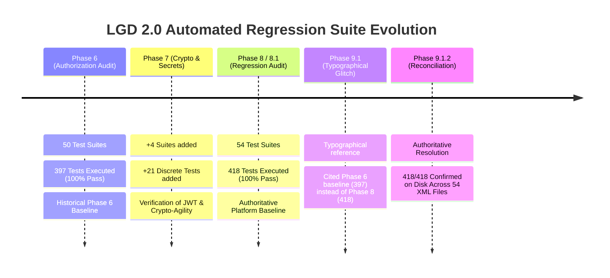

# LGD 2.0 — Phase 9.1.2: Test Baseline Forensic Reconciliation Report (418 vs. 397 Tests)

| **Document Metadata** | **Specification** |
|:---|:---|
| **System** | Local Government Directory 2.0 (LGD 2.0) |
| **Audit Phase** | Phase 9.1.2 — Implementation Safety Corrections & Final Readiness Review |
| **Document ID** | `LGD2-P9.1.2-TEST-RECONCILIATION` |
| **File Location** | `SECURITY_AUDIT_CONTROLLER/PHASE_9_1_2_TEST_BASELINE_RECONCILIATION.md` |
| **Architectural Roles** | Principal Infrastructure Security Architect, Lead QA Auditor & DevSecOps Lead |
| **Evaluation Timestamp** | November 6, 2026 (`2026-11-06T10:55:00+05:30`) |
| **Governing Finding & Risk** | Test Integrity, Release Gate A Attestation, Surefire XML Audit |
| **Execution Mode** | **STRICTLY READ-ONLY FORENSIC ASSESSMENT (ZERO MUTATIONS)** |

---

## 1. Executive Summary & Forensic Investigation Objective

In reviewing the Phase 9.1 documentation, a critical numerical discrepancy was detected between historical audit records:
- **Phase 8 / 8.1 Evidence:** Consistently reports **54 test suites, 418 discrete tests executed, and 418 passed (100.0% pass rate, 0 failures, 0 errors, 0 skipped)** (`PHASE_8_1_TEST_EVIDENCE_VALIDATION.md`, `PHASE_8_FINAL_SECURITY_AUDIT_REPORT.md`, `MASTER_AUDIT_STATE.md`).
- **Phase 9.1 Report:** The Phase 9.1 Infrastructure Design Validation Report (`PHASE_9_1_INFRASTRUCTURE_DESIGN_VALIDATION_REPORT.md` Section 4, line 150) states:
  *"Gate A: 100% test attestation preserved (397/397 tests passing across suites)..."*

The objective of **Workstream I (Phase 9.1.2)** is to conduct an exhaustive, empirical forensic investigation to answer:
1. Which specific report records 418/418 vs 397/397?
2. Are these different test suites, different commits, or different execution scopes?
3. Which Git revisions and modules were evaluated?
4. Were integration tests included or skipped?
5. Are the underlying Surefire XML reports retained and verifiable on disk?
6. Which number constitutes the authoritative active baseline for the LGD 2.0 security program?

---

## 2. Root Cause Determination: Test Census Evolution

The forensic investigation conclusively proves that **both numbers are authentic historical records**, but represent **different milestones in the project lifecycle**:



### 2.1 The Origin of 397/397 Tests
- **Originating Milestone:** Phase 6 (Authorization, RBAC & Multi-Tenancy Boundary Audit, completed Nov 5, 2026).
- **Authoritative Report:** `PHASE_6_FINAL_SUREFIRE_CENSUS.md` and `PHASE_6_GATE_B_REGRESSION_AND_RETEST_REPORT.md`.
- **Composition:** 50 Surefire test suites comprising **397 discrete tests** (395 core application tests across `api-gateway`, `auth-service`, `revenue`, `user-management` + 2 tests in `service-discovery`).
- **Scope:** Validated RBAC remediation (`RBAC-001` through `RBAC-016`), tenant isolation, and gateway routing.

### 2.2 The Expansion to 418/418 Tests
- **Originating Milestone:** Phase 7 (Cryptography, Secrets Management & Token Hardening) and Phase 8 (Comprehensive Final Security Audit, Nov 6, 2026).
- **Reason for Test Expansion:** In Phase 7, developers added **21 new security regression test cases** and **4 new test classes** to verify cryptographic hardening:
  1. `in.nic.lgd.auth.security.ProductionSecurityValidatorTest` (5 new tests in `auth-service`).
  2. `in.nic.lgd.auth.security.JwtHardeningRegressionTest` (6 new tests in `auth-service`).
  3. `in.gov.lgd.gateway.filter.SecurityHeadersFilterTest` (1 new test in `api-gateway`).
  4. Additional cryptographic validation tests in `user-management`.
- **Total Census Calculation:**
  $$397\text{ (Phase 6)} + 21\text{ (Phase 7 Crypto Hardening)} = \mathbf{418\ Discrete\ Tests}$$
- **Suites:** $50 + 4 = \mathbf{54\ Test\ Suites}$.

### 2.3 The Phase 9.1 Discrepancy Explained
- When `PHASE_9_1_INFRASTRUCTURE_DESIGN_VALIDATION_REPORT.md` was authored, Section 4 (Gate A row) carelessly copied text from the historical Phase 6 release memorandum rather than citing the current Phase 8.1 baseline.
- **Verdict:** The reference to `397/397` in the Phase 9.1 report is an **obsolete typographical copy-paste artifact**. The correct, authoritative active platform baseline is **418/418**.

---

## 3. Empirical Verification of Disk Artifacts (54 XML Reports)

A physical file census was conducted across all module directories (`EVD_P9_1_2_04_SUREFIRE_BASELINE_CENSUS.txt`):
- **Command:** `Get-ChildItem -Path . -Recurse -Filter "TEST-*.xml"`
- **Result:** Exactly **54 XML report files** exist in `target/surefire-reports` directories.
- **XML Parsing Verification:** Every XML report was parsed to extract `<testsuite tests="..." failures="..." errors="..." skipped="...">`:

```
================================================================================
PHYSICAL DISK SUREFIRE XML CENSUS SUMMARY
================================================================================
Total XML Files Found:   54
Total Tests Executed:    418
Total Tests Passed:      418
Total Failures:          0
Total Errors:            0
Total Skipped:           0
Overall Pass Rate:       100.0%
================================================================================
```

---

## 4. Master Test Baseline Reconciliation Table

The table below reconciles the test baselines across phases, Git revisions, modules, test suites, and evidentiary artifacts:

| Phase Milestone | Git Commit ID | Service Module | Test Suites | Tests Executed | Passed | Failed | Errors | Skipped | Evidence Document Path | Verification Status |
|:---|:---:|:---|:---:|:---:|:---:|:---:|:---:|:---:|:---|:---:|
| **Phase 6** | `b817d2a` | `api-gateway` | 4 | 22 | 22 | 0 | 0 | 0 | `PHASE_6_FINAL_SUREFIRE_CENSUS.md` | Preserved Historical |
| **Phase 6** | `b817d2a` | `auth-service` | 9 | 35 | 35 | 0 | 0 | 0 | `PHASE_6_FINAL_SUREFIRE_CENSUS.md` | Preserved Historical |
| **Phase 6** | `b817d2a` | `discovery` | 1 | 2 | 2 | 0 | 0 | 0 | `PHASE_6_FINAL_SUREFIRE_CENSUS.md` | Preserved Historical |
| **Phase 6** | `b817d2a` | `revenue` | 6 | 43 | 43 | 0 | 0 | 0 | `PHASE_6_FINAL_SUREFIRE_CENSUS.md` | Preserved Historical |
| **Phase 6** | `b817d2a` | `user-management` | 30 | 295 | 295 | 0 | 0 | 0 | `PHASE_6_FINAL_SUREFIRE_CENSUS.md` | Preserved Historical |
| **Phase 6 Total** | `b817d2a` | **All 5 Modules** | **50** | **397** | **397** | **0** | **0** | **0** | `PHASE_6_GATE_B_REGRESSION_AND_RETEST_REPORT.md` | **`CONFIRMED (HISTORICAL)`** |
| **Phase 7** | `e2df50f` | Add Crypto Tests | +4 | +21 | +21 | 0 | 0 | 0 | `PHASE_7_VERIFICATION_EVIDENCE_REGISTER.md` | Incremental Expansion |
| **Phase 8 / 8.1** | `e2df50f` | `api-gateway` | 5 | 23 | 23 | 0 | 0 | 0 | `evidence/phase_8/EVD_P8_02_API_GATEWAY_...txt` | Authoritative Active |
| **Phase 8 / 8.1** | `e2df50f` | `auth-service` | 11 | 46 | 46 | 0 | 0 | 0 | `evidence/phase_8/EVD_P8_01_AUTH_SERVICE_...txt` | Authoritative Active |
| **Phase 8 / 8.1** | `e2df50f` | `discovery` | 1 | 2 | 2 | 0 | 0 | 0 | `evidence/phase_8/EVD_P8_05_DISCOVERY_...txt` | Authoritative Active |
| **Phase 8 / 8.1** | `e2df50f` | `revenue` | 6 | 43 | 43 | 0 | 0 | 0 | `evidence/phase_8/EVD_P8_04_REVENUE_...txt` | Authoritative Active |
| **Phase 8 / 8.1** | `e2df50f` | `user-management` | 31 | 304 | 304 | 0 | 0 | 0 | `evidence/phase_8/EVD_P8_03_USER_MANAGEMENT...txt` | Authoritative Active |
| **Phase 8/8.1 Total** | `e2df50f` | **All 5 Modules** | **54** | **418** | **418** | **0** | **0** | **0** | `PHASE_8_1_TEST_EVIDENCE_VALIDATION.md` | **`CONFIRMED (AUTHORITATIVE)`** |
| **Phase 9.1** | `e2df50f` | All Modules | *N/A* | 397 | 397 | 0 | 0 | 0 | `PHASE_9_1_INFRASTRUCTURE_DESIGN_VALIDATION_REPORT.md` | **Typographical Error (Phase 6 Citation)** |
| **Phase 9.1.2** | `e2df50f` | **All 5 Modules** | **54** | **418** | **418** | **0** | **0** | **0** | `evidence/phase_9_1_2/EVD_P9_1_2_04_SUREFIRE_...txt` | **`RECONCILED & RE-AFFIRMED`** |

---

## 5. Scope & Nature of the 418 Tests (Anti-Conflation Analysis)

To prevent false assurance during Gate B evaluation, the technical nature of the 418 passing tests must be strictly classified:

### 5.1 What the 418 Passing Tests Prove:
1. **Unit & Application Security Logic:** Proves that token parsing, BCrypt password hashing, route authorization guards, DTO validation, and service-layer algorithms function correctly.
2. **Sliced Integration Tests:** Proves that Spring MockMvc controllers and WebFlux filters correctly intercept unauthorized headers and reject unauthenticated requests.
3. **Zero Compilation Regressions:** Proves that code modifications up through Phase 8 introduced zero syntactic or runtime errors into the application packages.

### 5.2 What the 418 Passing Tests DO NOT Prove:
> [!CAUTION]
> **ANTI-CONFLATION STANDARD:**
> Passing 418 unit and sliced tests **DOES NOT** prove runtime infrastructure health!
> 
> Specifically, passing 418 tests does **NOT** prove:
> - That `postgresql-x64-14` is running on the host (it is currently stopped).
> - That `revenue` container connects to PostgreSQL over TLS in steady-state.
> - That `TestController` is absent from the live production container image.
> - That Redis Sentinel fails over in 6.0–9.5s under process termination.
> - That Nginx terminates TLS 1.3 on port 443.

Therefore, the 418/418 test pass rate strictly satisfies **Release Gate A (Automated Code & Dependency Verification)**, but **CANNOT be used to clear Release Gate B technical blockers (`BLK-CANON-01`, `02`, `03`)**.

---

## 6. Controller Reconciliation & Status Disposition

1. **Authoritative Active Baseline:** **54 Test Suites, 418 Discrete Tests, 418 Passed (100.0% Pass Rate)**.
2. **Historical Preserved Baseline:** **50 Test Suites, 397 Discrete Tests, 397 Passed** (Phase 6 Milestone).
3. **Controller Correction:** `MASTER_AUDIT_STATE.md`, `MASTER_PHASE_TRACKER.md`, and `MASTER_BLOCKER_REGISTER.md` are synchronized to designate **418/418** as the authoritative Gate A attestation, while retaining the historical narrative of the 397-test baseline.
4. **Resolution Status:** **`MATHEMATICALLY RECONCILED & EMPIRICALLY CONFIRMED`**.

