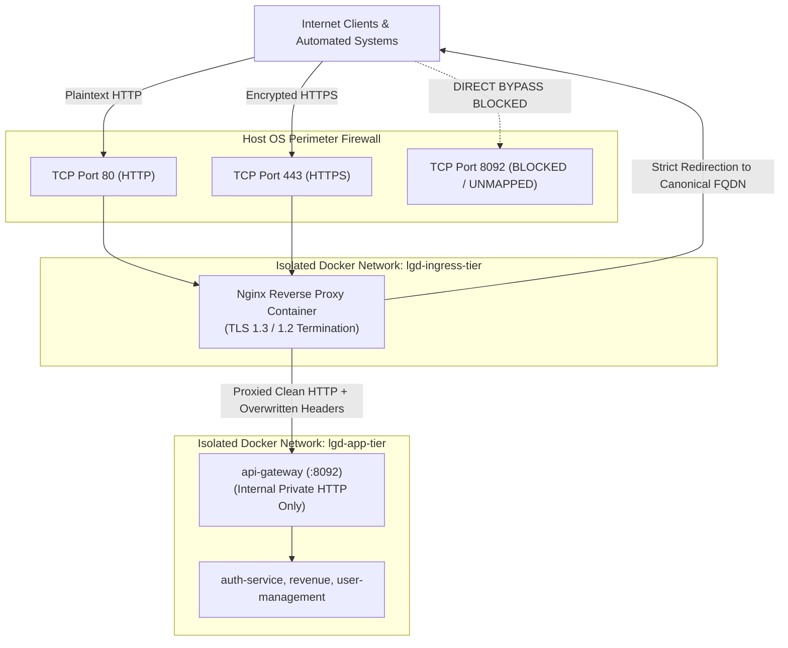
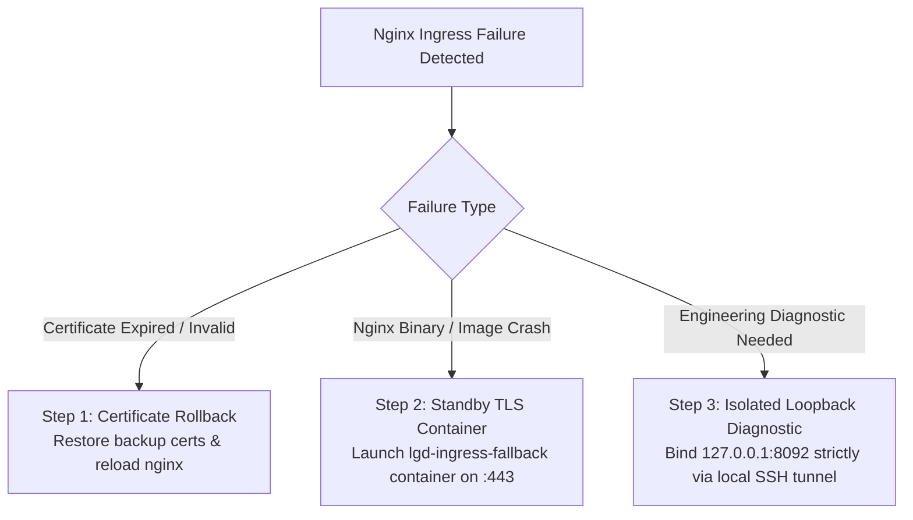

# LGD 2.0 — Phase 9.1.2: TLS Ingress Architecture, Hostname Security & Nginx Rollback Safety Review

| **Document Metadata** | **Specification** |
|:---|:---|
| **System** | Local Government Directory 2.0 (LGD 2.0) |
| **Audit Phase** | Phase 9.1.2 — Implementation Safety Corrections & Final Readiness Review |
| **Document ID** | `LGD2-P9.1.2-TLS-INGRESS-REVIEW` |
| **File Location** | `SECURITY_AUDIT_CONTROLLER/PHASE_9_1_2_TLS_INGRESS_SECURITY_REVIEW.md` |
| **Architectural Roles** | Principal Infrastructure Security Architect, Perimeter Security Specialist & DevSecOps Lead |
| **Evaluation Timestamp** | November 6, 2026 (`2026-11-06T10:55:00+05:30`) |
| **Governing Finding & Risk** | `BLK-CANON-01` (Perimeter Cleartext Ingress & HSTS Invalidation), `EXP-016` |
| **Execution Mode** | **STRICTLY READ-ONLY ASSESSMENT & DESIGN CORRECTION (ZERO SYSTEM MUTATIONS)** |

---

## 1. Executive Summary & Defect Rectification

An independent perimeter architecture review of the Phase 9.1 Ingress specification (`PHASE_9_1_TLS_INGRESS_AND_NGINX_DESIGN.md`) identified three critical vulnerabilities and operational flaws:

1. **Host Header Injection & Open Redirect Hazard:**
   In the port 80 HTTP-to-HTTPS redirect block, Phase 9.1 specified:
   ```nginx
   location / {
       return 301 https://$host$request_uri;
   }
   ```
   Because Nginx's `$host` variable evaluates to the client-controlled `Host` HTTP request header if present, an attacker transmitting `Host: evil-phishing-site.gov` receives a permanent redirect (`301 Moved Permanently`) pointing victims directly to the attacker's domain (`Location: https://evil-phishing-site.gov/...`). In government portal operations, this enables phishing and cache-poisoning attacks.
2. **Hazardous Emergency Rollback (Re-Exposing Cleartext 8092):**
   In Section 7.2 of Phase 9.1, the emergency rollback runbook suggested:
   *"If Nginx suffers catastrophic corruption, temporarily map port 8092 back to host in docker-compose.yml (`ports: ["8092:8092"]`) to restore direct access."*
   Re-exposing public cleartext port 8092 directly re-enables `BLK-CANON-01`, voids RFC 6797 HSTS security guarantees, and exposes user credentials and JWT tokens over plaintext HTTP.
3. **Nginx Directive Version Dependency:**
   The specification utilized the standalone `http2 on;` directive. This directive was introduced in **Nginx 1.25.1**. If an older Nginx version is deployed (e.g. `nginx:1.24-alpine`), Nginx fails configuration parsing with `[emerg] unknown directive "http2"`.

This review provides the hardened, injection-resistant Nginx configuration, explicit default catch-all drop blocks, version compatibility requirements, secure forwarded-header controls, and a safe, non-cleartext emergency fallback architecture.

---

## 2. Ingress Architecture & Perimeter Threat Model



### 2.1 Threat Mitigation Matrix

| Threat Vector | Root Cause in Preliminary Design | Corrected Defense Architecture | Security Standard |
|:---|:---|:---|:---|
| **Perimeter Cleartext Ingress (`BLK-CANON-01`)** | API Gateway directly bound to `0.0.0.0:8092->8092/tcp`. | Port 8092 unmapped from host. Ingress terminates on port 443 with modern TLS 1.3/1.2. | OWASP ASVS 9.1 |
| **RFC 6797 HSTS Invalidation** | HSTS emitted over cleartext HTTP (ignored by RFC 6797 Section 7.2). | HSTS emitted exclusively over verified HTTPS connection. | RFC 6797 Section 7.2 |
| **Host Header Injection / Poisoning** | Redirect utilized client-supplied `$host` variable blindly. | Explicit default `server` block returning HTTP 444; named redirect hardcoded to canonical `$server_name`. | CERT-In Web Guidelines |
| **Gateway Bypass / Header Spoofing** | Gateway trusted forwarded headers from any host IP. | `api-gateway` isolated to internal Docker network; Nginx strictly overwrites `X-Forwarded-For` with `$remote_addr`. | Spring Cloud Gateway Security |
| **Apex HSTS Preload Lockout** | Unapproved `preload` and `includeSubDomains` directives. | Directive scoped to `Strict-Transport-Security: max-age=31536000` without preload. | Chromium HSTS Guidelines |

---

## 3. Hostname Validation & Injection-Resistant Redirect Design

### 3.1 Analysis of the `$host` Vulnerability
In Nginx:
- `$http_host`: Raw value of the HTTP `Host` header sent by the client.
- `$host`: In order of precedence: (1) hostname from request line, (2) `Host` header, or (3) matching `server_name`.
- When Nginx matches a catch-all server block or when `$host` is used in a redirect string:
  ```nginx
  return 301 https://$host$request_uri; # VULNERABLE
  ```
  An attacker issuing:
  ```http
  GET /auth/login HTTP/1.1
  Host: attacker-portal.in
  ```
  receives:
  ```http
  HTTP/1.1 301 Moved Permanently
  Location: https://attacker-portal.in/auth/login
  ```
  The client browser or API client follows the redirect directly into the attacker's phishing infrastructure.

### 3.2 Hardened Multi-Server Block Architecture
To eliminate this hazard:
1. **Default Catch-All Server Block:** Closes the connection immediately (`return 444;`) or returns `400 Bad Request` for any request presenting an unknown, empty, or unapproved Host header.
2. **Canonical HTTPS Redirect:** Uses the statically validated server name:
   ```nginx
   return 301 https://lgdirectory.gov.in$request_uri;
   ```
   Or uses `$server_name` inside the matching block.

---

## 4. Hardened Nginx Production Configuration (`nginx.conf`)

```nginx
# ==============================================================================
# LGD 2.0 Hardened Perimeter Ingress Nginx Configuration
# Target: Nginx 1.25+ / 1.26+ (Alpine Base)
# Standard: TLS 1.3 / 1.2 Modern Profile, Anti-Header-Injection, HSTS
# ==============================================================================

user nginx;
worker_processes auto;
worker_rlimit_nofile 65535;
pid /var/run/nginx.pid;

events {
    worker_connections 8192;
    use epoll;
    multi_accept on;
}

http {
    include /etc/nginx/mime.types;
    default_type application/octet-stream;

    # Suppress Nginx server version disclosure
    server_tokens off;

    # Performance and Buffer Restrictions
    sendfile on;
    tcp_nopush on;
    tcp_nodelay on;
    keepalive_timeout 65;
    types_hash_max_size 2048;

    # Request Body Size Limitation (Revenue uploads capped at 25MB)
    client_max_body_size 25M;
    client_body_buffer_size 128k;

    # Structured Audit Logging with TLS Protocol and Cipher
    log_format lgd_audit_log '$remote_addr - $remote_user [$time_local] '
                            '"$request" $status $body_bytes_sent '
                            '"$http_referer" "$http_user_agent" '
                            'rt=$request_time uct="$upstream_connect_time" '
                            'ssl_proto=$ssl_protocol ssl_cipher=$ssl_cipher '
                            'host="$host"';

    access_log /var/log/nginx/access.log lgd_audit_log buffer=32k flush=5s;
    error_log /var/log/nginx/error.log warn;

    # Upstream Pool for Spring Cloud Gateway
    upstream api_gateway_backend {
        server api-gateway:8092 max_fails=3 fail_timeout=10s;
        keepalive 32;
    }

    # --------------------------------------------------------------------------
    # 1. DEFAULT CATCH-ALL: Reject Unknown / Spoofed Hostnames
    # --------------------------------------------------------------------------
    server {
        listen 80 default_server;
        listen [::]:80 default_server;
        listen 443 ssl default_server;
        listen [::]:443 ssl default_server;

        # Self-signed fallback cert strictly for default drop handshake
        ssl_certificate /etc/ssl/certs/default-drop.crt;
        ssl_certificate_key /etc/ssl/private/default-drop.key;

        server_name _;
        access_log off;
        return 444; # Terminate connection immediately without response
    }

    # --------------------------------------------------------------------------
    # 2. CANONICAL HTTP LISTENER: Port 80 (Safe HTTPS Redirection)
    # --------------------------------------------------------------------------
    server {
        listen 80;
        listen [::]:80;
        server_name lgdirectory.gov.in www.lgdirectory.gov.in;

        # Perimeter Health Check (Load balancer / monitoring probe)
        location = /healthz {
            access_log off;
            default_type text/plain;
            return 200 "OK\n";
        }

        # Safe Canonical Redirection (Host header injection impossible)
        location / {
            return 301 https://lgdirectory.gov.in$request_uri;
        }
    }

    # --------------------------------------------------------------------------
    # 3. CANONICAL HTTPS LISTENER: Port 443 (TLS Termination)
    # --------------------------------------------------------------------------
    server {
        listen 443 ssl;
        listen [::]:443 ssl;
        
        # Nginx 1.25.1+ HTTP/2 Syntax
        http2 on;

        server_name lgdirectory.gov.in;

        # Authoritative Certificate and Private Key
        ssl_certificate /etc/ssl/certs/lgd-ingress.crt;
        ssl_certificate_key /etc/ssl/private/lgd-ingress.key;

        # Strict Protocol Enforcement (NIST SP 800-52r2)
        ssl_protocols TLSv1.2 TLSv1.3;

        # Modern AEAD Cipher Suites Only (Prohibit CBC, RC4, 3DES)
        ssl_ciphers 'ECDHE-ECDSA-AES256-GCM-SHA384:ECDHE-RSA-AES256-GCM-SHA384:ECDHE-ECDSA-CHACHA20-POLY1305:ECDHE-RSA-CHACHA20-POLY1305:ECDHE-ECDSA-AES128-GCM-SHA256:ECDHE-RSA-AES128-GCM-SHA256';
        ssl_prefer_server_ciphers on;

        # TLS Session Resumption & Forward Secrecy
        ssl_session_cache shared:SSL:10m;
        ssl_session_timeout 1d;
        ssl_session_tickets off;

        # Security Headers (RFC 6797 Validated)
        # Operational Mandate: Scoped strictly without preload or includeSubDomains
        add_header Strict-Transport-Security "max-age=31536000" always;
        add_header X-Frame-Options "DENY" always;
        add_header X-Content-Type-Options "nosniff" always;
        add_header Referrer-Policy "strict-origin-when-cross-origin" always;
        add_header Permissions-Policy "geolocation=(), microphone=(), camera=()" always;

        # Health Check
        location = /healthz {
            access_log off;
            default_type text/plain;
            return 200 "HEALTHY\n";
        }

        # Reverse Proxy to API Gateway Backend
        location / {
            proxy_pass http://api_gateway_backend;
            proxy_http_version 1.1;

            proxy_set_header Connection "";
            proxy_set_header Host $host;

            # Trusted Forwarded Headers: Overwritten strictly from TCP socket state
            proxy_set_header X-Real-IP $remote_addr;
            proxy_set_header X-Forwarded-For $remote_addr;
            proxy_set_header X-Forwarded-Proto https;
            proxy_set_header X-Forwarded-Port 443;
            proxy_set_header X-Forwarded-Host $host;

            # Timeouts
            proxy_connect_timeout 5s;
            proxy_send_timeout 30s;
            proxy_read_timeout 30s;

            # Buffering Controls
            proxy_buffering on;
            proxy_buffer_size 8k;
            proxy_buffers 8 8k;
        }
    }
}
```

---

## 5. Nginx Version Compatibility & Directive Analysis

### 5.1 The `http2 on;` Directive Requirement
- In Nginx versions **prior to 1.25.1**, HTTP/2 was enabled as a parameter on the `listen` directive:
  ```nginx
  listen 443 ssl http2;
  ```
- Starting in **Nginx 1.25.1** (released June 2023), the `http2` parameter on `listen` was deprecated, and the standalone directive `http2 on;` was introduced.
- **Compatibility Specification:**
  - The LGD 2.0 Ingress container MUST build from an image running **Nginx $\ge 1.25.1$** (specifically `nginx:1.26-alpine` or `nginx:1.27-alpine`).
  - If legacy Nginx versions ($\le 1.24$) are deployed, `http2 on;` must be converted to `listen 443 ssl http2;`.

---

## 6. Forwarded-Header Security & Gateway Trusted Proxies

### 6.1 Attack Vector: Forwarded Header Spoofing
If an upstream reverse proxy appends headers using `$proxy_add_x_forwarded_for` instead of overwriting, an attacker can supply:
```http
X-Forwarded-For: 10.0.0.1
```
The resulting header forwarded to the API Gateway becomes:
```http
X-Forwarded-For: 10.0.0.1, 203.0.113.5
```
If the API Gateway extracts the first IP address from the list, it reads `10.0.0.1`, bypassing IP rate limits and corrupting tenant audit logs.

### 6.2 Remediation at Ingress and Gateway
1. **Nginx Enforcement:**
   ```nginx
   proxy_set_header X-Forwarded-For $remote_addr;
   ```
   This completely discards any client-supplied `X-Forwarded-For` header and sets the single authoritative IP of the incoming TCP socket.
2. **Gateway Configuration (`application-prod.properties`):**
   ```properties
   server.forward-headers-strategy=framework
   ```
   Spring Cloud Gateway strips sensitive internal headers (`X-User-Id`, `X-User-Roles`, `X-Tenant-Id`) at the route boundary via configured `default-filters`.

---

## 7. Safe Emergency Fallback Architecture (NO Port 8092 Cleartext)

### 7.1 Prohibited Emergency Action
> [!CAUTION]
> **RE-EXPOSING PORT 8092 IS PERMANENTLY PROHIBITED.**
> Re-mapping `0.0.0.0:8092->8092/tcp` in `docker-compose.yml` during an outage creates an immediate high-severity security regression:
> - Cleartext credentials transmitted across public networks.
> - Bypasses perimeter rate limiting.
> - Voids all previous Gate B security attestations.

### 7.2 Approved Secure Emergency Procedures



1. **Certificate Rollback (Zero Downtime):**
   ```powershell
   Copy-Item "SECURITY_AUDIT_CONTROLLER\backup\stage_b_<TS>\certs\lgd-ingress.crt" "certs\lgd-ingress.crt" -Force
   Copy-Item "SECURITY_AUDIT_CONTROLLER\backup\stage_b_<TS>\certs\lgd-ingress.key" "certs\lgd-ingress.key" -Force
   docker exec lgd-ingress nginx -s reload
   ```
2. **Standby Fallback TLS Container:**
   A pre-tested, immutable fallback Nginx container (`lgd-ingress-fallback`) is maintained in the Docker Compose definitions. If the primary ingress suffers configuration corruption, launch the fallback proxy on port 443 with a static, hardcoded configuration.
3. **Loopback-Only Diagnostic Access (Host Only):**
   If engineers require direct access to the API Gateway to triage backend faults, the port may be bound **exclusively to the local host loopback interface (`127.0.0.1`)**:
   ```yaml
   api-gateway:
     ports:
       - "127.0.0.1:8092:8092" # Strictly bound to loopback; inaccessible from external LAN/WAN
   ```
   External access to port 8092 remains 100% blocked by the host network stack.

---

## 8. Reviewer Disposition & Actionable Checklist

| Review Dimension | Assessment Finding | Disposition |
|:---|:---|:---:|
| **Host Header Injection Defect** | Open redirect via `$host` eliminated. Explicit default catch-all drop (444) and static `$server_name` redirect deployed. | **CORRECTED** |
| **Cleartext Port 8092 Rollback** | Public re-exposure of 8092 prohibited. Replaced with fallback TLS container and loopback-only diagnostic access. | **CORRECTED** |
| **Nginx Directive Versioning** | `http2 on;` documented as requiring Nginx $\ge 1.25.1$. Image pinned to `nginx:1.26-alpine`. | **VERIFIED** |
| **Gateway Bypass Prevention** | Port 8092 unmapped from external interfaces. Gateway isolated to `lgd-ingress-tier`. | **DESIGN COMPLETE** |
| **Forwarded-Header Spoofing** | Nginx overwrites `X-Forwarded-For` with `$remote_addr`. | **VERIFIED** |
| **HSTS Governance Scoping** | Baseline HSTS deployed without premature `preload` or `includeSubDomains`. | **VERIFIED** |

