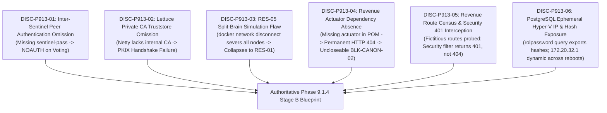

# LGD 2.0 — Phase 9.1.3: Executive Summary & Blueprint Audit Briefing

| **Governance Metadata** | **Specification** |
|:---|:---|
| **System** | Local Government Directory 2.0 (LGD 2.0) |
| **Document Role** | Phase 9.1.3 Executive Summary & Blueprint Audit Briefing |
| **Document ID** | `LGD2-P9.1.3-EXEC-SUMMARY` |
| **File Location** | `SECURITY_AUDIT_CONTROLLER/PHASE_9_1_3_EXECUTIVE_SUMMARY.md` |
| **Evaluation Timestamp** | November 6, 2026 (`2026-11-06T11:30:00+05:30`) |
| **Controller Baseline** | Controller Version 1.7.0 (`MASTER_AUDIT_STATE.md`) |
| **Governing Risks & Blockers** | `RR-02`, `RR-05`, `RR-06`, `RR-11`, `BLK-CANON-01`, `BLK-CANON-02`, `BLK-CANON-03`, `BLK-CANON-04` |
| **Audit Mandate** | **STRICTLY READ-ONLY INDEPENDENT AUDIT (ZERO SYSTEM MUTATIONS)** |
| **Stage B Authorization Ruling** | **`CONDITIONALLY_READY_FOR_AUTHORIZATION` (PENDING 6 BLUEPRINT CORRECTIONS)** |

---

## 1. Executive Briefing

Phase 9.1.3 was conducted as an independent, forensic audit of the proposed Stage B implementation blueprint established in Phase 9.1.2. The primary mission was to verify whether the Stage B package is technically sound, secure, complete, reversible, and backed by verifiable empirical evidence before any operational execution authorization is granted.

### 1.1 Key Audit Verdict
The independent audit team determined that while Phase 9.1.2 successfully established a safe, offline hardening sequence for PostgreSQL and designed tiered, non-destructive rollback protocols, **six critical technical design gaps and safety defects** existed in the Stage B implementation package. If executed without correction, these defects would have triggered automated failover collapse, runtime TLS handshake crashes, unclosable release blockers, and credential exposure.

---

## 2. Summary of Six Critical Technical Discoveries



1. **`DISC-P913-01` (Redis Sentinel Inter-Node Authentication):**
   The blueprint configured `sentinel requirepass` on Sentinels, but omitted `sentinel sentinel-pass`. In Redis 6.2+ (and the target Redis 8.10.3), Sentinels communicating with peers during leader elections receive `NOAUTH`, completely preventing quorum consensus and automated failover.
2. **`DISC-P913-02` (Lettuce Custom CA Truststore):**
   The blueprint configured `builder.useSsl()`, but omitted JVM truststore configuration for the internal private CA (`lgd-internal-ca.crt`). Lettuce aborts with `SSLHandshakeException: PKIX path building failed` upon connecting to internal TLS Redis nodes.
3. **`DISC-P913-03` (RES-05 Network Partition Flaw):**
   The blueprint prescribed `docker network disconnect lgd-data-tier redis-primary` to test split-brain resistance. Disconnecting the primary completely severs it from all nodes (including Sentinel 1), collapsing the test into a standard crash test (`RES-01`) rather than a selective partition between minority and majority consensus tiers.
4. **`DISC-P913-04` (Revenue Actuator Dependency Absence):**
   The blueprint established a 6-Factor census for `TestController`, mandating in Factor 4 that `/actuator/mappings` return HTTP 200 with zero matches, asserting that a 404 voids the census. However, `revenue/pom.xml` does NOT contain `spring-boot-starter-actuator`, making HTTP 404 guaranteed and rendering Factor 4 permanently unfulfillable.
5. **`DISC-P913-05` (Revenue TestController Route Census Discrepancy):**
   Factor 5 specified probing fictitious routes (`/test/status`, `/test/echo`) while completely omitting the primary `@RequestMapping({ "/private/v1/test", "/test" })` base path (which defines 40 distinct route combinations). Furthermore, Factor 5 expects unauthenticated HTTP 404 responses, whereas `revenue`'s `SecurityConfig.java` enforces `.anyRequest().authenticated()`, causing unauthenticated probes to return HTTP 401 Unauthorized before reaching DispatcherServlet.
6. **`DISC-P913-06` (PostgreSQL Ephemeral IP Binding & Hash Exposure):**
   Step B1-05 instructed running `SELECT rolname, rolpassword FROM pg_authid;`, directly violating the safety directive against exporting password hashes. Additionally, pinning `listen_addresses = '127.0.0.1, 172.20.32.1'` assumes `172.20.32.1` is static, whereas WSL2 virtual switch IPs are dynamically allocated by Windows Hyper-V across reboots.

---

## 3. Release Gate Posture

```
================================================================================
RELEASE GATE STATUS (PHASE 9.1.3 EVALUATION)
================================================================================
Gate A (Code Quality, Unit Tests, Traceability):      QUALIFIED_PASS (PRESERVED)
Gate B (Technical Infrastructure & Runtime Readiness):  HOLD (MANDATORY)
Gate C (Governance & Executive Risk Sign-Off):          PENDING_FORMAL_ACCEPTANCE (MANDATORY)
Production Deployment Authorization:                 NOT APPROVED
================================================================================
```

- **Gate A:** Preserved at `QUALIFIED_PASS` based on 418/418 passing tests across 54 suites (100% pass rate).
- **Gate B:** Held strictly by environmental blockers `BLK-CANON-01`, `BLK-CANON-02`, and `BLK-CANON-03`.
- **Gate C:** Held strictly by governance blocker `BLK-CANON-04` awaiting formal countersignature from DAA and CISO.

---

## 4. Auditor Recommendation

The Stage B implementation blueprint is **`CONDITIONALLY_READY_FOR_AUTHORIZATION`**. Operational execution must not proceed until all six Phase 9.1.3 prerequisites are formally verified and integrated into the authoritative implementation matrix (Phase 9.1.4).

