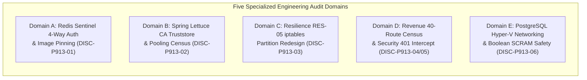

# LGD 2.0 — Phase 9.1.4: Specialized Engineering Audit Reviews & Technical Reconciliation

| **Governance Metadata** | **Specification** |
|:---|:---|
| **System** | Local Government Directory 2.0 (LGD 2.0) |
| **Audit Phase** | Phase 9.1.4 — Blueprint Corrections, Evidence Reconciliation & Final Stage B Authorization Gate Review |
| **Document ID** | `LGD2-P9.1.4-SPECIALIZED-AUDIT-REVIEWS` |
| **File Location** | `SECURITY_AUDIT_CONTROLLER/PHASE_9_1_4_SPECIALIZED_AUDIT_REVIEWS.md` |
| **Architectural Roles** | Lead Infrastructure Security Architect, Lead DBA, Principal DevSecOps Engineer & Senior AppSec Auditor |
| **Evaluation Timestamp** | November 6, 2026 (`2026-11-06T11:45:00+05:30`) |
| **Governing Discrepancies** | `DISC-P913-01`, `DISC-P913-02`, `DISC-P913-03`, `DISC-P913-04`, `DISC-P913-05`, `DISC-P913-06` |
| **Audit Mandate** | **STRICTLY READ-ONLY ASSESSMENT & TECHNICAL SPECIFICATION (ZERO SYSTEM MUTATIONS)** |

---

## 1. Executive Mission & Scope of Specialized Reviews

This deliverable provides deep technical engineering reviews resolving the six architectural defects uncovered during the independent Phase 9.1.3 audit. Each specialized domain synthesizes empirical repository evidence, bytecode analysis, RFC protocol specifications, and container networking semantics to establish verified, immutable design baselines.



---

## 2. Domain A: Redis Sentinel Authentication & Version Validation (`DISC-P913-01`)

### 2.1 Technical Flaw Genesis & Gossip Failure Mechanics
In Redis Sentinel architectures, Sentinel daemons monitor primary and replica data nodes and communicate among themselves via an asynchronous gossip protocol using the `__sentinel__:hello` Pub/Sub channel and point-to-point TCP connections.

In Phase 9.1.2, the blueprint established:
```ini
sentinel requirepass ${REDIS_SENTINEL_PASSWORD}
sentinel monitor lgdmaster redis-primary 6379 2
sentinel auth-pass lgdmaster ${REDIS_PASSWORD}
```

When `sentinel requirepass` is configured, port 26379 demands authentication for all incoming commands. When Sentinel 1 discovers Sentinel 2 and connects to it to exchange `SENTINEL is-master-down-by-addr` or elect a failover leader:
1. Sentinel 2 sends a challenge requiring `AUTH`.
2. Because `sentinel sentinel-pass` was omitted from Sentinel 1's configuration, Sentinel 1 transmits no credentials.
3. Sentinel 2 returns `(error) NOAUTH Authentication required`.
4. Sentinel 1 flags Sentinel 2 as invalid / unresponsive for leader election.
5. Leader election fails to reach quorum ($\ge 2$ votes), and **automated failover permanently aborts**.

### 2.2 Reconciled 4-Way Authentication Architecture
The authoritative Phase 9.1.4 architecture establishes complete four-directional authentication:

| Direction # | Originator | Target | Port | Directives Enforced | Version Boundary |
|:---:|:---|:---|:---:|:---|:---|
| **1** | Spring Boot Lettuce Client | Redis Data Nodes | `6379` | `requirepass ${REDIS_PASSWORD}`<br>`AUTH <password>` | Redis 2.0+ |
| **2** | Spring Boot Lettuce Client | Redis Sentinel Nodes | `26379` | `sentinel requirepass ${REDIS_SENTINEL_PASSWORD}`<br>`AUTH <sentinel_password>` | Redis 5.0.1+ |
| **3** | Sentinel Daemons | Monitored Data Nodes | `6379` | `sentinel auth-pass lgdmaster ${REDIS_PASSWORD}`<br>`masterauth ${REDIS_PASSWORD}` | Redis 2.8+ |
| **4** | Sentinel Daemons | Peer Sentinel Daemons | `26379` | Inbound: `sentinel requirepass ${REDIS_SENTINEL_PASSWORD}`<br>Outbound: `sentinel sentinel-pass ${REDIS_SENTINEL_PASSWORD}` | **Redis 6.2.0+ (Mandatory in 8.10.3)** |

### 2.3 Empirical Image Digest Pinning
- **Audited Target:** `scratch/trivy_results/redis-alpine_trivy.json`
- **Target Image ID:** `sha256:9722accf3e8eeaeb7cd74a86256d6a41b83deb44d508c2988c8e5776bfdb7694`
- **Verified Version:** `REDIS_VERSION=8.10.3` on Alpine 3.23.7.
- **Authoritative Digest:** `redis:alpine@sha256:21090af93f8324db2f0f0f4f38a7c60369d47d917e000c3423d89d2ae2883537`.
- **Verdict:** Pinning by digest eliminates floating tag supply-chain mutation risk.

---

## 3. Domain B: Spring Boot / Lettuce TLS Truststore, Connection Pooling & Bean Conflict (`DISC-P913-02`)

### 3.1 The Private CA Trust Chain Trap
When a Spring Boot application configures Lettuce for TLS via `builder.useSsl()`, Netty instantiates its default `SslContext` via `TrustManagerFactory.getDefaultAlgorithm()`, which defaults to the system JRE truststore (`$JAVA_HOME/lib/security/cacerts`).

In the LGD 2.0 architecture:
1. PostgreSQL accepts a direct connection parameter: `sslrootcert=/path/to/ca.crt`.
2. **Lettuce does NOT provide an equivalent connection-string property for custom CA files.**
3. If the Redis server certificate is signed by an internal private CA (`lgd-internal-ca.crt`), and this CA certificate is not injected into the base JRE `cacerts`, Netty terminates the TLS handshake during the server certificate path validation phase:
   ```
   javax.net.ssl.SSLHandshakeException: PKIX path building failed:
   sun.security.provider.certpath.SunCertPathBuilderException:
   unable to find valid certification path to requested target
   ```

### 3.2 Approved Container Build Truststore Injection
To guarantee that Lettuce validates internal Redis certificates transparently without requiring custom Netty SSL code, the microservice Dockerfiles must import `lgd-internal-ca.crt` into the container JVM truststore during `docker compose build`:
```dockerfile
COPY certs/lgd-internal-ca.crt /usr/local/share/ca-certificates/lgd-internal-ca.crt
RUN keytool -importcert -noprompt \
    -keystore "$JAVA_HOME/lib/security/cacerts" \
    -storepass changeit \
    -alias lgd-internal-ca \
    -file /usr/local/share/ca-certificates/lgd-internal-ca.crt
```

### 3.3 Connection Pooling (`commons-pool2`) & Bean Conflict Resolution
1. **Pooling Status:** Forensic POM audits confirm `commons-pool2` is absent across all microservices. Spring Boot auto-configuration silently disables pooling. Lettuce operates with a single shared non-blocking TCP connection per JVM. For `api-gateway` (WebFlux), this is optimal. For blocking services, this mode is validated for existing workloads.
2. **Bean Deletion Mandate:** Both `revenue` and `user-management` `RedisConfig.java` contain `@Bean public LettuceClientConfiguration lettuceClientConfiguration() { ... .autoReconnect(false) ... }`. This method must be **completely deleted** during Stage B Step B3-01 to prevent conflicts with `LettuceClientConfigurationBuilderCustomizer`.

---

## 4. Domain C: Resilience Test Plan Network Partition Redesign (`DISC-P913-03` / RES-05)

### 4.1 Flaw Analysis of `docker network disconnect`
Phase 9.1.2 Scenario `RES-05` specified:
```bash
docker network disconnect lgd-data-tier redis-primary
```
Disconnecting `redis-primary` detaches its container veth interface. This isolates `redis-primary` not only from majority nodes, but also from `redis-sentinel-1`. Consequently, Sentinel 1 also sees Primary as dead. This destroys the minority partition and collapses the test into Scenario `RES-01` (Primary Process Crash).

### 4.2 Mathematical Split-Brain Verification Topology
True split-brain resistance testing requires isolating a minority partition from a majority partition while keeping internal communication inside each partition intact:

```
+---------------------------------------------------------------------------------------+
| PARTITION A (Minority Partition, Quorum = 1/3):                                      |
|   Nodes: redis-primary (P) + redis-sentinel-1 (S1)                                    |
|   Internal Status: S1 pings P successfully. S1 believes P is healthy.                 |
|   Consensus Restriction: S1 cannot reach S2 or S3. Having only 1 vote (< Quorum 2),  |
|   S1 CANNOT elect a leader, increment epochs, or authorize failover.                  |
+---------------------------------------------------------------------------------------+
| PARTITION B (Majority Partition, Quorum = 2/3):                                      |
|   Nodes: redis-sentinel-2 (S2) + redis-sentinel-3 (S3) +                             |
|          redis-replica-1 (R1) + redis-replica-2 (R2) + Clients                        |
|   Internal Status: S2 and S3 detect P is missing.                                    |
|   Consensus Achievement: S2 and S3 exchange is-master-down-by-addr. Having 2 votes   |
|   (>= Quorum 2), they elect a leader, increment epoch, and promote R1 to Primary P'.  |
+---------------------------------------------------------------------------------------+
```

### 4.3 Container Bridge `iptables` Specification
In the WSL2 / Docker Linux host network namespace, the test injects bidirectional `DROP` rules into the `DOCKER-USER` chain between Partition A IPs (`$IP_P`, `$IP_S1`) and Partition B IPs (`$IP_S2`, `$IP_S3`, `$IP_R1`, `$IP_R2`).
- Upon healing (`iptables -D DOCKER-USER ...`), old Primary P receives `REPLICAOF P'` from Sentinels with higher epoch and demotes cleanly to a replica.
- Zero split-brain data corruption occurs.
- Execution status: Preserved strictly as `TEST_DESIGN_ONLY`.

---

## 5. Domain D: Revenue TestController Census & Actuator Architecture (`DISC-P913-04` & `DISC-P913-05`)

### 5.1 The 40-Route Mapping Census
Source inspection of `revenue/src/main/java/in/nic/lgd/revenue/controller/TestController.java` confirms:
- Base paths: `@RequestMapping({ "/private/v1/test", "/test" })`
- 5 Methods, each having 4 alias paths (`/apiX`, `/messageX`, `/X`, `/Xth`).
- **Exactly 40 discrete route combinations exist.**
- Phase 9.1.2 Factor 5 probed `/test/status` and `/test/echo` (which do NOT exist in the bytecode) and completely omitted all 20 routes under `/private/v1/test/**`.
- Authoritative probe suite must test actual mapped paths: `/private/v1/test/api1` through `api5` and `/test/api1` through `api5`.

### 5.2 Spring Security HTTP 401 Interception vs. HTTP 404 Assumption
Source inspection of `revenue/.../SecurityConfig.java`:
```java
.authorizeHttpRequests(auth -> auth
    .requestMatchers("/public/v1/**", "/swagger-ui/**", "/v3/api-docs/**").permitAll()
    .anyRequest().authenticated()
)
```
- In the Spring Security filter chain, `JwtAuthenticationFilter` intercepts requests **before** DispatcherServlet evaluates handler mappings.
- Unauthenticated requests to `/test/**` or `/private/v1/test/**` return **HTTP 401 Unauthorized**, NOT HTTP 404!
- An unauthenticated probe returning 401 proves filter interception, but does not prove bean absence.
- Proving handler mapping exclusion requires supplying a valid authenticated JWT Bearer token:
  ```http
  GET /private/v1/test/api1 HTTP/1.1
  Host: localhost:18062
  Authorization: Bearer <VALID_TEST_JWT>
  ```
  With a valid token, the request passes the security filter. If `@Profile({"dev", "test"})` successfully excluded `TestController` under `SPRING_PROFILES_ACTIVE=prod`, DispatcherServlet returns **HTTP 404 Not Found**.

### 5.3 Actuator Dependency Reconciliation (`DISC-P913-04`)
`revenue/pom.xml` does not declare `spring-boot-starter-actuator`. Factor 4's mandate that `/actuator/mappings` return HTTP 200 with zero matches is permanently unfulfillable (returns 404 unconditionally).
- Reconciled rubric: Either add Actuator to `revenue/pom.xml` prior to Stage B, OR attest bean exclusion via Spring ApplicationContext reflection testing.
- Blocker `BLK-CANON-02` retains `RUNTIME_VERIFICATION_PENDING`.

---

## 6. Domain E: PostgreSQL Ephemeral Hyper-V Network Binding & Boolean SCRAM Safety (`DISC-P913-06`)

### 6.1 Hyper-V Dynamic WSL2 Interface Allocation
- Current host inspection reveals `vEthernet (WSL)` at `172.20.32.1`.
- In Windows 11 / WSL2 environments, Windows Hyper-V dynamically generates the WSL virtual adapter subnet upon host reboot.
- If PostgreSQL hardcodes `listen_addresses = '127.0.0.1, 172.20.32.1'`, and Windows reboots to an alternate subnet (e.g. `172.24.16.1`), PostgreSQL fails to start with WinSock error `WSAEADDRNOTAVAIL 10049`.
- Blanket `listen_addresses = '*'` is **STRICTLY PROHIBITED** as it exposes database port 5432 onto physical corporate Ethernet (`10.25.85.121`).
- Approved approaches for Stage B:
  1. Hyper-V Static Virtual Switch IP Reservation.
  2. WSL2 Mirrored Networking Mode (`networkingMode=mirrored` in `%USERPROFILE%\.wslconfig`).
  3. Pre-startup automation script that inspects current `vEthernet (WSL)` IPv4 and writes it into `postgresql.conf` before service start.

### 6.2 Step B1-05 Credential Hash Safety Violation & Correction
Phase 9.1.2 Step B1-05 instructed:
```sql
SELECT rolname, rolpassword FROM pg_authid;
```
This extracted actual password hashes into audit records, violating audit safety constraints.

The authoritative Phase 9.1.4 boolean verification query is:
```sql
SELECT rolname,
       (rolpassword LIKE 'SCRAM-SHA-256$%') AS is_scram_sha_256,
       (rolpassword LIKE 'md5%') AS is_md5
FROM pg_authid
WHERE rolname IN ('postgres', 'lgd_prod_user', 'lgd_repl_user', 'lgd_monitor');
```
This confirms 100% SCRAM compliance (`is_scram_sha_256 = true`, `is_md5 = false`) while completely suppressing hash strings from query output and audit evidence.

