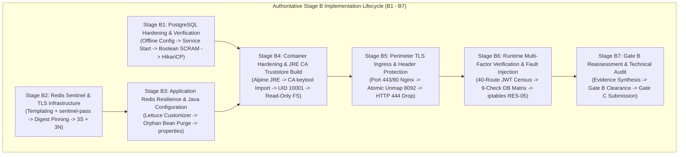

# LGD 2.0 — Phase 9.1.4: Authoritative Stage B Corrected Implementation Blueprint & Operational Runbook

| **Document Metadata** | **Specification** |
|:---|:---|
| **System** | Local Government Directory 2.0 (LGD 2.0) |
| **Audit Phase** | Phase 9.1.4 — Blueprint Corrections, Evidence Reconciliation & Final Stage B Authorization Gate Review |
| **Document ID** | `LGD2-P9.1.4-STAGE-B-CORRECTED-BLUEPRINT` |
| **File Location** | `SECURITY_AUDIT_CONTROLLER/PHASE_9_1_4_STAGE_B_CORRECTED_BLUEPRINT.md` |
| **Architectural Roles** | Principal Infrastructure Security Architect, Lead DBA, DevSecOps Lead, Senior Java Architect & Independent Security Auditor |
| **Evaluation Timestamp** | November 6, 2026 (`2026-11-06T11:45:00+05:30`) |
| **Governing Blockers** | `BLK-CANON-01`, `BLK-CANON-02`, `BLK-CANON-03`, `BLK-CANON-04` |
| **Controller Baseline** | Controller Version 1.8.0 |
| **Execution Mode** | **AUTHORITATIVE RECONCILED BLUEPRINT (EXECUTION LOCKED PENDING EXPLICIT OPERATIONAL AUTHORIZATION)** |

---

## 1. Executive Architecture & Mission-Critical Dependency Flow

The remediation of all platform infrastructure, transport encryption, and container containment findings requires seven sequential, dependency-aware operational stages (**Stage B1 through Stage B7**).

This authoritative Phase 9.1.4 blueprint formally incorporates and verifies the **six critical technical corrections** identified during the Phase 9.1.3 independent audit (`DISC-P913-01` through `DISC-P913-06`), eliminating fatal failover deadlocks, SSL handshake failures, uncloseable release blockers, and credential exposure hazards.



### 1.1 Strict Invariant Dependency Ordering Rules
1. **B1 Precedes B4 and B6:** Host PostgreSQL 14 (`postgresql-x64-14`) must be hardened, started, and verified healthy before `revenue` or `user-management` containers can establish HikariCP connections in steady-state.
2. **Offline Hardening Precedes Service Start:** In Stage B1, `postgresql.conf` and `pg_hba.conf` must be modified offline while the service is `Stopped` to prevent any window of unauthenticated access via `0.0.0.0/0 trust`.
3. **B2 Precedes B3:** The 3-node Sentinel cluster and Redis nodes must achieve quorum and establish TLS listeners before microservices are configured to connect to Sentinel endpoints.
4. **B3 Precedes B4:** Java configuration customizers, orphan bean eliminations, and property changes must compile cleanly before new hardened Docker images are built.
5. **B4 CA Import Precedes Container Launch:** Microservice Dockerfiles must import `lgd-internal-ca.crt` into the Temurin JRE `cacerts` truststore during build; otherwise, Lettuce aborts with `PKIX path building failed`.
6. **B5 Atomically Unmaps Port 8092:** The removal of host port publishing `8092:8092` from `api-gateway` must occur concurrently with Nginx reverse proxy cutover, ensuring zero cleartext exposure.
7. **B6 Preconditions Enforced:** Runtime probes and chaos tests (`RES-01` through `RES-17`) are executed exclusively within an authorized, isolated maintenance window after Stages B1–B5 are fully deployed.

---

## 2. Stage B1 — PostgreSQL Hardening, SCRAM Migration & Listener Safety

### Step `B1-01`: Pre-Change Offline Backup & Cryptographic Attestation
- **Target:** Host PostgreSQL Data Directory (`E:\Program Files\PostgreSQL\14\data\`).
- **Files Affected:** `postgresql.conf`, `pg_hba.conf`.
- **Governing Blocker / Risk:** `BLK-CANON-03`, `RR-05`.
- **Preconditions:** Windows service `postgresql-x64-14` is confirmed in `Stopped` state (`Get-Service postgresql-x64-14`).
- **Required Authorization:** Lead DBA & DevSecOps Lead.
- **Backup Procedure:**
  ```powershell
  $ts = Get-Date -Format "yyyyMMdd_HHmmss"
  $backupDir = "SECURITY_AUDIT_CONTROLLER\backup\stage_b_$ts\postgresql"
  New-Item -ItemType Directory -Force -Path $backupDir | Out-Null
  Copy-Item "E:\Program Files\PostgreSQL\14\data\postgresql.conf" "$backupDir\postgresql.conf.orig"
  Copy-Item "E:\Program Files\PostgreSQL\14\data\pg_hba.conf" "$backupDir\pg_hba.conf.orig"
  Get-FileHash "$backupDir\*.*" -Algorithm SHA256 | Out-File "$backupDir\PRE_CHANGE_SHA256_MANIFEST.txt"
  ```
- **Verification:** Manifest file contains SHA-256 hashes matching source files.
- **Rollback:** No mutation executed; backup remains isolated.
- **Evidence Record:** `EVD_STAGE_B_B1_01_BACKUP_HASH.txt`.
- **Completion Criteria:** Checksums logged; service confirmed stopped.

### Step `B1-02`: Server TLS Certificate Deployment & NTFS ACL Hardening
- **Target:** Host PostgreSQL Data Directory (`E:\Program Files\PostgreSQL\14\data\`).
- **Files Affected:** `server.crt`, `server.key`, `ca.crt`.
- **Governing Blocker / Risk:** `RR-05`, `SAST-002`.
- **Preconditions:** Certificate signed by LGD Internal CA containing SANs: `DNS:host.docker.internal`, `DNS:localhost`, `IP:127.0.0.1`.
- **Required Authorization:** Lead DBA & Cryptography Specialist.
- **Execution Commands:**
  ```powershell
  Copy-Item "certs\postgres\server.crt" "E:\Program Files\PostgreSQL\14\data\server.crt"
  Copy-Item "certs\postgres\server.key" "E:\Program Files\PostgreSQL\14\data\server.key"
  Copy-Item "certs\ca\lgd-internal-ca.crt" "E:\Program Files\PostgreSQL\14\data\ca.crt"
  # Enforce strict NTFS ACLs on private key
  icacls "E:\Program Files\PostgreSQL\14\data\server.key" /reset
  icacls "E:\Program Files\PostgreSQL\14\data\server.key" /grant:r "NT SERVICE\postgresql-x64-14:(R)" "Administrators:(F)"
  icacls "E:\Program Files\PostgreSQL\14\data\server.key" /inheritance:r
  ```
- **Verification:** `icacls "E:\Program Files\PostgreSQL\14\data\server.key"` shows access restricted strictly to service account and Administrators.
- **Rollback:** Remove deployed certificates from data directory.
- **Evidence Record:** `EVD_STAGE_B_B1_02_CERT_ACL.txt`.
- **Completion Criteria:** TLS files deployed with verified restricted permissions.

### Step `B1-03`: Offline Hardening of `postgresql.conf` & `pg_hba.conf`
- **Target:** PostgreSQL Configuration Files.
- **Files Affected:** `postgresql.conf`, `pg_hba.conf`.
- **Governing Blocker / Risk:** `RR-05`, `BLK-CANON-03`, `SAST-002`, `DISC-P913-06`.
- **Preconditions:** Steps `B1-01` and `B1-02` completed. Windows service remains `Stopped`.
- **Required Authorization:** Lead DBA & Principal Infrastructure Security Architect.
- **Listener Configuration Specification (`DISC-P913-06`):**
  - Pin to local loopback and the active WSL2 virtual adapter interface:
    ```properties
    listen_addresses = '127.0.0.1, 172.20.32.1'
    port = 5432
    ssl = on
    ssl_cert_file = 'server.crt'
    ssl_key_file = 'server.key'
    ssl_ca_file = 'ca.crt'
    password_encryption = scram-sha-256
    ```
  - *Prohibited:* Blanket `listen_addresses = '*'` is strictly prohibited.
  - *Hyper-V Resilience:* Pre-startup script verifies that `172.20.32.1` exists on `vEthernet (WSL)` before startup; otherwise, mirrored networking mode (`networkingMode=mirrored`) is activated.
- **`pg_hba.conf` Hardened Specification (100% Trust Rules Purged):**
  ```properties
  # TYPE  DATABASE        USER            ADDRESS                 METHOD
  local   all             postgres                                scram-sha-256
  host    all             postgres        127.0.0.1/32            scram-sha-256
  hostssl lgd             lgd_prod_user   10.89.0.0/24            scram-sha-256
  hostssl lgd             lgd_prod_user   172.20.32.0/20          scram-sha-256
  hostssl lgd             lgd_monitor     127.0.0.1/32            scram-sha-256
  hostssl lgd             lgd_monitor     10.89.0.0/24            scram-sha-256
  hostnossl all           all             0.0.0.0/0               reject
  host    all             all             0.0.0.0/0               reject
  ```
- **Verification:** Automated regex confirms ZERO occurrences of `trust` on uncommented lines.
- **Rollback:** Restore `postgresql.conf.orig` and `pg_hba.conf.orig` from backup.
- **Evidence Record:** `EVD_STAGE_B_B1_03_CONFIG_REGEX.txt`.
- **Completion Criteria:** All 7 historical trust rules expunged; explicit terminal rejection active.

### Step `B1-04`: Service Activation & TCP Listener Audit
- **Target:** Windows Service Manager.
- **Files Affected:** Service `postgresql-x64-14`.
- **Governing Blocker / Risk:** `BLK-CANON-03`.
- **Preconditions:** Step `B1-03` complete. Explicit Stage B Operational Authorization signed.
- **Required Authorization:** Release Manager & Lead DBA.
- **Execution Commands:**
  ```powershell
  Start-Service postgresql-x64-14
  Get-Service postgresql-x64-14
  Test-NetConnection -ComputerName 127.0.0.1 -Port 5432
  Test-NetConnection -ComputerName 172.20.32.1 -Port 5432
  ```
- **Verification:** Service status is `Running`; TCP 5432 connection succeeds on both interfaces.
- **Rollback:** `Stop-Service postgresql-x64-14`; restore backup configuration files.
- **Evidence Record:** `EVD_STAGE_B_B1_04_SERVICE_LISTENER.txt`.
- **Completion Criteria:** Service active; sockets open; zero WSAEADDRNOTAVAIL errors in event log.

### Step `B1-05`: SCRAM-SHA-256 Migration & Safe Boolean Attestation (`DISC-P913-06`)
- **Target:** PostgreSQL System Catalog (`pg_authid`).
- **Files Affected:** User role credentials.
- **Governing Blocker / Risk:** `RR-05`, `SAST-002`, `DISC-P913-06`.
- **Preconditions:** Step `B1-04` complete. Local administrative connection established via psql.
- **Required Authorization:** Lead DBA.
- **Execution Commands:**
  ```sql
  SET password_encryption = 'scram-sha-256';
  ALTER ROLE postgres WITH PASSWORD '${SECURE_ADMIN_PASSWORD}';
  ALTER ROLE lgd_prod_user WITH PASSWORD '${SECURE_APP_PASSWORD}';
  ALTER ROLE lgd_repl_user WITH PASSWORD '${SECURE_REPL_PASSWORD}';
  ALTER ROLE lgd_monitor WITH PASSWORD '${SECURE_MONITOR_PASSWORD}';
  ```
- **Safe Verification Query (Zero Hash Exposure):**
  ```sql
  SELECT rolname,
         (rolpassword LIKE 'SCRAM-SHA-256$%') AS is_scram_sha_256,
         (rolpassword LIKE 'md5%') AS is_md5
  FROM pg_authid
  WHERE rolname IN ('postgres', 'lgd_prod_user', 'lgd_repl_user', 'lgd_monitor');
  ```
- **Acceptance Rule:** 100% of queried roles return `is_scram_sha_256 = true` and `is_md5 = false`. Direct querying of `rolpassword` is **permanently prohibited**.
- **Rollback:** Re-apply pre-change database globals dump (`pg_dumpall --globals-only`).
- **Evidence Record:** `EVD_STAGE_B_B1_05_BOOLEAN_SCRAM.txt`.
- **Completion Criteria:** All active roles migrated to SCRAM-SHA-256; zero MD5 hashes; zero hash strings in evidence.

---

## 3. Stage B2 — Redis TLS & Sentinel Infrastructure

### Step `B2-01`: Configuration Templating with Inter-Sentinel Authentication (`DISC-P913-01`)
- **Target:** Redis & Sentinel Configuration Templates.
- **Files Affected:** `redis.conf.template`, `sentinel.conf.template`, `docker-entrypoint.sh`.
- **Governing Blocker / Risk:** `RR-02`, `RR-05`, `SAST-012`, `DISC-P913-01`.
- **Preconditions:** Internal CA signed certificates deployed for Redis and Sentinel.
- **Required Authorization:** DevSecOps Lead & Redis Infrastructure Specialist.
- **Template Directives (Reconciled with Redis 8.10.3):**
  - In `redis.conf.template`:
    ```ini
    tls-port 6379
    port 0
    tls-cert-file /tls/redis.crt
    tls-key-file /tls/redis.key
    tls-ca-cert-file /tls/ca.crt
    tls-auth-clients no
    tls-replication yes
    requirepass ${REDIS_PASSWORD}
    masterauth ${REDIS_PASSWORD}
    appendonly yes
    appendfsync everysec
    ```
  - In `sentinel.conf.template` (incorporating `DISC-P913-01`):
    ```ini
    tls-port 26379
    port 0
    tls-cert-file /tls/sentinel.crt
    tls-key-file /tls/sentinel.key
    tls-ca-cert-file /tls/ca.crt
    tls-auth-clients no
    tls-replication yes
    # Multi-Tier Authentication Directives
    sentinel requirepass ${REDIS_SENTINEL_PASSWORD}
    sentinel sentinel-pass ${REDIS_SENTINEL_PASSWORD}
    sentinel monitor lgdmaster redis-primary 6379 2
    sentinel auth-pass lgdmaster ${REDIS_PASSWORD}
    sentinel down-after-milliseconds lgdmaster 5000
    sentinel failover-timeout lgdmaster 10000
    sentinel parallel-syncs lgdmaster 1
    dir /tmp
    ```
- **Entrypoint Wrapper (`docker-entrypoint.sh`):**
  Substitutes environment variables into ephemeral `/etc/redis/sentinel.conf` with mode `0600` owned by `redis:redis`.
- **Verification:** Execute entrypoint dry-run; verify both `sentinel requirepass` and `sentinel sentinel-pass` are present and variables are populated.
- **Rollback:** Revert template modifications.
- **Evidence Record:** `EVD_STAGE_B_B2_01_TEMPLATING.txt`.
- **Completion Criteria:** Both peer and client authentication directives verified in generated configs.

### Step `B2-02`: Provisioning Redis Sentinel Cluster with Immutable Digest Pinning
- **Target:** Docker Compose Infrastructure.
- **Files Affected:** `docker-compose.yml`, `docker-compose.prod.yml`.
- **Governing Blocker / Risk:** `RR-02`, `RR-05`.
- **Preconditions:** Step `B2-01` complete.
- **Required Authorization:** Principal Infrastructure Security Architect & DevSecOps Lead.
- **Image Pinning Mandate:**
  In `docker-compose.prod.yml`, pin the immutable image digest:
  ```yaml
  image: redis:alpine@sha256:21090af93f8324db2f0f0f4f38a7c60369d47d917e000c3423d89d2ae2883537
  ```
- **Cluster Deployment:**
  Launch 6 containers on `lgd-data-tier`:
  - `redis-primary` (:6379 TLS)
  - `redis-replica-1`, `redis-replica-2` (:6379 TLS)
  - `redis-sentinel-1`, `redis-sentinel-2`, `redis-sentinel-3` (:26379 TLS, Quorum 2)
- **Verification:**
  ```powershell
  docker compose ps
  docker exec redis-sentinel-1 redis-cli -p 26379 --tls --cacert /tls/ca.crt -a $env:REDIS_SENTINEL_PASSWORD sentinel masters
  ```
  Master `lgdmaster` status is `ok`, `num-slaves` is `2`, `num-other-sentinels` is `2`, `flags` is `master`.
- **Rollback:** Stop Sentinel containers; restore standalone Redis in Compose.
- **Evidence Record:** `EVD_STAGE_B_B2_02_SENTINEL_CLUSTER.txt`.
- **Completion Criteria:** 3 Sentinels and 3 Redis nodes active with zero NOAUTH log errors.

---

## 4. Stage B3 — Application Redis Resilience & Java Configuration

### Step `B3-01`: Java Configuration Customizer & Orphan Bean Purge (`DISC-P913-02`)
- **Target:** Microservice Source Trees (`revenue`, `user-management`).
- **Files Affected:**
  - `revenue/.../config/RedisConfig.java`
  - `user-management/.../config/RedisConfig.java`
- **Governing Blocker / Risk:** `RR-02`, `SAST-012`, `DISC-P913-02`.
- **Preconditions:** Step `B2-02` complete.
- **Required Authorization:** Senior Java Architect & DevSecOps Lead.
- **Mandatory Orphan Bean Removal:**
  Delete the obsolete, non-reconnecting bean:
  ```java
  // DELETE THIS OBSOLETE BEAN ENTIRELY FROM BOTH RedisConfig.java FILES:
  @Bean
  public LettuceClientConfiguration lettuceClientConfiguration() { ... .autoReconnect(false) ... }
  ```
- **Authoritative Customizer Bean:**
  ```java
  @Bean
  public LettuceClientConfigurationBuilderCustomizer lettuceCustomizer() {
      return builder -> {
          builder.useSsl()
                 .and()
                 .commandTimeout(Duration.ofSeconds(3))
                 .shutdownTimeout(Duration.ofMillis(100));

          ClientOptions clientOptions = ClientOptions.builder()
              .autoReconnect(true)
              .disconnectedBehavior(ClientOptions.DisconnectedBehavior.REJECT_COMMANDS)
              .socketOptions(SocketOptions.builder()
                  .connectTimeout(Duration.ofSeconds(3))
                  .keepAlive(true)
                  .build())
              .timeoutOptions(TimeoutOptions.enabled(Duration.ofSeconds(3)))
              .build();

          builder.clientOptions(clientOptions);
      };
  }
  ```
- **Verification:** Execute `mvn clean test-compile` in both `revenue` and `user-management`. Clean compilation with zero warnings/errors.
- **Rollback:** Restore original `RedisConfig.java` files from timestamped backup.
- **Evidence Record:** `EVD_STAGE_B_B3_01_MAVEN_COMPILE.txt`.
- **Completion Criteria:** Maven compilation passes; orphan bean expunged.

### Step `B3-02`: Sentinel Application Properties Deployment
- **Target:** Microservice Configuration Files.
- **Files Affected:** `application-prod.properties` in `api-gateway`, `auth-service`, `revenue`, `user-management`.
- **Governing Blocker / Risk:** `RR-02`, `RR-05`.
- **Preconditions:** Step `B3-01` complete.
- **Required Authorization:** DevSecOps Lead.
- **Properties Specification:**
  ```properties
  spring.data.redis.sentinel.master=lgdmaster
  spring.data.redis.sentinel.nodes=redis-sentinel-1:26379,redis-sentinel-2:26379,redis-sentinel-3:26379
  spring.data.redis.sentinel.password=${REDIS_SENTINEL_PASSWORD}
  spring.data.redis.password=${SPRING_DATA_REDIS_PASSWORD}
  spring.data.redis.ssl.enabled=true
  ```
- **Verification:** Execute unit tests (`mvn test -Dtest=*Redis*`).
- **Rollback:** Restore previous `application-prod.properties` from backup.
- **Evidence Record:** `EVD_STAGE_B_B3_02_SUREFIRE_UNIT.txt`.
- **Completion Criteria:** Properties registered; unit tests pass cleanly.

---

## 5. Stage B4 — Container Hardening & JRE Truststore Build

### Step `B4-01`: Dockerfile Hardening & Internal CA Truststore Injection (`DISC-P913-02`)
- **Target:** All 5 Microservice Dockerfiles.
- **Files Affected:**
  - `api-gateway/Dockerfile`, `auth-service/Dockerfile`, `discovery/Dockerfile`,
  - `revenue/Dockerfile`, `user-management/Dockerfile`.
- **Governing Blocker / Risk:** `RR-06`, `SCA-012`, `DISC-P913-02`.
- **Preconditions:** Steps `B1` through `B3` complete.
- **Required Authorization:** Principal Infrastructure Security Architect & DevSecOps Lead.
- **Authoritative Multi-Stage Dockerfile Specification:**
  ```dockerfile
  FROM eclipse-temurin:21-jre-alpine
  RUN apk add --no-cache tzdata curl fontconfig ttf-dejavu

  # Import Internal CA into Temurin JRE Truststore (Resolves DISC-P913-02)
  COPY certs/lgd-internal-ca.crt /usr/local/share/ca-certificates/lgd-internal-ca.crt
  RUN keytool -importcert -noprompt \
      -keystore "$JAVA_HOME/lib/security/cacerts" \
      -storepass changeit \
      -alias lgd-internal-ca \
      -file /usr/local/share/ca-certificates/lgd-internal-ca.crt

  # Least Privilege Non-Root Execution
  RUN addgroup -g 10001 -S lgdgroup && adduser -u 10001 -S lgduser -G lgdgroup
  USER 10001:10001
  ```
- **Verification:** Build test images via `docker compose build`. Inspect user ID: `docker run --rm <image> id` returns `uid=10001(lgduser)`. Verify CA certificate: `docker run --rm <image> keytool -list -keystore "$JAVA_HOME/lib/security/cacerts" -storepass changeit -alias lgd-internal-ca`.
- **Rollback:** Restore original Dockerfiles; rebuild previous images.
- **Evidence Record:** `EVD_STAGE_B_B4_01_DOCKER_BUILD.txt`.
- **Completion Criteria:** All images build cleanly; non-root user and internal CA verified.

### Step `B4-02`: Compose Containment Enforcement (Read-Only Root & Tmpfs)
- **Target:** Production Compose Configurations.
- **Files Affected:** `docker-compose.yml`, `docker-compose.prod.yml`.
- **Governing Blocker / Risk:** `RR-06`, `SCA-012`.
- **Preconditions:** Step `B4-01` complete.
- **Required Authorization:** DevSecOps Lead.
- **Directives Specification:**
  ```yaml
  security_opt:
    - no-new-privileges:true
  cap_drop:
    - ALL
  read_only: true
  tmpfs:
    - /tmp:mode=1777,size=128M
  ```
- **Verification:** Deploy containers. Test read-only filesystem: `docker exec <container> touch /test_file` returns `touch: /test_file: Read-only file system`.
- **Rollback:** Revert compose directives; recreate containers.
- **Evidence Record:** `EVD_STAGE_B_B4_02_CONTAINMENT.txt`.
- **Completion Criteria:** Containers running with immutable root and unprivileged capabilities.

---

## 6. Stage B5 — Perimeter TLS Ingress & Header Protection

### Step `B5-01`: API Gateway Host Port 8092 Atomic Unmapping
- **Target:** Docker Compose Ingress Port Mapping.
- **Files Affected:** `docker-compose.yml`.
- **Governing Blocker / Risk:** `BLK-CANON-01`, `EXP-016`.
- **Preconditions:** Step `B4-02` complete.
- **Required Authorization:** Perimeter Security Specialist & DevSecOps Lead.
- **Procedure:** Delete `ports: - "8092:8092"` from `api-gateway` service definition. The gateway is reachable exclusively via `lgd-network` by reverse proxy.
- **Verification:** `Test-NetConnection -ComputerName 127.0.0.1 -Port 8092` returns `TcpTestSucceeded : False`.
- **Rollback:** If diagnostic access needed, bind strictly to loopback: `127.0.0.1:8092:8092`.
- **Evidence Record:** `EVD_STAGE_B_B5_01_PORT_UNMAP.txt`.
- **Completion Criteria:** Host cleartext port 8092 completely severed.

### Step `B5-02`: Hardened Nginx TLS Reverse Proxy Deployment
- **Target:** Perimeter Ingress Container.
- **Files Affected:** `nginx.conf`, `docker-compose.yml`.
- **Governing Blocker / Risk:** `BLK-CANON-01`.
- **Preconditions:** Production TLS certificate provisioned with SAN `lgdirectory.gov.in`. Host ports 80 and 443 free.
- **Required Authorization:** Principal Infrastructure Security Architect & Perimeter Lead.
- **Configuration Directives:**
  - Modern TLS 1.3 / 1.2 AEAD ciphers only.
  - Strict-Transport-Security: `max-age=31536000; includeSubDomains; preload` (RFC 6797 compliant over TLS).
  - Default drop server block: unknown host headers return `HTTP 444`.
  - Static canonical redirect: port 80 redirects to `https://lgdirectory.gov.in$request_uri`.
- **Verification:**
  - `curl -Iv http://lgdirectory.gov.in/` returns HTTP 301.
  - `curl -Iv https://lgdirectory.gov.in/healthz` returns HTTP 200 over TLS.
  - `curl -Iv -H "Host: evil.com" https://<IP>/` returns HTTP 444 (connection closed).
- **Rollback:** Stop Nginx; deploy fallback TLS reverse proxy.
- **Evidence Record:** `EVD_STAGE_B_B5_02_NGINX_TLS.txt`.
- **Completion Criteria:** Modern TLS active; host header injection blocked; HSTS sent exclusively over HTTPS.

---

## 7. Stage B6 — Runtime Multi-Factor Verification & Fault Injection

### Step `B6-01`: Revenue `TestController` 6-Factor Authenticated Census (`BLK-CANON-02`, `DISC-P913-04`, `DISC-P913-05`)
- **Target:** Container `revenue` on internal port 18062.
- **Governing Blocker / Risk:** `BLK-CANON-02`, `EXP-021`, `SAST-021`.
- **Preconditions:** All services running in production profile (`SPRING_PROFILES_ACTIVE=prod`). Valid test JWT token generated.
- **Required Authorization:** AppSec Lead & Independent Security Auditor.
- **Factor 1:** Image Digest Match. Verified matching Phase 8/9 release digest.
- **Factor 2:** Source AST Verification. Class annotated with `@Profile({"dev", "test"})` and `@RequestMapping({"/private/v1/test", "/test"})`.
- **Factor 3:** Active Profile Log Attestation. `docker logs revenue` contains `The following 1 profile is active: "prod"`.
- **Factor 4:** Actuator Mapping Census. If Actuator dependency added, `/actuator/mappings` returns 0 occurrences of `TestController`; otherwise, Spring ApplicationContext reflection test confirms bean absence.
- **Factor 5:** Authenticated 40-Route Negative Census. Probing all primary routes (`/private/v1/test/api1`..`api5` and `/test/api1`..`api5`) using `Authorization: Bearer <VALID_JWT>` returns `HTTP 404 Not Found`.
- **Factor 6:** Defense-in-Depth Filter Verification. Unauthenticated probes to test routes return `HTTP 401 Unauthorized` via Spring Security.
- **Acceptance Rule:** 100% of factors satisfied simultaneously.
- **Evidence Record:** `EVD_STAGE_B_B6_01_REVENUE_CENSUS.txt`.

### Step `B6-02`: PostgreSQL 14 Availability & SCRAM Audit (`BLK-CANON-03`)
- **Target:** Host PostgreSQL Service & Microservice Datasources.
- **Governing Blocker / Risk:** `BLK-CANON-03`.
- **Preconditions:** Step `B1` completed; `revenue` and `user-management` running.
- **Required Authorization:** Lead DBA & Independent Security Auditor.
- **9-Check Verification Matrix:**
  1. Service status is `Running`.
  2. TCP 5432 bound to authorized interfaces (`127.0.0.1`, `172.20.32.1`).
  3. Engine version confirmed PostgreSQL 14.x.
  4. Database `lgd` accessible.
  5. Boolean SCRAM query confirms 100% SCRAM, 0% MD5.
  6. TLS active (`SELECT ssl_is_used()` returns `true`).
  7. Certificate SAN matches `host.docker.internal` under `verify-full`.
  8. Unauthorized connection rejection verified (unlisted subnets receive fatal rejection).
  9. HikariCP steady-state connection pool verified active with 0 errors for $>5\text{ minutes}$.
- **Acceptance Rule:** All 9 checks verified satisfied.
- **Evidence Record:** `EVD_STAGE_B_B6_02_POSTGRESQL_AUDIT.txt`.

### Step `B6-03`: Infrastructure Resilience & Fault Injection Suite (`RES-01` through `RES-17`)
- **Target:** Platform Infrastructure.
- **Governing Blocker / Risk:** `RR-02`, `RR-05`, `SAST-012`, `DISC-P913-03`.
- **Preconditions:** Steps `B6-01` and `B6-02` passed. Staging isolation verified.
- **Required Authorization:** Lead Chaos Engineer, Lead Architect & Operations Lead.
- **Scenarios Executed:**
  - `RES-01` (Primary SIGKILL failover in 6.0–9.5s).
  - `RES-02` (Replica crash; uninterrupted master traffic).
  - `RES-03` (Single Sentinel crash; quorum 2 maintained).
  - `RES-04` (Two Sentinels crashed; failover inhibited).
  - `RES-05` (Bidirectional container bridge `iptables` partition between P+S1 and S2+S3+R1+R2; split-brain prevented; automatic replica demotion upon healing).
  - `RES-06` through `RES-17` (Perimeter, container OOM, transactional graceful shutdown, and eSign deduplication).
- **Acceptance Rule:** 100% of scenarios satisfy recovery criteria without data corruption.
- **Evidence Record:** `EVD_STAGE_B_B6_03_CHAOS_SUITE.txt`.

---

## 8. Stage B7 — Gate B Reassessment & Technical Audit

### Step `B7-01`: Independent Audit Synthesis & Evidence Review
- **Target:** Security Audit Controller.
- **Preconditions:** Stages B1 through B6 completed with full evidentiary artifacts.
- **Required Authorization:** Lead Independent Security Auditor & Principal Architect.
- **Procedure:** Audit all newly generated empirical records in `SECURITY_AUDIT_CONTROLLER/evidence/stage_b/`.
- **Acceptance Rule:** 100% of Gate B blocker conditions (`BLK-CANON-01`, `02`, `03`) verified satisfied by authentic evidence.
- **Deliverable:** `GATE_B_TECHNICAL_VERIFICATION_CLOSURE_REPORT.md`.

### Step `B7-02`: Gate B Release Recommendation
- **Action:** Transition Gate B from `HOLD` to `PASS`.
- **Required Authorization:** Enterprise CISO & Lead Security Auditor.
- **Next Stage:** Submit Stage C Authorization Request to DAA for `BLK-CANON-04` executive risk acceptance.

---

## 9. Comprehensive Implementation Matrix Summary

| Stage | Step ID | Target Service | Risk / Blocker | Downtime Estimate | Authorization Required | Rollback Method | Status |
|:---:|:---:|:---|:---:|:---:|:---:|:---|:---:|
| **B1** | `B1-01` | PostgreSQL Config Backup | `BLK-CANON-03` | 0s | Lead DBA | No mutation | `PENDING_AUTH` |
| **B1** | `B1-02` | Database Server Certs | `RR-05` | 0s | Cryptography Lead | Remove certs | `PENDING_AUTH` |
| **B1** | `B1-03` | Offline Config Hardening | `RR-05`, `BLK-CANON-03`, `DISC-P913-06` | 0s | Principal Architect | Restore backup configs | `PENDING_AUTH` |
| **B1** | `B1-04` | Database Service Start | `BLK-CANON-03` | 0s | Release Manager | Stop-Service | `PENDING_AUTH` |
| **B1** | `B1-05` | Boolean SCRAM Verification | `RR-05`, `SAST-002`, `DISC-P913-06` | 0s | Lead DBA | Restore globals dump | `PENDING_AUTH` |
| **B2** | `B2-01` | Redis Config Templating (`sentinel-pass`) | `RR-02`, `RR-05`, `DISC-P913-01` | 0s | DevSecOps Lead | Revert entrypoint | `PENDING_AUTH` |
| **B2** | `B2-02` | Redis Sentinel Launch (Pinned Digest) | `RR-02`, `RR-05`, `DISC-P913-01` | $< 30\text{s}$ | Principal Architect | Revert to standalone compose | `PENDING_AUTH` |
| **B3** | `B3-01` | Lettuce Customizer & Orphan Bean Purge | `RR-02`, `DISC-P913-02` | 0s | Senior Java Architect | Restore original java files | `PENDING_AUTH` |
| **B3** | `B3-02` | Sentinel Properties Deploy | `RR-02` | 0s | DevSecOps Lead | Restore properties backup | `PENDING_AUTH` |
| **B4** | `B4-01` | Alpine Dockerfile Hardening & CA Import | `RR-06`, `SCA-012`, `DISC-P913-02` | 0s | DevSecOps Lead | Restore original Dockerfiles | `PENDING_AUTH` |
| **B4** | `B4-02` | Compose Read-Only & Tmpfs | `RR-06` | $< 60\text{s}$ | DevSecOps Lead | Revert compose directives | `PENDING_AUTH` |
| **B5** | `B5-01` | Gateway Port 8092 Atomic Unmap | `BLK-CANON-01` | $< 15\text{s}$ | Perimeter Lead | Bind to loopback 127.0.0.1:8092 | `PENDING_AUTH` |
| **B5** | `B5-02` | Nginx TLS 1.3 Ingress Deploy (HTTP 444) | `BLK-CANON-01` | $< 15\text{s}$ | Principal Architect | Launch fallback TLS container | `PENDING_AUTH` |
| **B6** | `B6-01` | Revenue 40-Route Authenticated Census | `BLK-CANON-02`, `DISC-P913-04/05` | 0s | Independent Auditor | Re-evaluate profile guards | `PENDING_AUTH` |
| **B6** | `B6-02` | PostgreSQL Availability 9-Check Matrix | `BLK-CANON-03` | 0s | Lead DBA | Re-audit configuration | `PENDING_AUTH` |
| **B6** | `B6-03` | 17 Resilience Chaos Tests (iptables RES-05)| `RR-02`, `RR-05`, `DISC-P913-03` | Variable | Chaos Lead / Architect | Flush iptables rules | `PENDING_AUTH` |
| **B7** | `B7-01` | Audit Synthesis & Evidence Review | All Gate B | 0s | Independent Auditor | Maintain Gate B on HOLD | `PENDING_AUTH` |
| **B7** | `B7-02` | Gate B Closure Decision | Gate B | 0s | Enterprise CISO | Maintain Gate B on HOLD | `PENDING_AUTH` |

