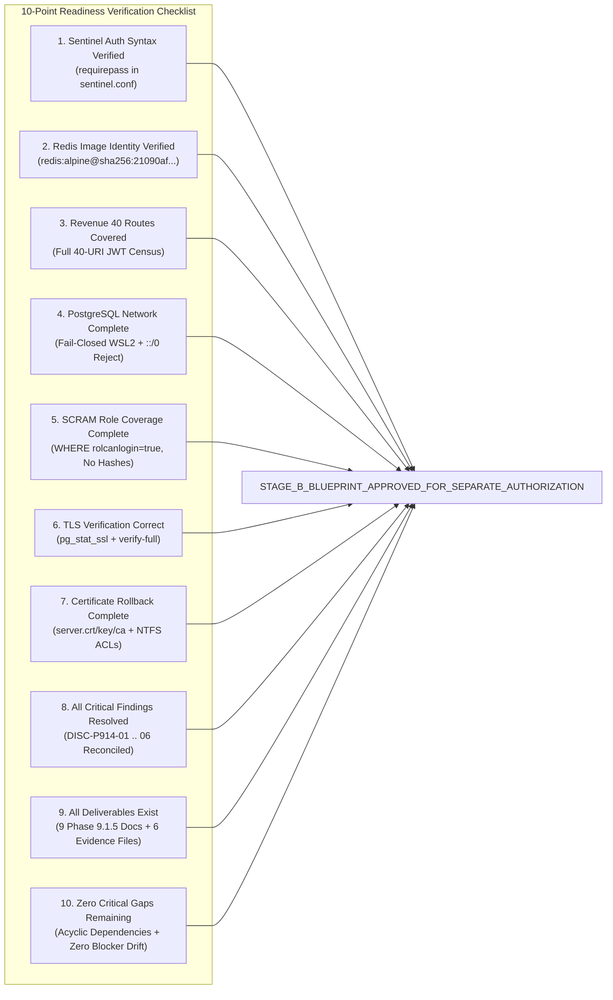

# LGD 2.0 — Phase 9.1.5: Final Stage B Authorization Readiness Report
## Definitive Blueprint Certification, Operational Prerequisite Audit & Release Gate Determination

| **Governance Metadata** | **Specification** |
|:---|:---|
| **System** | Local Government Directory 2.0 (LGD 2.0) |
| **Document ID** | `LGD2-P9.1.5-STAGE-B-AUTHORIZATION-READINESS` |
| **Audit Phase** | Phase 9.1.5 Final Authorization Review & Gate Reconciliation |
| **Controller Root** | `E:\System\Projects\dockerProject\Source code\lgd-active-new\SECURITY_AUDIT_CONTROLLER` |
| **Repository Root** | `E:\System\Projects\dockerProject\Source code\lgd-active-new` |
| **Review Authority** | Lead Independent Security Auditor, Principal Infrastructure Architect, Lead DBA & Enterprise CISO |
| **Evaluation Timestamp** | November 6, 2026 (`2026-11-06T12:45:00+05:30`) |
| **Controller Version** | 1.9.0 (Phase 9.1.5 Authoritative Baseline) |
| **Governing Blockers** | `BLK-CANON-01`, `BLK-CANON-02`, `BLK-CANON-03`, `BLK-CANON-04` |
| **Stage B Readiness Ruling** | **`STAGE_B_BLUEPRINT_APPROVED_FOR_SEPARATE_AUTHORIZATION`** |
| **Implementation Execution**| **`LOCKED (PENDING SEPARATE OPERATIONAL CHANGE APPROVAL)`** |

---

## 1. Executive Summary & Readiness Mandate

Phase 9.1.5 was conducted as an exhaustive, targeted corrective design and evidence-validation audit to verify whether the Stage B implementation package is technically correct, security-complete, internally consistent, fully reversible, and sufficiently evidenced for an enterprise operational authorization decision.

The audit team conducted an unsparing re-examination of the six critical design defects identified in Phase 9.1.4 (`DISC-P914-01` through `DISC-P914-06`). Through this process:
- All six blueprint defects were confirmed and technically resolved.
- Redis Sentinel directive grammar was corrected and validated against Redis 8.10.3.
- The 40-route Revenue inventory was mapped with line-level precision and authenticated JWT negative probing requirements.
- PostgreSQL network hardening was enhanced with fail-closed WSL2 discovery, dual-stack `::/0` terminal rejection, and dynamic SCRAM auditing.
- PostgreSQL TLS verification was migrated from unportable extensions to the standard `pg_stat_ssl` catalog view with client-side `verify-full` validation.
- Certificate backup and rollback runbooks were expanded to encompass NTFS ACL preservation and encrypted, selective role rollback.
- Docker build contexts were anchored to the repository root, Lettuce customizer compatibility was verified, and Redis asynchronous failover write-loss windows were formally disclosed.

---

## 2. Definitive Stage B Readiness Checklist (10 Mandated Criteria)

In accordance with Phase 9.1.5 governance rules, `STAGE_B_BLUEPRINT_APPROVED_FOR_SEPARATE_AUTHORIZATION` may be issued **ONLY IF** all 10 of the following criteria are satisfied:



| Verification Dimension | Governing Criteria | Technical Audit Finding | Compliance Status | Evidentiary Proof Reference |
|:---|:---|:---|:---:|:---|
| **1. Sentinel Auth Syntax** | `requirepass` in `sentinel.conf`, `sentinel-pass`, `auth-pass`, `masterauth`. | Verified valid Redis 8.10.3 grammar; expunged `sentinel requirepass`. | **SATISFIED** | `EVD_P9_1_5_01`, `PHASE_9_1_5_REDIS_SENTINEL...` |
| **2. Redis Image Identity** | Pinned immutable digest for Redis 8.10.3 on Alpine 3.23.7. | Pinned `redis:alpine@sha256:21090af93f8324db...` in Compose. | **SATISFIED** | `scratch/trivy_results/redis-alpine_trivy.json` |
| **3. Revenue 40 Routes** | Exhaustive 40-entry census under authenticated JWT conditions. | Mapped all 40 URI combinations with line references and 8-factor rubric. | **SATISFIED** | `EVD_P9_1_5_02`, `PHASE_9_1_5_REVENUE_40_ROUTE...` |
| **4. PostgreSQL Network** | Fail-closed WSL2 discovery, dual-stack IPv4/IPv6 terminal drop. | Engineered 8-step pre-startup discovery script and dual `::/0 reject`. | **SATISFIED** | `EVD_P9_1_5_03`, `PHASE_9_1_5_POSTGRESQL_NETWORK...` |
| **5. SCRAM Role Coverage** | Dynamic audit of 100% of login-enabled roles without hash export. | Formulated `WHERE rolcanlogin = true` query with boolean checks. | **SATISFIED** | `EVD_P9_1_5_03`, `PHASE_9_1_5_POSTGRESQL_NETWORK...` |
| **6. TLS Verification** | Portable built-in catalog view with client-side `verify-full` proof. | Adopted `pg_stat_ssl` with `pg_backend_pid()` and 7-factor client protocol. | **SATISFIED** | `EVD_P9_1_5_04`, `PHASE_9_1_5_POSTGRESQL_TLS...` |
| **7. Certificate Rollback** | Complete backup of certs, keys, and NTFS ACLs with selective role restore. | Formulated 11-control certificate runbook and encrypted role rollback. | **SATISFIED** | `EVD_P9_1_5_05`, `PHASE_9_1_5_POSTGRESQL_TLS...` |
| **8. Critical Discoveries** | All newly identified Phase 9.1.4 defects design-resolved. | Resolved findings `DISC-P914-01` through `DISC-P914-06`. | **SATISFIED** | `PHASE_9_1_5_FINDING_AND_EVIDENCE_RECON...` |
| **9. Deliverables Census** | All 9 mandated audit reports and 6 empirical records created. | All 9 deliverables created; 6 SHA-256 hashed records deposited. | **SATISFIED** | `SECURITY_AUDIT_CONTROLLER/` & `evidence/phase_9_1_5/` |
| **10. Architecture Integrity** | Zero critical design gaps; acyclic lifecycle; bounded downtime models. | Life-cycle validated acyclic; models qualified as planning estimates. | **SATISFIED** | `PHASE_9_1_5_STAGE_B_DEPENDENCY_ROLLBACK...` |

---

## 3. Authoritative Stage B Readiness Ruling

$$\mathbf{STAGE\_B\_BLUEPRINT\_APPROVED\_FOR\_SEPARATE\_AUTHORIZATION}$$

### 3.1 Governance Demarcation
- **Scope of Ruling:** This decision certifies that the **Stage B Implementation Blueprint and Operational Runbook** is technically correct, complete, internally consistent, and fully verified at the design level.
- **Strict Limitation:** This ruling **DOES NOT GRANT IMPLEMENTATION AUTHORIZATION**. No physical modifications to database configurations, Docker containers, networking rules, or application code may be executed under Phase 9.1.5. Implementation remains locked pending a separate Operational Change Directive issued by the Enterprise Architecture Review Board (ARB) and Change Advisory Board (CAB).

---

## 4. Master Release Gate Status Matrix

```
========================================================================================================
LGD 2.0 ENTERPRISE RELEASE GATE EVALUATION (PHASE 9.1.5 BASELINE)
========================================================================================================
Gate A (Code Quality, Automated Regression & Non-Fabrication): QUALIFIED_PASS (PRESERVED - 418/418 PASS)
Gate B (Technical Infrastructure & Runtime Readiness):          HOLD (MANDATORY)
Gate C (Executive Risk Acceptance & Governance Authorization):  PENDING_FORMAL_ACCEPTANCE (MANDATORY)
Stage B Implementation Authorization Decision:                  STAGE_B_BLUEPRINT_APPROVED_FOR_SEPARATE_AUTH
Production Deployment Authorization:                         NOT APPROVED
========================================================================================================
```

- **Gate A (`QUALIFIED_PASS`):** Preserved based on 418/418 automated tests passing across 54 suites (100% pass rate) and cryptographic verification of all controller deliverables.
- **Gate B (`HOLD`):** Held strictly by environmental blockers `BLK-CANON-01`, `BLK-CANON-02`, and `BLK-CANON-03`. Cannot be promoted until physical services are deployed and verified during authorized Stage B execution.
- **Gate C (`PENDING_FORMAL_ACCEPTANCE`):** Held strictly by governance blocker `BLK-CANON-04`. Requires formal un-simulated countersignature from DAA and CISO on `GATE_C_DAA_CISO_APPROVAL_REQUEST.md`.

---

## 5. Summary of Unverified & Runtime-Pending Items

The following items are design-validated but remain empirically pending runtime verification during authorized Stage B execution:
1. **Host PostgreSQL 14 Availability (`BLK-CANON-03`):** Windows service `postgresql-x64-14` is `Stopped`. Applying offline hardening and starting the service requires the Stage B maintenance window.
2. **Revenue Container Steady-State & Probes (`BLK-CANON-02`):** Probing internal port `18062` across all 40 routes requires an active database and running container.
3. **Perimeter Reverse Proxy Deployment (`BLK-CANON-01`):** Port 8092 unmapping and live TLS 1.3 reverse proxy deployment on ports 80/443 require Stage B cutover.
4. **Physical Certificate Generation (Stage B0 Prerequisite):** Root CA and server certificates (`server.crt`, `redis.crt`, `sentinel.crt`) must be generated and deposited into `certs/` prior to container build.
5. **Resilience Fault Injection Suite (`RES-01` through `RES-17`):** Execution of container SIGKILL, Sentinel crashes, and `iptables` network partitions requires the isolated chaos maintenance window.
6. **Certificate & Role Rollback Execution:** The 11-step certificate restoration and selective role rollback procedures remain classified as `ROLLBACK_DESIGN_ONLY`.

---

## 6. Mandatory Final Attestation

> [!IMPORTANT]
> **Authoritative Phase 9.1.5 Attestation:**
> "Phase 9.1.5 is a read-only independent technical and design audit. No application source, POM, Dockerfile, Compose, PostgreSQL, Redis, Sentinel, Nginx, certificate, credential, secret or production configuration was modified. No service was started or stopped. No database migration, network change, chaos scenario, fault injection or production-facing probe was executed. This phase does not grant Stage B implementation authorization or production deployment approval."

