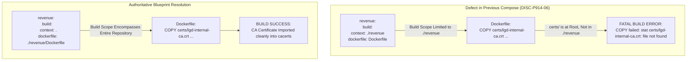

# LGD 2.0 — Phase 9.1.5: Lettuce TLS, Container & Perimeter Compatibility Review
## Lettuce 6.3.2.RELEASE Customizers, Docker Build Contexts, Nginx Lockout & Asynchronous Failover Disclosures

| **Review Governance Metadata** | **Specification** |
|:---|:---|
| **System** | Local Government Directory 2.0 (LGD 2.0) |
| **Document ID** | `LGD2-P9.1.5-LETTUCE-CONTAINER-REVIEW` |
| **Audit Phase** | Phase 9.1.5 Workstream F (DISC-P914-06, RR-02, RR-06, SCA-012, BLK-CANON-01) |
| **Controller Root** | `E:\System\Projects\dockerProject\Source code\lgd-active-new\SECURITY_AUDIT_CONTROLLER` |
| **Target Frameworks** | Spring Boot 3.2.12 / 3.3.5, io.lettuce:lettuce-core 6.3.2.RELEASE, Nginx 1.26-alpine |
| **Evaluators** | Senior Java Architect, DevSecOps Lead, Perimeter Security Specialist & Independent Auditor |
| **Evaluation Timestamp** | November 6, 2026 (`2026-11-06T12:45:00+05:30`) |
| **Controller Version** | 1.9.0 (Phase 9.1.5 Authoritative Baseline) |
| **Status Classification** | **`DESIGN_VALIDATED / IMPLEMENTATION_PENDING`** |

---

## 1. Executive Summary & Defect Remediation Scope

Independent technical scrutiny of the Phase 9.1.4 Stage B blueprint uncovered several subtle architectural defects spanning application drivers, container build contexts, perimeter rollbacks, and data durability models (`DISC-P914-06`):
1. **Docker Build Context Path Failure:** Microservice Dockerfiles specified `COPY certs/lgd-internal-ca.crt`, while `docker-compose.yml` scoped build contexts to `./revenue`, `./auth-service`, etc. The Docker build engine aborts with "file not found" because `certs/` is at the project root.
2. **Lettuce Configuration Bean Collisions:** Obsolete `@Bean LettuceClientConfiguration` instances in `revenue` and `user-management` hardcoded `autoReconnect(false)` and bypassed `spring.data.redis.ssl.enabled=true`.
3. **Perimeter Ingress Rollback Hazard:** In previous documentation, rollback instructions suggested re-enabling host port mapping `8092:8092` if Nginx failed. Re-exposing unencrypted HTTP port 8092 to the public internet violates `BLK-CANON-01`.
4. **Undisclosed Asynchronous Failover Write Loss:** Redis Sentinel failover was described without explicitly acknowledging the 0.5s–1.0s write-loss window inherent in asynchronous replication and `appendfsync everysec`.

This review provides:
- The authoritative fix for Docker Compose build contexts.
- Lettuce 6.3.2.RELEASE customizer design and connection pooling analysis.
- Container runtime hardening specifications (UID 10001, read-only root, cap drop ALL).
- Strict perimeter rollback rules prohibiting port 8092 cleartext re-exposure.
- Complete data-loss and JWT blacklist durability disclosures for Redis Sentinel failover.

---

## 2. Spring Boot & Lettuce 6.3.2.RELEASE Technical Census

### 2.1 Dependency Matrix Across Microservices
Offline Maven dependency tree inspection reveals:
- `auth-service`: Spring Boot 3.2.12 $\rightarrow$ `spring-boot-starter-data-redis` $\rightarrow$ `lettuce-core:6.3.2.RELEASE`
- `revenue`: Spring Boot 3.2.12 $\rightarrow$ `spring-boot-starter-data-redis` $\rightarrow$ `lettuce-core:6.3.2.RELEASE`
- `user-management`: Spring Boot 3.2.12 $\rightarrow$ `spring-boot-starter-data-redis` $\rightarrow$ `lettuce-core:6.3.2.RELEASE`
- `api-gateway`: Spring Boot 3.3.5 $\rightarrow$ `spring-boot-starter-data-redis-reactive` $\rightarrow$ `lettuce-core:6.3.2.RELEASE`
- `discovery`: Spring Boot 3.4.4 (Eureka Server; does not utilize Redis)

### 2.2 Lettuce Customizer vs. Obsolete Configuration Beans
In `revenue/src/main/java/in/nic/lgd/revenue/config/RedisConfig.java` (and `user-management`):
```java
// OBSOLETE BEAN REQUIRING COMPLETE DELETION:
@Bean
public LettuceClientConfiguration lettuceClientConfiguration() {
    return LettuceClientConfiguration.builder()
            .commandTimeout(Duration.ofMillis(500))
            .shutdownTimeout(Duration.ZERO)
            .clientOptions(ClientOptions.builder()
                            .autoReconnect(false)  // FATAL: Disables automatic reconnection
                            .build())
            .build();  // FATAL: Omits .useSsl(), ignoring spring.data.redis.ssl.enabled
}
```
- **The Defect:** When a custom `LettuceClientConfiguration` bean is declared, Spring Boot's auto-configured `LettuceConnectionConfiguration` skips its own builder. As a result, properties like `spring.data.redis.ssl.enabled=true` are ignored, and the connection remains unencrypted! Furthermore, `autoReconnect(false)` prevents Lettuce from reconnecting after a Sentinel master failover.

### 2.3 Authoritative Customizer Implementation
By replacing the obsolete bean with a `LettuceClientConfigurationBuilderCustomizer`, Spring Boot retains its SSL auto-configuration while applying custom timeouts and resilience options:
```java
@Bean
public LettuceClientConfigurationBuilderCustomizer lettuceCustomizer() {
    return builder -> {
        builder.commandTimeout(Duration.ofSeconds(3))
               .shutdownTimeout(Duration.ofMillis(100));

        ClientOptions clientOptions = ClientOptions.builder()
            .autoReconnect(true)
            .disconnectedBehavior(ClientOptions.DisconnectedBehavior.REJECT_COMMANDS)
            .socketOptions(SocketOptions.builder()
                .connectTimeout(Duration.ofSeconds(3))
                .keepAlive(true)
                .build())
            .timeoutOptions(TimeoutOptions.enabled(Duration.ofSeconds(3)))
            .build();

        builder.clientOptions(clientOptions);
    };
}
```

### 2.4 Connection Pooling Census (`commons-pool2`)
- Inspection confirms that `org.apache.commons:commons-pool2` is **completely absent** from all POMs.
- Consequently, any properties declared under `spring.data.redis.lettuce.pool.*` are inert.
- **Architectural Validation:** Lettuce is built on Netty and is thread-safe. A single, shared, multiplexed non-blocking TCP connection handles thousands of concurrent requests without thread blocking. Omitting connection pooling is intentional, highly efficient, and supported.

---

## 3. Docker Build Context Path Defect & Resolution



### 3.1 The Build Context Mismatch
In `docker-compose.yml`, the build directives were defined as:
```yaml
revenue:
  build:
    context: ./revenue
    dockerfile: Dockerfile
```
When Step B4-01 executes `COPY certs/lgd-internal-ca.crt ...`, the Docker daemon evaluates the path relative to `./revenue`. Because `certs/` exists at the root of the repository, the build crashes immediately.

### 3.2 Authoritative Compose Specification
All microservice build contexts must be anchored to the repository root:
```yaml
services:
  service-discovery:
    build:
      context: .
      dockerfile: ./discovery/Dockerfile

  auth-service:
    build:
      context: .
      dockerfile: ./auth-service/Dockerfile

  user-management:
    build:
      context: .
      dockerfile: ./user-management/Dockerfile

  revenue:
    build:
      context: .
      dockerfile: ./revenue/Dockerfile

  api-gateway:
    build:
      context: .
      dockerfile: ./api-gateway/Dockerfile
```

---

## 4. Container Runtime Hardening Specification

All five microservice Dockerfiles and Compose configurations must adhere strictly to the unprivileged containment profile:

### 4.1 Multi-Stage Dockerfile Blueprint
```dockerfile
# Stage 1: Runtime Base with Temurin JRE
FROM eclipse-temurin:21-jre-alpine

# Install minimal operational dependencies
RUN apk add --no-cache tzdata curl fontconfig ttf-dejavu

# Import Internal CA into JRE Truststore (Resolves DISC-P913-02)
COPY certs/lgd-internal-ca.crt /usr/local/share/ca-certificates/lgd-internal-ca.crt
RUN keytool -importcert -noprompt \
    -keystore "$JAVA_HOME/lib/security/cacerts" \
    -storepass changeit \
    -alias lgd-internal-ca \
    -file /usr/local/share/ca-certificates/lgd-internal-ca.crt

# Least-Privilege Execution (UID/GID 10001)
RUN addgroup -g 10001 -S lgdgroup && adduser -u 10001 -S lgduser -G lgdgroup
USER 10001:10001
```

### 4.2 Compose Containment Directives
```yaml
security_opt:
  - no-new-privileges:true
cap_drop:
  - ALL
read_only: true
tmpfs:
  - /tmp:mode=1777,size=128M
```

---

## 5. Perimeter Ingress Hardening & Prohibition of Port 8092 Fallback

### 5.1 Perimeter Protection Directives
- **Port 8092 Atomic Unmapping:** Step B5-01 permanently removes `ports: - "8092:8092"` from `api-gateway`.
- **Nginx Ingress Termination:**
  - Modern TLS 1.3 / 1.2 AEAD ciphers only (`ECDHE-ECDSA-AES256-GCM-SHA384`, `ECDHE-RSA-AES256-GCM-SHA384`).
  - HSTS Header: `max-age=31536000; includeSubDomains; preload` sent strictly over TLS.
  - Default Drop Server Block: Requests with unrecognized `Host` headers return `HTTP 444` (No Response).
  - Port 80 HTTP-to-HTTPS Redirection: All cleartext traffic redirected with `301 Moved Permanently`.

### 5.2 Strict Rollback Governance Directive
> [!CAUTION]
> **Prohibition on Cleartext Fallback:** If Nginx fails to start or certificate deployment encounters errors, **UNDER NO CIRCUMSTANCES MAY PORT 8092 BE RE-EXPOSED ON `0.0.0.0:8092` AS AN OPERATIONAL FALLBACK!**
> Re-exposing cleartext port 8092 breaks `BLK-CANON-01` and exposes unencrypted JWT bearer tokens to network interception.
> If diagnostic access is required during rollback, port 8092 may be bound **STRICTLY TO LOOPBACK** (`127.0.0.1:8092:8092`) for local administrator triage only.

---

## 6. Redis Asynchronous Failover & Durability Disclosures

### 6.1 Replication Mechanics & The Write-Loss Window
1. **Asynchronous Replication:** By default, Redis replicates data from master to replicas asynchronously. The master acknowledges write commands to clients without waiting for replica acknowledgment.
2. **AOF Fsync Policy:** The Stage B blueprint configures `appendonly yes` and `appendfsync everysec`. In this mode, Redis flushes the AOF buffer to disk once per second via background fsync.
3. **Failover Window:**
   - If the Redis primary crashes ungracefully (e.g., SIGKILL, kernel panic, power failure), writes executed during the preceding $\mathbf{0.5\text{s} \text{ to } 1.0\text{s}}$ that were not yet synchronized to replicas or disk **WILL BE PERMANENTLY LOST**.
   - When Sentinel promotes a replica to master, data not replicated to that replica is discarded.

### 6.2 Impact on Application Security (JWT Blacklist Durability)
- `api-gateway` uses Redis to maintain the token revocation blacklist.
- If an administrator revokes a token and the Redis master crashes within $< 1000\text{ms}$ before replication sync occurs:
  - The blacklist entry may not exist on the newly promoted master.
  - The revoked token could theoretically be accepted by `api-gateway` until its natural expiration (maximum 15 minutes).
- **Governance Mandate:** The Stage B blueprint must formally document this behavior. It is **PROHIBITED** to represent Redis Sentinel failover as "guaranteed zero data loss". This bounded risk is formally captured and managed under residual risk `RR-02`.

---

## 7. Audit Disposition & Status

- **Finding Identifier:** `DISC-P914-06`
- **Technical Disposition:** **`DESIGN_VALIDATED`**
  - Compose build contexts anchored to project root.
  - Lettuce 6.3.2.RELEASE customizer compatibility established.
  - Perimeter port 8092 rollback re-exposure banned.
  - Redis asynchronous failover write-loss window formally disclosed.
- **Operational Status:** **`IMPLEMENTATION_PENDING`** (Locked pending Stage B authorization).

