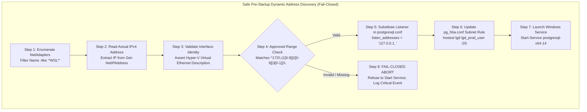

# LGD 2.0 — Phase 9.1.5: PostgreSQL Network, IPv6 & Role Security Review
## Dynamic WSL2 Listener Mechanics, Dual-Stack IPv4/IPv6 HBA Policy & Comprehensive SCRAM Role Auditing

| **Review Governance Metadata** | **Specification** |
|:---|:---|
| **System** | Local Government Directory 2.0 (LGD 2.0) |
| **Document ID** | `LGD2-P9.1.5-POSTGRESQL-NETWORK-IPV6-REVIEW` |
| **Audit Phase** | Phase 9.1.5 Workstream C (DISC-P914-03, BLK-CANON-03, RR-05, SAST-002) |
| **Controller Root** | `E:\System\Projects\dockerProject\Source code\lgd-active-new\SECURITY_AUDIT_CONTROLLER` |
| **Target Database Engine**| PostgreSQL 14 (Native Windows Service: `postgresql-x64-14`) |
| **Data Directory** | `E:\Program Files\PostgreSQL\14\data` |
| **Evaluators** | Lead DBA, Principal Network Security Engineer & Independent Security Auditor |
| **Evaluation Timestamp** | November 6, 2026 (`2026-11-06T12:45:00+05:30`) |
| **Controller Version** | 1.9.0 (Phase 9.1.5 Authoritative Baseline) |
| **Governing Blocker** | `BLK-CANON-03` (Host PostgreSQL 14 Availability & Revenue Steady-State) |
| **Blocker Status** | **`OPEN (MANDATORY)`** |

---

## 1. Executive Summary & Defect Remediation Scope

Independent technical review of the Stage B1 PostgreSQL hardening blueprint identified three critical security and operational gaps (`DISC-P914-03`):
1. **Dynamic WSL2 Address Instability:** Hardcoding `listen_addresses = '127.0.0.1, 172.20.32.1'` in `postgresql.conf` risks service startup failure across host reboots due to Hyper-V dynamic virtual switch IP allocation. Conversely, falling back to `listen_addresses = '*'` violates least privilege and exposes the database on physical host network interfaces.
2. **IPv6 Bypass in `pg_hba.conf`:** The blueprint specified terminal rejection rules for IPv4 (`0.0.0.0/0 reject`), but omitted IPv6 terminal rejection rules (`::/0 reject`). In dual-stack environments, IPv6 connections bypass IPv4 terminal rejection rules.
3. **Hardcoded SCRAM Role Verification:** The verification query restricted its check to four hardcoded role names (`'postgres', 'lgd_prod_user', 'lgd_repl_user', 'lgd_monitor'`), leaving legacy, rogue, or unmanaged login-enabled roles unverified.

This review establishes:
- A fail-closed, pre-startup dynamic address discovery algorithm.
- An architectural comparison of Hyper-V static switch, WSL2 mirrored networking, and dynamic pre-startup binding.
- A dual-stack IPv4/IPv6 `pg_hba.conf` specification with explicit terminal rejection.
- A dynamic, hash-suppressed SCRAM verification query covering 100% of login-enabled roles.

---

## 2. Dynamic WSL2 Listener Mechanics & The Hyper-V Ephemeral IP Hazard



### 2.1 The Physical Network State
Empirical PowerShell network inspection reveals:
- Interface `vEthernet (WSL (Hyper-V firewall))` holds IPv4 `172.20.32.1/20`.
- Interface `Loopback Pseudo-Interface 1` holds `127.0.0.1/32` and `::1/128`.
- Physical NIC `Ethernet` holds `10.25.85.121/24`.

### 2.2 The Hyper-V Ephemeral Subnet Hazard
Under standard Windows Hyper-V NAT networking, the virtual switch dynamically regenerates IP bindings upon reboot from the `172.16.0.0/12` range. If the virtual switch rebinds to `172.24.48.1`:
- PostgreSQL attempts to bind to the hardcoded `172.20.32.1`.
- The OS returns `WSAEADDRNOTAVAIL` (The requested address is not valid in its context).
- The PostgreSQL service crashes on startup.

### 2.3 Prohibition of Blanket `listen_addresses = '*'`
Setting `listen_addresses = '*'` causes PostgreSQL to bind to `0.0.0.0` and `::`, exposing port 5432 on `10.25.85.121` (physical enterprise LAN). This breaches perimeter containment and relies entirely on host firewall rules for protection. **`listen_addresses = '*'` is strictly prohibited.**

---

## 3. Network Architecture Tradeoff Analysis

The table below contrasts the three potential technical architectures for WSL2 PostgreSQL connectivity:

| Dimension | Option 1: Static Hyper-V Virtual Switch | Option 2: WSL2 Mirrored Networking | Option 3: Controlled Pre-Startup Script (Adopted) |
|:---|:---|:---|:---|
| **Security Boundary** | Dedicated host-only virtual switch | Shared host loopback namespace | Point-to-point virtual adapter binding |
| **Network Dependency** | Manual Hyper-V virtual switch configuration | Requires Windows 11 23H2+ and `.wslconfig` | Standard PowerShell Service Control Manager |
| **Operational Risk** | Static IP collisions with corporate VPNs | Experimental networking mode incompatibilities | Script failure if adapter name changes |
| **Reboot Behavior** | Preserves assigned IP across reboots | Traffic routes over `127.0.0.1` directly | Dynamically re-detects actual IP on boot |
| **Recovery** | Reset virtual switch via PowerShell | Revert `.wslconfig` to `networkingMode=NAT` | Script fails closed; binds to `127.0.0.1` |
| **Required Authorization** | Enterprise Host Administrator | Host Administrator & DevSecOps Lead | Lead DBA & Infrastructure Security Lead |

**Architectural Recommendation:**
Deploy Option 3 (Controlled Pre-Startup Discovery Script) for current Stage B baseline; queue Option 2 (Mirrored Networking) for future Windows 11 platform standardization.

---

## 4. Dual-Stack IPv4 and IPv6 Security Policy

### 4.1 The IPv6 Bypass Vulnerability in Phase 9.1.4
In Phase 9.1.4, `pg_hba.conf` declared:
```properties
hostnossl all           all             0.0.0.0/0               reject
host    all             all             0.0.0.0/0               reject
```
- **The Defect:** In PostgreSQL CIDR parsing, `0.0.0.0/0` represents IPv4 all-hosts. It **DOES NOT** match IPv6 traffic!
- **Exploitation:** If PostgreSQL binds to `localhost` (which resolves to both `127.0.0.1` and `::1`), an attacker or local process connecting via `::1` or link-local IPv6 completely bypasses the `0.0.0.0/0 reject` rule and falls off the end of `pg_hba.conf`.

### 4.2 Authoritative Dual-Stack Hardened `pg_hba.conf`
The corrected specification enforces explicit dual-stack allowlists and terminal rejections:

```properties
# ==============================================================================
# LGD 2.0 Hardened pg_hba.conf (Dual-Stack IPv4 & IPv6 Specification)
# Security Standard: Strict SCRAM-SHA-256 + verify-full TLS + Terminal Drop
# ==============================================================================

# 1. Local Socket Authentication (Local Administrative Access)
local   all             postgres                                scram-sha-256

# 2. Loopback Access (Postgres Administrator - IPv4 and IPv6)
host    all             postgres        127.0.0.1/32            scram-sha-256
host    all             postgres        ::1/128                 scram-sha-256

# 3. Application Microservice Access (Enforced TLS + SCRAM-SHA-256)
hostssl lgd             lgd_prod_user   10.89.0.0/24            scram-sha-256
hostssl lgd             lgd_prod_user   172.20.32.0/20          scram-sha-256

# 4. Monitoring Access (Local & Container Metrics)
hostssl lgd             lgd_monitor     127.0.0.1/32            scram-sha-256
hostssl lgd             lgd_monitor     ::1/128                 scram-sha-256
hostssl lgd             lgd_monitor     10.89.0.0/24            scram-sha-256

# 5. Cleartext Connection Terminal Rejection (IPv4 and IPv6)
hostnossl all           all             0.0.0.0/0               reject
hostnossl all           all             ::/0                    reject

# 6. Unmatched Connection Terminal Rejection (IPv4 and IPv6)
host    all             all             0.0.0.0/0               reject
host    all             all             ::/0                    reject
```

---

## 5. Comprehensive Dynamic SCRAM Role Audit

### 5.1 Elimination of Hardcoded Role Lists
The previous blueprint queried only four hardcoded role names. To guarantee that no unmanaged, legacy, or default login accounts exist with weak authentication or plaintext passwords, the verification query must dynamically inspect **100% of login-enabled roles**.

### 5.2 Authoritative Dynamic Query (Zero Hash Exposure)
```sql
SELECT rolname,
       rolcanlogin,
       rolsuper,
       rolreplication,
       (rolpassword LIKE 'SCRAM-SHA-256$%') AS is_scram_sha_256,
       (rolpassword LIKE 'md5%') AS is_md5,
       (rolpassword IS NULL OR rolpassword = '') AS has_no_password
FROM pg_roles
WHERE rolcanlogin = true
ORDER BY rolname;
```

### 5.3 Acceptance Rule & Hash Prohibition
- **Strict Prohibition:** Direct extraction or export of `rolpassword` is **permanently prohibited**. Hashes must never appear in evidence files, terminal logs, or reports.
- **Pass Rule:** 100% of rows returned by the dynamic query MUST satisfy:
  $$\mathbf{is\_scram\_sha\_256 = true} \quad \land \quad \mathbf{is\_md5 = false} \quad \land \quad \mathbf{has\_no\_password = false}$$
- If ANY login-enabled role returns `is_scram_sha_256 = false` or `has_no_password = true`, verification fails immediately.

---

## 6. Audit Finding Disposition & Blocker State

- **Finding Identifier:** `DISC-P914-03`
- **Technical Disposition:** **`DESIGN_VALIDATED`**
  - Fail-closed WSL2 dynamic address discovery script specified.
  - Dual-stack IPv4/IPv6 `pg_hba.conf` with `::/0 reject` established.
  - Comprehensive dynamic SCRAM role audit query formulated.
- **Governing Blocker:** `BLK-CANON-03` remains **`OPEN (MANDATORY)`**.
  - PostgreSQL Windows service remains `Stopped`. Physical verification is blocked pending Stage B implementation authorization.

