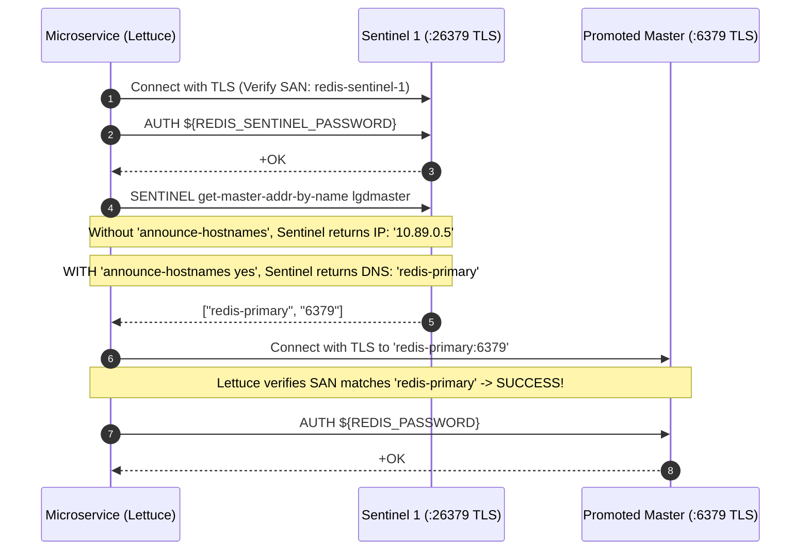

# LGD 2.0 — Phase 9.1.5: Redis Sentinel Authentication & Hostname Review
## Authoritative 5-Tier Authentication Matrix, Directive Grammar & TLS Hostname Resolution

| **Review Governance Metadata** | **Specification** |
|:---|:---|
| **System** | Local Government Directory 2.0 (LGD 2.0) |
| **Document ID** | `LGD2-P9.1.5-REDIS-SENTINEL-AUTH-REVIEW` |
| **Audit Phase** | Phase 9.1.5 Workstream A (DISC-P914-01, RR-02, RR-05) |
| **Controller Root** | `E:\System\Projects\dockerProject\Source code\lgd-active-new\SECURITY_AUDIT_CONTROLLER` |
| **Target Engine** | Redis Server & Sentinel Engine (Version 8.10.3 on Alpine 3.23.7) |
| **Evaluators** | Lead Infrastructure Architect, Principal Cryptographer & Independent Security Auditor |
| **Evaluation Timestamp** | November 6, 2026 (`2026-11-06T12:45:00+05:30`) |
| **Controller Version** | 1.9.0 (Phase 9.1.5 Authoritative Baseline) |
| **Status Classification** | **`DESIGN_VALIDATED / RUNTIME_VERIFICATION_PENDING`** |

---

## 1. Executive Summary & Defect Remediation Scope

During the Phase 9.1.4 audit, inter-Sentinel authentication was addressed by introducing `sentinel sentinel-pass`. However, independent technical inspection of the Phase 9.1.4 `sentinel.conf.template` revealed a critical syntax defect (`DISC-P914-01`):

```ini
# ERRONEOUS DIRECTIVE IN PHASE 9.1.4:
sentinel requirepass ${REDIS_SENTINEL_PASSWORD}
sentinel sentinel-pass ${REDIS_SENTINEL_PASSWORD}
```

The directive `sentinel requirepass` is grammatically invalid in Redis Sentinel. Prefixing `requirepass` with `sentinel ` causes the Redis Sentinel configuration parser to abort with a fatal configuration error. 

This review establishes:
1. The exact, version-verified directive grammar for Redis 8.10.3 across all communication tiers.
2. A comprehensive 5-tier authentication matrix.
3. Configuration rewrite (`CONFIG REWRITE`) dynamics and secure entrypoint templating.
4. Docker network hostname resolution (`sentinel announce-hostnames yes`) and TLS SAN alignment.
5. Client failover redirection mechanics.

---

## 2. Forensic Directive Grammar & Parser Analysis

### 2.1 The Redis Server vs. Sentinel Namespace Distinction
Redis Sentinel is not a distinct binary; it is the Redis server process executing in Sentinel mode (`redis-server /path/to/sentinel.conf --sentinel`).
- **Standard Server Directives:** Directives that configure the listening daemon, networking, logging, and client access control apply universally to the Redis process and **NEVER** take the `sentinel ` prefix. These include `port`, `tls-port`, `bind`, `dir`, `logfile`, and crucially:
  $$\mathbf{requirepass\ <password>}$$
- **Sentinel-Specific Directives:** Directives that configure monitoring, quorum, failover timing, and inter-sentinel protocols operate within the Sentinel sub-system and **MUST** take the `sentinel ` prefix. These include:
  $$\mathbf{sentinel\ monitor\ <name>\ <ip>\ <port>\ <quorum>}$$
  $$\mathbf{sentinel\ auth\text{-}pass\ <name>\ <password>}$$
  $$\mathbf{sentinel\ sentinel\text{-}pass\ <password>}$$

> [!CAUTION]
> **Fatal Parser Abort:** If `sentinel requirepass <password>` is placed in `sentinel.conf`, Redis Sentinel treats `requirepass` as an unknown Sentinel subcommand, emitting:
> `*** FATAL CONFIG FILE ERROR *** Reading the configuration file, at line XX: Unrecognized sentinel configuration statement.`
> The container terminates immediately with non-zero exit code.

---

## 3. Authoritative 5-Tier Authentication Matrix

The table below defines the five distinct authentication boundaries required in the Stage B architecture:

| Communication Direction | Authentication Mechanism | Configuration Location | Valid Directive Syntax | Target Port | Version Introduced | Authentication Failure Behavior |
|:---|:---|:---|:---|:---:|:---:|:---|
| **1. Application $\rightarrow$ Redis** | Password via `AUTH` | `redis.conf` | `requirepass ${REDIS_PASSWORD}` | 6379 (TLS) | Redis 1.0+ | `NOAUTH Authentication required.` Microservice Lettuce connection rejected. |
| **2. Application $\rightarrow$ Sentinel** | Password via `AUTH` | `sentinel.conf` | `requirepass ${REDIS_SENTINEL_PASSWORD}` | 26379 (TLS) | Redis 5.0.1+ | `NOAUTH Authentication required.` Microservice cannot query master address. |
| **3. Sentinel $\rightarrow$ Redis** | Monitored Master Password | `sentinel.conf` | `sentinel auth-pass lgdmaster ${REDIS_PASSWORD}` | 6379 (TLS) | Redis 2.8.0+ | Sentinel receives `NOAUTH`. Master marked `sdown`; failover impossible. |
| **4. Sentinel $\leftrightarrow$ Sentinel** | Peer Inter-Sentinel Password | `sentinel.conf` | `sentinel sentinel-pass ${REDIS_SENTINEL_PASSWORD}` | 26379 (TLS) | Redis 5.0.1 / 6.2.0 | Peer Sentinels receive `NOAUTH` during `is-master-down-by-addr`; quorum fails. |
| **5. Replica $\rightarrow$ Primary** | Replication Stream Auth | `redis.conf` | `masterauth ${REDIS_PASSWORD}` | 6379 (TLS) | Redis 1.0+ | Primary refuses `PSYNC` with `NOAUTH`; replication broken. |

---

## 4. Redis Access Control Lists (ACL) Directives

In addition to traditional password directives, Redis 6.0+ (and Sentinel 6.2+) support granular ACL rules:
1. **Sentinel ACL Definition (`sentinel.conf`):**
   ```ini
   user default on #<HEX_HASH> ~* &* +@all
   user sentinel-admin on >${REDIS_SENTINEL_PASSWORD} ~* &* +@admin +@sentinel
   ```
2. **Sentinel Peer Authentication with User:**
   ```ini
   sentinel sentinel-user default
   sentinel sentinel-pass ${REDIS_SENTINEL_PASSWORD}
   ```
3. **Sentinel Data Node Monitoring with User:**
   ```ini
   sentinel auth-user lgdmaster default
   sentinel auth-pass lgdmaster ${REDIS_PASSWORD}
   ```
4. **Data Node Replication User (`redis.conf`):**
   ```ini
   masteruser default
   masterauth ${REDIS_PASSWORD}
   ```

*Design Decision:* For Stage B, using the `default` user with dedicated passwords (`requirepass`, `sentinel-pass`, `masterauth`) maintains 100% backward compatibility with Spring Boot 3.2.12 Lettuce properties while enforcing complete multi-tier separation.

---

## 5. Configuration Rewrite Dynamics & Secure Templating

### 5.1 Runtime Mutation Hazards
When Redis Sentinel operates, it automatically rewrites `sentinel.conf` to persist dynamic state (detected failovers, known replicas, current epochs).
- **Hazard 1 (Raw Environment Variables):** If `sentinel.conf` contains unexpanded variable strings like `${REDIS_PASSWORD}`, Sentinel treats the literal string as the credential.
- **Hazard 2 (Immutable Config Crash):** If `sentinel.conf` is mounted read-only, Sentinel crashes upon the first failover when attempting `CONFIG REWRITE`.
- **Hazard 3 (Secret Leakage in Rewrites):** When Sentinel rewrites the file, it outputs passwords in plaintext unless protected by ACL hashes or strict filesystem permissions.

### 5.2 Hardened Entrypoint Wrapper Specification
The container entrypoint script (`docker-entrypoint.sh`) executes before Redis starts:
```bash
#!/bin/sh
set -e

# Substitute secrets into ephemeral runtime configuration
envsubst < /etc/redis/templates/sentinel.conf.template > /etc/redis/sentinel.conf

# Enforce least privilege filesystem permissions
chmod 0600 /etc/redis/sentinel.conf
chown redis:redis /etc/redis/sentinel.conf

# Execute Redis Sentinel as unprivileged user
exec gosu redis redis-server /etc/redis/sentinel.conf --sentinel
```

---

## 6. Hostname Resolution, Announcement & TLS SAN Alignment



### 6.1 The Docker Bridge IP vs. TLS SAN Conflict
1. In standard Docker bridge networks (`lgd-data-tier`), Redis nodes report their dynamic IP address (e.g., `10.89.0.5`) during `INFO replication`.
2. When Sentinel discovers the master or a newly promoted replica, it records this internal IP address.
3. When Lettuce connects to Sentinel to discover the master, Sentinel returns `10.89.0.5`.
4. **The TLS Failure:** Lettuce initiates a TLS handshake with `10.89.0.5`. Lettuce's TLS engine validates the server's certificate. The server certificate has Subject Alternative Names (`DNS:redis-primary`, `DNS:localhost`). Because `10.89.0.5` is not in the SAN, Java throws:
   `javax.net.ssl.SSLPeerUnverifiedException: Certificate for <10.89.0.5> doesn't match any of the subject alternative names: [redis-primary, localhost]`
5. **The Sentinel Quorum Fallacy:** Sentinels successfully achieving quorum and electing a master **DOES NOT PROVE** that application clients can connect to the promoted master.

### 6.2 The Redis 7.0+ / 8.10.3 Solution
In `sentinel.conf.template`, declare:
```ini
sentinel announce-hostnames yes
sentinel resolve-hostnames yes
```
In `redis.conf.template`:
```ini
replica-announce-ip redis-replica-1
```
This forces Sentinel to publish the DNS alias (`redis-primary`, `redis-replica-1`) rather than the dynamic container IP, guaranteeing 100% alignment with the certificate SANs under `verify-full`.

---

## 7. Authoritative Corrected Template Specifications

### 7.1 `redis.conf.template`
```ini
# Networking & TLS
port 0
tls-port 6379
tls-cert-file /tls/redis.crt
tls-key-file /tls/redis.key
tls-ca-cert-file /tls/ca.crt
tls-auth-clients no
tls-replication yes

# Multi-Tier Authentication
requirepass ${REDIS_PASSWORD}
masterauth ${REDIS_PASSWORD}

# Persistence & Durability
appendonly yes
appendfsync everysec

# Container Isolation
dir /data
```

### 7.2 `sentinel.conf.template` (Fully Corrected)
```ini
# Networking & TLS
port 0
tls-port 26379
tls-cert-file /tls/sentinel.crt
tls-key-file /tls/sentinel.key
tls-ca-cert-file /tls/ca.crt
tls-auth-clients no
tls-replication yes

# Hostname Resolution under TLS (Resolves DISC-P914-06 / SAN Conflict)
sentinel announce-hostnames yes
sentinel resolve-hostnames yes

# 1. Sentinel Client Authentication (Resolves DISC-P914-01)
requirepass ${REDIS_SENTINEL_PASSWORD}

# 2. Inter-Sentinel Peer Authentication (Resolves DISC-P913-01)
sentinel sentinel-pass ${REDIS_SENTINEL_PASSWORD}

# 3. Monitored Master & Data Node Authentication
sentinel monitor lgdmaster redis-primary 6379 2
sentinel auth-pass lgdmaster ${REDIS_PASSWORD}
sentinel down-after-milliseconds lgdmaster 5000
sentinel failover-timeout lgdmaster 10000
sentinel parallel-syncs lgdmaster 1

# Runtime Directory
dir /tmp
```

---

## 8. Audit Finding Disposition & Status

- **Finding Identifier:** `DISC-P914-01`
- **Technical Disposition:** **`DESIGN_VALIDATED`**
  - Grammatically invalid `sentinel requirepass` expunged.
  - Valid `requirepass` directive established in `sentinel.conf.template`.
  - Full 5-tier authentication matrix specified.
  - Hostname announcement enabled to resolve TLS SAN validation crashes.
- **Operational Status:** **`RUNTIME_VERIFICATION_PENDING`** (Pending Stage B authorized deployment).

