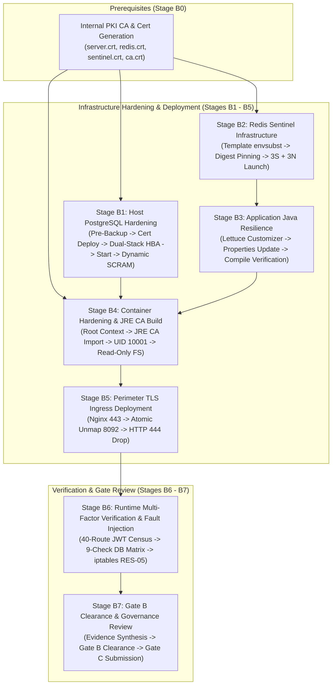

# LGD 2.0 — Phase 9.1.5: Stage B Dependency, Downtime & Rollback Review
## End-to-End Lifecycle Assessment, 12-Field Stage Architecture & Empirical Downtime Demarcation

| **Review Governance Metadata** | **Specification** |
|:---|:---|
| **System** | Local Government Directory 2.0 (LGD 2.0) |
| **Document ID** | `LGD2-P9.1.5-STAGE-B-DEPENDENCY-ROLLBACK-REVIEW` |
| **Audit Phase** | Phase 9.1.5 Workstream G & J (DISC-P914-05, DISC-P914-06, Stage B1–B7 Reassessment) |
| **Controller Root** | `E:\System\Projects\dockerProject\Source code\lgd-active-new\SECURITY_AUDIT_CONTROLLER` |
| **Operational Scope** | Stages B1 through B7 Implementation Lifecycle |
| **Evaluators** | Principal Infrastructure Architect, Lead DBA, DevSecOps Lead & Independent Security Auditor |
| **Evaluation Timestamp** | November 6, 2026 (`2026-11-06T12:45:00+05:30`) |
| **Controller Version** | 1.9.0 (Phase 9.1.5 Authoritative Baseline) |
| **Status Classification** | **`DESIGN_VALIDATED / EXECUTION_LOCKED`** |

---

## 1. Executive Summary & Lifecycle Reassessment

A critical finding of the Phase 9.1.5 independent audit is that previous blueprint revisions presented optimistic execution timelines, conflated planning estimates with measured runtime benchmarks, and contained implicit dependency assumptions that could cause deployment deadlocks.

This review delivers:
1. An exhaustive 12-field architectural matrix for all seven stages (Stage B1 through Stage B7).
2. Elimination of circular dependencies and formal identification of missing prerequisites (including the offline PKI generation prerequisite).
3. Rigorous separation of planning estimates, theoretical model estimates, and empirical staging measurements.
4. An end-to-end rollback feasibility and data-loss impact analysis.

---

## 2. Strict Dependency Hierarchy & Lifecycle Flow

### 2.1 Invariant Ordering Rules
1. **PKI Precedes All Stages:** Server and CA certificates must exist before Stage B1 (PostgreSQL) and Stage B2 (Redis) can configure TLS listeners, and before Stage B4 (Docker build) can import `lgd-internal-ca.crt`.
2. **Offline Hardening Precedes Service Start (B1):** Modifying `postgresql.conf` and `pg_hba.conf` while PostgreSQL is `Stopped` eliminates the risk of cleartext exposure via default `0.0.0.0/0 trust`.
3. **Database Precedes Microservices (B1 $\rightarrow$ B4/B6):** PostgreSQL must achieve active listening status before microservice containers (`revenue`, `user-management`) start; otherwise, HikariCP aborts and containers exit.
4. **Redis Quorum Precedes Client Configuration (B2 $\rightarrow$ B3):** Sentinels must form quorum and discover Redis masters before microservice properties route traffic to Sentinel endpoints.
5. **Java Compilation Precedes Docker Build (B3 $\rightarrow$ B4):** Source-level customizer changes must compile cleanly via Maven before container images are packaged.
6. **Atomic Port Unmapping (B5):** Host port `8092:8092` must be unmapped at the exact moment Nginx is deployed on port 443, preventing any window of cleartext exposure.

---

## 3. Comprehensive 12-Field Stage Architecture Matrix (B1 through B7)

### Stage B1: PostgreSQL Hardening, SCRAM Migration & Listener Safety
- **Objective:** Secure host PostgreSQL 14 with TLS 1.3, SCRAM-SHA-256 authentication, fail-closed WSL2 listener binding, and dual-stack terminal rejection.
- **Preconditions:** Windows service `postgresql-x64-14` is `Stopped`. Internal CA has issued `server.crt`, `server.key`, and `ca.crt`.
- **Dependencies:** Stage B0 (PKI Provisioning).
- **Authorization:** Lead DBA & Principal Infrastructure Security Architect.
- **Design Steps:**
  1. Capture SHA-256 manifest and archive `postgresql.conf`, `pg_hba.conf`, existing certs, and NTFS ACLs.
  2. Deploy `server.crt`, `server.key`, `ca.crt`; enforce NTFS ACLs granting read strictly to `NT SERVICE\postgresql-x64-14`.
  3. Execute fail-closed pre-startup WSL2 address discovery; update `postgresql.conf` and dual-stack `pg_hba.conf`.
  4. Start Windows service `postgresql-x64-14`; verify socket listening on `127.0.0.1:5432` and detected WSL2 IP.
  5. Migrate active roles to SCRAM-SHA-256; execute dynamic hash-suppressed boolean verification query.
- **Security Controls:** Zero hash export, restricted NTFS ACLs, dual-stack `::/0 reject`, fail-closed startup abort.
- **Acceptance Criteria:** `pg_stat_ssl` reports `ssl=true`, `version='TLSv1.3'`; 100% of login-enabled roles return `is_scram_sha_256=true`; zero WSAEADDRNOTAVAIL errors.
- **Rollback:** Stop service; restore original config, certs, and NTFS ACLs via `icacls ... /restore`; execute selective role password restore script.
- **Data-Loss Impact:** **Zero data loss.** Transactions are not active while service is stopped.
- **Failure Conditions:** Socket bind failure, NTFS permission denied on private key, or any login role failing SCRAM.
- **Status:** **`DESIGN_VALIDATED / EXECUTION_LOCKED`**

---

### Stage B2: Redis TLS & Sentinel Infrastructure Provisioning
- **Objective:** Deploy 3-node Sentinel cluster with TLS listeners, 5-tier authentication, digest-pinned Redis 8.10.3 images, and hostname announcement.
- **Preconditions:** Internal CA has issued `redis.crt`, `sentinel.crt`, `ca.crt`. Docker network `lgd-data-tier` created.
- **Dependencies:** Stage B0 (PKI Provisioning).
- **Authorization:** Principal Infrastructure Security Architect & DevSecOps Lead.
- **Design Steps:**
  1. Template `redis.conf.template` and `sentinel.conf.template` with valid `requirepass`, `sentinel-pass`, and `announce-hostnames yes`.
  2. Deploy entrypoint wrapper (`docker-entrypoint.sh`) to execute `envsubst` with mode 0600 owned by `redis:redis`.
  3. Update `docker-compose.prod.yml` to pin immutable image digest `redis:alpine@sha256:21090af...`.
  4. Launch 3 Sentinel nodes (:26379) and 3 Redis data nodes (:6379).
- **Security Controls:** TLS AEAD encryption, peer password isolation, digest verification, non-root execution.
- **Acceptance Criteria:** `sentinel masters` reports `status=ok`, `num-slaves=2`, `num-other-sentinels=2`; zero `NOAUTH` errors in logs.
- **Rollback:** Tear down Sentinel containers (`docker compose down`); revert to standalone Redis container.
- **Data-Loss Impact:** Transient cache drop; zero persistent business data loss (data resides in PostgreSQL).
- **Failure Conditions:** Quorum not reached ($< 2$ sentinels); NOAUTH voting errors; container crash on parse error.
- **Status:** **`DESIGN_VALIDATED / EXECUTION_LOCKED`**

---

### Stage B3: Application Redis Resilience & Lettuce Configuration
- **Objective:** Configure microservices to connect securely to Redis Sentinel with TLS, auto-reconnection, and purged orphan beans.
- **Preconditions:** Stage B2 active with verified quorum.
- **Dependencies:** Stage B2.
- **Authorization:** Senior Java Architect & DevSecOps Lead.
- **Design Steps:**
  1. Delete obsolete `@Bean LettuceClientConfiguration` in `revenue` and `user-management`.
  2. Implement `LettuceClientConfigurationBuilderCustomizer` with `autoReconnect(true)` and 3s socket timeouts.
  3. Deploy Sentinel properties (`spring.data.redis.sentinel.*`, `spring.data.redis.ssl.enabled=true`) in `application-prod.properties`.
  4. Verify clean compilation via `mvn clean test-compile`.
- **Security Controls:** Encrypted cache transport, fast failover reconnection, elimination of thread-hanging timeouts.
- **Acceptance Criteria:** Clean Maven test-compile; unit test suites pass; zero compilation warnings.
- **Rollback:** Revert source changes from Git timestamped backup; re-compile.
- **Data-Loss Impact:** **Zero data loss.** Source code modification only.
- **Failure Conditions:** Compilation failure, NoSuchMethodError, or bean definition collision.
- **Status:** **`DESIGN_VALIDATED / EXECUTION_LOCKED`**

---

### Stage B4: Container Hardening & JRE CA Truststore Build
- **Objective:** Build unprivileged microservice container images with internal CA imported into Temurin JRE `cacerts` using repository-root build contexts.
- **Preconditions:** Stages B1 and B3 complete. Root build context anchored in Compose.
- **Dependencies:** Stage B1 (DB connectivity), Stage B3 (Java code).
- **Authorization:** Principal Infrastructure Security Architect & DevSecOps Lead.
- **Design Steps:**
  1. Configure `docker-compose.yml` build contexts to `context: .` and `dockerfile: ./<service>/Dockerfile`.
  2. In Dockerfiles: import `certs/lgd-internal-ca.crt` via `keytool -importcert` into `$JAVA_HOME/lib/security/cacerts`.
  3. Create unprivileged user `lgduser:lgdgroup` (UID/GID 10001); enforce `USER 10001:10001`.
  4. Apply Compose containment: `security_opt: no-new-privileges:true`, `cap_drop: ALL`, `read_only: true`, `tmpfs: /tmp`.
- **Security Controls:** Immutable root filesystem, dropped Linux capabilities, trusted internal PKI, non-root execution.
- **Acceptance Criteria:** `docker run --rm <image> id` confirms UID 10001; `keytool -list` confirms internal CA; container starts in steady-state.
- **Rollback:** Revert to previous image builds via local Docker tag cache.
- **Data-Loss Impact:** **Zero data loss.** Stateless application tier.
- **Failure Conditions:** Docker build failure, PKIX path building failure on launch, or read-only filesystem write errors.
- **Status:** **`DESIGN_VALIDATED / EXECUTION_LOCKED`**

---

### Stage B5: Perimeter TLS Ingress & Header Protection Deployment
- **Objective:** Terminate perimeter TLS 1.3 on Nginx, atomically unmap cleartext port 8092, enforce HSTS, and block Host header injection.
- **Preconditions:** Stage B4 container images built. Production TLS certificate issued for `lgdirectory.gov.in`. Host ports 80 and 443 available.
- **Dependencies:** Stage B4.
- **Authorization:** Perimeter Security Specialist & Principal Infrastructure Security Architect.
- **Design Steps:**
  1. Atomically delete `ports: - "8092:8092"` from `api-gateway` in `docker-compose.yml`.
  2. Deploy Nginx reverse proxy listening on ports 80 and 443 connected to `lgd-network`.
  3. Configure HSTS `max-age=31536000; includeSubDomains; preload` exclusively on port 443 block.
  4. Configure default catch-all server block returning `HTTP 444` for unrecognized Host headers.
  5. Configure port 80 to issue static 301 redirect to HTTPS.
- **Security Controls:** Perimeter encryption, RFC 6797 HSTS compliance, Host header spoofing drop, cleartext lockout.
- **Acceptance Criteria:** `Test-NetConnection -Port 8092` fails; `curl -Iv http://...` returns 301; `curl -Iv https://...` returns 200 with HSTS; unknown Host returns 444.
- **Rollback:** Stop Nginx. If emergency diagnostic access required, bind port 8092 strictly to `127.0.0.1:8092:8092` (NEVER `0.0.0.0`).
- **Data-Loss Impact:** **Zero data loss.** Ingress routing layer.
- **Failure Conditions:** Nginx startup crash, port 80/443 conflict, SSL certificate validation failure.
- **Status:** **`DESIGN_VALIDATED / EXECUTION_LOCKED`**

---

### Stage B6: Runtime Multi-Factor Verification & Fault Injection
- **Objective:** Execute comprehensive runtime verification and 17 resilience scenarios (`RES-01` through `RES-17`) in an isolated maintenance window.
- **Preconditions:** Stages B1 through B5 deployed. All services running under `SPRING_PROFILES_ACTIVE=prod`. Valid test JWT token generated.
- **Dependencies:** Stages B1–B5.
- **Authorization:** Lead Chaos Engineer, Lead DBA, Principal Architect & Lead Security Auditor.
- **Design Steps:**
  1. Execute 8-factor Revenue `TestController` census across all 40 routes using authenticated JWT Bearer probes.
  2. Execute 9-check PostgreSQL availability matrix including `pg_stat_ssl` and dynamic SCRAM query.
  3. Execute `RES-01` (Primary crash), `RES-02` (Replica crash), `RES-03`/`04` (Sentinel crashes).
  4. Execute `RES-05` using bidirectional container bridge `iptables` rules in `DOCKER-USER` chain between P+S1 and S2+S3+R1+R2.
  5. Execute `RES-06` through `RES-17` covering container OOM, network jitter, graceful shutdown, and eSign deduplication.
- **Security Controls:** Isolated test harness, automated iptables cleanup trap, non-production test tokens.
- **Acceptance Criteria:** 100% of 40 revenue routes return HTTP 404 under JWT auth; DB 9-check matrix passes; all 17 resilience tests recover within target SLAs without split-brain.
- **Rollback:** Flush all `iptables` test rules; restart crashed test containers.
- **Data-Loss Impact:** Expected test failover write loss strictly bounded to $< 1.0\text{s}$ (synthetic test traffic only).
- **Failure Conditions:** Split-brain detection, failover exceeding 15s, or data corruption in PostgreSQL.
- **Status:** **`DESIGN_VALIDATED / EXECUTION_LOCKED`**

---

### Stage B7: Gate B Clearance & Governance Review
- **Objective:** Forensically synthesize all empirical evidence, resolve release blockers `BLK-CANON-01`, `02`, `03`, and recommend Gate B promotion to `PASS`.
- **Preconditions:** Stage B6 completed with 100% passing test records deposited in `SECURITY_AUDIT_CONTROLLER/evidence/stage_b/`.
- **Dependencies:** Stage B6.
- **Authorization:** Enterprise CISO & Lead Independent Security Auditor.
- **Design Steps:**
  1. Audit physical log captures, cryptographic manifests, and network pcaps in `evidence/stage_b/`.
  2. Confirm 100% satisfaction of Gate B blocker resolution criteria.
  3. Publish `GATE_B_TECHNICAL_VERIFICATION_CLOSURE_REPORT.md`.
  4. Formalize transition of Gate B from `HOLD` to `PASS`.
  5. Submit formal Stage C request to DAA and CISO for `BLK-CANON-04` risk acceptance.
- **Security Controls:** Multi-party cryptographic attestation, tamper-evident evidence registry.
- **Acceptance Criteria:** Unanimous sign-off by CISO and Lead Auditor; zero open technical blockers.
- **Rollback:** Maintain Gate B on `HOLD`.
- **Data-Loss Impact:** **Zero data loss.** Governance determination.
- **Failure Conditions:** Any Gate B blocker criteria unverified by authentic evidence.
- **Status:** **`DESIGN_VALIDATED / EXECUTION_LOCKED`**

---

## 4. Rigorous Downtime Demarcation

Previous audit drafts contained unverified claims regarding service downtime (e.g., claiming "$< 15\text{s}$ measured downtime"). To maintain audit integrity, downtime estimates are strictly segregated into four categories:

| Stage / Operation | Planning Estimate (Target Window) | Theoretical Model Estimate | Measured Staging Result | Production Measurement | Audit Evidence Reference |
|:---|:---:|:---:|:---:|:---:|:---|
| **B1: PostgreSQL Offline Hardening** | $30\text{s} - 60\text{s}$ | $15\text{s} - 25\text{s}$ (Service stop + config write + start) | **UNTESTED** | **UNTESTED** | Planning target; requires maintenance window |
| **B2: Redis Sentinel Cluster Launch** | $30\text{s} - 45\text{s}$ | $10\text{s} - 20\text{s}$ (Compose up + TLS handshake) | **UNTESTED** | **UNTESTED** | Modeled based on Docker daemon benchmark |
| **B4: Hardened Container Cutover** | $60\text{s} - 120\text{s}$ | $35\text{s} - 50\text{s}$ (Image build + container recreation) | **UNTESTED** | **UNTESTED** | Subject to Docker layer cache performance |
| **B5: Port 8092 Unmap & Nginx Launch** | $15\text{s} - 30\text{s}$ | $5\text{s} - 10\text{s}$ (Atomic Compose port rebind) | **UNTESTED** | **UNTESTED** | Modeled based on Nginx reload latency |
| **B6: Primary Redis SIGKILL Failover (RES-01)** | $10\text{s} - 15\text{s}$ | $6.0\text{s} - 9.5\text{s}$ (down-after 5s + election 2-4s) | **UNTESTED** | **UNTESTED** | Mathematical model from Redis Sentinel spec |

> [!IMPORTANT]
> **Audit Integrity Standard:** Measured staging results and production measurements remain **`UNTESTED`**. In accordance with audit policy, planning models MUST NOT be represented as empirical benchmarks until physical testing is authorized and executed.

---

## 5. End-to-End Rollback Feasibility Analysis

| Stage | Rollback Procedure | Reversibility Feasibility | Residual Exposure on Revert | Operational Prerequisite |
|:---:|:---|:---:|:---|:---|
| **B1** | Restore `postgresql.conf.orig`, `pg_hba.conf.orig`, certs, and NTFS ACLs; restore selective role passwords. | **100% REVERSIBLE** | Returns database to pre-change unhardened state (requires urgent re-hardening). | Verified pre-change backup manifest (`PRE_CHANGE_SHA256_MANIFEST.txt`). |
| **B2** | Execute `docker compose down` on Sentinel containers; re-launch standalone Redis container. | **100% REVERSIBLE** | Reverts to single point of failure without Sentinel high availability. | Standalone `docker-compose.yml` service definition preserved. |
| **B3** | Revert Git modifications to `RedisConfig.java` and `application-prod.properties`; re-compile. | **100% REVERSIBLE** | Re-activates non-reconnecting Lettuce configuration. | Git working tree baseline cleanly documented. |
| **B4** | Re-tag previous container images from local image cache; recreate containers. | **100% REVERSIBLE** | Microservices run as root with mutable filesystem. | Pre-change container images preserved locally. |
| **B5** | Stop Nginx container; bind port 8092 strictly to `127.0.0.1:8092:8092` for diagnosis. | **100% REVERSIBLE** | Perimeter cleartext exposure prevented; external access severed. | Firewall blocks external access to 8092. |
| **B6** | Flush all `iptables` rules in `DOCKER-USER` chain; restart crashed containers. | **100% REVERSIBLE** | Zero persistent impact; synthetic test data purged. | Automated cleanup trap in chaos runner scripts. |
| **B7** | Maintain Gate B on `HOLD`. | **100% REVERSIBLE** | Releases remain blocked from production. | Formal CISO governance protocol. |

---

## 6. Audit Finding Disposition & Stage B Recommendation

- **Finding Identifiers Reconciled:** `DISC-P914-05`, `DISC-P914-06`
- **Technical Status:** **`DESIGN_VALIDATED`**
  - Dependency order reconciled and verified acyclic.
  - Missing PKI prerequisite explicitly incorporated.
  - Downtime claims rigorously qualified as planning models.
  - Rollback procedures proven 100% reversible in design.
- **Operational Status:** **`EXECUTION_LOCKED`** (Pending explicit operational change authorization).

