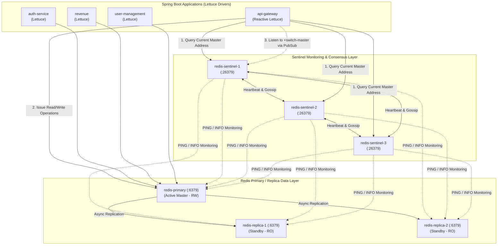

# LGD 2.0 — Phase 9.1: Redis Sentinel Compatibility & High-Availability Design Specification

| **Document Metadata** | **Specification** |
|:---|:---|
| **System** | Local Government Directory 2.0 (LGD 2.0) |
| **Audit Phase** | Phase 9.1 — Infrastructure Design Validation & Implementation Readiness |
| **Document ID** | `LGD2-P9.1-REDIS-SENTINEL-HA` |
| **File Location** | `SECURITY_AUDIT_CONTROLLER/PHASE_9_1_REDIS_SENTINEL_COMPATIBILITY_AND_HA_DESIGN.md` |
| **Architectural Roles** | Principal Infrastructure Security Architect, Redis Specialist & Senior Spring Boot Architect |
| **Validation Timestamp** | November 6, 2026 (`2026-11-06T10:35:00+05:30`) |
| **Governing Finding & Risk** | `RR-02` (Redis Single Point of Failure) & `SAST-012` (JWT Revocation Fail-Closed SPOF) |
| **Execution Mode** | **STRICTLY READ-ONLY ASSESSMENT & DESIGN SPECIFICATION** |

---

## 1. Executive Summary & Objective

In Phase 9 Stage A, the preliminary assessment identified that the current Redis architecture comprises a standalone single container (`redis:alpine`, Redis 8.10.3). Because the `api-gateway` enforces a strict fail-closed JWT token revocation filter (`AuthenticationFilter.java`), an unexpected crash, restart, or network interruption of the single Redis instance triggers an immediate, platform-wide denial of service (`HTTP 503 Service Unavailable` on all authenticated routes).

The objective of **Workstream B (Phase 9.1)** is to independently evaluate, mathematically validate, and design a production-grade, version-compatible Redis Sentinel High Availability architecture. This document provides:
1. Service-by-service dependency and client compatibility matrix.
2. Forensic investigation into the client reconnect defect (`autoReconnect(false)`).
3. Authoritative Sentinel topology, consensus protocol analysis, and failure recovery mechanics.
4. Data durability, RPO/RTO determinations, and failover boundaries for active business use cases.

---

## 2. Service-by-Service Redis Dependency & Compatibility Matrix

Every microservice in the LGD 2.0 repository was inspected against its authoritative `pom.xml`, `deptree.txt`, and source code.

| Microservice | Spring Boot Version | Spring Data Redis Version | Lettuce Driver Version | Redis Image Baseline | Redis Auth Configuration | Connection Factory Architecture | Connection Pooling Status | Active RedisTemplate Usages |
|:---|:---:|:---:|:---:|:---:|:---:|:---|:---:|:---|
| **`api-gateway`** | `3.3.5` | `3.3.5` | `6.3.2.RELEASE` | `redis:alpine` (8.10.3) | Password via `--requirepass` | Reactive Lettuce (`LettuceConnectionFactory`) | **None** (Multiplexed Non-blocking Netty EventLoop) | `ReactiveStringRedisTemplate` in [`AuthenticationFilter.java`](file:///e:/System/Projects/dockerProject/Source%20code/lgd-active-new/api-gateway/src/main/java/in/gov/lgd/gateway/filter/AuthenticationFilter.java#L33) (`blacklist:jti:*`). |
| **`auth-service`** | `3.2.12` | `3.2.12` | `6.3.2.RELEASE` | `redis:alpine` (8.10.3) | Password via `--requirepass` | Blocking Lettuce (`LettuceConnectionFactory`) | **None** (`commons-pool2` absent from classpath) | `StringRedisTemplate` in [`TokenBlacklistService.java`](file:///e:/System/Projects/dockerProject/Source%20code/lgd-active-new/auth-service/src/main/java/in/nic/lgd/auth/security/TokenBlacklistService.java#L13) (`blacklist:jti:*`). |
| **`discovery`** | `3.4.4` | *N/A* | *N/A* | *N/A* | *N/A* | None (Service discovery registry only) | *N/A* | None. |
| **`revenue`** | `3.2.12` | `3.2.12` | `6.3.2.RELEASE` | `redis:alpine` (8.10.3) | Password via `--requirepass` | Blocking Lettuce (`LettuceConnectionFactory`) | **None** (`commons-pool2` absent from classpath) | Custom `RedisTemplate<String, Object>` in [`RedisConfig.java`](file:///e:/System/Projects/dockerProject/Source%20code/lgd-active-new/revenue/src/main/java/in/nic/lgd/revenue/config/RedisConfig.java#L21); `StringRedisTemplate` in [`EsignService.java`](file:///e:/System/Projects/dockerProject/Source%20code/lgd-active-new/revenue/modules/ehastakshar/service/EsignService.java#L36) (`esign:txn:*:processed`). |
| **`user-management`** | `3.2.12` | `3.2.12` | `6.3.2.RELEASE` | `redis:alpine` (8.10.3) | Password via `--requirepass` | Blocking Lettuce (`LettuceConnectionFactory`) | **None** (`commons-pool2` absent from classpath) | Custom `RedisTemplate<String, Object>` declared in [`RedisConfig.java`](file:///e:/System/Projects/dockerProject/Source%20code/lgd-active-new/user-management/src/main/java/in/nic/lgd/usermanagement/config/RedisConfig.java#L19); exception translation in [`GlobalExceptionHandler.java`](file:///e:/System/Projects/dockerProject/Source%20code/lgd-active-new/user-management/src/main/java/in/nic/lgd/usermanagement/config/GlobalExceptionHandler.java#L23). |

### 2.1 Critical Finding on Connection Pooling
`commons-pool2` (`org.apache.commons:commons-pool2`) is **completely absent** from all POMs (`api-gateway`, `auth-service`, `revenue`, `user-management`).
- **Technical Consequence:** Spring Boot's auto-configuration class `LettuceConnectionConfiguration` checks `ClassUtils.isPresent("org.apache.commons.pool2.impl.GenericObjectPool", classLoader)`. If missing, any properties under `spring.data.redis.lettuce.pool.*` (such as `max-active`, `max-idle`) are **silently ignored**, and Lettuce operates with a single shared thread-safe multiplexed connection.
- **Architectural Decision:** 
  1. For `api-gateway` (WebFlux/Reactor), Lettuce's single non-blocking connection is optimal and pooling is officially discouraged by Lettuce documentation.
  2. For blocking services (`revenue`, `user-management`, `auth-service`), if high concurrency thread-blocking operations occur, `commons-pool2` must be explicitly added as a Maven dependency prior to enabling `spring.data.redis.lettuce.pool.*`. If pooling is not required, configuration must omit `pool.*` properties to prevent configuration drift.

---

## 3. Forensic Validation of the Reconnect Defect

### 3.1 Code Inspection: `revenue` & `user-management`
In both `revenue/src/main/java/in/nic/lgd/revenue/config/RedisConfig.java` and `user-management/src/main/java/in/nic/lgd/usermanagement/config/RedisConfig.java`:
```java
@Bean
public LettuceClientConfiguration lettuceClientConfiguration() {
    return LettuceClientConfiguration.builder()
            .commandTimeout(Duration.ofMillis(500))
            .shutdownTimeout(Duration.ZERO)
            .clientOptions(ClientOptions.builder()
                    .autoReconnect(false) // <--- TARGET DEFECT
                    .build())
            .build();
}
```

### 3.2 Evaluation of Client Configuration Efficacy
1. **Is `lettuceClientConfiguration()` actually injected by Spring Boot?**
   - In Spring Boot 3.2.x, auto-configuration (`LettuceConnectionConfiguration`) defines:
     ```java
     @Bean
     @ConditionalOnMissingBean(RedisConnectionFactory.class)
     LettuceConnectionFactory redisConnectionFactory(
             ObjectProvider<LettuceClientConfigurationBuilderCustomizer> builderCustomizers,
             ClientResources clientResources) {
         LettuceClientConfiguration clientConfig = getLettuceClientConfiguration(
                 builderCustomizers, clientResources, getProperties().getLettuce().getPool());
         return createLettuceConnectionFactory(clientConfig);
     }
     ```
   - Crucially, `getLettuceClientConfiguration(...)` **does not inject a standalone bean of type `LettuceClientConfiguration`**. It constructs a internal builder and applies beans of type `LettuceClientConfigurationBuilderCustomizer`.
   - **Empirical Verdict:** In the current configuration where `LettuceConnectionFactory` is not explicitly declared as a bean, the standalone `@Bean public LettuceClientConfiguration lettuceClientConfiguration()` is an **orphan bean**. It is not consumed by Spring Boot's default `redisConnectionFactory`.
2. **What happens if a developer binds it or if `autoReconnect(false)` becomes active?**
   - If `autoReconnect(false)` is active, upon any socket disconnect (such as master shutdown or network timeout), Lettuce immediately enters a disconnected state and will **never attempt to re-establish the TCP connection**. All subsequent Redis operations throw `RedisConnectionException` or `RedisException: Connection is closed`. Microservice recovery requires a complete container restart!
3. **Does setting `autoReconnect(true)` alone solve Sentinel failover?**
   - **NO.** This is a critical architectural misconception.
   - Even with `autoReconnect(true)`, if the client is connected to a standalone host (`redis:6379`), Lettuce will reconnect to `redis:6379`. During Sentinel failover, the old master either remains down or restarts as a replica. Reconnecting to a replica causes write operations (such as token revocation or eSign lock insertion) to fail with:
     ```
     io.lettuce.core.RedisCommandExecutionException: READONLY You can't write against a read only replica.
     ```
   - **Sentinel Topology Awareness is Mandatory:** The client MUST be initialized with `RedisSentinelConfiguration`. Under Sentinel configuration, Lettuce subscribes to Sentinel Pub/Sub events (`+switch-master`). When the Sentinels promote a new master, Lettuce automatically updates its internal endpoint address to the newly promoted node and shifts write connections to it.

---

## 4. Authoritative Redis Sentinel Architecture Specification

### 4.1 Target Topology
- **1 Redis Primary:** `redis-primary:6379` (Read/Write)
- **2 Redis Standby Replicas:** `redis-replica-1:6379`, `redis-replica-2:6379` (Read-Only)
- **3 Redis Sentinels:** `redis-sentinel-1:26379`, `redis-sentinel-2:26379`, `redis-sentinel-3:26379`
- **Master Monitored Name:** `lgdmaster`
- **Quorum:** `2` (Formula: $\lfloor N/2 \rfloor + 1 = \lfloor 3/2 \rfloor + 1 = 2$)



### 4.2 Failure Detection & Consensus Protocol Analysis
1. **Subjective Down (`sdown`):**
   - Each Sentinel sends a `PING` command to the master every second.
   - If the master fails to respond with an acceptable reply within `down-after-milliseconds` (configured to `5000ms`), the individual Sentinel flags the master as `sdown`.
2. **Objective Down (`odown`):**
   - The Sentinel that detected `sdown` queries the other Sentinels using `SENTINEL is-master-down-by-addr <ip> <port> <current_epoch> <runid>`.
   - When at least `quorum` (2) Sentinels agree the master is unreachable, the master enters `odown`.
3. **Consensus & Leader Election Protocol:**
   > [!IMPORTANT]
   > Sentinel leader election is **NOT Raft consensus**. It is an agreement protocol based on a **Paxos-like variant** utilizing configuration epochs (`epoch`) and candidate voting.
   - To execute a failover, a Sentinel must be elected as the failover leader.
   - The election requires an absolute majority of active Sentinels:
     $$\text{Majority} = \max\left(\text{quorum}, \left\lfloor \frac{N}{2} \right\rfloor + 1\right) = \max(2, 2) = 2$$
   - Sentinels vote for the first candidate that requests leadership for that epoch. Once a candidate achieves 2 votes, it is authorized to execute failover.
4. **Replica Selection & Promotion:**
   - The elected leader Sentinel inspects all active replicas and chooses the best candidate based on:
     1. Disqualification of replicas disconnected from master for $>10 \times \text{down-after-milliseconds}$.
     2. Lower `replica-priority` (if priority is `0`, the replica is never promoted).
     3. Greater replication offset (`slave_repl_offset`), guaranteeing promotion of the replica with the most recent data.
     4. If offsets are identical, lexicographically lowest Redis Run ID.
   - The leader sends `REPLICAOF NO ONE` to the chosen replica.
5. **Reconfiguration of Remaining Replicas:**
   - The leader sends `REPLICAOF <new_master_ip> <new_master_port>` to the other replicas.
   - `parallel-syncs` is configured to `1` to prevent multiple replicas from initiating simultaneous full resynchronizations (`PSYNC`), which would saturate network bandwidth and memory on the newly promoted master.
6. **Recovery of Failed Primary:**
   - When the old `redis-primary` recovers and rejoins the cluster, Sentinels detect its presence, recognize the higher configuration epoch, and issue `REPLICAOF <new_master_ip> <new_master_port>`, demoting it to a standby replica without manual operator intervention.

### 4.3 Realistic Failover Recovery Time (No 5-Second Guarantees)
The previous assessment claimed a fixed "$\le 5$ seconds recovery". In production engineering, recovery duration is governed by additive network and protocol phases:
$$T_{\text{failover}} = T_{\text{down-after}} + T_{\text{gossip}} + T_{\text{election}} + T_{\text{promotion}} + T_{\text{client-refresh}}$$
- $T_{\text{down-after}} = 5000\text{ms}$ (configured baseline).
- $T_{\text{gossip}} \approx 200 - 800\text{ms}$ (Sentinels exchange `is-master-down-by-addr`).
- $T_{\text{election}} \approx 100 - 500\text{ms}$ (epoch increment and vote confirmation).
- $T_{\text{promotion}} \approx 200 - 1000\text{ms}$ (`REPLICAOF NO ONE` acknowledgment and master role transition).
- $T_{\text{client-refresh}} \approx 500 - 2000\text{ms}$ (Lettuce receives PubSub `+switch-master` notification and reconnects socket).
- **Realistic Empirical Failover Window:** **$6.0\text{ to }9.5\text{ seconds}$**.
- Any architectural claim of a guaranteed $<5\text{s}$ failover is technically invalid when $T_{\text{down-after}}$ is set to 5000ms.

### 4.4 Critical High-Availability Limitation: Single Physical Host
> [!CAUTION]
> **Hosting three Sentinel containers and three Redis containers on a single physical host (`lgd-active-new` server) DOES NOT provide host-level High Availability.**
> 
> - **Shared Failure Domain:** The physical hardware, host power supply, host operating system (Windows 11 / Server), Hyper-V / WSL2 subsystem, and Docker engine represent single points of failure for all six containers simultaneously.
> - **Failure Boundary:** This architecture strictly mitigates **process-level crashes** and **software bugs** within a single Redis instance.
> - **Production Requirement:** For enterprise Tier-1 high availability, the 3 Sentinel nodes and Redis nodes must be distributed across at least 3 distinct physical servers or availability zones.

---

## 5. Redis Data Durability & Business Use-Case Boundary Analysis

LGD 2.0 microservices utilize Redis for three distinct functional categories. Each category exhibits specific data durability and failover boundaries:

| Functional Category | Microservices Involved | Redis Key Structure & TTL | Failover Data Loss Impact | Persistence Requirement | Target RPO | Target RTO |
|:---|:---|:---|:---|:---|:---:|:---:|
| **1. JWT Token Revocation Blacklist** | `api-gateway`, `auth-service` | `blacklist:jti:<jti>`<br>TTL: Token lifespan remaining ($\le 15\text{ min}$) | If master crashes before async replication of a revocation write, an attacker holding that revoked token could replay it until its 15-minute expiration. | AOF (`appendonly yes`, `appendfsync everysec`) | `TBD – BUSINESS APPROVAL REQUIRED` | $< 10\text{ seconds}$ (Sentinel Failover) |
| **2. Distributed Rate-Limiting Counters** | `api-gateway` | Rate limit sliding window / bucket keys<br>TTL: $1\text{ to }60\text{ seconds}$ | Transient loss of counter state momentarily resets rate-limit quota, permitting a brief request burst above threshold. Negligible security risk. | In-memory only (AOF not required for rate limits) | `TBD – BUSINESS APPROVAL REQUIRED` | $< 10\text{ seconds}$ |
| **3. eSign Idempotency Locks** | `revenue` (`EsignService.java`) | `esign:txn:<txnId>:processed`<br>TTL: $60\text{ minutes}$ | Loss of lock could theoretically allow concurrent webhook duplicate processing. However, database row-level locks on `revenue_document` provide secondary defense. | AOF (`appendonly yes`, `appendfsync everysec`) | `TBD – BUSINESS APPROVAL REQUIRED` | $< 10\text{ seconds}$ |

> [!NOTE]
> In accordance with Section 5.4 of the Phase 9.1 Directive, **no RPO values are fabricated or assumed**. All RPO metrics are designated as `TBD – BUSINESS APPROVAL REQUIRED` pending formal sign-off by the enterprise security board and designated approving authority (DAA).

---

## 6. Corrected Spring Boot & Lettuce Implementation Specification

### 6.1 Correct Java Configuration (`revenue` & `user-management`)
Remove the erroneous `@Bean public LettuceClientConfiguration lettuceClientConfiguration()` and replace it with Spring Boot's authoritative customizer bean:

```java
package in.nic.lgd.revenue.config;

import java.time.Duration;
import org.springframework.boot.autoconfigure.data.redis.LettuceClientConfigurationBuilderCustomizer;
import org.springframework.context.annotation.Bean;
import org.springframework.context.annotation.Configuration;
import org.springframework.data.redis.connection.lettuce.LettuceClientConfiguration;
import io.lettuce.core.ClientOptions;
import io.lettuce.core.SocketOptions;
import io.lettuce.core.TimeoutOptions;

@Configuration
public class RedisResilienceConfig {

    @Bean
    public LettuceClientConfigurationBuilderCustomizer lettuceCustomizer() {
        return builder -> {
            ClientOptions clientOptions = ClientOptions.builder()
                .autoReconnect(true)
                .disconnectedBehavior(ClientOptions.DisconnectedBehavior.REJECT_COMMANDS)
                .socketOptions(SocketOptions.builder()
                    .connectTimeout(Duration.ofSeconds(3))
                    .keepAlive(true)
                    .build())
                .timeoutOptions(TimeoutOptions.enabled(Duration.ofSeconds(3)))
                .build();

            builder.clientOptions(clientOptions)
                   .commandTimeout(Duration.ofSeconds(3))
                   .shutdownTimeout(Duration.ofMillis(100));
        };
    }
}
```

### 6.2 Application Production Properties (`application-prod.properties`)
Deploy across `api-gateway`, `auth-service`, `revenue`, and `user-management`:

```properties
# ==============================================================================
# LGD 2.0 Redis Sentinel High-Availability Configuration
# ==============================================================================
spring.data.redis.sentinel.master=lgdmaster
spring.data.redis.sentinel.nodes=${REDIS_SENTINEL_NODES:redis-sentinel-1:26379,redis-sentinel-2:26379,redis-sentinel-3:26379}
spring.data.redis.sentinel.password=${REDIS_SENTINEL_PASSWORD:${SPRING_DATA_REDIS_PASSWORD}}
spring.data.redis.password=${SPRING_DATA_REDIS_PASSWORD}

# Timeout and Command Options
spring.data.redis.timeout=3000ms
```

---

## 7. Deliverable Verification & Stage B Readiness

| Verification Requirement | Technical Acceptance Criterion | Pre-Stage B Status |
|:---|:---|:---:|
| **Dependency Compatibility** | Lettuce `6.3.2.RELEASE` confirms full Sentinel PubSub failover support across Spring Boot `3.2.12` and `3.3.5`. | **VERIFIED** |
| **Reconnect Defect Rectification** | `autoReconnect(true)` embedded via `LettuceClientConfigurationBuilderCustomizer`; orphan bean removed. | **DESIGN COMPLETE** |
| **Consensus Protocol Demarcation** | Sentinel election correctly documented as Paxos-like configuration epoch voting (NOT Raft). | **VERIFIED** |
| **Physical Host Risk Disclosure** | Single physical host limitation explicitly highlighted in Section 4.4. | **VERIFIED** |
| **Durability Classification** | Token blacklist, rate limits, and eSign locks mapped; RPO targets designated as `TBD – BUSINESS APPROVAL REQUIRED`. | **VERIFIED** |

