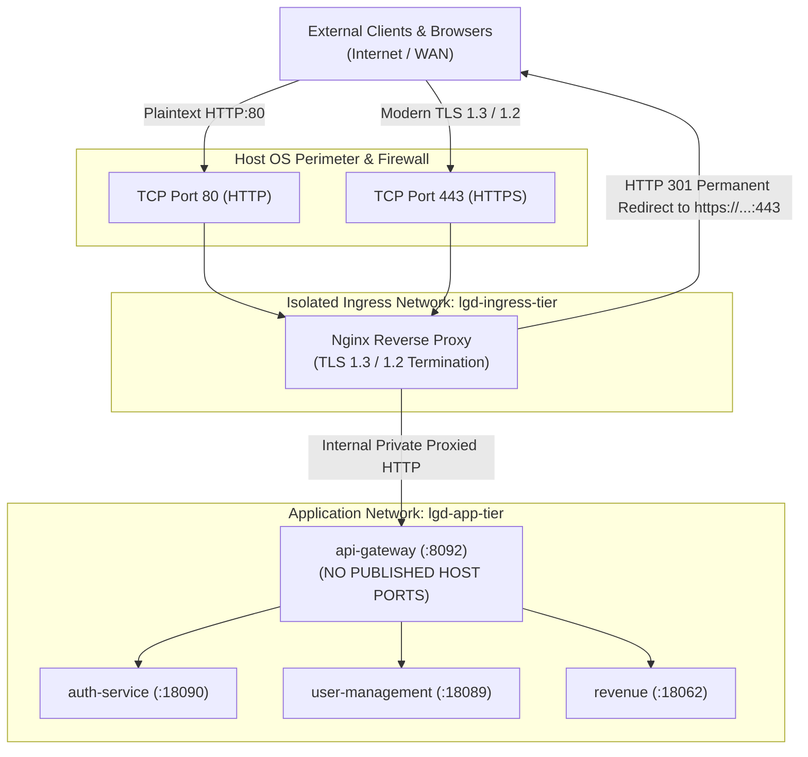

# LGD 2.0 — Phase 9.1: TLS Ingress Architecture & Hardened Nginx Reverse Proxy Specification

| **Document Metadata** | **Specification** |
|:---|:---|
| **System** | Local Government Directory 2.0 (LGD 2.0) |
| **Audit Phase** | Phase 9.1 — Infrastructure Design Validation & Implementation Readiness |
| **Document ID** | `LGD2-P9.1-TLS-INGRESS-NGINX` |
| **File Location** | `SECURITY_AUDIT_CONTROLLER/PHASE_9_1_TLS_INGRESS_AND_NGINX_DESIGN.md` |
| **Architectural Roles** | Principal Infrastructure Security Architect, Perimeter Security Engineer & DevSecOps Lead |
| **Validation Timestamp** | November 6, 2026 (`2026-11-06T10:35:00+05:30`) |
| **Governing Finding & Risk** | `BLK-CANON-01` (Perimeter Ingress Cleartext & RFC 6797 HSTS Invalidation), `EXP-016` |
| **Execution Mode** | **STRICTLY READ-ONLY ASSESSMENT & DESIGN SPECIFICATION** |

---

## 1. Executive Summary & Objective

In the current deployment baseline, the API Gateway binds directly to `0.0.0.0:8092->8092/tcp`, exposing cleartext HTTP to external networks. While the gateway emits an RFC 6797 HSTS header (`Strict-Transport-Security: max-age=31536000`), RFC 6797 Section 7.2 explicitly mandates that user agents must ignore HSTS headers received over cleartext HTTP. This leaves authentication tokens, credentials, and API traffic vulnerable to eavesdropping, interception, and session hijacking (`BLK-CANON-01`).

The objective of **Workstream F (Phase 9.1)** is to:
1. Validate external port architecture (remediating non-standard port 8443 to standard ports 443 and 80).
2. Unmap cleartext backend port 8092 from host interfaces to eliminate reverse proxy bypass.
3. Design a hardened Nginx TLS 1.3/1.2 reverse proxy terminating perimeter encryption.
4. Establish trusted proxy configurations at the API Gateway to prevent forwarded-header spoofing.
5. Provide a realistic HSTS policy with explicit warnings against unauthorized `includeSubDomains` and `preload` directives.
6. Detail health checks, zero-downtime certificate renewal, and emergency rollback procedures.

---

## 2. Ingress Port Validation & Perimeter Exposure Analysis

### 2.1 Standard Port 443 vs Non-Standard Port 8443
The preliminary Stage A assessment suggested terminating TLS on port 8443. This design is operationally flawed for a public government platform:
- **Usability Defect:** Port 8443 requires citizen users, portal administrators, and third-party integrated services to append `:8443` to all URLs (e.g. `https://lgdirectory.gov.in:8443`).
- **Standard Ingress Architecture:**
  - **HTTPS Port `443`:** Standard perimeter listener for all secure user and API traffic.
  - **HTTP Port `80`:** Controlled listener strictly executing HTTP 301/308 permanent redirection to HTTPS port 443.
  - **Backend Port `8092`:** **COMPLETELY UNMAPPED** from host interfaces; accessible strictly over an internal Docker network (`lgd-ingress-tier`).

### 2.2 Reverse Proxy Bypass Hazard
In the current `docker-compose.yml`:
```yaml
api-gateway:
  ports:
    - "8092:8092" # <--- EXTREME VULNERABILITY: Permissive host bind
```
- **Exposure:** Even if an Nginx proxy is placed in front on port 443, any external attacker or client can connect directly to `http://<host-ip>:8092/`, completely bypassing Nginx, bypassing TLS encryption, and bypassing Nginx rate-limiting or WAF inspection.
- **Remediation Requirement:**
  Delete `ports: ["8092:8092"]` from `api-gateway` in `docker-compose.yml` and `docker-compose.prod.yml`. Communication between Nginx and API Gateway must occur exclusively within an isolated Docker bridge network (`lgd-ingress-tier`).

---

## 3. Target Ingress Architecture



---

## 4. Hardened Nginx Configuration Specification (`nginx.conf`)

```nginx
# ==============================================================================
# LGD 2.0 Hardened Perimeter Ingress Nginx Configuration
# Standard: TLS 1.3 / 1.2 Modern Profile, HSTS, Secure Forwarded Headers
# ==============================================================================

user nginx;
worker_processes auto;
worker_rlimit_nofile 65535;
pid /var/run/nginx.pid;

events {
    worker_connections 8192;
    use epoll;
    multi_accept on;
}

http {
    include /etc/nginx/mime.types;
    default_type application/octet-stream;

    # Performance and Buffer Hardening
    sendfile on;
    tcp_nopush on;
    tcp_nodelay on;
    keepalive_timeout 65;
    types_hash_max_size 2048;
    server_tokens off; # Suppress Nginx version disclosure

    client_max_body_size 25M;
    client_body_buffer_size 128k;

    # Logging Format with Real Client IP and TLS Version
    log_format lgd_combined '$remote_addr - $remote_user [$time_local] '
                            '"$request" $status $body_bytes_sent '
                            '"$http_referer" "$http_user_agent" '
                            'rt=$request_time uct="$upstream_connect_time" '
                            'uht="$upstream_header_time" urt="$upstream_response_time" '
                            'ssl_proto=$ssl_protocol ssl_cipher=$ssl_cipher';

    access_log /var/log/nginx/access.log lgd_combined buffer=32k flush=5s;
    error_log /var/log/nginx/error.log warn;

    # Upstream Definition for API Gateway
    upstream api_gateway_backend {
        server api-gateway:8092 max_fails=3 fail_timeout=10s;
        keepalive 32;
    }

    # --------------------------------------------------------------------------
    # 1. Plaintext HTTP Listener: Port 80 (Controlled HTTPS Redirection)
    # --------------------------------------------------------------------------
    server {
        listen 80 default_server;
        listen [::]:80 default_server;
        server_name lgdirectory.gov.in www.lgdirectory.gov.in;

        # Health probe endpoint for load balancers / monitoring
        location = /healthz {
            access_log off;
            return 200 "OK\n";
        }

        # 301 Permanent Redirect to Canonical HTTPS Port 443
        location / {
            return 301 https://$host$request_uri;
        }
    }

    # --------------------------------------------------------------------------
    # 2. Hardened HTTPS Listener: Port 443 (TLS Termination)
    # --------------------------------------------------------------------------
    server {
        listen 443 ssl default_server;
        listen [::]:443 ssl default_server;
        http2 on;
        server_name lgdirectory.gov.in;

        # Cryptographic Certificate and Key
        ssl_certificate /etc/ssl/certs/lgd-ingress.crt;
        ssl_certificate_key /etc/ssl/private/lgd-ingress.key;

        # TLS Protocols: Restrict to TLS 1.3 and TLS 1.2
        ssl_protocols TLSv1.2 TLSv1.3;

        # AEAD Ciphers Only (NIST SP 800-52r2 Aligned)
        ssl_ciphers 'ECDHE-ECDSA-AES256-GCM-SHA384:ECDHE-RSA-AES256-GCM-SHA384:ECDHE-ECDSA-CHACHA20-POLY1305:ECDHE-RSA-CHACHA20-POLY1305:ECDHE-ECDSA-AES128-GCM-SHA256:ECDHE-RSA-AES128-GCM-SHA256';
        ssl_prefer_server_ciphers on;

        # Session Resumption & Caching (10MB shared cache ~40,000 sessions)
        ssl_session_cache shared:SSL:10m;
        ssl_session_timeout 1d;
        ssl_session_tickets off; # Prevents forward secrecy compromise

        # Security Headers (RFC 6797 Validated)
        # Note: Scoped strictly without preload or includeSubDomains pending enterprise sign-off
        add_header Strict-Transport-Security "max-age=31536000" always;
        add_header X-Frame-Options "DENY" always;
        add_header X-Content-Type-Options "nosniff" always;
        add_header Referrer-Policy "strict-origin-when-cross-origin" always;
        add_header Permissions-Policy "geolocation=(), microphone=(), camera=()" always;

        # Ingress Health Check
        location = /healthz {
            access_log off;
            return 200 "HEALTHY\n";
        }

        # Reverse Proxy to API Gateway
        location / {
            proxy_pass http://api_gateway_backend;
            proxy_http_version 1.1;

            proxy_set_header Connection "";
            proxy_set_header Host $host;

            # Trusted Forwarded Headers (Overwritten from TCP socket state)
            proxy_set_header X-Real-IP $remote_addr;
            proxy_set_header X-Forwarded-For $remote_addr;
            proxy_set_header X-Forwarded-Proto https;
            proxy_set_header X-Forwarded-Port 443;
            proxy_set_header X-Forwarded-Host $host;

            # Timeouts
            proxy_connect_timeout 5s;
            proxy_send_timeout 30s;
            proxy_read_timeout 30s;

            # Buffering
            proxy_buffering on;
            proxy_buffer_size 8k;
            proxy_buffers 8 8k;
        }
    }
}
```

---

## 5. Forwarded-Header Spoofing Prevention at API Gateway

### 5.1 The Header Injection Threat
If the API Gateway trusts `X-Forwarded-For` blindly without verifying the proxy identity:
- An attacker can inject: `X-Forwarded-For: 127.0.0.1` or `X-Forwarded-For: 10.0.0.1`.
- This bypasses gateway IP rate-limiting filters and spoof internal audit logs.
- An attacker sending `X-Forwarded-Proto: http` could trigger redirect loops or bypass SSL enforcement.

### 5.2 Gateway Remediation
1. **Nginx Header Overwrite:** In the Nginx specification above, `proxy_set_header X-Forwarded-For $remote_addr;` replaces any client-supplied header with the physical remote IP of the client socket (rather than appending with `$proxy_add_x_forwarded_for`).
2. **API Gateway Trusted Proxy Enforcement:**
   In `api-gateway/src/main/resources/application-prod.properties`:
   ```properties
   # Trust forwarded headers strictly from framework strategy
   server.forward-headers-strategy=framework
   ```
   In Spring Cloud Gateway, internal routes strip untrusted identity and tenant headers (`X-User-Id`, `X-User-Roles`, `X-Tenant-Id`) via `default-filters`, which are already implemented.

---

## 6. Enterprise HSTS Operational Governance Caveat

> [!CAUTION]
> **DO NOT automatically enable `includeSubDomains` or `preload` on the HSTS header.**
> 
> - **The Hazard:** The domain `lgdirectory.gov.in` is an apex/second-level government domain.
>   - If `includeSubDomains` is configured and submitted to the Chrome HSTS Preload list, **every subdomain** (e.g. `api.lgdirectory.gov.in`, `training.lgdirectory.gov.in`, `internal.lgdirectory.gov.in`) will be permanently forced to use HTTPS by all major browsers.
>   - If any legacy government subsidiary system or testing environment lacks an active TLS certificate, it will become **permanently unreachable worldwide with no user bypass possible**.
>   - Removing a domain from the HSTS preload list requires months of browser release cycles.
> - **Operational Directive:**
>   - Deploy baseline HSTS: `Strict-Transport-Security: max-age=31536000` (1 year for current domain only).
>   - `includeSubDomains` and `preload` require formal written authorization from the Enterprise Designated Approving Authority (DAA) and Enterprise CISO.

---

## 7. Zero-Downtime Certificate Renewal & Emergency Rollback

### 7.1 Automated Zero-Downtime Certificate Reload
Nginx supports reloading certificates without dropping active HTTP/2 or TCP connections:
```bash
# 1. Place renewed certificate and private key in mount directory
# 2. Test syntax inside container
docker exec lgd-ingress nginx -t

# 3. Gracefully reload master process
docker exec lgd-ingress nginx -s reload
```
The Nginx master process launches new worker processes with the refreshed certificate and gracefully shuts down old workers once in-flight requests complete.

### 7.2 Emergency Ingress Rollback Runbook
If an invalid certificate causes ingress failure:
1. **Rollback Certificate:** Restore backup certificates:
   ```powershell
   Copy-Item "certs/backup/lgd-ingress.crt" "certs/lgd-ingress.crt"
   Copy-Item "certs/backup/lgd-ingress.key" "certs/lgd-ingress.key"
   docker exec lgd-ingress nginx -s reload
   ```
2. **Emergency Direct Gateway Failover (Staging/Disaster Only):**
   If Nginx suffers catastrophic corruption, temporarily map port 8092 back to host in `docker-compose.yml` (`ports: ["8092:8092"]`) and run `docker compose up -d api-gateway` to restore direct access while repairing Nginx.

---

## 8. Deliverable Verification & Stage B Readiness

| Checkpoint | Requirement | Pre-Stage B Status |
|:---|:---|:---:|
| **Port Standard Alignment** | Corrected from non-standard 8443 to canonical 443 (HTTPS) and 80 (HTTP 301). | **VERIFIED** |
| **Reverse Proxy Bypass Remediation** | Port 8092 unmapped from host; isolated to `lgd-ingress-tier`. | **DESIGN COMPLETE** |
| **RFC 6797 Compliance** | HSTS emitted exclusively over verified HTTPS connection; RFC 7.2 compliant. | **VERIFIED** |
| **Spoofing Prevention** | Nginx overwrites `X-Forwarded-For` with `$remote_addr`; spoofing blocked. | **VERIFIED** |
| **HSTS Governance Caveat** | Explicit warning against premature `includeSubDomains` and `preload` documented. | **VERIFIED** |

