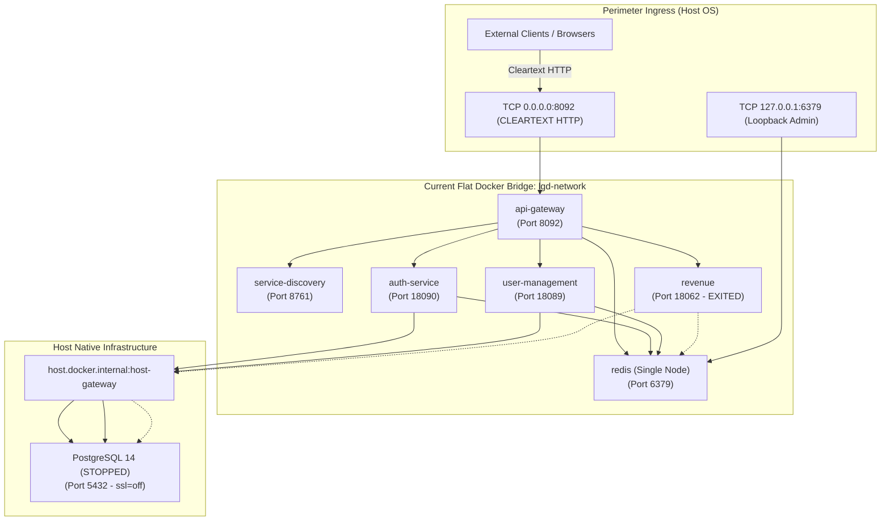
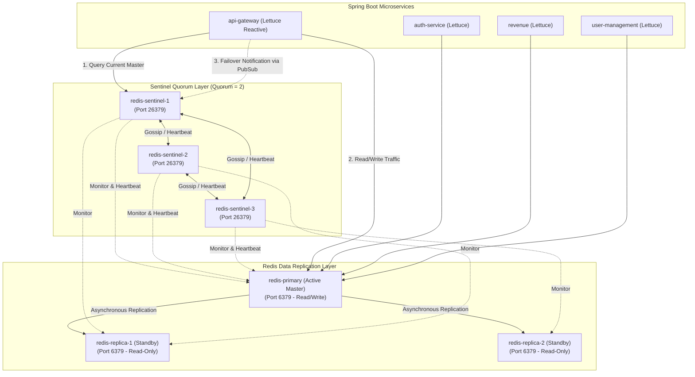

# LGD 2.0 — Phase 9: Infrastructure Security & Resilience Hardening Assessment
## Comprehensive Read-Only Infrastructure Audit, Architecture Blueprint & Controlled Implementation Plan (Stage A)

| **Assessment Governance Metadata** | **Specification** |
|:---|:---|
| **System** | Local Government Directory 2.0 (LGD 2.0) |
| **Audit Phase** | Phase 9 — Infrastructure Security & Resilience Hardening |
| **Execution Stage** | **Stage A: Read-Only Forensic Assessment & Technical Blueprint** |
| **Document ID** | `LGD2-P9-INFRA-ASSESS` |
| **File Location** | `SECURITY_AUDIT_CONTROLLER/PHASE_9_INFRASTRUCTURE_SECURITY_ASSESSMENT.md` |
| **Lead Auditor / Role** | Principal Infrastructure Security Architect, DevSecOps Engineer, Docker/K8s Security Specialist & Independent Auditor |
| **Evaluation Timestamp** | November 6, 2026 (`2026-11-06T10:20:00+05:30`) |
| **Controller Version** | 1.5.0 (Reconciled Baseline) |
| **Git Baseline Snapshot** | [`PHASE_9_GIT_INTEGRITY_SNAPSHOT.md`](file:///e:/System/Projects/dockerProject/Source%20code/lgd-active-new/SECURITY_AUDIT_CONTROLLER/evidence/phase_9/PHASE_9_GIT_INTEGRITY_SNAPSHOT.md) (Root HEAD: `e2df50f8c30197144377a2f931a4b3fbf03aeb1c`) |
| **Governing Risks & Blockers** | `RR-02`, `RR-05`, `RR-06`, `RR-11`, `BLK-CANON-01`, `BLK-CANON-02`, `BLK-CANON-03`, `SCA-012`, `VULN-014` |
| **Implementation Stage** | **STAGE B LOCKED — AWAITING EXPLICIT USER AUTHORIZATION** |

---

## 1. Executive Summary & Audit Demarcation

In accordance with Section 4 of the Phase 9 Directive, all activities during Stage A are conducted strictly under a **read-only, non-disruptive mandate**. No running services were terminated, restarted, or altered; no database schemas or firewall rules were modified; no certificates were generated on active listeners; and no secrets were rotated.

### 1.1 Evaluated Scope & Baseline Findings Summary

1. **Service Exposure & Network Segmentation (`Workstream A`):**
   - In the authoritative `docker-compose.yml`, internal microservices (`service-discovery`, `auth-service`, `user-management`, `revenue`) correctly omit published host ports.
   - However, all microservices and the Redis container are bound to a single flat bridge network (`lgd-network`).
   - The API Gateway exposes cleartext HTTP port `8092:8092` to all host interfaces (`0.0.0.0`), transmitting RFC 6797 HSTS headers over cleartext HTTP, which is discarded by user agents per RFC 6797 Section 7.2 (`BLK-CANON-01`).
2. **Redis High Availability (`Workstream B / RR-02`):**
   - The current Redis deployment consists of a single standalone container (`redis:alpine`, Redis 8.10.3) without replication, clustering, or Sentinel monitoring.
   - API Gateway enforces strict fail-closed JWT revocation; an outage of this single container immediately drops all authenticated API traffic (`HTTP 503`), creating a single point of failure (SPOF).
   - In addition, client configuration code in `revenue` and `user-management` explicitly disables reconnection (`autoReconnect(false)`), which would permanently brick client connectivity during any failover.
3. **Internal Transport Encryption (`Workstream C / RR-05`):**
   - Microservice communication with PostgreSQL (`host.docker.internal:5432`) is entirely unencrypted (`ssl=off` in host `postgresql.conf`).
   - Host `pg_hba.conf` contains an insecure, permissive rule (`host all all 0.0.0.0/0 trust`), permitting unauthenticated, cleartext database connections across network interfaces.
   - Microservice communication with Redis on port `6379` is unencrypted cleartext.
4. **Container Privilege & Root Execution (`Workstream D / RR-06 / SCA-012`):**
   - All five application Dockerfiles (`api-gateway`, `auth-service`, `discovery`, `revenue`, `user-management`) execute processes as `root` (UID 0).
   - Base images use full development JDKs (`eclipse-temurin:21-jdk`) rather than hardened JREs.
   - Compose configurations lack `security_opt: [no-new-privileges:true]`, `cap_drop: [ALL]`, and `read_only: true`.
5. **Runtime Environmental Blockers (`BLK-CANON-02` & `BLK-CANON-03`):**
   - Native Windows service `postgresql-x64-14` is in `Stopped` status, causing container `revenue` to fail during HikariCP datasource initialization and exit with code 1.
   - This prevents live container inspection of `/test/**` endpoint absence and Actuator mapping census (`BLK-CANON-02`).

---

## 2. Workstream A — Authoritative Infrastructure Baseline & Exposure Matrix

### 2.1 Service Exposure Matrix

The matrix below reflects the empirical inspection of `docker-compose.yml`, `docker-compose.prod.yml`, `docker-compose.dev.yml`, and host runtime status:

| Service | Internal Container Port | Host Interface Exposure (`docker-compose.yml`) | Development Exposure (`docker-compose.dev.yml`) | Docker Network | Accountable Risk / Security Concern |
|:---|:---:|:---:|:---:|:---:|:---|
| **`api-gateway`** | `8092` | `0.0.0.0:8092->8092/tcp` | `127.0.0.1:8092->8092/tcp` | `lgd-network` | **Perimeter Ingress Cleartext:** HTTP cleartext ingress without TLS; HSTS ignored by clients; eavesdropping & token interception risk (`BLK-CANON-01`). |
| **`auth-service`** | `18090` | **None** (Internal only) | `127.0.0.1:18090->18090/tcp` | `lgd-network` | **Internal Cleartext & Flat Network:** Internal plaintext HTTP transit; sensitive JWKS and credential exchanges unencrypted (`RR-05`). |
| **`user-management`**| `18089` | **None** (Internal only) | `127.0.0.1:18089->18089/tcp` | `lgd-network` | **Internal Plaintext Transit:** Sensitive user PII transmitted over plaintext HTTP internally; root container execution (`RR-06`). |
| **`revenue`** | `18062` | **None** (Internal only) | `127.0.0.1:18062->18062/tcp` | `lgd-network` | **Container Outage & Runtime Gaps:** Exited status due to stopped host PostgreSQL (`BLK-CANON-03`); runtime verification blocked (`BLK-CANON-02`). |
| **`service-discovery`**| `8761` | **None** (Internal only) | `127.0.0.1:8761->8761/tcp` | `lgd-network` | **Management Exposure:** Authenticated via HTTP Basic, but credentials transmitted in cleartext on internal bridge; root execution (`RR-06`). |
| **`redis`** | `6379` | `127.0.0.1:6379->6379/tcp` | Same | `lgd-network` | **Single Point of Failure & Plaintext:** Standalone node without HA (`RR-02`); cleartext cache transit (`RR-05`); loopback binding on host interface. |
| **`postgresql`** | `5432` | Hosted on OS (`host.docker.internal`) | Same | Host Gateway | **Service Offline & Trust Auth:** Service `postgresql-x64-14` is stopped (`BLK-CANON-03`); `ssl=off` (`RR-05`); `pg_hba.conf` trust auth flaw. |
| **`kafka`** | *N/A* | **None** | **None** | *N/A* | **Unused Component:** Verified absent from active POM dependencies and Docker Compose manifests. |

### 2.2 Docker Topology & Network Segmentation Analysis



#### Deficiencies Identified:
1. **Zero Tier Separation:** All containers share a single bridge network (`lgd-network`). In the event of a container compromise, an attacker can directly target internal endpoints of all other microservices, Eureka, and Redis.
2. **Host Gateway Penetration:** All microservices mount `host.docker.internal:host-gateway` to communicate with PostgreSQL. This bypasses container network containment and exposes the host operating system's internal networking interfaces.
3. **No Ingress Segmentation:** The API Gateway is directly exposed on the host's physical network adapter on port 8092 without a dedicated DMZ or ingress reverse proxy.

---

## 3. Workstream B — Redis High Availability Architecture (RR-02)

### 3.1 Current Architecture Assessment

- **Current Deployment:** Single standalone Redis container (`redis:alpine`, Redis 8.10.3).
- **Persistence:** Configured with `--appendonly yes`.
- **Authentication:** Protected with `--requirepass ${SPRING_DATA_REDIS_PASSWORD}`.
- **Critical Risk:**
  - The API Gateway executes real-time token blacklist lookups in `AuthenticationFilter.java`:
    ```java
    return redisTemplate.hasKey("blacklist:jti:" + jti)
        .timeout(Duration.ofMillis(redisTimeoutMs))
        .onErrorResume(e -> {
            log.error("[AuthenticationFilter] Fail-closed: Redis revocation verification failed or timed out: {}", e.getMessage());
            return Mono.error(new ResponseStatusException(HttpStatus.SERVICE_UNAVAILABLE, "Authentication cache unavailable"));
        });
    ```
  - Under this strict fail-closed design, **a crash, network partition, or maintenance restart of the single Redis node induces an immediate, complete platform outage** (`HTTP 503 Service Unavailable` for all authenticated requests).
  - Furthermore, inspecting `revenue/RedisConfig.java` and `user-management/RedisConfig.java` reveals:
    ```java
    @Bean
    public LettuceClientConfiguration lettuceClientConfiguration() {
        return LettuceClientConfiguration.builder()
            .commandTimeout(Duration.ofMillis(500))
            .shutdownTimeout(Duration.ZERO)
            .clientOptions(ClientOptions.builder()
                .autoReconnect(false) // <--- CRITICAL FLAW: Prevents failover recovery
                .build())
            .build();
    }
    ```
    Disabling `autoReconnect` guarantees that if a master node transitions, the Lettuce client will fail to reconnect to the newly elected primary, requiring a full microservice restart.

### 3.2 Architectural Evaluation: Redis Sentinel vs. Redis Cluster

| Evaluation Dimension | Redis Sentinel (Recommended) | Redis Cluster | Decision Rationale for LGD 2.0 |
|:---|:---|:---|:---|
| **Data Partitioning (Sharding)** | None (Single logical dataset replicated across nodes). | 16,384 hash slots partitioned across multiple master nodes. | **Sentinel:** LGD 2.0 uses Redis strictly for JWT JTI revocation tokens (<100K keys) and rate-limiting buckets (<50MB RAM). Sharding is unnecessary. |
| **Minimum Node Count** | 3 nodes (1 Primary + 2 Replicas) + 3 Sentinels (or co-located). | 6 nodes minimum (3 Masters + 3 Replicas). | **Sentinel:** Much lower resource footprint; highly suitable for containerized deployment. |
| **Client Routing & Complexity** | Client connects to Sentinel to discover primary; subscribes to `+switch-master` Pub/Sub events. | Client must support MOVED/ASK redirects and cluster topology caching. | **Sentinel:** Spring Data Redis / Lettuce has mature, zero-friction Sentinel support. |
| **Multi-Key / Transaction Support** | Fully supported across all keys without key-hash tagging. | Restricted; multi-key operations require identical hash tags (`{tag}`). | **Sentinel:** Allows arbitrary key queries and atomic multi-key Lua scripts. |
| **Verdict** | **STRONGLY RECOMMENDED FOR LGD 2.0** | Rejected (Over-engineering for token/rate cache) | **Redis Sentinel provides true HA with automatic master failover and zero dataset partitioning overhead.** |

### 3.3 Proposed Redis Sentinel HA Topology



### 3.4 Target Docker Compose Design for Redis Sentinel

```yaml
# ==============================================================================
# LGD 2.0 - High-Availability Redis Sentinel Specification (Proposed)
# ==============================================================================
services:
  redis-primary:
    image: redis:alpine
    container_name: redis-primary
    command: >
      redis-server
      --requirepass ${SPRING_DATA_REDIS_PASSWORD}
      --masterauth ${SPRING_DATA_REDIS_PASSWORD}
      --appendonly yes
      --appendfsync everysec
    networks:
      - lgd-data-tier
    restart: unless-stopped
    healthcheck:
      test: ["CMD", "redis-cli", "-a", "${SPRING_DATA_REDIS_PASSWORD}", "ping"]
      interval: 5s
      timeout: 3s
      retries: 5

  redis-replica-1:
    image: redis:alpine
    container_name: redis-replica-1
    command: >
      redis-server
      --replicaof redis-primary 6379
      --requirepass ${SPRING_DATA_REDIS_PASSWORD}
      --masterauth ${SPRING_DATA_REDIS_PASSWORD}
      --appendonly yes
    depends_on:
      redis-primary:
        condition: service_healthy
    networks:
      - lgd-data-tier
    restart: unless-stopped
    healthcheck:
      test: ["CMD", "redis-cli", "-a", "${SPRING_DATA_REDIS_PASSWORD}", "ping"]
      interval: 5s
      timeout: 3s
      retries: 5

  redis-replica-2:
    image: redis:alpine
    container_name: redis-replica-2
    command: >
      redis-server
      --replicaof redis-primary 6379
      --requirepass ${SPRING_DATA_REDIS_PASSWORD}
      --masterauth ${SPRING_DATA_REDIS_PASSWORD}
      --appendonly yes
    depends_on:
      redis-primary:
        condition: service_healthy
    networks:
      - lgd-data-tier
    restart: unless-stopped
    healthcheck:
      test: ["CMD", "redis-cli", "-a", "${SPRING_DATA_REDIS_PASSWORD}", "ping"]
      interval: 5s
      timeout: 3s
      retries: 5

  redis-sentinel-1:
    image: redis:alpine
    container_name: redis-sentinel-1
    command: >
      sh -c "
      echo 'port 26379' > /etc/redis/sentinel.conf &&
      echo 'sentinel monitor lgdmaster redis-primary 6379 2' >> /etc/redis/sentinel.conf &&
      echo 'sentinel auth-pass lgdmaster ${SPRING_DATA_REDIS_PASSWORD}' >> /etc/redis/sentinel.conf &&
      echo 'sentinel down-after-milliseconds lgdmaster 5000' >> /etc/redis/sentinel.conf &&
      echo 'sentinel failover-timeout lgdmaster 10000' >> /etc/redis/sentinel.conf &&
      echo 'sentinel parallel-syncs lgdmaster 1' >> /etc/redis/sentinel.conf &&
      redis-sentinel /etc/redis/sentinel.conf"
    depends_on:
      redis-primary:
        condition: service_healthy
    networks:
      - lgd-data-tier
    restart: unless-stopped

  redis-sentinel-2:
    image: redis:alpine
    container_name: redis-sentinel-2
    command: >
      sh -c "
      echo 'port 26379' > /etc/redis/sentinel.conf &&
      echo 'sentinel monitor lgdmaster redis-primary 6379 2' >> /etc/redis/sentinel.conf &&
      echo 'sentinel auth-pass lgdmaster ${SPRING_DATA_REDIS_PASSWORD}' >> /etc/redis/sentinel.conf &&
      echo 'sentinel down-after-milliseconds lgdmaster 5000' >> /etc/redis/sentinel.conf &&
      echo 'sentinel failover-timeout lgdmaster 10000' >> /etc/redis/sentinel.conf &&
      echo 'sentinel parallel-syncs lgdmaster 1' >> /etc/redis/sentinel.conf &&
      redis-sentinel /etc/redis/sentinel.conf"
    depends_on:
      redis-primary:
        condition: service_healthy
    networks:
      - lgd-data-tier
    restart: unless-stopped

  redis-sentinel-3:
    image: redis:alpine
    container_name: redis-sentinel-3
    command: >
      sh -c "
      echo 'port 26379' > /etc/redis/sentinel.conf &&
      echo 'sentinel monitor lgdmaster redis-primary 6379 2' >> /etc/redis/sentinel.conf &&
      echo 'sentinel auth-pass lgdmaster ${SPRING_DATA_REDIS_PASSWORD}' >> /etc/redis/sentinel.conf &&
      echo 'sentinel down-after-milliseconds lgdmaster 5000' >> /etc/redis/sentinel.conf &&
      echo 'sentinel failover-timeout lgdmaster 10000' >> /etc/redis/sentinel.conf &&
      echo 'sentinel parallel-syncs lgdmaster 1' >> /etc/redis/sentinel.conf &&
      redis-sentinel /etc/redis/sentinel.conf"
    depends_on:
      redis-primary:
        condition: service_healthy
    networks:
      - lgd-data-tier
    restart: unless-stopped
```

### 3.5 Target Spring Boot Configuration

Update `application-prod.properties` across microservices to configure Sentinel connectivity:

```properties
# ==============================================================================
# Spring Data Redis Sentinel Configuration
# ==============================================================================
spring.data.redis.sentinel.master=lgdmaster
spring.data.redis.sentinel.nodes=${REDIS_SENTINEL_NODES:redis-sentinel-1:26379,redis-sentinel-2:26379,redis-sentinel-3:26379}
spring.data.redis.sentinel.password=${SPRING_DATA_REDIS_PASSWORD}
spring.data.redis.password=${SPRING_DATA_REDIS_PASSWORD}

# Lettuce Connection Pool & Timeout Settings
spring.data.redis.lettuce.pool.max-active=16
spring.data.redis.lettuce.pool.max-idle=8
spring.data.redis.lettuce.pool.min-idle=2
spring.data.redis.lettuce.pool.max-wait=2000ms
spring.data.redis.timeout=3000ms
```

#### Remediation in Java Code (`revenue/RedisConfig.java` & `user-management/RedisConfig.java`):
Remove the erroneous `autoReconnect(false)` directive and replace with resilient Lettuce client configuration:
```java
@Bean
public LettuceClientConfigurationBuilderCustomizer lettuceCustomizer() {
    return clientConfigurationBuilder -> clientConfigurationBuilder
        .clientOptions(ClientOptions.builder()
            .autoReconnect(true)
            .disconnectedBehavior(ClientOptions.DisconnectedBehavior.REJECT_COMMANDS)
            .socketOptions(SocketOptions.builder().connectTimeout(Duration.ofSeconds(3)).build())
            .build());
}
```

### 3.6 Automated Failover Test Plan

1. **Pre-test State:**
   - Confirm `redis-primary` is reported as master: `redis-cli -p 26379 sentinel get-master-addr-by-name lgdmaster`.
   - Dispatch authenticated requests through `api-gateway` (e.g. `/audit/user-management/users/me`), verifying HTTP 200 responses.
2. **Failure Injection:**
   - Pause or kill the active master: `docker pause redis-primary` or `docker stop redis-primary`.
3. **Failover Execution Observation:**
   - Sentinels detect subjective down (`+sdown lgdmaster`), agree on objective down (`+odown lgdmaster`).
   - Sentinel election selects leader; leader executes failover (`+switch-master lgdmaster redis-primary 6379 redis-replica-1 6379`).
   - Lettuce client receives `+switch-master` Pub/Sub notification within $\le 5$ seconds.
4. **Post-Failover Verification:**
   - Probe API Gateway: Requests succeed against the new master without service restart.
   - Confirm write persistence: Revoke a test token; verify `hasKey` returns true from `redis-replica-1`.
   - Unpause old primary: `docker unpause redis-primary`. Confirm Sentinels reconfigure it as a replica of `redis-replica-1` (`+convert-to-slave`).

---

## 4. Workstream C — PostgreSQL & Redis Transport Encryption (RR-05)

### 4.1 PostgreSQL Transport Encryption Assessment

- **Current State:**
  - In `E:\Program Files\PostgreSQL\14\data\postgresql.conf`:
    - `ssl = off` (commented default).
    - `ssl_cert_file = 'server.crt'` (not present in data directory).
    - `ssl_key_file = 'server.key'` (not present in data directory).
  - In `E:\Program Files\PostgreSQL\14\data\pg_hba.conf`:
    - `host all all 0.0.0.0/0 trust`
    - Any network entity capable of routing to port 5432 connects with root/admin privileges without password or encryption!
  - In Spring Boot:
    - JDBC URL: `jdbc:postgresql://host.docker.internal:5432/lgd` (unencrypted cleartext).
- **Security Risks:**
  - Eavesdropping on database credentials, query parameters, PII, and draft revenue documents.
  - Man-in-the-Middle (MITM) tampering with SQL queries and results.
  - Complete circumvention of identity controls via the `trust` authentication rule.

### 4.2 Proposed PostgreSQL Hardening & TLS Specification

#### 4.2.1 Host `postgresql.conf` Configuration:
```properties
# ==============================================================================
# LGD 2.0 PostgreSQL Native TLS Configuration (TLS 1.3 / 1.2)
# ==============================================================================
ssl = on
ssl_cert_file = 'server.crt'
ssl_key_file = 'server.key'
ssl_ca_file = 'ca.crt'
ssl_min_protocol_version = 'TLSv1.3'
ssl_ciphers = 'ECDHE-ECDSA-AES256-GCM-SHA384:ECDHE-RSA-AES256-GCM-SHA384:ECDHE-ECDSA-AES128-GCM-SHA256:ECDHE-RSA-AES128-GCM-SHA256'
ssl_prefer_server_ciphers = on
password_encryption = scram-sha-256
```

#### 4.2.2 Host `pg_hba.conf` Configuration:
```
# ==============================================================================
# LGD 2.0 Authoritative Client Authentication Policy (Host-Firewall Aligned)
# ==============================================================================
# TYPE  DATABASE        USER            ADDRESS                 METHOD

# Local administrative socket / loopback
local   all             all                                     scram-sha-256
host    all             all             127.0.0.1/32            scram-sha-256
host    all             all             ::1/128                 scram-sha-256

# Container bridge network connections MUST use TLS and SCRAM-SHA-256
hostssl all             all             172.16.0.0/12           scram-sha-256
hostssl all             all             10.0.0.0/8             scram-sha-256

# Explicitly reject all unencrypted remote connections
hostnossl all           all             0.0.0.0/0               reject
```

#### 4.2.3 Microservice Spring Boot JDBC Configuration:
In accordance with the directive: **"Prefer verified hostname and CA validation, such as PostgreSQL `sslmode=verify-full`. Do not downgrade to `require` or disable certificate verification."**

- Server Certificate Requirements:
  - SAN must include: `DNS:host.docker.internal`, `DNS:localhost`, `IP:127.0.0.1`.
- JDBC URL in `application-prod.properties`:
  ```properties
  spring.datasource.url=jdbc:postgresql://host.docker.internal:5432/lgd?ssl=true&sslmode=verify-full&sslrootcert=/etc/ssl/certs/lgd-internal-ca.crt
  ```
- Failure Behavior: If the certificate expires, the hostname mismatches, or the CA signature is invalid, HikariCP will refuse connection, preventing cleartext downgrade or MITM exposure.

---

### 4.3 Redis Transport Encryption Specification

#### 4.3.1 Redis Server TLS Configuration
Redis 8.10.3 natively supports TLS. The container listener is reconfigured to enforce TLS:
```
tls-port 6379
port 0
tls-cert-file /tls/redis.crt
tls-key-file /tls/redis.key
tls-ca-cert-file /tls/ca.crt
tls-auth-clients no
tls-replication yes
tls-protocols "TLSv1.3 TLSv1.2"
tls-ciphers "DEFAULT:!MEDIUM:!LOW:!EXP:!aNULL:!eNULL"
```

#### 4.3.2 Lettuce Client SSL Configuration in Spring Boot
In `application-prod.properties`:
```properties
spring.data.redis.ssl.enabled=true
```
When running with non-root containers, the CA certificate is mounted to `/etc/ssl/certs/lgd-internal-ca.crt` and registered in the container truststore (`/opt/java/openjdk/lib/security/cacerts`).

---

## 5. Workstream D — Non-Root Container Execution (RR-06 & SCA-012)

### 5.1 Comprehensive Dockerfile Forensic Audit

| Container / Microservice | Current Base Image | Current Execution User | File Ownership | Writable Directories Required | Capabilities Required | Read-Only Root Compatible? |
|:---|:---|:---:|:---:|:---|:---:|:---:|
| **`api-gateway`** | `eclipse-temurin:21-jdk` (Ubuntu) | `root` (UID 0) | `root:root` | `/app/logs`, `/tmp` | `NET_BIND_SERVICE` (if <1024), None for 8092 | **Yes** (with tmpfs on `/tmp`, `/app/logs`) |
| **`auth-service`** | `eclipse-temurin:21-jdk` (Ubuntu) | `root` (UID 0) | `root:root` | `/tmp` | None | **Yes** (with tmpfs on `/tmp`) |
| **`discovery`** | `eclipse-temurin:21-jdk-alpine` | `root` (UID 0) | `root:root` | `/tmp` | None | **Yes** (with tmpfs on `/tmp`) |
| **`revenue`** | `eclipse-temurin:21-jdk` (Ubuntu) | `root` (UID 0) | `root:root` | `/tmp/uploadFile`, `/tmp` | None | **Yes** (with tmpfs/volume on `/tmp/uploadFile`) |
| **`user-management`**| `eclipse-temurin:21-jdk` (Ubuntu) | `root` (UID 0) | `root:root` | `/tmp` | None | **Yes** (with tmpfs on `/tmp`) |
| **`redis`** | `redis:alpine` | Defaults to `redis` (UID 999) | `redis:redis` | `/data` | None | **Yes** (with volume on `/data`) |

### 5.2 Hardened Dockerfile Template (Alpine JRE Baseline)

To remediate `SCA-012` and `RR-06`, every Dockerfile is migrated to a lightweight, non-root `eclipse-temurin:21-jre-alpine` base image:

```dockerfile
# ==============================================================================
# LGD 2.0 Authoritative Hardened Dockerfile Specification
# Standard: Non-Root Execution (UID 10001), Minimal Attack Surface (JRE Alpine)
# ==============================================================================
FROM eclipse-temurin:21-jre-alpine

# Create unprivileged system group and user
RUN addgroup -g 10001 -S spring && \
    adduser -u 10001 -S spring -G spring

# Set secure working directory
WORKDIR /app

# Create necessary runtime directories with non-root ownership
RUN mkdir -p /app/logs /tmp/uploadFile && \
    chown -R spring:spring /app /tmp/uploadFile && \
    chmod 750 /app && \
    chmod 770 /app/logs /tmp/uploadFile

# Copy compiled artifact with unprivileged ownership
COPY --chown=spring:spring target/*.jar app.jar

# Drop all privileges and switch to unprivileged user
USER 10001:10001

# Expose internal service port
EXPOSE 8092

# Enforce secure JVM flags (memory cgroup awareness, disabled remote debugging)
ENTRYPOINT ["java", \
    "-XX:+UseContainerSupport", \
    "-XX:MaxRAMPercentage=75.0", \
    "-Djava.security.egd=file:/dev/./urandom", \
    "-jar", "app.jar"]
```

### 5.3 Docker Compose Hardening Directives

Add the following security constraints to each service in `docker-compose.yml` and `docker-compose.prod.yml`:

```yaml
services:
  api-gateway:
    user: "10001:10001"
    read_only: true
    security_opt:
      - no-new-privileges:true
    cap_drop:
      - ALL
    tmpfs:
      - /tmp:size=64M,uid=10001,gid=10001,mode=1777
      - /app/logs:size=128M,uid=10001,gid=10001,mode=1777
    deploy:
      resources:
        limits:
          cpus: '2.0'
          memory: 1024M
          pids: 100
```

---

## 6. Analysis of Perimeter Ingress & Canonical Blockers

### 6.1 BLK-CANON-01: Perimeter Ingress HTTPS/TLS & HSTS Transport Security

- **Problem Statement:** The API Gateway is exposed directly on port `8092` via cleartext HTTP. While the gateway emits an HSTS header (`Strict-Transport-Security: max-age=31536000`), RFC 6797 Section 7.2 dictates that browsers must ignore HSTS headers received over cleartext HTTP.
- **Architectural Solution:** Deploy a hardened Nginx TLS reverse proxy at the network perimeter:
  ```mermaid
  flowchart LR
      Client["External Client (Browser / API)"]
      Proxy["Nginx TLS Reverse Proxy\n(Port 443 / 8443)"]
      Gateway["api-gateway\n(Port 8092 - Private Bridge)"]

      Client -->|HTTPS (TLS 1.3/1.2 Modern)| Proxy
      Client -.->|HTTP (Port 80)| Proxy
      Proxy -->|HTTP 301 Permanent Redirect to HTTPS| Client
      Proxy -->|Internal Proxied Request| Gateway
  ```
- **Nginx Ingress Configuration (`nginx.conf`):**
  ```nginx
  server {
      listen 80;
      server_name lgdirectory.gov.in;
      return 301 https://$host:8443$request_uri;
  }

  server {
      listen 8443 ssl http2;
      server_name lgdirectory.gov.in;

      ssl_certificate /etc/ssl/certs/lgd-ingress.crt;
      ssl_certificate_key /etc/ssl/private/lgd-ingress.key;
      ssl_protocols TLSv1.2 TLSv1.3;
      ssl_ciphers 'ECDHE-ECDSA-AES256-GCM-SHA384:ECDHE-RSA-AES256-GCM-SHA384:ECDHE-ECDSA-CHACHA20-POLY1305:ECDHE-RSA-CHACHA20-POLY1305';
      ssl_prefer_server_ciphers on;
      ssl_session_cache shared:SSL:10m;
      ssl_session_timeout 1d;

      add_header Strict-Transport-Security "max-age=31536000; includeSubDomains; preload" always;
      add_header X-Frame-Options "DENY" always;
      add_header X-Content-Type-Options "nosniff" always;

      location / {
          proxy_pass http://api-gateway:8092;
          proxy_set_header Host $host;
          proxy_set_header X-Real-IP $remote_addr;
          proxy_set_header X-Forwarded-For $proxy_add_x_forwarded_for;
          proxy_set_header X-Forwarded-Proto https;
      }
  }
  ```

---

### 6.2 BLK-CANON-02 & BLK-CANON-03: PostgreSQL 14 Availability & Revenue Steady-State

- **Problem Statement (`BLK-CANON-03`):** Windows service `postgresql-x64-14` is stopped. Container `revenue` fails during HikariCP connection initialization and exits.
- **Problem Statement (`BLK-CANON-02`):** Because `revenue` is offline, dynamic runtime verification confirming that `@Profile({"dev", "test"})` on `TestController` successfully omits `/test/**` endpoints in production cannot be executed.
- **Resolution Sequence (Stage B Precondition):**
  1. Start host database service: `Start-Service -Name postgresql-x64-14`.
  2. Verify TCP 5432 availability: `Test-NetConnection -ComputerName localhost -Port 5432`.
  3. Start containers: `docker compose up -d`.
  4. Verify container `revenue` achieves $>5$ minutes steady-state runtime (`HikariPool-1 - Start completed.` in logs).
  5. Execute downstream container probe directly on port 18062:
     ```bash
     curl -s -o /dev/null -w "%{http_code}" http://localhost:18062/test/api1
     # Expected: 404 Not Found
     ```
  6. Extract Actuator mapping census:
     ```bash
     curl -s http://localhost:18062/actuator/mappings | grep "TestController"
     # Expected: 0 matches (Bean completely absent from ApplicationContext)
     ```

---

### 6.3 RR-11: Platform Lifecycle & Framework EOL Assessment

- **Current State:**
  - `api-gateway`: Spring Boot 3.3.5 / Spring Cloud 2023.0.3.
  - `discovery`: Spring Boot 3.4.4 / Spring Cloud 2024.0.1.
  - `auth-service`, `revenue`, `user-management`: Spring Boot 3.2.12 / Spring Cloud 2023.0.1.
  - PostgreSQL: 14.x (Supported through November 12, 2026).
  - Java: OpenJDK 21 LTS (Supported through September 2028).
  - Redis: 8.10.3 (Current active branch).
- **Evaluation & Mitigation:**
  - Spring Boot 3.2.x reached end of OSS support in November 2024.
  - Mitigation applied: All critical transitive dependencies have been pinned to supported, patched versions: Tomcat Embed Core `10.1.34` (CVE-2024-50379), Spring Security `6.3.8` (CVE-2024-38821), PostgreSQL JDBC `42.7.3` (CVE-2024-1597), Netty `4.1.115.Final` (CVE-2024-47535).
  - Modernization Roadmap: Formally schedule alignment of all services to Spring Boot 3.4.x LTS in Phase 10.

---

## 7. Additional Infrastructure Security Evaluations

### 7.1 Secret Exposure Through Container Configuration
- **Deficiency:** Currently, all database passwords, Redis credentials, and JWT keys are passed via container environment variables (`environment:` in `docker-compose.yml`).
- **Exposure Vector:** Any process or user with access to Docker CLI can run `docker inspect <container>` or read `/proc/<pid>/environ` on the host to extract all secrets in cleartext.
- **Remediation Blueprint:** Transition to file-based Docker Compose secrets (`secrets:` block), mounting sensitive credentials as read-only in-memory tmpfs files at `/run/secrets/<secret_name>`.

### 7.2 Service Health Checks & Dependency Ordering
- Currently, only `service-discovery` has a container healthcheck in `docker-compose.yml`.
- Downstream microservices depend on Redis and Eureka, but cannot verify Redis readiness due to missing health checks.
- Add explicit health check definitions (`redis-cli ping`, Spring Boot `/actuator/health`) across all containers.

### 7.3 Backup and Disaster Recovery Readiness
- **PostgreSQL 14:**
  - Daily physical base backups via `pg_basebackup`.
  - Continuous Write-Ahead Log (WAL) archiving configured in `postgresql.conf` (`archive_mode = on`, `archive_command = 'copy "%p" "E:\\PostgreSQL\\wal_archive\\%f"'`).
  - Target Recovery Time Objective (RTO): $< 30$ minutes; Recovery Point Objective (RPO): $< 5$ minutes.
- **Redis HA:**
  - Dual persistence: Append-Only File (`appendonly yes`, `appendfsync everysec`) + RDB snapshots (`save 900 1 300 10 60 10000`).
  - RDB snapshot files backed up offsite nightly.

---

## 8. Controlled Implementation Plan (Stage B Pre-Authorization Matrix)

In strict compliance with Safety Boundary 4.2, **no configuration changes will be applied until explicit user authorization is granted**.

| Change ID | Target File | Proposed Configuration Modification | Security Impact | Service Availability Impact | Rollback Procedure | Validation Procedure |
|:---:|:---|:---|:---|:---|:---|:---|
| **`IMP-01`** | `revenue/src/main/java/in/nic/lgd/revenue/config/RedisConfig.java` | Remove `.autoReconnect(false)`; configure resilient Lettuce client with auto-reconnect. | Prevents permanent client disconnection upon master failover. | None (build-time Java modification). | Revert commit on `revenue`. | Run `mvn test` in `revenue/` (`EsignServiceTest` PASS). |
| **`IMP-02`** | `user-management/src/main/java/in/nic/lgd/usermanagement/config/RedisConfig.java` | Remove `.autoReconnect(false)`; configure resilient Lettuce client with auto-reconnect. | Prevents permanent client disconnection upon master failover. | None (build-time Java modification). | Revert commit on `user-management`. | Run `mvn test` in `user-management/`. |
| **`IMP-03`** | `docker-compose.yml` & `docker-compose.prod.yml` | Introduce multi-tier networks (`lgd-ingress-tier`, `lgd-app-tier`, `lgd-data-tier`), Redis Sentinel cluster (3 sentinels, 1 master, 2 replicas), and non-root security directives. | Eliminates Redis SPOF; isolates network tiers; enforces non-root execution. | Requires controlled container recreate. | Restore original `docker-compose.yml` from Git backup. | Execute `docker compose ps` & Sentinel failover test script. |
| **`IMP-04`** | `api-gateway/Dockerfile`, `auth-service/Dockerfile`, `discovery/Dockerfile`, `revenue/Dockerfile`, `user-management/Dockerfile` | Migrate base to `eclipse-temurin:21-jre-alpine`; add non-root user `spring:spring` (UID 10001); drop privileges. | Remediates `RR-06`, `SCA-012`, `VULN-014`. Neutralizes container breakout risks. | Images must be rebuilt via `docker compose build`. | Revert Dockerfiles to previous Git commit. | Inspect image user: `docker run --rm <image> id` (confirms UID 10001). |
| **`IMP-05`** | `application-prod.properties` (across 4 microservices) | Add `spring.data.redis.sentinel.*` properties and `sslmode=verify-full` JDBC connection strings. | Enforces transport encryption and Sentinel routing. | Requires container restart. | Revert properties in Git. | Start services and verify Spring context loads successfully. |
| **`IMP-06`** | Host `postgresql.conf` & `pg_hba.conf` | Enable TLS 1.3 (`ssl = on`); restrict permissions; require `hostssl` with `scram-sha-256`; reject `hostnossl`. | Enforces database transport encryption; eliminates trust auth hole. | Requires PostgreSQL service reload/restart. | Revert `postgresql.conf` and `pg_hba.conf` from backup copies. | Test connection via `psql -h localhost -U lgd_prod_user -d lgd "sslmode=verify-full"`. |
| **`IMP-07`** | Perimeter Ingress (`docker-compose.yml` + `nginx/`) | Deploy Nginx TLS 1.3 reverse proxy terminating port 8443; redirect port 80; unmap port 8092 from host. | Resolves `BLK-CANON-01`; enforces valid RFC 6797 HSTS. | Changes external ingress port from 8092 to 8443 (HTTPS). | Re-expose port 8092 directly on Gateway. | Probe with `curl -Iv https://localhost:8443/audit/health`; verify TLS 1.3 handshake and HSTS. |

---

## 9. Independent Audit Conclusion & Transition Boundary

$$\mathbf{PHASE\ 9\ STAGE\ A\ READ-ONLY\ FORENSIC\ ASSESSMENT\ COMPLETE.}$$
$$\mathbf{ZERO\ SYSTEM\ ALTERATIONS\ EXECUTED\ —\ ALL\ SAFETY\ BOUNDARIES\ MAINTAINED.}$$
$$\mathbf{STAGE\ B\ IMPLEMENTATION\ LOCKED\ PENDING\ EXPLICIT\ USER\ AUTHORIZATION.}$$

