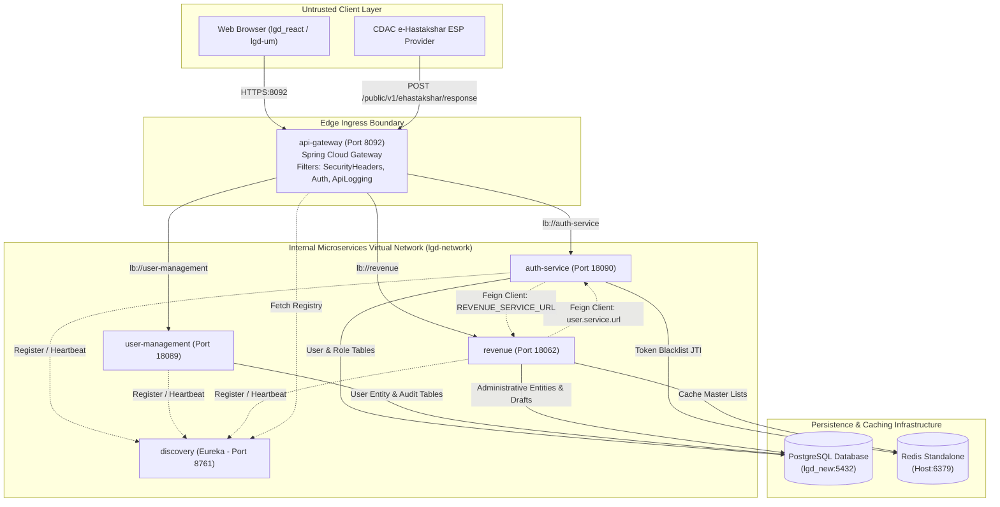

# LGD 2.0 - Security Architecture Inventory

| **Document Version** | 1.0.0 |
| **Audit Phase** | Phase 0: Project Discovery & Security Baseline |
| **System** | Local Government Directory (LGD 2.0) |
| **Classification** | OFFICIAL / CONFIDENTIAL |
| **Standards** | OWASP Top 10, OWASP API Top 10, NIST SP 800-53, CERT-In |

---

## 1. System Overview & Context

The **Local Government Directory (LGD 2.0)** is an enterprise government system providing the single source of truth for administrative and revenue units across the Republic of India (States, Districts, Sub-Districts/Tehsils, Blocks, Gram Panchayats, and Villages).

The architecture is implemented as a distributed Spring Boot / Spring Cloud microservices ecosystem deployed in containerized Docker environments, interfacing with high-volume relational databases, in-memory caches, electronic signature providers, and modern single-page frontend dashboards.

---

## 2. Comprehensive Module Inventory

| Module Name | Technology Stack | Port | Runtime Role | Repository Path |
|---|---|---|---|---|
| **discovery** | Java 21, Spring Cloud Netflix Eureka | 8761 | Service Discovery & Registry | `discovery/` |
| **api-gateway** | Java 21, Spring Cloud Gateway (Reactive) | 8092 | Edge Ingress, JWT Validation, Audit Logging | `api-gateway/` |
| **auth-service** | Java 21, Spring Boot 3.3, Spring Security 6 | 18090 | Identity Provider, Authentication, Redis Token Blacklist | `auth-service/` |
| **user-management** | Java 21, Spring Boot, Spring Data JPA | 18089 | User CRUD, Hierarchy, RBAC Mappings, Audit History | `user-management/` |
| **revenue** | Java 21, Spring Boot, Spring Data JPA | 18062 | Land Revenue Entities, Draft Workflows, e-Hastakshar | `revenue/` |
| **lgd-um** | React, Vite, Tailwind CSS | 5173 / Client | Frontend User Management Administration Portal | `lgd-um/` |
| **lgd_react** | React 19, TypeScript, Vite, Redux | 4200 / Client | Nodal Officer Dashboard & Administrative Console | `lgd_react/` |
| **PostgreSQL** | PostgreSQL 14+ (`lgd_new`) | 5432 | Primary Relational Persistence Store | Database host |
| **Redis** | Redis 6/7 Standalone | 6379 | Distributed Token Revocation Blacklist & Caching | In-memory store |

### 2.1 Scope & Verification of Optional Modules
- **Kafka / Event Streaming:** **ABSENT**. Inspected repository; no Kafka dependencies, configuration properties, producers, consumers, or container services are present.
- **Mobile Applications (Android / Flutter):** **ABSENT**. Inspected repository; no mobile source trees (Java/Kotlin Android or Dart/Flutter) exist in this repository.
- **CI/CD Pipelines:** **ABSENT**. Inspected repository; no GitHub Actions (`.github/workflows`), GitLab CI (`.gitlab-ci.yml`), or Jenkinsfile pipelines are committed in this repository.

---

## 3. Inter-Service Communication Topology

---

## 4. Trust Boundaries & Demarcation Analysis

### Trust Boundary 1: External Client to API Gateway (Edge Perimeter)
- **Ingress Protocol:** HTTP/HTTPS over port 8092.
- **Controls Applied:**
  - Route validation determining public vs. secured paths (`RouteValidator`).
  - Bearer JWT extraction and cryptographic signature validation (`AuthenticationFilter`).
  - Response header injection (`SecurityHeadersFilter`).
  - Access logging with header sanitization (`ApiLoggingFilter`).

### Trust Boundary 2: API Gateway to Internal Microservices
- **Communication Protocol:** Internal container bridge network (`lgd-network`) using Eureka service discovery lookup.
- **Security Assessment:**
  - Downstream microservices (`auth-service`, `user-management`, `revenue`) execute independent secondary security filters (`JwtAuthenticationFilter`).
  - *Identified Gap:* Internal container ports (8761, 18090, 18089, 18062) were mapped to host interfaces in `docker-compose.yml`, allowing potential edge bypass if host interfaces are unsegmented.

### Trust Boundary 3: Internal Microservice-to-Microservice (East-West)
- **Protocol:** Spring Cloud OpenFeign over HTTP.
  - `revenue` calls `auth-service` via `${USER_SERVICE_URL}`.
  - `auth-service` calls `revenue` via `${REVENUE_SERVICE_URL}`.
- **Security Assessment:** Calls traverse unauthenticated internal HTTP channels without mutual TLS (mTLS) or service-to-service service tokens.

### Trust Boundary 4: Microservices to Data Persistence
- **PostgreSQL Connection:** HikariCP JDBC over TCP (Port 5432).
  - *Identified Gap:* Connection string and credentials (`postgres@206`) committed in plaintext across multiple `application.properties` files.
- **Redis Connection:** Lettuce / Jedis over TCP (Port 6379).
  - *Identified Gap:* Redis connection configured without password authentication (`requirepass` not enforced).

### Trust Boundary 5: Revenue Service to External ESP (CDAC e-Hastakshar)
- **Outbound:** Multipart form POST transmitting SHA-256 pre-hashed PDF byte ranges and signed XML requests to `${esign.esp.url}`.
- **Inbound Callback:** `POST /public/v1/ehastakshar/response` consuming application/x-www-form-urlencoded XML signatures.
  - *Identified Gap:* Unauthenticated public callback; required strict XML-DSig signature verification and XXE protection.

---

## 5. Sensitive Data Flows

### Flow 1: Authentication & Token Issuance
1. Client POSTs credentials (`username`, `password`) to Gateway `/audit/auth/public/v1/auth/login`.
2. Gateway routes request to `auth-service`.
3. `auth-service` queries PostgreSQL table `users` by `user_login_id`, active status, and non-deleted flags.
4. Password verified against `password_hash` using BCrypt.
5. `auth-service` retrieves assigned active roles and privileges.
6. Nimbus JWT signed with HS256 using `jwt.secret`. JWT payload embeds `userId`, `userType`, `stateCode`, `districtCode`, `roleId`, `roleTypeCode`, `roleLevelCode`, and `privileges`.
7. `auth-service` issues token response with TTL (default 24h / 86400000ms).

### Flow 2: Authenticated API Request Execution
1. Client submits request with `Authorization: Bearer <JWT>` to `/audit/revenue/private/v1/...`.
2. Gateway `AuthenticationFilter` validates token signature, expiration, and extracts claims.
3. Gateway verifies path against required privileges.
4. Gateway forwards request to downstream microservice.
5. Microservice `JwtAuthenticationFilter` re-validates token, constructs `UserContext` principal, and sets `SecurityContextHolder`.
6. Controller and service execute business logic using `UserContext`.

### Flow 3: Electronic Signature (e-Hastakshar) Lifecycle
1. Authorized officer submits PDF document to `POST /private/v1/ehastakshar/initiate`.
2. `revenue` calculates PDF byte range, embeds visual signature placeholder, and computes SHA-256 hash.
3. XML request constructed with transaction ID and digitally signed using server keystore (`PKCS12`).
4. Client receives signed XML payload and is redirected to CDAC ESP portal.
5. User completes Aadhaar OTP / biometric verification at ESP.
6. ESP POSTs response XML with PKCS#7 signature block to `/public/v1/ehastakshar/response`.
7. `revenue` verifies XML-DSig signature, verifies transaction status, injects PKCS#7 signature into PDF byte range, and records signed government order.
