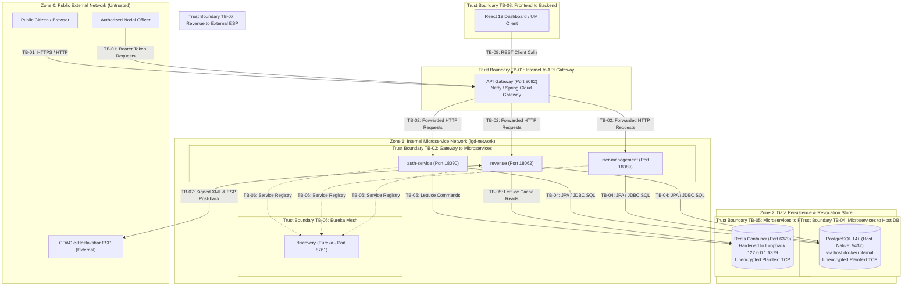

# LGD 2.0 - Trust Boundary Analysis Report

| **Document Version** | 1.0.0 |
| **Audit Phase** | Phase 1: Threat Modeling & Trust Boundary Analysis |
| **System** | Local Government Directory (LGD 2.0) |
| **Classification** | CONFIDENTIAL / GOVERNMENT AUDIT |
| **Methodology** | OWASP Threat Modeling, STRIDE, NIST SP 800-53, Zero Trust Principles |

---

## 1. Executive Summary

In a modern microservices architecture, security cannot rely on an antiquated "hardened perimeter, trusted interior" model. This Trust Boundary Analysis inspects all 8 operational demarcations in the Local Government Directory (LGD 2.0) platform where data transitions across differing levels of privilege, encryption, or administrative trust.

Each boundary is evaluated for entry mechanisms, protocol security, trust assumptions, threats, and defensive gaps identified through direct source code inspection.

---

## 2. Global Trust Boundary Map

---

## 3. In-Depth Trust Boundary Analysis

### TB-01: Internet to API Gateway (External Perimeter)

- **Demarcation:** Transitions traffic from untrusted public Internet / client browsers to the `api-gateway` edge service (Port 8092).
- **Protocols & Transports:** HTTP/1.1, HTTP/2 over TLS (or unencrypted HTTP on development/staging ports).
- **Assets Exposed at Boundary:** Gateway routes, OpenAPI documentation (`/audit/docs`), authentication endpoint (`/audit/auth/public/v1/auth/login`), public master directory data, eSign response webhook (`/public/v1/ehastakshar/response`).
- **Trust Assumptions in Baseline:** 
  - Assumption that ingress requests are arriving over TLS.
  - Assumption that public requests can be identified exclusively via path string matching in `RouteValidator`.
- **Threat Vector Analysis:**
  1. *Unauthorized Endpoint Access:* Misconfigured path patterns in `RouteValidator.openApiEndPoints` could allow unauthorized users to bypass `AuthenticationFilter`. (Verified in baseline: `/audit/auth/**` was previously wild-carded, exempting all auth service sub-routes).
  2. *Denial of Service & API Flooding:* The gateway currently lacks distributed rate limiting (no Redis-backed `RequestRateLimiter` filter configured in routes), allowing automated credential-stuffing and volumetric resource exhaustion.
  3. *Request & Header Manipulation:* Attackers can submit spoofed headers (`X-Forwarded-For`, `User-Agent`, malformed `Authorization` headers) to manipulate logging or tamper with client IP tracking.
  4. *Large Payload Uploads:* While downstream `revenue` caps multipart files at 10MB, the Gateway itself does not strictly enforce an early HTTP body buffer ceiling before reading chunked requests.
- **Defensive Posture & Status:**
  - `SecurityHeadersFilter` deployed injecting browser hardening headers (`X-Content-Type-Options: nosniff`, `X-Frame-Options: DENY`, `X-XSS-Protection: 1; mode=block`, `Referrer-Policy: strict-origin-when-cross-origin`).
  - `RouteValidator` narrowed to ensure only strictly public paths are exempt from authentication.

---

### TB-02: API Gateway to Internal Microservices (Edge to Mesh)

- **Demarcation:** Transitions traffic from the API Gateway to downstream internal microservices (`auth-service:18090`, `user-management:18089`, `revenue:18062`) over `lgd-network`.
- **Protocols & Transports:** Plaintext HTTP via Spring Cloud Gateway Netty routing and Eureka discovery resolution.
- **Assets Exposed at Boundary:** Internal REST APIs, serialized JSON entities, downstream authentication filters.
- **Trust Assumptions in Baseline:**
  - Assumption that any request reaching a microservice was pre-validated by the Gateway.
  - Assumption that the internal network cannot be sniffed or accessed by unauthorized actors.
- **Threat Vector Analysis:**
  1. *Gateway Perimeter Bypass:* Internal microservice ports (18090, 18089, 18062, 8761) were exposed to host interfaces in `docker-compose.yml`, enabling attackers on the local or corporate network to query services directly, completely bypassing gateway authentication and logging filters.
  2. *Header Injection & Identity Spoofing:* If an internal microservice trusts incoming HTTP headers without verifying JWT signatures, an attacker bypassing the gateway can inject arbitrary user context headers. (Source inspection confirmed downstream services execute independent `JwtAuthenticationFilter` instances, which mitigates header spoofing).
  3. *Token Revocation Bypass:* When `auth-service` blacklists a revoked token in Redis upon logout, `api-gateway` does not query Redis to check revocation status. As long as the JWT signature is valid and not expired, the Gateway forwards the request downstream.
- **Defensive Posture & Status:**
  - Host port exposures identified for closure; all microservices must run strictly on internal container bridge.
  - Microservices enforce local token validation; Redis blacklist verification must be integrated into Gateway `AuthenticationFilter`.

---

### TB-03: User to Organizational Data (Tenant Isolation & Authorization)

- **Demarcation:** Transitions authenticated officer identity context (`UserContext`: `userId`, `stateCode`, `districtCode`, `roleId`) to persistent government entities (States, Districts, Sub-districts, Drafts, Users).
- **Protocols & Transports:** JVM memory / Spring Security context (`SecurityContextHolder.getContext().getAuthentication()`).
- **Assets Exposed at Boundary:** National land directory data, administrative draft transactions, government order PDFs, user account records.
- **Trust Assumptions in Baseline:**
  - False Assumption: Authenticated state officers will only interact with resources in their own state jurisdiction.
  - False Assumption: The frontend will prevent users from submitting draft IDs or user IDs outside their authorized district or state.
- **Threat Vector Analysis:**
  1. *Broken Object Level Authorization (BOLA / IDOR):* Endpoints accepting user-controlled path parameters or form keys without checking ownership. (Verified: `DistrictServiceImpl.publishCreateDistrict` previously accepted `draftCode` without verifying `districtDraft.getStateCode() == userContext.getStateCode()`).
  2. *State-to-State Data Tampering:* An officer authorized in State 10 could publish, modify, or delete administrative draft orders for State 20.
  3. *Privilege Escalation via Role Modification:* In `UserServiceImpl.updateUser`, an authenticated caller could provide a new `specificRoleId` in `UpdateUserDto` to elevate arbitrary user accounts to administrative tiers.
  4. *Missing Method-Level Access Controls:* Controllers relied exclusively on `.anyRequest().authenticated()` in the security filter chain, omitting `@PreAuthorize("hasAuthority(...)")` method security.
- **Defensive Posture & Status:**
  - Implemented explicit state ownership checks in `DistrictServiceImpl.java`.
  - `@EnableMethodSecurity` active; declarative method-level authorization mapped in remediation roadmap.

---

### TB-04: Microservices to PostgreSQL (Persistence Boundary)

- **Demarcation:** Transitions SQL commands and database transactions from microservices to PostgreSQL. **Actual Runtime Topology:** PostgreSQL 14 is installed natively on the Host OS (`listen_addresses = '*'`, configured to listen on `0.0.0.0:5432` / `[::]:5432` when active). Containerized backend microservices route out of the Docker bridge network to the host via `jdbc:postgresql://host.docker.internal:5432/lgd`. At audit time, the host PostgreSQL service is stopped (State: Stopped). When active, effective Windows Firewall inbound rules (`Rule: PostgreSQL Server`) allow traffic on port 5432 across Public network profiles, exposing the database to the local area network unless restricted.
- **Protocols & Transports:** JDBC over plaintext TCP via HikariCP connection pool; Hibernate ORM / Spring Data JPA. **Unencrypted plaintext transit** (no `sslmode=require`).
- **Assets Exposed at Boundary:** All database tables (`users`, `user_history`, `district_draft`, `subdistrict_draft`, `attachment`, `ws_access_log`, master tables).
- **Trust Assumptions in Baseline:**
  - Assumption that database traffic on the bridge gateway (`host.docker.internal`) does not require TLS encryption.
  - Assumption that application database users possess appropriate least-privilege permissions.
- **Threat Vector Analysis:**
  1. *Host Port Exposure & Firewall Permissiveness (RR-05):* Host PostgreSQL binding `0.0.0.0:5432` combined with a permissive Windows Firewall Public profile inbound rule permits external network clients to reach the database port directly. Access must be restricted by tightening the Windows Firewall inbound rule to Docker's virtual gateway/subnet (`172.16.0.0/12`), preserving `host.docker.internal` routing while blocking LAN/WAN access.
  2. *Unencrypted Network Transit (RR-05):* Database connections lack `sslmode=require` / `sslmode=verify-full`, allowing network eavesdroppers on the host/bridge to inspect database queries, password hashes, and user records in transit.
  3. *Excessive Database Privileges:* Applications connect using the administrative `postgres` superuser account rather than an unprivileged role restricted to application schemas.
  4. *ORM / SQL Injection:* Audited custom repositories (`CreateDistrictRepositoryImpl`, `ChangeNameSubdistrictRepositoryImpl`, `DistrictDraftRepository`). All native queries use prepared parameters (`:p_state_code`, `:districtCode`), mitigating direct SQL injection (`EV-021`).
- **Defensive Posture & Status:**
  - Parameterized queries confirmed across codebase.
  - Credential externalization completed; network segmentation and transport encryption tracked under residual risk `RR-05` (pending formal acceptance).

---

### TB-05: Microservices to Redis (Cache & Session Boundary)

- **Demarcation:** Transitions cache read/write operations and session blacklist lookups from microservices to Redis. **Actual Runtime Topology:** Redis runs in a Docker container (`redis:alpine`) with port 6379 published strictly to loopback interface `127.0.0.1:6379:6379` via compose specification. Probes against external host interfaces (`10.25.85.121:6379`) confirmed connection refused / inaccessible from external networks. Internal microservices communicate securely across `lgd-network` via `redis:6379`.
- **Protocols & Transports:** RESP (REdis Serialization Protocol) over plaintext TCP via Lettuce / Spring Data Redis. **Unencrypted plaintext transit**.
- **Assets Exposed at Boundary:** Token revocation blacklist keys (`blacklist:<jti>`), cached district lists (`districtByDlc`), cached state records.
- **Trust Assumptions in Baseline:**
  - Assumption that Redis loopback-only publication prevents unauthorized network access.
  - Assumption that Redis key collisions between services cannot occur.
- **Threat Vector Analysis:**
  1. *Unauthenticated Store Access (Local/Internal):* Redis configuration operates without password authentication (`requirepass` is omitted). Any local process on loopback or container on `lgd-network` can query or delete keys.
  2. *Token Blacklist Tampering:* An actor with access to the Docker network can issue `DEL blacklist:*` or `FLUSHALL`, resurrecting revoked tokens across the platform.
  3. *Cache Poisoning:* Modifying cached entity keys (`districtByDlc`) to cause false data to be returned to clients without querying PostgreSQL.
  4. *Unencrypted Network Transit (RR-05):* Cache transfers and session blacklist tokens traverse unencrypted plaintext TCP.
- **Defensive Posture & Status:**
  - Hardened Docker Compose port binding strictly to `127.0.0.1:6379:6379`. External network interface scan confirmed connection refused.
  - Redis key naming uses explicit namespaces (`blacklist:<jti>`).
  - Redis password authentication (`requirepass`) and unencrypted transit tracked under residual risks `RR-02` and `RR-05` (pending formal acceptance).

---

### TB-06: Microservices to Eureka (Service Discovery Boundary)

- **Demarcation:** Transitions service registry heartbeat, instance lookup, and metadata polling between microservices and `discovery` (Port 8761).
- **Protocols & Transports:** HTTP REST API / Jersey client.
- **Assets Exposed at Boundary:** Microservice registry metadata, internal IP addresses, service hostnames, container health endpoints.
- **Trust Assumptions in Baseline:**
  - Assumption that only legitimate microservices will register with Eureka.
  - Assumption that registry metadata is non-sensitive.
- **Threat Vector Analysis:**
  1. *Unauthenticated Service Registration:* Eureka server runs without Spring Security. Any rogue container on the network can issue `POST /eureka/apps/{APP_NAME}` to register a malicious endpoint for `auth-service` or `revenue`.
  2. *Man-in-the-Middle (MitM) & Route Poisoning:* Once a rogue instance is registered, the API Gateway round-robin load balancer will forward legitimate user traffic (including credentials and bearer tokens) to the rogue service.
  3. *Network Reconnaissance:* Any network device can query `GET /eureka/apps` to retrieve the complete network topology, internal IP addresses, and versions of all microservices.
- **Defensive Posture & Status:**
  - Microservices communicate via Docker bridge; Eureka authentication via HTTP Basic Auth required.

---

### TB-07: Revenue to External eSign Provider (CDAC e-Hastakshar)

- **Demarcation:** Transitions electronic signature requests and callback verification between `revenue` and CDAC e-Hastakshar external ESP portal.
- **Protocols & Transports:** HTTPS multipart POST outbound; HTTP/HTTPS application/x-www-form-urlencoded webhook inbound (`POST /public/v1/ehastakshar/response`).
- **Assets Exposed at Boundary:** Government order PDF byte range hashes, XML-DSig signature envelopes, server signing certificates, transaction IDs (`txnId`).
- **Trust Assumptions in Baseline:**
  - Assumption that the external provider will always send valid XML-DSig structures.
  - Dangerous False Assumption in Baseline: "ESP Signature validation failed, however proceeding for dev environment."
- **Threat Vector Analysis:**
  1. *Signature Verification Bypass:* Baseline code logged a warning and bypassed the exception when signature validation failed, enabling attackers to forge valid eSign callbacks for any transaction ID.
  2. *XML External Entity (XXE) Injection:* Untrusted XML response was parsed by `DocumentBuilderFactory` without `disallow-doctype-decl`, allowing external entity expansion to read server files or execute internal SSRF.
  3. *Transaction Parameter Substitution:* Attacker spoofing the callback can manipulate the `txn` attribute to match another officer's pending draft order.
- **Defensive Posture & Status:**
  - Implemented strict XXE defenses on `DocumentBuilderFactory` in both `EsignService` and `XmlSignatureUtil`.
  - Reinstated active signature verification enforcement throwing `SecurityException` on signature failure.

---

### TB-08: Frontend to Backend (Client-to-Server Boundary)

- **Demarcation:** Transitions user interactions and browser state from React applications (`lgd-um`, `lgd_react`) to backend REST APIs.
- **Protocols & Transports:** HTTPS, Axios, Fetch, Redux Toolkit state.
- **Assets Exposed at Boundary:** Bearer tokens stored in browser memory/localStorage, user profile state, client routing tables.
- **Trust Assumptions in Baseline:**
  - Assumption that CORS restricts browser access to legitimate origins.
  - False Assumption: Hiding UI buttons prevents unauthorized API invocation.
- **Threat Vector Analysis:**
  1. *Overly Permissive CORS with Credentials:* `CorsConfig` previously used wildcard `setAllowedOriginPatterns("*")` with `allowCredentials=true`, allowing malicious third-party websites to execute authenticated cross-origin requests.
  2. *Cross-Site Scripting (XSS) & Token Theft:* If client-side dependencies contain vulnerabilities or user input is rendered unescaped, an attacker can steal JWTs stored in browser storage.
  3. *Third-Party Dependency Vulnerabilities:* Baseline audit revealed 23 vulnerabilities in `lgd_react`, including prototype pollution in SheetJS `xlsx` and Vite dev server file disclosure.
- **Defensive Posture & Status:**
  - CORS hardened with strict allowed origins whitelist.
  - Frontend dependencies upgraded via `npm update`, reducing vulnerabilities from 23 to 2.
