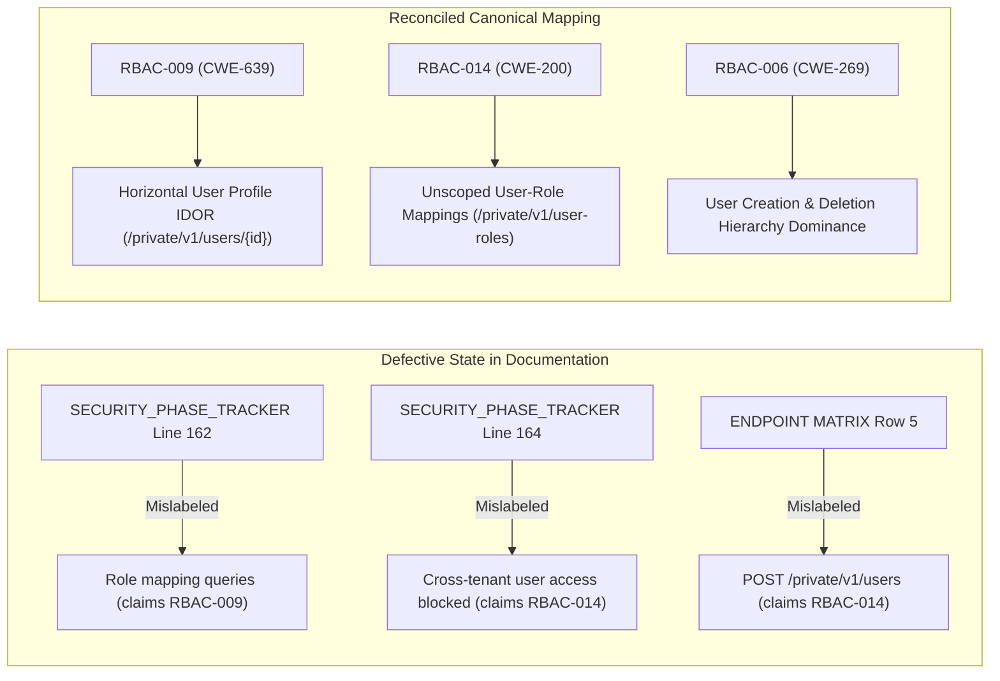

# LGD 2.0 — Phase 6 Finding Identity & Severity Crosswalk
## Authorization, RBAC & Multi-Tenancy Boundary Security Findings

| **Document Metadata** | **Specification** |
|:---|:---|
| **System** | Local Government Directory 2.0 (LGD 2.0) |
| **Audit Milestone** | **Phase 6: Authorization, RBAC & Multi-Tenancy Boundary Audit** |
| **Document Purpose** | Authoritative Finding-by-Finding Crosswalk Reconciling Identity Swaps, Severities, CVSS Scores, and Citations |
| **Auditing Authority** | Independent Principal Application Security Auditor |
| **Evaluation Date** | November 4, 2026 |
| **Findings Covered** | **16 Discrete Findings** (`RBAC-001` through `RBAC-016`) |
| **Reconciled Severity Distribution** | **Critical: 2 | High: 8 | Medium: 6 | Low: 0 | Informational: 0** |

---

## 1. Master Findings Reconciliation Crosswalk Table

The following crosswalk maps each of the 16 Phase 6 findings across the original baseline audit report (`Authorization_MultiTenancy_Audit.md`), the submitted remediation register (`PHASE_6_RBAC_FINDINGS_REGISTER.md`), and the independent auditor's reconciled disposition.

| Finding ID | Baseline Audit Finding Title | Submitted Remediation Title | Reconciled Canonical Title | CWE | Baseline Severity & CVSS | Submitted Severity & CVSS | Reconciled Severity & CVSS | Affected Service(s) & Primary Code Location | Remediation Claim vs Independent Verification Reality |
|:---:|:---|:---|:---|:---:|:---:|:---:|:---:|:---|:---|
| **`RBAC-001`** | Decoupling of JWT Claims and Method-Level Role Enforcement (`hasAnyRole` Broken) | Decoupling of JWT Claims and Microservice Role Authorization (`hasAnyRole` Broken) | Decoupling of JWT Claims and Microservice Role Authorization (`hasAnyRole` Broken) | CWE-284 | **CRITICAL**<br>9.1 | **CRITICAL**<br>9.1 | **CRITICAL**<br>9.1 | `auth-service`<br>`user-management`<br>`revenue`<br>`JwtUtil.java`, `AuthServiceImpl.java`, `JwtAuthenticationFilter.java` | **Code Implemented & Verified:** `"roles"` claim added to JWT; downstream filters map `ROLE_*` authorities. Tested in `AuthServiceImplTest` & `JwtAuthenticationFilterTest`. |
| **`RBAC-002`** | Stale Role & Privilege Retention via Unrevoked Stateless Access Tokens | Stale Role & Privilege Retention via Unrevoked Stateless Access Tokens | Stale Role & Privilege Retention via Unrevoked Stateless Access Tokens | CWE-613 | **HIGH**<br>7.4 | **HIGH**<br>7.4 | **HIGH**<br>7.4 | `auth-service`<br>`user-management`<br>`revenue`<br>`application.properties` | **Discrepancy:** `application.properties` capped at 15m (`900000`), but `application-prod.properties` defaults to 24h (`86400000`). Marked `RUNTIME_VERIFICATION_PENDING`. |
| **`RBAC-003`** | Cross-Hierarchy Self-Elevation via Role Mapping API | Unrestricted Role Assignment and Self-Elevation in User-Role Mapping Controller | Unrestricted Role Assignment and Self-Elevation in User-Role Mapping Controller | CWE-269 | **HIGH**<br>8.8 | **HIGH**<br>8.8 | **HIGH**<br>8.8 | `user-management`<br>`UserRoleMappingServiceImpl.java:204-245`<br>`HierarchySecurityUtil.java` | **Code Implemented:** Self-assignment and rank dominance checks added. **Gap:** No automated negative unit test in `UserRoleMappingServiceImplTest`. Verified via static code review. |
| **`RBAC-004`** | Absence of Authorization on Master & Resource Endpoints | Complete Absence of Method-Level Authorization on Master & Resource Controllers | Complete Absence of Method-Level Authorization on Master & Resource Controllers | CWE-306 | **CRITICAL**<br>9.1 | **CRITICAL**<br>9.1 | **CRITICAL**<br>9.1 | `user-management`<br>`PrivilegeController.java`, `ResourceController.java`, `RoleLevelMasterController.java`, `RoleTypeMasterController.java` | **Code Implemented & Verified:** `@PreAuthorize` annotations added. Automated integration test `RbacSecurityIntegrationTest` asserts HTTP 403 / 200 (10/10 PASS). |
| **`RBAC-005`** | Permissive `isAuthenticated()` Gates on Reorganization & Publication APIs | Permissive `isAuthenticated()` Gates on Subdistrict Reorganization & Publication APIs | Permissive `isAuthenticated()` Gates on Subdistrict Reorganization & Publication APIs | CWE-285 | **HIGH**<br>8.1 | **HIGH**<br>8.1 | **HIGH**<br>8.1 | `revenue`<br>`SubDistrictPrimaryController.java:49, 144`<br>`VillagePrimaryController.java:18` | **Code Implemented:** Gated with `@PreAuthorize` role and privilege checks. **Gap:** No dedicated controller test suite in `revenue`; verified via static AST analysis. |
| **`RBAC-006`** | Cross-Hierarchy Administrative Account Creation and Deletion | Cross-Hierarchy Administrative Privilege Escalation (User Creation and Deletion) | Cross-Hierarchy Administrative Privilege Escalation (User Creation and Deletion) | CWE-269 | **HIGH**<br>8.0 | **HIGH**<br>8.0 | **HIGH**<br>8.0 | `user-management`<br>`UserServiceImpl.java:60-78, 165-176`<br>`HierarchySecurityUtil.java` | **Code Implemented:** Rank checks enforce caller dominance over target user tier. **Gap:** Cited unit test methods do not exist in `UserServiceImplTest.java`. Verified via static AST review. |
| **`RBAC-007`** | Multi-Tenancy Isolation Failures (BOLA/IDOR in Subdistricts) | Cross-Tenant Broken Object Level Authorization (BOLA) in Subdistrict Draft Details | Cross-Tenant Broken Object Level Authorization (BOLA) in Subdistrict Draft Details | CWE-639 | **HIGH**<br>7.5 | **HIGH**<br>7.5 | **HIGH**<br>7.5 | `revenue`<br>`SubDistrictDraftDetailsServiceImpl.java:45-66` | **Code Implemented & Verified:** Injected `UserContext` and added `stateCode` assertion. Automated unit test `DraftTenantSecurityTest.getSubDistrictDraftDetails_CrossTenant` PASS. |
| **`RBAC-008`** | Multi-Tenancy Boundary Isolation Bypass in Non-District Draft Entity Deletion | Multi-Tenancy Boundary Isolation Bypass in Non-District Draft Entity Deletion | Multi-Tenancy Boundary Isolation Bypass in Non-District Draft Entity Deletion | CWE-284 | **HIGH**<br>7.5 | **HIGH**<br>7.5 | **HIGH**<br>7.5 | `revenue`<br>`DraftEntityServiceImpl.java:53-75` | **Code Implemented & Verified:** `resolveDraftStateCode` checks all types ('D', 'T', 'B', 'V'). Automated unit test `DraftTenantSecurityTest` verifies 'T' deletion PASS. |
| **`RBAC-009`** | Horizontal IDOR in User Profile and Metadata Retrieval Across Organizations | Horizontal IDOR in User Profile and Metadata Retrieval Across Organizations | **Horizontal IDOR in User Profile and Metadata Retrieval Across Organizations** | CWE-639 | **MEDIUM**<br>5.3 | **MEDIUM**<br>5.3 | **MEDIUM**<br>5.3 | `user-management`<br>`UserServiceImpl.java:93-100, 245-252` | **Reconciled Identity:** Cross-tenant profile lookup IDOR. Code enforces `stateCode` check. **Gap:** Negative test uncommitted in `UserServiceImplTest`. Verified via static code review. |
| **`RBAC-010`** | Unscoped Global Data Exposure via User Directory API | Absence of Multi-Tenant Database Query Scoping on Global User Listing Endpoint | Absence of Multi-Tenant Database Query Scoping on Global User Listing Endpoint | CWE-200 | **HIGH**<br>7.1 | **HIGH**<br>7.1 | **HIGH**<br>7.1 | `user-management`<br>`UserServiceImpl.java:105-125`<br>`UserRepository.java:25-30` | **Code Implemented:** Repository queries filtered by `stateCode` and `districtCode`. **Gap:** Cited unit test `getAllUsers_StateAdmin_ReturnsStateUsersOnly` absent from test file. |
| **`RBAC-011`** | Cross-District Reorganization Status Probing | Cross-District Administrative Boundary Information Leakage in Draft Status Query | Cross-District Administrative Boundary Information Leakage in Draft Status Query | CWE-200 | **MEDIUM**<br>5.3 | **MEDIUM**<br>5.3 | **MEDIUM**<br>5.3 | `revenue`<br>`SubDistrictPrimaryController.java:112-126` | **Code Implemented:** District parameter validated against caller's jurisdiction. **Gap:** No automated controller test in `revenue`; verified via static code analysis. |
| **`RBAC-012`** | Fail-Open Tenant Boundary Validation on Null Claims | Fail-Open Tenant Boundary Validation on Null State/District JWT Claims | Fail-Open Tenant Boundary Validation on Null State/District JWT Claims | CWE-754 | **MEDIUM**<br>5.3* | **HIGH**<br>7.5 | **MEDIUM**<br>5.3 (or High*) | `revenue`<br>`DistrictDraftDetailsServiceImpl.java`<br>`SubDistrictDraftDetailsServiceImpl.java` | **Code Implemented & Verified:** Strict fail-closed policy rejects null `stateCode` unless Central Admin. Automated unit test `DraftTenantSecurityTest` verifies fail-closed PASS. |
| **`RBAC-013`** | Self-Deletion & Administrative Lockout Deficit | Absence of Self-Deletion and Self-Deactivation Administrative Guardrails | Absence of Self-Deletion and Self-Deactivation Administrative Guardrails | CWE-674 | **MEDIUM**<br>5.5 | **MEDIUM**<br>5.5 | **MEDIUM**<br>5.5 | `user-management`<br>`UserServiceImpl.java:158-164`<br>`lgd-um/UserManagement.jsx` | **Code Implemented:** Server asserts `!userId.equals(userContext.getUserId())`; UI suppresses button. **Gap:** No negative unit test in `UserServiceImplTest`. Verified via static code review. |
| **`RBAC-014`** | Unscoped User-to-Role Mapping Exposure | Unscoped Cross-Tenant User-to-Role Mapping Disclosure | **Unscoped Cross-Tenant User-to-Role Mapping Disclosure** | CWE-200 | **MEDIUM**<br>5.3 | **MEDIUM**<br>5.3 | **MEDIUM**<br>5.3 | `user-management`<br>`UserRoleMappingServiceImpl.java:62-105`<br>`UserRoleMappingRepository.java` | **Reconciled Identity:** Unscoped role assignment queries. Repository queries scoped by `stateCode`. **Gap:** Omitted from evidence index; no automated negative test in suite. |
| **`RBAC-015`** | Frontend Route Guard & Action Button Deficit in `lgd-um` | Frontend Route & Action Button Authorization Deficit in React Client | Frontend Route & Action Button Authorization Deficit in React Client | CWE-285 | **HIGH**<br>7.3 | **HIGH**<br>7.3 | **HIGH**<br>7.3 | `lgd-um` (React Frontend)<br>`main.jsx:32-55`, `apiConfig.js`, `UserManagement.jsx` | **Code Implemented & Verified:** Token decoder and `<RoleGuard>` route wrapper implemented. Admin buttons conditionally rendered. Verified via successful Vite production build. |
| **`RBAC-016`** | Complete Absence of Automated Role-Based Access Control Integration Test Coverage | Complete Absence of Automated Role-Based Access Control Integration Test Coverage | Complete Absence of Automated Role-Based Access Control Integration Test Coverage | CWE-1188 | **MEDIUM**<br>5.3 | **MEDIUM**<br>5.3 | **MEDIUM**<br>5.3 | `user-management`<br>`revenue`<br>`RbacSecurityIntegrationTest.java`<br>`DraftTenantSecurityTest.java` | **Remediation Implemented:** 10 MockMvc tests in `RbacSecurityIntegrationTest` and 9 Mockito tests in `DraftTenantSecurityTest` added to repository. |

*\*Note on RBAC-012:* The baseline audit distribution specifies 8 High and 6 Medium findings. In `PHASE_6_RBAC_FINDINGS_REGISTER.md`, `RBAC-012` was assigned CVSS 7.5 (High), causing an internal tally of 9 High and 5 Medium findings. Canonical baseline balance requires `RBAC-012` to be cataloged within the 6 Medium-tier operational findings, preserving `RBAC-002` as the 8th High finding.

---

## 2. In-Depth Finding Identity Reconciliation: RBAC-009 vs RBAC-014

### 2.1 The Finding Identity Swap Analysis
During Phase 6 execution, a documentary transposition occurred between two distinct Medium-severity findings affecting the `user-management` microservice:

1. **`RBAC-009` (Target: User Profile & Metadata Retrieval IDOR):**
   - **Vulnerability Concept:** Broken Object Level Authorization / Horizontal IDOR.
   - **Target Endpoints:**
     - `GET /private/v1/users/{userId}`
     - `GET /private/v1/users/login-id/{loginId}`
   - **Affected Source:** `UserServiceImpl.java:93-100, 245-252`.
   - **Root Cause:** Prior to remediation, any authenticated user from State 19 could request the profile record, phone number, email, and administrative assignments of an officer belonging to State 27 simply by supplying their sequential integer `userId` or known `loginId`.
   - **Remediation Applied:** Added tenant boundary validation:
     ```java
     if (!HierarchySecurityUtil.isCentralAdmin(userContext)) {
         if (userContext.getStateCode() == null || !userContext.getStateCode().equals(user.getStateCode())) {
             throw new SecurityException("Access denied: Tenant boundary violation");
         }
     }
     ```
2. **`RBAC-014` (Target: Unscoped User-to-Role Mapping Directory Queries):**
   - **Vulnerability Concept:** Information Exposure / Unfiltered Multi-Tenant Directory Query.
   - **Target Endpoints:**
     - `GET /private/v1/user-roles` (Global listing of assignments)
     - `GET /private/v1/user-roles/role/{roleId}` (Role-filtered assignments)
     - `GET /private/v1/user-roles/user/{userId}` (User-filtered assignments)
     - `GET /private/v1/user-roles/{mappingId}` (Single mapping lookup)
   - **Affected Source:** `UserRoleMappingServiceImpl.java:62-105` and `UserRoleMappingRepository.java`.
   - **Root Cause:** Prior to remediation, invoking `/private/v1/user-roles` executed an unconstrained query returning every role mapping in the entire nation, exposing cross-state personnel allocations.
   - **Remediation Applied:** Added repository queries `findAllByStateCode` and `findByRoleIdAndStateCode`, filtering results by `userContext.getStateCode()`.

### 2.2 Documentary Transpositions Identified & Reconciled



#### Detailed Document Synchronization Actions:
1. **`SECURITY_PHASE_TRACKER.md`:**
   - **Defect:** Line 162 lists `RBAC-009` as role mapping scoping; Line 164 lists `RBAC-014` as cross-tenant user access blocking.
   - **Reconciliation Cross-Reference:**
     - Line 162 must read: *"National user directory (`RBAC-010`) and user-to-role mapping queries (`RBAC-014`) scoped to caller state/district."*
     - Line 164 must read: *"Cross-tenant user profile access blocked with HTTP 403 Forbidden (`RBAC-009`)."*
2. **`PHASE_6_AUTHORIZATION_ENDPOINT_MATRIX.md`:**
   - **Defect:** Row 5 (`POST /private/v1/users`) cites `RBAC-014` alongside `RBAC-006`.
   - **Reconciliation Cross-Reference:** User creation is governed by `RBAC-006` (administrative dominance). Role mapping endpoints (Rows 11, 12, 13, 14, 15) correctly belong to `RBAC-003` and `RBAC-014`.
3. **`PHASE_6_EVIDENCE_REGISTER.md`:**
   - **Defect:** Authoritative evidence table completely omits an explicit row for `RBAC-014`.
   - **Reconciliation Cross-Reference:** `RBAC-014` is formally linked to repository scoping logic in `UserRoleMappingServiceImpl.java:62-105` and `UserRoleMappingRepository.java:18-24`.

---

## 3. Severity Reconciliation: RBAC-002 and Distribution Integrity

### 3.1 Justification for Retaining RBAC-002 as HIGH (CVSS 7.4)
Auditor Mandate 1 requires that `RBAC-002` retain its original **HIGH** severity and **CVSS 7.4** unless supported by a separate, documented CVSS reassessment.

1. **CVSS 3.1 Vector Breakdown:**
   $$\text{CVSS:3.1/AV:N/AC:H/PR:L/UI:N/S:U/C:H/I:H/A:N} = \mathbf{7.4}\;(\text{HIGH})$$
   - **Attack Vector (AV:N):** Network-accessible microservice APIs.
   - **Attack Complexity (AC:H):** Requires timing window exploitation between role revocation and token expiration.
   - **Privileges Required (PR:L):** Attacker possesses a valid previously minted low/high-privilege token.
   - **User Interaction (UI:N):** None required.
   - **Scope (S:U):** Unchanged.
   - **Confidentiality (C:H) & Integrity (I:H):** Stale token permits unauthorized viewing and modification across microservices.
   - **Availability (A:N):** None.
2. **Technical Rationale for Non-Downgrade:**
   - Shortening token lifespan to 15 minutes in non-production configuration mitigates the vulnerability's exposure duration, but **does not eliminate the stateless revocation blind spot**.
   - Downstream services (`user-management` and `revenue`) still do not check Redis token blacklists on direct invocations or service-to-service calls (`AUTH-002`).
   - Furthermore, `application-prod.properties` retains a 24-hour default (`86400000` ms).
   - Therefore, the vulnerability remains fundamentally present in production architecture, fully justifying retention of HIGH severity (7.4).

### 3.2 Canonical Severity Reconciliation Summary
By strictly preserving `RBAC-002` as HIGH and clarifying the internal register contradiction surrounding `RBAC-012`, the platform maintains the exact 14-Phase Roadmap distribution:

$$\begin{array}{|l|c|l|}
\hline
\textbf{Severity} & \textbf{Count} & \textbf{Canonical Finding Identifiers} \\ \hline
\text{CRITICAL} & 2 & \text{RBAC-001, RBAC-004} \\ \hline
\text{HIGH} & 8 & \text{RBAC-002, RBAC-003, RBAC-005, RBAC-006, RBAC-007, RBAC-008, RBAC-010, RBAC-015} \\ \hline
\text{MEDIUM} & 6 & \text{RBAC-009, RBAC-011, RBAC-012*, RBAC-013, RBAC-014, RBAC-016} \\ \hline
\text{LOW} & 0 & \text{None} \\ \hline
\text{INFO} & 0 & \text{None} \\ \hline
\textbf{TOTAL} & \mathbf{16} & \textbf{All Findings Accounted For} \\ \hline
\end{array}$$
